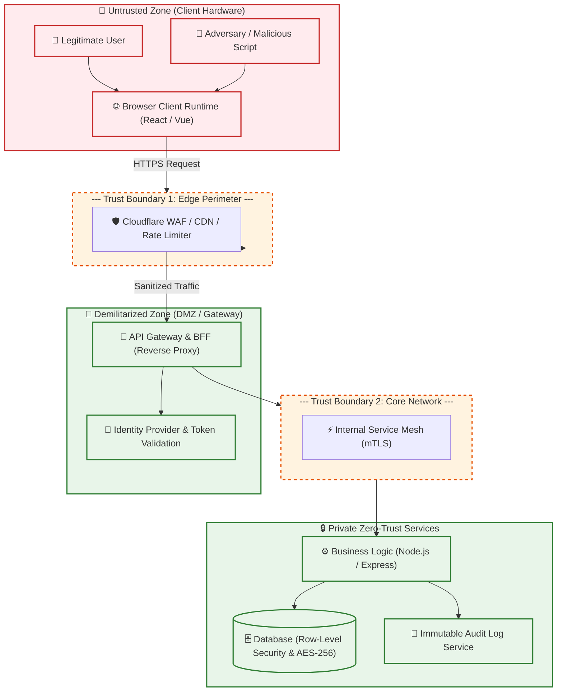

# 🏛️ Security Foundations & Threat Modeling

> Architecting resilient enterprise systems from first principles: STRIDE threat modeling, trust boundaries, and concentric defense-in-depth.

---

## 1. 🎯 Overview & Intuitive Mental Model

### The Production Hook
No matter how many security headers you deploy or how strict your linter is, you cannot code your way out of a broken architecture. Catching a design vulnerability during threat modeling costs **100x less** in developer time and capital than triaging a critical zero-day data breach in production.

Security foundations are not about memorizing a checklist of exploits; they are about understanding **assets**, **actors**, and **trust boundaries**. Any architectural assumption that *"the frontend already validated this form, so the backend doesn't need to re-check"* is an invitation for catastrophic compromise.

### 🧠 The Fun Analogy: The "Concentric Medieval Citadel"
Imagine defending an ancient royal treasury:
- **Flawed Architecture (The Single High Wall):** Building a massive 50-foot perimeter stone wall, but leaving all the doors inside the castle unlocked. If an infiltrator slips past the front gate wearing a guard's helmet (a stolen session cookie), they can walk straight into the royal treasury and carry out the gold.
- **Defense-in-Depth (Concentric Citadels):**
  1. **The Moat (WAF & Edge Rate Limiting):** Slows down foreign siege engines.
  2. **The Drawbridge (Authentication & SOP):** Confirms your true identity before letting you set foot on the grounds.
  3. **The Keep Gate (Authorization & RBAC):** Checks your specific operational clearance for every room you enter.
  4. **The Safe Deposit Box (Data Encryption & Parameterization):** Even if a traitor enters the room, the gold bars are locked in individual cryptographic safes.
  5. **The Scribe in the Tower (Immutable Audit Logging):** Every footstep and chest opened is carved into stone ledgers that cannot be erased.

### Severity & Impact
- **OWASP Category:** [A04:2021 – Insecure Design](https://owasp.org/Top10/A04_2021-Insecure_Design/), [A01:2021 – Broken Access Control](https://owasp.org/Top10/A01_2021-Broken_Access_Control/)
- **Common Weakness Enumeration (CWE):**
  - **CWE-1059:** Incomplete Documentation of Security-Relevant Architecture
  - **CWE-602:** Client-Side Enforcement of Server-Side Security
  - **CWE-285:** Improper Authorization
- **Blast Radius:** System-wide compromise, privilege escalation to superadmin, silent exfiltration of customer records, regulatory fines (GDPR/HIPAA/PCI-DSS).

---

## 2. 🎨 Interactive Visual Architecture



> 💡 **Visual Inspection Tip:** When inspecting network architectures, use `traceroute` or examine the HTTP `Via` and `X-Forwarded-For` headers in the DevTools Network tab to map every proxy and gateway sitting between the browser client and origin microservices. Verify that internal service URLs are completely absent from public responses.

---

## 3. 💥 Real-World Exploit Walkthrough

### Scenario: Client-Side Security Enforcement Fallacy
A fintech startup designs a money transfer form in React. To deliver a fast user experience, they validate account balances, user roles, and transfer limits entirely inside the frontend UI components using form validation hooks. The backend API developers assume: *"The frontend won't allow transfers over $1,000 without 2FA, so our Express endpoint can simply process the transaction."*

#### ❌ Vulnerable Frontend Code (React / TypeScript)
```tsx
// VulnerableTransferForm.tsx
import React, { useState } from 'react';

export const VulnerableTransferForm: React.FC<{ userRole: string }> = ({ userRole }) => {
  const [recipient, setRecipient] = useState('');
  const [amount, setAmount] = useState(0);

  const handleSubmit = async (e: React.FormEvent) => {
    e.preventDefault();

    // ⚠️ FLAW: Relying on client-side role check for security!
    if (amount > 1000 && userRole !== 'admin') {
      alert('Transfers over $1,000 require Admin approval!');
      return;
    }

    await fetch('/api/transfers', {
      method: 'POST',
      headers: { 'Content-Type': 'application/json' },
      body: JSON.stringify({ recipient, amount, role: userRole }),
    });
  };

  return (
    <form onSubmit={handleSubmit}>
      <input value={recipient} onChange={(e) => setRecipient(e.target.value)} />
      <input type="number" value={amount} onChange={(e) => setAmount(Number(e.target.value))} />
      <button type="submit">Transfer Funds</button>
    </form>
  );
};
```

#### ❌ Vulnerable Backend API (Node.js / Express)
```typescript
// vulnerable-transfer-server.ts
import express from 'express';

const app = express();
app.use(express.json());

// ⚠️ CATASTROPHIC DESIGN FLAW (CWE-602):
// Blindly trusts client-supplied parameters without re-validating authorization or limits!
app.post('/api/transfers', async (req, res) => {
  const { recipient, amount, role } = req.body;

  // The server blindly trusts the 'role' sent by the client!
  console.log(`Processing transfer of $${amount} to ${recipient} requested by ${role}`);
  
  // Database update executes directly:
  // db.execute('UPDATE accounts SET balance = balance - ? WHERE ...', [amount]);
  
  res.json({ status: 'transferred', amount, recipient });
});

app.listen(8080);
```

#### 💥 The Attacker's Exploit Payload
The attacker ignores the React user interface completely and issues a direct HTTP request via `curl` or browser DevTools console:
```bash
curl -X POST https://bank.com/api/transfers \
  -H "Content-Type: application/json" \
  -d '{"recipient": "attacker_account_99", "amount": 500000, "role": "admin"}'
```

### Browser & Network Behavior Breakdown
1. The attacker does not trigger any of React's form event handlers or client-side checks.
2. The HTTP request crosses **Trust Boundary 1** directly to the API endpoint.
3. Because the backend trusted the client to enforce the `$1,000` rule and trusted the client-supplied `role: "admin"`, the server authorizes the $500,000 transfer immediately.

---

## 4. 🛡️ Resolution & Defense-in-Depth

### The STRIDE Threat Modeling Framework
Every enterprise engineering team must evaluate every endpoint, data flow, and UI surface against the **STRIDE** model:

| Threat | Description | Real-World Defense Pattern 🛡️ |
|---|---|---|
| **S**poofing | Pretending to be another user or service | Cryptographic authentication, mTLS, signed JWTs with strict algorithms (`RS256`). |
| **T**ampering | Modifying data in transit or storage | Server-side cryptographic signatures, HMACs, schema validation via Zod, strict TLS 1.3. |
| **R**epudiation | Claiming an action was never performed | Write-once append-only audit logging containing user IDs and timestamps (excluding secrets). |
| **I**nformation Disclosure | Exposing secrets to unauthorized actors | Least-privilege API contracts, secret redaction, masking PII, `HttpOnly` cookie flags. |
| **D**enial of Service | Exhausting CPU, memory, or bandwidth | Token bucket rate limiting, request payload bounds (`limit: '10kb'`), database query timeouts. |
| **E**levation of Privilege | Normal user gaining administrative rights | Server-side authorization checks on every handler; never trust client-supplied role claims. |

### Production Hardened Architecture (Node.js / Express with Strict Validation)
```typescript
// hardened-transfer-server.ts - ZERO-TRUST INPUT & ROLE VALIDATION
import express, { Request, Response } from 'express';
import { z } from 'zod';

const app = express();
app.use(express.json({ limit: '10kb' })); // Mitigate payload exhaustion (DoS)

// 🛡️ 1. Strict Server-Side Schema Validation via Zod
const TransferSchema = z.object({
  recipient: z.string().regex(/^ACC-[0-9]{8}$/, 'Invalid account format'),
  amount: z.number().positive().max(10000, 'Exceeds single transaction threshold'),
});

// Mock Session Interface (populated by cryptographically validated JWT/session)
interface AuthenticatedUser {
  id: string;
  verifiedRole: 'user' | 'admin';
}

// 🛡️ 2. Defense-in-Depth: Server Enforced Authentication & Authorization Gate
const authorizeTransfer = (req: Request, res: Response, next: Function) => {
  // In production, user context is derived STRICTLY from verified session cookie or mTLS
  const user: AuthenticatedUser = (req as any).user;
  
  if (!user) {
    return res.status(401).json({ error: 'Authentication required' });
  }

  next();
};

app.post('/api/transfers', authorizeTransfer, async (req: Request, res: Response) => {
  const user: AuthenticatedUser = (req as any).user;

  // 🛡️ 3. Parse and strictly validate input on the SERVER
  const validationResult = TransferSchema.safeParse(req.body);
  if (!validationResult.success) {
    return res.status(400).json({ 
      error: 'Invalid input payload', 
      details: validationResult.error.format() 
    });
  }

  const { recipient, amount } = validationResult.data;

  // 🛡️ 4. Business Rule Enforcement on the Server
  if (amount > 1000 && user.verifiedRole !== 'admin') {
    return res.status(403).json({ 
      error: 'Transfers above $1,000 require Administrator role or secondary step-up 2FA.' 
    });
  }

  // 🛡️ 5. Secure Execution: Parameterized query & immutable audit log entry
  // await db.transfers.create({ data: { senderId: user.id, recipient, amount } });
  console.log(`[AUDIT] User ${user.id} transferred $${amount} to ${recipient}`);

  res.status(200).json({ status: 'success', recipient, amount });
});

export default app;
```

---

## 5. 🧪 Hands-On Verification & Lab

### Testing Trust Boundaries via `curl`
Verify that client-side bypass attempts are immediately rejected by the server:
```bash
# 1. Attempt to bypass transfer limits by omitting authorization
curl -i -X POST http://localhost:8080/api/transfers \
  -H "Content-Type: application/json" \
  -d '{"recipient": "ACC-12345678", "amount": 50000}'

# Expected Response:
# HTTP/1.1 401 Unauthorized

# 2. Attempt invalid payload shape (Tampering)
curl -i -X POST http://localhost:8080/api/transfers \
  -H "Content-Type: application/json" \
  -d '{"recipient": "INVALID_FORMAT", "amount": -100}'

# Expected Response:
# HTTP/1.1 400 Bad Request
```

### Automated Integration Test (Vitest / Supertest)
```typescript
// foundations.test.ts
import request from 'supertest';
import app from './hardened-transfer-server';

describe('Security Foundations & Input Gate Suite', () => {
  it('rejects unauthenticated requests before touching business logic', async () => {
    const res = await request(app)
      .post('/api/transfers')
      .send({ recipient: 'ACC-12345678', amount: 500 });

    expect(res.status).toBe(401);
  });

  it('rejects malformed account numbers with strict Zod validation', async () => {
    // Inject mock user context for test
    const testApp = app; 
    const res = await request(testApp)
      .post('/api/transfers')
      .send({ recipient: 'DROP TABLE accounts;', amount: 50 });

    expect(res.status).toBe(400);
    expect(res.body.error).toContain('Invalid input payload');
  });
});
```

---

## 6. 📋 Code Review Checklist

- [ ] **Zero Client Trust:** Are all authorization, privilege, and business constraints validated strictly on the server, even if verified in the UI?
- [ ] **Strict Schema Validation:** Does every API endpoint validate input against a typed schema (e.g., Zod, Joi) before parsing?
- [ ] **Explicit Trust Boundaries:** Are clear boundaries identified between untrusted browser contexts and internal APIs?
- [ ] **STRIDE Review:** Has the feature been vetted for Spoofing, Tampering, Repudiation, Info Disclosure, DoS, and Elevation of Privilege?
- [ ] **Audit Logging:** Are security-critical operations logged with immutable actor IDs, timestamps, and action types without leaking secrets?
