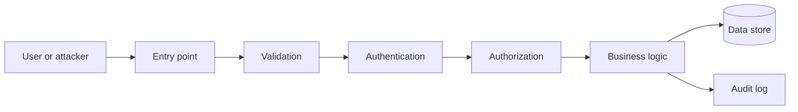

# Foundations

Threat modeling starts by identifying assets, actors, entry points, trust boundaries, and impact. Use defense in depth: no single control should be the only barrier protecting sensitive data or privileged operations.

## Threat-model loop
1. List assets and security goals.
2. Draw data flows and trust boundaries.
3. Identify attacker capabilities and abuse cases.
4. Choose preventive, detective, and recovery controls.
5. Add tests and revisit after architectural changes.

## Request flow

## Key principles
- Minimize attack surface and privilege.
- Treat input from browsers, APIs, queues, files, and third parties as untrusted.
- Enforce authorization on the server for every sensitive operation.
- Log security-relevant events without secrets or unnecessary personal data.

References: [OWASP ASVS](https://owasp.org/www-project-application-security-verification-standard/), [OWASP Cheat Sheets](https://cheatsheetseries.owasp.org/).
