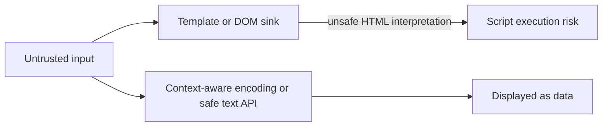

# Browser and Frontend Security

Frontend security concerns arise where untrusted data crosses into browser interpreters or where browser-managed credentials are sent automatically. Framework escaping helps but does not protect every unsafe DOM sink or URL context.

## XSS prevention
- Prefer text APIs and framework interpolation over HTML string injection.
- Avoid `innerHTML`, `dangerouslySetInnerHTML`, and equivalent sinks for untrusted values.
- If rich HTML is a requirement, use a maintained sanitizer with a strict allowlist.
- Deploy a restrictive Content Security Policy as defense in depth.

## CSRF, CORS, and clickjacking
- Use appropriate SameSite cookie settings and CSRF defenses for cookie-authenticated state changes.
- CORS controls browser script access to responses; it is not authorization.
- Use frame-ancestors or equivalent framing policy where embedding is not allowed.
- Avoid storing long-lived sensitive tokens in JavaScript-accessible storage when a safer architecture is available.

## Trust boundary

Test every untrusted-data path, including URL parameters, API responses, Markdown/rich text, and error messages. References: [MDN Web Security](https://developer.mozilla.org/en-US/docs/Web/Security), [OWASP XSS Prevention](https://cheatsheetseries.owasp.org/cheatsheets/Cross_Site_Scripting_Prevention_Cheat_Sheet.html), [MDN CSP](https://developer.mozilla.org/en-US/docs/Web/HTTP/CSP).
