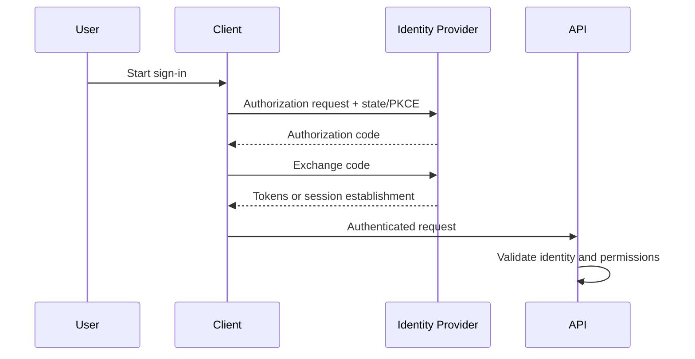

# Authentication and Sessions

Authentication establishes an identity; a session or token represents an authenticated context. Secure systems define issuance, renewal, expiration, revocation, logout, and recovery—not only the login form.

## Cookies and sessions
- Set Secure, HttpOnly, and an appropriate SameSite policy on session cookies.
- Rotate session identifiers after login and privilege changes.
- Enforce idle and absolute expiry; revoke sessions after compromise or account recovery.
- Never log session IDs, access tokens, refresh tokens, or passwords.

## OAuth 2.0 and OIDC
Use a maintained library and the authorization-code flow with PKCE for public clients. Validate redirect URIs exactly, validate issuer/audience/state/nonce as applicable, and avoid inventing token validation. OAuth is an authorization framework; OpenID Connect adds identity semantics.

## Typical flow

JWTs are signed claims, not encrypted secrets by default. Validate algorithm, issuer, audience, expiry, and intended use. References: [OWASP Authentication Cheat Sheet](https://cheatsheetseries.owasp.org/cheatsheets/Authentication_Cheat_Sheet.html), [OAuth 2.0 Security BCP RFC 9700](https://www.rfc-editor.org/rfc/rfc9700), [OpenID Connect](https://openid.net/developers/specs/).
