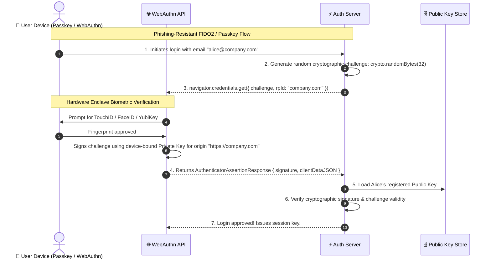

# 🪪 All Authentication Types: The Complete Engineering Guide

> Comprehensive taxonomy, architecture trade-offs, and security profiles for every major web and API authentication mechanism.

---

## 1. 🎯 Overview & Intuitive Mental Model

### The Production Hook
Modern software engineering has moved far beyond the naive "username and password in a database" model. Today's applications must authenticate single-page apps, mobile clients, background microservices, enterprise employees, and IoT sensors across heterogeneous networks.

Choosing the wrong authentication strategy introduces catastrophic vulnerabilities or unmaintainable architectural complexity. For example:
- Using stateless JWTs for browser sessions makes **instant session revocation virtually impossible**.
- Using stateful sessions for third-party mobile apps introduces **brittle cookie management and CORS headaches**.
- Using long-lived static API keys without rotation leads to **imminent GitHub repository credential leaks**.

### 🧠 The Fun Analogy: The "Metropolitan Transit Passports"
Think of your system as a high-security international airport transit terminal:
1. **Stateful Session (`HttpOnly` Cookie):** An electronic keycard issued by the airport lounge. The lounge mainframe remembers keycard `#42`. If the traveler is banned, the front desk clicks "Revoke", and card `#42` immediately stops opening doors.
2. **Stateless JWT:** A laminated international driver's license stamped with a cryptographic watermark. The security guard at the gate doesn't need to call the government DMV; they just check the watermark with a UV light. But if you lose your license, an impostor can use it until the expiration date stamped on the plastic!
3. **PASETO (Platform-Agnostic Security Tokens):** The bulletproof replacement for JWTs. Unlike JWTs (which let developers mistakenly choose insecure ciphers like `alg: "none"`), PASETO enforces modern cryptography (Ed25519 or ChaCha20-Poly1305) with zero cipher negotiation.
4. **OAuth 2.0 / OIDC:** A diplomatic valet ticket. You authorize the airport parking attendant to park your car without handing them the key to your bank safe.
5. **Passkeys / WebAuthn (FIDO2):** A fingerprint scanner on a hardware security enclave. The airport security desk generates a cryptographic riddle (a challenge). Your smartphone signs the riddle using a private key stored inside a tamper-proof hardware chip unlocked only by your physical face or thumb. The private key never leaves your phone!
6. **Mutual TLS (mTLS):** Two armored guards meeting in a secure bunker. Both guards demand to inspect each other's cryptographic certificates before speaking a single word.

### Authentication Taxonomy Matrix

| Auth Type | State Location | Best Suited For | Revocation Speed | Primary Risk |
|---|---|---|---|---|
| **Stateful Sessions** | Central Redis / DB | Web SPAs & Monoliths | ⚡ Instant (< 1ms) | Redis storage scaling & CSRF |
| **Stateless JWT** | Client / Microservices | High-throughput APIs | 🐢 Slow (Until TTL expires) | Token theft, alg confusion |
| **PASETO** | Client / Microservices | Zero-Trust APIs | 🐢 Slow (Until TTL) | Token theft |
| **OAuth 2.0 + PKCE** | IdP + Client | 3rd-party auth & SPAs | ⚡ Fast via Refresh Revocation | Redirect URI hijacking |
| **WebAuthn / Passkeys**| Hardware Enclave | Phishing-resistant login | ⚡ Fast (Server-side key disable) | Device recovery complexity |
| **SAML 2.0 / SSO** | Enterprise IdP (Okta) | B2B SaaS Enterprise | ⚡ Controlled by enterprise IdP | XML signature wrapping (XSW) |
| **mTLS** | TLS Handshake | Service-to-Service | ⚡ Immediate via CRL / OCSP | Certificate rotation overhead |
| **API Keys** | Database / Cache | Developer APIs & CLIs | ⚡ Instant | Accidental source code commit |

---

## 2. 🎨 Interactive Visual Architecture



> 💡 **Visual Inspection Tip:** In Chrome DevTools, open the **Application** tab and locate the **WebAuthn** pane under the *Sensors* / *More tools* drawer. You can enable a virtual hardware authenticator to simulate FIDO2 / WebAuthn registration and assertion flows locally without physical biometric hardware!

---

## 3. 💥 Real-World Exploit Walkthrough

### Scenario: The Pitfall of Stateless JWTs for Web Banking
A fintech company implemented stateless JWTs stored in browser cookies. A customer reported their laptop was stolen. The customer support agent clicked "Deactivate Account" in the admin dashboard, marking the user as `active: false` in the database.

However, because the application used pure stateless JWTs without a revocation blacklist, the thief was able to execute wire transfers for another 6 hours because the API gateway checked only the cryptographic signature and expiration timestamp (`exp`)!

#### ❌ Vulnerable Stateless JWT Gateway (Node.js / Express)
```typescript
// vulnerable-gateway.ts
import express, { Request, Response, NextFunction } from 'express';
import jwt from 'jsonwebtoken';

const app = express();
const JWT_SECRET = 'super-secret-key-123';

// ⚠️ CATASTROPHIC FLAW: Pure stateless verification ignores database revocation state!
app.use((req: Request, res: Response, next: NextFunction) => {
  const token = req.headers.authorization?.split(' ')[1];
  if (!token) return res.status(401).json({ error: 'Missing token' });

  try {
    const payload = jwt.verify(token, JWT_SECRET) as any;
    // ⚠️ Server never checks if payload.sub is banned or if session was revoked!
    (req as any).user = payload;
    next();
  } catch (err) {
    res.status(401).json({ error: 'Invalid token' });
  }
});

app.post('/api/bank/withdraw', (req: Request, res: Response) => {
  const user = (req as any).user;
  res.json({ message: `Withdrew $10,000 for user ${user.sub}` });
});
```

#### 💥 The Exploit Execution
1. The attacker obtains a stolen JWT with 12 hours remaining on its `exp` claim.
2. Even after the victim clicks "Log out of all devices" and changes their password, the signature on the JWT remains cryptographically valid.
3. The attacker issues withdrawals repeatedly using `curl` until the token expires.

---

## 4. 🛡️ Resolution & Defense-in-Depth

### The Production Fix: Hybrid Distributed Session Revocation via Redis
For high-scale systems requiring stateless performance with instant revocation, implement a **Token Blacklist / Versioning Pattern** or use stateful Redis sessions:

```typescript
// hardened-session-auth.ts - PRODUCTION-READY REVOCABLE AUTH
import express, { Request, Response, NextFunction } from 'express';
import Redis from 'ioredis';
import crypto from 'crypto';

const app = express();
app.use(express.json());

// In-memory distributed session cache (Redis cluster)
const redis = new Redis();

// 🛡️ Middleware: Fast Redis Session Check (< 1ms latency)
export const authenticateSession = async (req: Request, res: Response, next: NextFunction) => {
  const sessionId = req.cookies?.['__Host-session_id'];
  if (!sessionId) {
    return res.status(401).json({ error: 'Unauthenticated' });
  }

  // Lookup active session in Redis
  const sessionData = await redis.get(`session:${sessionId}`);
  if (!sessionData) {
    return res.status(401).json({ error: 'Session expired or revoked' });
  }

  const session = JSON.parse(sessionData);

  // Check if user was globally revoked / banned
  const isRevoked = await redis.get(`user_revoked:${session.userId}`);
  if (isRevoked && Number(isRevoked) > session.issuedAt) {
    await redis.del(`session:${sessionId}`); // Destroy session immediately
    return res.status(401).json({ error: 'Account session invalidated globally' });
  }

  (req as any).session = session;
  next();
};

// 🛡️ Global Revocation Handler (Kills all active sessions across all devices instantly!)
app.post('/api/auth/revoke-all', authenticateSession, async (req: Request, res: Response) => {
  const userId = (req as any).session.userId;

  // Mark all tokens issued before this timestamp as invalid
  await redis.set(`user_revoked:${userId}`, Date.now(), 'EX', 7 * 86400);

  res.json({ message: 'All active sessions globally revoked across all devices.' });
});

export default app;
```

---

## 5. 🧪 Hands-On Verification & Lab

### Testing Instant Session Revocation with Supertest
```typescript
// auth-types.test.ts
import request from 'supertest';
import app from './hardened-session-auth';
import Redis from 'ioredis';

describe('Global Session Revocation Suite', () => {
  it('instantly denies requests after global revocation timestamp', async () => {
    // 1. Simulate active session
    const sid = 'test_sid_123';
    const redis = new Redis();
    await redis.set(`session:${sid}`, JSON.stringify({ userId: 'u99', issuedAt: Date.now() - 5000 }));

    // 2. Trigger global revocation
    await redis.set(`user_revoked:u99`, Date.now());

    // 3. Attempt request with previous session
    const res = await request(app)
      .get('/api/protected')
      .set('Cookie', [`__Host-session_id=${sid}`]);

    expect(res.status).toBe(401);
    expect(res.body.error).toContain('Account session invalidated');
  });
});
```

---

## 6. 📋 Code Review Checklist

- [ ] **Auth Type Appropriate for Architecture:** Are web SPAs using stateful sessions or memory tokens + `HttpOnly` cookies rather than raw `localStorage` JWTs?
- [ ] **Revocation Strategy Defined:** If using JWTs, is an active revocation check (Redis blacklist or token version in user claims) implemented?
- [ ] **Phishing-Resistant MFA:** Are critical systems adopting FIDO2/WebAuthn Passkeys over insecure SMS verification?
- [ ] **Service-to-Service mTLS:** Are internal microservices communicating over mutual TLS rather than unauthenticated internal HTTP?
- [ ] **Cryptographic Strength:** Are password hashes computed with modern memory-hard algorithms (**Argon2id** or **bcrypt** with cost >= 12), and NOT MD5/SHA-256?
