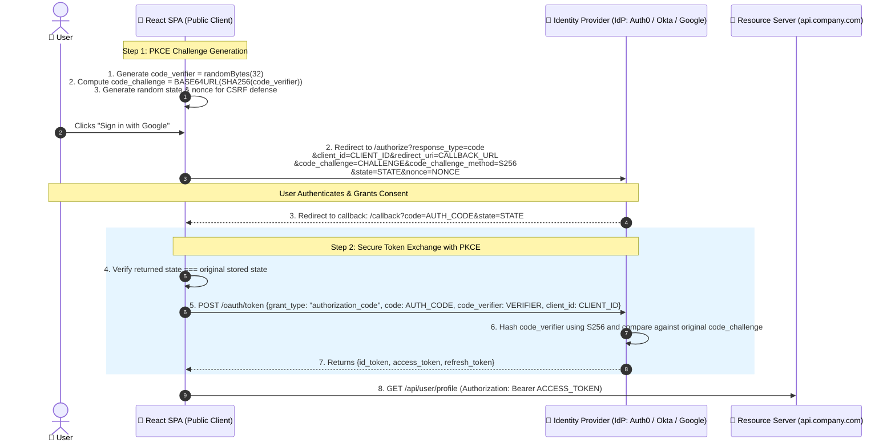

# 🤝 OAuth 2.0 & OpenID Connect (OIDC) with PKCE

> Production guide to federated identity, delegated authorization, Authorization Code Flow with PKCE, and token exchange security.

---

## 1. 🎯 Overview & Intuitive Mental Model

### The Production Hook
OAuth 2.0 (RFC 6749) is the global standard for delegated authorization, and OpenID Connect (OIDC) adds a standardized identity layer on top of it. In modern SPAs and mobile apps (which are considered "Public Clients" incapable of securely storing client secrets), the legacy Implicit Grant flow is strictly deprecated.

**Proof Key for Code Exchange (PKCE, RFC 7636)** is now mandatory for all public clients. Without PKCE, any malicious application or proxy on the victim's device that intercepts the authorization code can exchange it for tokens and hijack the user's account.

### 🧠 The Fun Analogy: The "Secret Valet Code Word"
Imagine you are dining at a luxury restaurant and give your keys to a valet parking attendant:
- **Without PKCE:** The valet gives you a ticket stub (Authorization Code). If a pickpocket grabs your ticket stub from your pocket, they can walk to the valet booth and claim your Ferrari.
- **With PKCE:** Before requesting parking, you generate a secret secret word (the `code_verifier`, e.g., *"EmeraldEagle"*). You put it through a meat grinder to generate a cryptographic hash (the `code_challenge`, e.g., *"H9xQ2m"*). You give the hash to the restaurant receptionist.
- When you collect your car, you hand the valet the ticket stub **AND whisper the unhashed secret word** (*"EmeraldEagle"*). The valet hashes it on the spot. Because only YOU know the pre-image word that turns into *"H9xQ2m"*, a thief with just the ticket stub cannot steal your car!

### Severity & Impact
- **OWASP Category:** [A01:2021 – Broken Access Control](https://owasp.org/Top10/A01_2021-Broken_Access_Control/), [A07:2021 – Identification and Authentication Failures](https://owasp.org/Top10/A07_2021-Identification_and_Authentication_Failures/)
- **Common Weakness Enumeration (CWE):**
  - **CWE-287:** Improper Authentication
  - **CWE-352:** Cross-Site Request Forgery (State validation)
- **Blast Radius:** Complete account takeover via third-party account linking, token interception, and impersonation.

---

## 2. 🎨 Interactive Visual Architecture



> 💡 **Visual Inspection Tip:** Open DevTools (`Network` tab). Click "Login with SSO". Find the first outgoing request to your identity provider. Inspect the query parameters: confirm that `code_challenge_method=S256` is present (NEVER `plain`), and ensure the `state` parameter is a high-entropy cryptographically random string.

---

## 3. 💥 Real-World Exploit Walkthrough

### Scenario: The Missing `state` Parameter & Login CSRF Attack
A developer implemented the OAuth 2.0 authorization code flow but omitted the `state` parameter validation because "it seemed like optional boilerplate".

#### ❌ Vulnerable OAuth Callback Handler (React / Node.js)
```typescript
// vulnerable-oauth-callback.ts
app.get('/auth/callback', async (req, res) => {
  const { code } = req.query; // ⚠️ FLAW: 'state' parameter completely omitted or ignored!

  // Exchange authorization code for token
  const tokenResponse = await fetch('https://idp.example.com/oauth/token', {
    method: 'POST',
    headers: { 'Content-Type': 'application/json' },
    body: JSON.stringify({
      grant_type: 'authorization_code',
      code,
      client_id: 'app_client_id',
      client_secret: 'app_client_secret',
      redirect_uri: 'https://app.example.com/auth/callback',
    }),
  });

  const tokens = await tokenResponse.json();
  // ⚠️ Ties the active session to whoever owned this authorization code!
  req.session.userId = tokens.userId;
  res.redirect('/dashboard');
});
```

#### 💥 The Attacker's Exploit Payload
1. The attacker starts an OAuth login with Google on `app.example.com` using the attacker's own credentials.
2. When the IdP redirects back to `/auth/callback?code=ATTACKER_CODE`, the attacker intercepts the request and does NOT complete it.
3. The attacker tricks the victim into clicking:
   `https://app.example.com/auth/callback?code=ATTACKER_CODE`
4. The victim's browser visits the link. The app completes the exchange and logs the victim into the **attacker's account**.
5. The victim adds their credit card details or uploads private tax documents, thinking they are in their own account—giving the attacker complete access to the victim's data!

---

## 4. 🛡️ Resolution & Defense-in-Depth

### Production Hardened OAuth 2.0 + PKCE Client Implementation (TypeScript)
```typescript
// pkce-helper.ts - BROWSER CRYPTO ENGINE FOR PKCE
import crypto from 'crypto';

// 1. Generate high-entropy code_verifier (43-128 chars)
export function generateCodeVerifier(): string {
  return crypto.randomBytes(32).toString('base64url');
}

// 2. Compute SHA-256 code_challenge
export function generateCodeChallenge(verifier: string): string {
  return crypto.createHash('sha256').update(verifier).digest('base64url');
}

// 3. Initiate authorization with strict state and nonce
export function buildAuthorizationUrl(verifier: string, state: string, nonce: string): string {
  const challenge = generateCodeChallenge(verifier);

  const params = new URLSearchParams({
    response_type: 'code',
    client_id: process.env.OAUTH_CLIENT_ID!,
    redirect_uri: 'https://app.company.com/auth/callback',
    scope: 'openid profile email',
    code_challenge: challenge,
    code_challenge_method: 'S256', // 🛡️ ALWAYS S256, NEVER PLAIN
    state: state,                  // 🛡️ Mitigates CSRF
    nonce: nonce,                  // 🛡️ Mitigates ID Token Replay
  });

  return `https://auth.company.com/authorize?${params.toString()}`;
}
```

### Production Callback Handler with State Verification
```typescript
// hardened-oauth-callback.ts
import { Request, Response } from 'express';

export async function handleOAuthCallback(req: Request, res: Response) {
  const { code, state } = req.query;
  const storedState = req.cookies['oauth_state'];
  const storedVerifier = req.cookies['code_verifier'];

  // 🛡️ 1. Enforce State Validation to defeat Login CSRF
  if (!state || state !== storedState) {
    return res.status(403).json({ error: 'OAuth state mismatch: Possible CSRF attack!' });
  }

  // Clear transient state cookies
  res.clearCookie('oauth_state');
  res.clearCookie('code_verifier');

  // 🛡️ 2. Exchange code with code_verifier
  const response = await fetch('https://auth.company.com/oauth/token', {
    method: 'POST',
    headers: { 'Content-Type': 'application/x-www-form-urlencoded' },
    body: new URLSearchParams({
      grant_type: 'authorization_code',
      client_id: process.env.OAUTH_CLIENT_ID!,
      code: code as string,
      code_verifier: storedVerifier,
      redirect_uri: 'https://app.company.com/auth/callback',
    }),
  });

  const tokens = await response.json();
  res.json({ status: 'authenticated', accessToken: tokens.access_token });
}
```

---

## 5. 🧪 Hands-On Verification & Lab

### Automated State Verification Test (Vitest)
```typescript
// oauth-pkce.test.ts
import { describe, it, expect } from 'vitest';
import { generateCodeVerifier, generateCodeChallenge } from './pkce-helper';

describe('OAuth PKCE Security Engine', () => {
  it('generates high-entropy base64url verifier and S256 challenge', () => {
    const verifier = generateCodeVerifier();
    const challenge = generateCodeChallenge(verifier);

    expect(verifier.length).toBeGreaterThanOrEqual(43);
    expect(challenge).not.toEqual(verifier);
    expect(challenge).toMatch(/^[A-Za-z0-9_-]+$/);
  });
});
```

---

## 6. 📋 Code Review Checklist

- [ ] **PKCE S256 Enforced:** Is `code_challenge_method=S256` strictly used (never `plain`)?
- [ ] **Cryptographic State Check:** Is a unique random `state` generated before redirect and validated upon callback return?
- [ ] **Nonce in OIDC:** Is a `nonce` included in authorization and verified inside the `id_token` claims?
- [ ] **Exact Redirect URI Matching:** Does the IdP enforce exact string matching on callback URLs (no wildcard subdomains)?
- [ ] **No Implicit Flow:** Is the deprecated `response_type=token` completely disabled in the IdP configuration?

---

## 7. 🎥 Curated Video Walkthroughs & Primary References

### 📺 High-Impact Video Explanations
- 🎥 [OAuth 2.0 and OpenID Connect in Plain English (Okta / Nate Barbettini)](https://www.youtube.com/watch?v=9964UnTzDr4) — The gold standard breakdown of tokens, scopes, claims, flows, and trust boundaries.
- 🎥 [OAuth 2.0 with PKCE Explained (ByteByteGo)](https://www.youtube.com/watch?v=CHzERullHe8) — Visual system architecture explaining code verifier, code challenge, and auth code injection defense.
- 🎥 [Why Implicit Flow is Dead: Auth Code + PKCE (Aaron Parecki)](https://www.youtube.com/watch?v=5cQNwifDq1U) — Authoritative explanation from IETF OAuth Working Group member on deprecating token URL leakage.

### 📖 Primary Documentation & Specifications
- 📜 [IETF RFC 7636: Proof Key for Code Exchange (PKCE)](https://datatracker.ietf.org/doc/html/rfc7636) — Official RFC defining code verifiers and SHA-256 challenges.
- 📜 [IETF RFC 9700: OAuth 2.0 Security Best Current Practice](https://www.rfc-editor.org/rfc/rfc9700) — Mandatory RFC requirements obsoleting implicit grant and securing redirects.
- 📜 [OpenID Connect Core 1.0 Specification](https://openid.net/specs/openid-connect-core-1_0.html) — Standard defining ID tokens, userinfo endpoints, and claims.

### 🧪 Interactive Hands-On Training Labs
- 🎯 [PortSwigger Lab: OAuth authentication bypass via OAuth profile linking](https://portswigger.net/web-security/oauth/lab-oauth-authentication-bypass-via-oauth-profile-linking) — Exploit missing user verification when linking third-party identity accounts.
- 🎯 [PortSwigger Lab: Forced OAuth profile linking (Missing State CSRF)](https://portswigger.net/web-security/oauth/lab-oauth-forced-profile-linking) — Attack authorization callbacks lacking state CSRF tokens.
- 🎯 [PortSwigger Lab: OAuth account hijacking via redirect_uri flaw](https://portswigger.net/web-security/oauth/lab-oauth-account-hijacking-via-redirect-uri) — Steal authorization codes using flawed open redirect validation.

