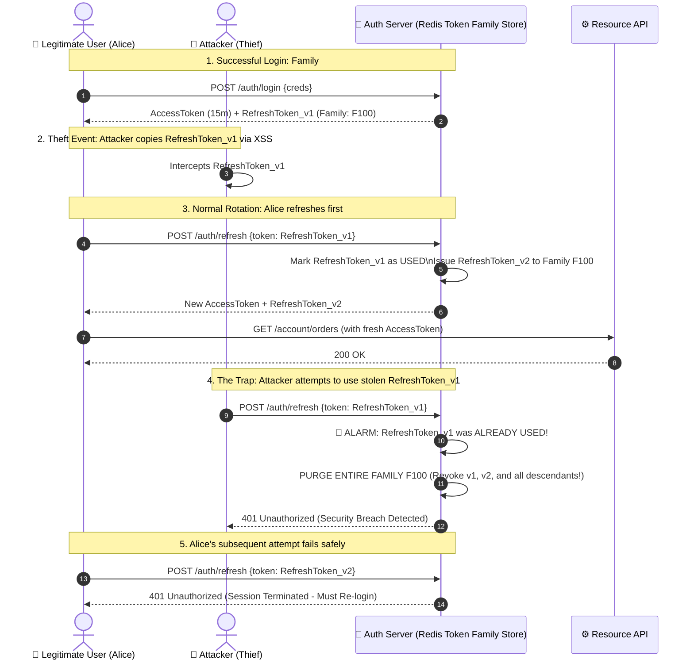

# Refresh Token Rotation (RTR) & Automatic Reuse Detection Architecture

## 1. 🎯 Overview & Intuitive Mental Model

In modern token-based architectures (OAuth 2.0 / OIDC / SPA authentication), applications decouple identity verification into two distinct tokens:
1. **Access Token (Short-Lived):** Typically valid for **5 to 15 minutes**. Used to access backend APIs and microservices. Because it expires rapidly, the window of exposure if intercepted is minimal.
2. **Refresh Token (Long-Lived):** Valid for **7 to 30 days**. Used strictly against the authorization server to mint fresh access tokens when old ones expire, preventing users from being forced to re-enter their passwords every 15 minutes.

However, a long-lived refresh token is a prime target for adversaries. If an attacker exfiltrates a static refresh token (via XSS, malware, or an insecure storage bucket), they obtain **permanent, persistent access** to the victim's account.

**Refresh Token Rotation (RTR)** with **Automatic Reuse Detection** (specified in [RFC 6749 §10.4](https://datatracker.ietf.org/doc/html/rfc6749#section-10.4) and [RFC 6819 §5.2.2.3](https://datatracker.ietf.org/doc/html/rfc6819#section-5.2.2.3)) transforms refresh tokens into **single-use disposable instruments**: every time a refresh token is used, it is invalidated and replaced by a brand-new token. Crucially, if an already-used refresh token is presented again, the system recognizes a **breach / replay attack** and immediately invalidates the entire token lineage, instantly terminating the attacker's and victim's active sessions.

```
+----------------------------------------------------------------------------------------------------+
|                                    🧠 THE PHYSICAL ANALOGY                                         |
|                                                                                                    |
|  🎟️ The Numbered Security Checkbook & The Silent Alarm:                                            |
|                                                                                                    |
|  1. The Sequential Checkbook (The Token Family):                                                   |
|     When you log in, the bank issues you a checkbook containing sequential checks #1, #2, #3...    |
|                                                                                                    |
|  2. The One-Time Exchange (Rotation):                                                              |
|     When your 15-minute cash voucher (Access Token) runs out, you present Check #1 to the teller.   |
|     The teller voids Check #1, stamps Check #2, and hands you fresh cash and Check #2.             |
|                                                                                                    |
|  3. The Theft & The Security Tripwire (Reuse Detection):                                           |
|     Suppose a pickpocket stole Check #1 before you used it, but you reached the bank first and     |
|     redeemed Check #1 for Check #2.                                                                |
|                                                                                                    |
|     Ten minutes later, the pickpocket walks up to the teller and presents Check #1.                |
|     The teller inspects the ledger and sees: *"Wait... Check #1 was ALREADY redeemed!"*           |
|                                                                                                    |
|     The teller does not simply reject the transaction. The teller presses the **SILENT ALARM**:   |
|     all checks in that checkbook (the entire Token Family) are canceled immediately! Both the      |
|     thief and the victim are locked out, and the victim receives a security notification to        |
|     re-authenticate with multi-factor authentication.                                              |
+----------------------------------------------------------------------------------------------------+
```

### Vulnerability & Severity Matrix
- **OWASP Category:** [A07:2021 – Identification and Authentication Failures](https://owasp.org/Top10/A07_2021-Identification_and_Authentication_Failures/)
- **Common Weakness Enumeration:** [CWE-294: Authentication Bypass by Capture-replay](https://cwe.mitre.org/data/definitions/294.html), [CWE-613: Insufficient Session Expiration](https://cwe.mitre.org/data/definitions/613.html)
- **OWASP ASVS:** Section V3.7 (Defenses Against Token Abuse)
- **Blast Radius:** Indefinite, unmonitored Account Takeover (ATO), administrative API access persistence, cross-tenant impersonation.

---

## 2. 🎨 Interactive Visual Architecture

### Normal Rotation vs. Theft & Automatic Token Family Revocation



> 💡 **Visual Inspection Tip:** In Chrome DevTools (`Application` -> `Cookies`):
> - Ensure your Refresh Token cookie is stored with `HttpOnly; Secure; SameSite=Strict; Path=/auth/refresh; __Host-`.
> - By restricting the cookie `Path` strictly to `/auth/refresh`, other endpoints on your domain never receive the token, drastically reducing token leakage from sub-path XSS attacks.

---

## 3. 💥 Real-World Exploit Walkthrough

### Scenario: The Persistent Backdoor via Static Refresh Tokens

A social media management SaaS used JWT access tokens (15-minute lifespan) paired with static refresh tokens (60-day lifespan) stored in a database table without rotation.

#### ❌ Vulnerable Implementation (`vulnerable-auth.ts`)
```typescript
// vulnerable-auth.ts - STATIC REFRESH TOKENS (NO ROTATION)
import express from 'express';
import jwt from 'jsonwebtoken';

const app = express();
app.use(express.json());

// In-memory DB
const users = { 'user_123': { refreshToken: 'static_super_secret_refresh_token_xyz' } };

// 💥 VULNERABILITY: Static Refresh Token is NEVER rotated upon consumption!
app.post('/api/auth/refresh', (req, res) => {
  const { refreshToken } = req.body;
  
  const user = Object.values(users).find(u => u.refreshToken === refreshToken);
  if (!user) {
    return res.status(401).json({ error: 'Invalid refresh token' });
  }

  // Mints new access token indefinitely without rotating or validating reuse
  const newAccessToken = jwt.sign({ sub: 'user_123' }, 'secret_key', { expiresIn: '15m' });
  res.json({ accessToken: newAccessToken });
});
```

#### The Attacker's Exploit Strategy
1. **Initial Vector:** The victim visits a shared office computer or falls victim to a stored XSS payload on an older dashboard page.
2. **Exfiltration:** The attacker's script extracts the static refresh token: `static_super_secret_refresh_token_xyz`.
3. **Permanent Access:** Even when the victim changes their password, clears their browser cache, or logs out on their primary machine, the static refresh token remains valid in the database.
4. **Indefinite Impersonation:** Every day for the next 60 days, the attacker runs a background cron script to mint fresh access tokens, downloading confidential private messages and financial reports undetected.

---

## 4. 🛡️ Resolution & Complete Production Implementation

### The Token Family Architecture

To defeat token capture-replay, we organize tokens into **Families**:
* When a user logs in, a unique `familyId` (UUID) is generated.
* Each refresh operation is a state transition:
  $$\text{RefreshToken}_{n} \longrightarrow \text{RefreshToken}_{n+1}$$
* If $\text{RefreshToken}_{n}$ is presented after it has already transitioned to $\text{RefreshToken}_{n+1}$, the server identifies a duplicate redemption and deletes the entire `familyId` from the Redis session cache.

---

### Part A: Production Token Engine with Redis (`tokenService.ts`)

```typescript
// tokenService.ts - PRODUCTION REFRESH TOKEN ROTATION ENGINE
import crypto from 'crypto';
import jwt from 'jsonwebtoken';
import Redis from 'ioredis';

const redis = new Redis(process.env.REDIS_URL || 'redis://127.0.0.1:6379');

const ACCESS_SECRET = process.env.ACCESS_TOKEN_SECRET || 'access_secret_key_12345';
const ACCESS_EXPIRY = '15m';
const REFRESH_TTL_SECONDS = 7 * 24 * 3600; // 7 days

interface TokenFamilyRecord {
  userId: string;
  familyId: string;
  activeTokenHash: string;
  usedTokenHashes: string[];
  createdAt: number;
}

export class TokenRotationService {
  // 🛡️ Helper: Cryptographic token generator
  private static generateTokenString(): string {
    return crypto.randomBytes(40).toString('hex');
  }

  // 🛡️ Helper: SHA-256 hash helper (Never store raw tokens in Redis/DB)
  private static hashToken(token: string): string {
    return crypto.createHash('sha256').update(token).digest('hex');
  }

  // ---------------------------------------------------------------------------
  // 1. Initial Login: Create New Token Family
  // ---------------------------------------------------------------------------
  static async createTokenFamily(userId: string) {
    const familyId = crypto.randomUUID();
    const rawRefreshToken = this.generateTokenString();
    const tokenHash = this.hashToken(rawRefreshToken);

    const record: TokenFamilyRecord = {
      userId,
      familyId,
      activeTokenHash: tokenHash,
      usedTokenHashes: [],
      createdAt: Date.now(),
    };

    // Store in Redis with 7-day TTL
    await redis.setex(
      `token_family:${familyId}`,
      REFRESH_TTL_SECONDS,
      JSON.stringify(record)
    );

    // Generate short-lived JWT access token
    const accessToken = jwt.sign({ sub: userId, familyId }, ACCESS_SECRET, {
      expiresIn: ACCESS_EXPIRY,
    });

    return {
      accessToken,
      refreshToken: `${familyId}.${rawRefreshToken}`,
    };
  }

  // ---------------------------------------------------------------------------
  // 2. Refresh Operation with Automatic Reuse Detection
  // ---------------------------------------------------------------------------
  static async rotateRefreshToken(combinedToken: string) {
    const [familyId, rawToken] = combinedToken.split('.');
    if (!familyId || !rawToken) {
      throw new Error('MALFORMED_TOKEN');
    }

    const key = `token_family:${familyId}`;
    const rawData = await redis.get(key);

    if (!rawData) {
      throw new Error('SESSION_EXPIRED');
    }

    const record: TokenFamilyRecord = JSON.parse(rawData);
    const incomingHash = this.hashToken(rawToken);

    // 🚨 3. REUSE DETECTION TRIGGER: Check if token was ALREADY used!
    if (record.usedTokenHashes.includes(incomingHash)) {
      // 💥 REPLAY ATTACK DETECTED: An adversary is presenting an old token!
      // Revoke the entire family immediately!
      await redis.del(key);
      console.error(
        `🚨 [SECURITY ALERT] Refresh token reuse detected for User: ${record.userId}, Family: ${familyId}! Session nuked.`
      );
      throw new Error('TOKEN_REUSE_DETECTED');
    }

    // 4. Verify that incoming token is the active valid token
    if (record.activeTokenHash !== incomingHash) {
      // Token does not match active and is not in history: Invalid token
      await redis.del(key);
      throw new Error('INVALID_TOKEN');
    }

    // 🛡️ 5. Successful Rotation: Transition to new token
    const newRawRefreshToken = this.generateTokenString();
    const newHash = this.hashToken(newRawRefreshToken);

    // Move current token to used history (keep last 10 to bound memory)
    record.usedTokenHashes.push(incomingHash);
    if (record.usedTokenHashes.length > 10) {
      record.usedTokenHashes.shift();
    }
    record.activeTokenHash = newHash;

    // Save updated record back to Redis with refreshed TTL
    await redis.setex(key, REFRESH_TTL_SECONDS, JSON.stringify(record));

    // Issue fresh access token
    const accessToken = jwt.sign({ sub: record.userId, familyId }, ACCESS_SECRET, {
      expiresIn: ACCESS_EXPIRY,
    });

    return {
      accessToken,
      refreshToken: `${familyId}.${newRawRefreshToken}`,
    };
  }
}
```

---

### Part B: Production Express Controller (`authController.ts`)

```typescript
// authController.ts - SECURE COOKIE TRANSMISSION
import { Request, Response } from 'express';
import { TokenRotationService } from './tokenService';

const REFRESH_COOKIE_NAME = '__Host-refresh-token';

export async function loginHandler(req: Request, res: Response) {
  const { userId } = req.body; // Assume verified credentials
  const { accessToken, refreshToken } = await TokenRotationService.createTokenFamily(userId);

  // Set refresh token in hardened cookie scoped ONLY to refresh path
  res.cookie(REFRESH_COOKIE_NAME, refreshToken, {
    httpOnly: true,
    secure: true,
    sameSite: 'strict',
    path: '/api/v1/auth/refresh', // Scoped strictly to refresh route!
    maxAge: 7 * 24 * 3600 * 1000,
  });

  res.json({ accessToken });
}

export async function refreshHandler(req: Request, res: Response) {
  const incomingToken = req.cookies[REFRESH_COOKIE_NAME];
  if (!incomingToken) {
    return res.status(401).json({ error: 'Missing refresh token' });
  }

  try {
    const { accessToken, refreshToken } = await TokenRotationService.rotateRefreshToken(incomingToken);

    // Overwrite old cookie with rotated new refresh token
    res.cookie(REFRESH_COOKIE_NAME, refreshToken, {
      httpOnly: true,
      secure: true,
      sameSite: 'strict',
      path: '/api/v1/auth/refresh',
      maxAge: 7 * 24 * 3600 * 1000,
    });

    res.json({ accessToken });
  } catch (err: any) {
    // Clear cookie on failure
    res.clearCookie(REFRESH_COOKIE_NAME, { path: '/api/v1/auth/refresh' });

    if (err.message === 'TOKEN_REUSE_DETECTED') {
      return res.status(401).json({
        error: 'Security breach detected. All sessions terminated. Please log in again.',
      });
    }

    return res.status(401).json({ error: 'Session expired. Please log in again.' });
  }
}
```

---

### Part C: Concurrency-Safe React Client Interceptor (`apiClient.ts`)

When multiple API requests trigger at the same time (e.g. mounting a dashboard with 5 widgets) and the access token has expired, all 5 requests will attempt to call `/auth/refresh` simultaneously.

Without **Request Queueing**, 5 parallel refresh requests would race, causing 4 of them to fail or trigger false-positive reuse alarms!

```typescript
// apiClient.ts - CONCURRENCY-SAFE REFRESH QUEUE
import axios, { AxiosError, InternalAxiosRequestConfig } from 'axios';

export const apiClient = axios.create({ baseURL: '/api/v1' });

let isRefreshing = false;
let failedQueue: Array<{
  resolve: (token: string) => void;
  reject: (err: any) => void;
}> = [];

const processQueue = (error: any, token: string | null = null) => {
  failedQueue.forEach((prom) => {
    if (error) {
      prom.reject(error);
    } else {
      prom.resolve(token!);
    }
  });
  failedQueue = [];
};

apiClient.interceptors.response.use(
  (response) => response,
  async (error: AxiosError) => {
    const originalRequest = error.config as InternalAxiosRequestConfig & { _retry?: boolean };

    if (error.response?.status === 401 && !originalRequest._retry) {
      if (isRefreshing) {
        // Queue parallel requests until the single refresh completes
        return new Promise((resolve, reject) => {
          failedQueue.push({ resolve, reject });
        })
          .then((token) => {
            originalRequest.headers.Authorization = `Bearer ${token}`;
            return apiClient(originalRequest);
          })
          .catch((err) => Promise.reject(err));
      }

      originalRequest._retry = true;
      isRefreshing = true;

      try {
        // Only ONE refresh request is fired across all concurrent callers
        const res = await axios.post('/api/v1/auth/refresh', {}, { withCredentials: true });
        const newAccessToken = res.data.accessToken;

        processQueue(null, newAccessToken);
        originalRequest.headers.Authorization = `Bearer ${newAccessToken}`;
        return apiClient(originalRequest);
      } catch (refreshError) {
        processQueue(refreshError, null);
        window.location.href = '/login?expired=true';
        return Promise.reject(refreshError);
      } finally {
        isRefreshing = false;
      }
    }

    return Promise.reject(error);
  }
);
```

---

## 5. 🧪 Hands-On Verification & Lab

### 1. Verification via Terminal (`curl`)

```bash
# 1. Login and save Cookie #1
curl -c cookies.txt -X POST http://localhost:3000/api/v1/auth/login \
  -H "Content-Type: application/json" \
  -d '{"userId":"alice_99"}'

# 2. Legitimate Refresh: Uses Cookie #1 and receives Cookie #2
curl -b cookies.txt -c cookies2.txt -X POST http://localhost:3000/api/v1/auth/refresh

# 3. Attacker Simulates Replay: Attacker attempts to use Cookie #1 again
curl -b cookies.txt -i -X POST http://localhost:3000/api/v1/auth/refresh
```

#### Expected Replay Response:
```http
HTTP/1.1 401 Unauthorized
Content-Type: application/json; charset=utf-8

{
  "error": "Security breach detected. All sessions terminated. Please log in again."
}
```

---

### 2. Automated Vitest Integration Test (`tokenRotation.test.ts`)

```typescript
// tokenRotation.test.ts - TOKEN FAMILY & REUSE TEST SUITE
import { describe, it, expect, beforeEach } from 'vitest';
import { TokenRotationService } from './tokenService';

describe('Refresh Token Rotation & Reuse Detection Suite', () => {
  it('successfully rotates tokens during normal lifecycle', async () => {
    // 1. Initial Login
    const { refreshToken: tokenV1, accessToken: accessV1 } =
      await TokenRotationService.createTokenFamily('user_123');
    expect(tokenV1).toBeDefined();
    expect(accessV1).toBeDefined();

    // 2. First Legitimate Rotation: V1 -> V2
    const { refreshToken: tokenV2, accessToken: accessV2 } =
      await TokenRotationService.rotateRefreshToken(tokenV1);
    expect(tokenV2).not.toEqual(tokenV1);
    expect(accessV2).toBeDefined();

    // 3. Second Legitimate Rotation: V2 -> V3
    const { refreshToken: tokenV3 } =
      await TokenRotationService.rotateRefreshToken(tokenV2);
    expect(tokenV3).not.toEqual(tokenV2);
  });

  it('triggers immediate family revocation upon reuse of an old token', async () => {
    // 1. User logs in (receives V1)
    const { refreshToken: tokenV1 } =
      await TokenRotationService.createTokenFamily('user_victim');

    // 2. User legitimately rotates V1 -> V2
    const { refreshToken: tokenV2 } =
      await TokenRotationService.rotateRefreshToken(tokenV1);

    // 3. Attacker attempts to redeem already-used token V1!
    await expect(
      TokenRotationService.rotateRefreshToken(tokenV1)
    ).rejects.toThrow('TOKEN_REUSE_DETECTED');

    // 4. Verification: The user's valid token V2 must NOW BE REVOKED as well!
    await expect(
      TokenRotationService.rotateRefreshToken(tokenV2)
    ).rejects.toThrow('SESSION_EXPIRED');
  });
});
```

---

## 6. 📋 Code Review Checklist

- [ ] **Single-Use Enforcement:** Does every refresh operation invalidate the incoming refresh token and issue a new one?
- [ ] **Token Family Linkage:** Are tokens tracked within a parent `familyId` to enable complete lineage revocation?
- [ ] **Automatic Family Revocation on Replay:** If an already-used token is presented, does the server revoke the entire token family immediately?
- [ ] **Hash Storage in Database/Cache:** Are refresh tokens hashed (SHA-256) before storing in Redis/PostgreSQL?
- [ ] **Restricted Cookie Path:** Is the refresh cookie scoped strictly to `path: '/api/v1/auth/refresh'`?
- [ ] **Hardened Cookie Flags:** Are `HttpOnly`, `Secure`, and `SameSite=Strict` explicitly set on refresh token cookies?
- [ ] **Frontend Interceptor Queue:** Does the client application queue concurrent requests during a refresh to avoid race-condition false alarms?
- [ ] **Absolute Session Lifespan:** Is there an absolute expiration cap (e.g., maximum 30 days) after which the user must re-enter their credentials regardless of active refresh activity?

---

## 7. 🎥 Curated Video Walkthroughs & Primary References

### 📺 High-Impact Video Explanations
- 🎥 [Refresh Token Rotation & Security Architecture (ByteByteGo)](https://www.youtube.com/watch?v=1r_A_B_k3l4) — Clear visual system design showing token families, reuse detection, and session storage.
- 🎥 [OAuth 2.0 Refresh Token Rotation in Practice (Aaron Parecki)](https://www.youtube.com/watch?v=0kF_WlA3G-U) — Authoritative guide by the OAuth 2.0 Working Group specification author on SPA security.
- 🎥 [JWT Authentication with Refresh Tokens (Hussein Nasser)](https://www.youtube.com/watch?v=7Q17ubqLfaM) — Deep networking analysis of stateless access tokens vs stateful refresh stores.

### 📖 Primary Documentation & Specifications
- 📜 [IETF RFC 6749 §10.4: Refresh Token Handling](https://datatracker.ietf.org/doc/html/rfc6749#section-10.4) — The primary OAuth 2.0 authorization framework standard governing refresh token security.
- 📜 [IETF RFC 6819 §5.2.2.3: Refresh Token Rotation](https://datatracker.ietf.org/doc/html/rfc6819#section-5.2.2.3) — Official OAuth 2.0 Threat Model and Security Considerations.
- 📜 [OWASP Cheat Sheet Series: JSON Web Token for Web Applications](https://cheatsheetseries.owasp.org/cheatsheets/JSON_Web_Token_for_Java_Cheat_Sheet.html) — Practical engineering rules for token lifecycles and revocation.

### 🧪 Interactive Hands-On Training Labs
- 🎯 [Auth0 / Okta Interactive OAuth Playground](https://www.oauth.com/playground/) — Test-drive live token exchanges, refresh token rotations, and PKCE grants.
- 🎯 [PortSwigger Web Security Academy: Authentication Vulnerabilities](https://portswigger.net/web-security/authentication) — Practice exploiting flawed session lifecycles and token persistence.
