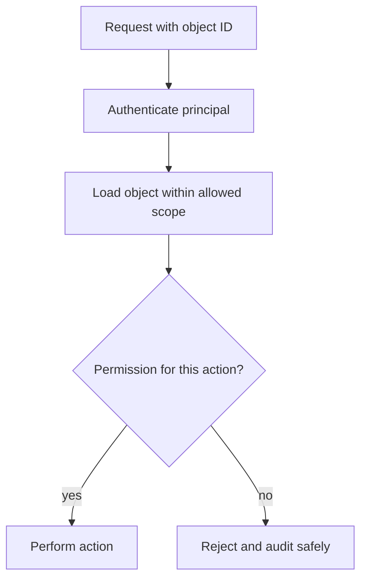

# Authorization

Authorization decides whether an actor may perform an action on a specific resource in a specific context. Hiding buttons or checking permissions only in the frontend is not a security boundary.

## Object-level authorization
For every read, update, delete, export, or action, check the authenticated principal against the target object and tenant on the server. Do not trust IDs supplied by the client. Deny by default and test both allowed and denied cases.

## Object access check

Use RBAC for role-oriented permissions and ABAC when resource, tenant, ownership, or context attributes matter. Avoid broad admin bypasses and verify tenant isolation in database queries and background jobs. References: [OWASP Authorization Cheat Sheet](https://cheatsheetseries.owasp.org/cheatsheets/Authorization_Cheat_Sheet.html), [OWASP API Security](https://owasp.org/www-project-api-security/).
