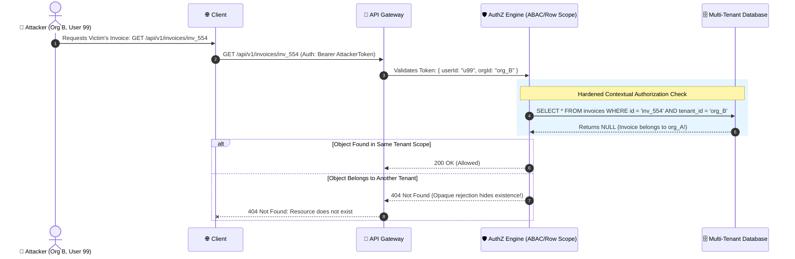

# 🛡️ Authorization Architecture & Access Control

> The master engineering guide to server-side access enforcement: RBAC, ABAC, ReBAC, BOLA/IDOR prevention, and multi-tenant isolation boundaries.

---

## 📚 Handbook Navigation & Sub-Modules

Dive into dedicated implementation guides for modern authorization architectures:

- 🎯 [**Broken Object Level Authorization (BOLA / IDOR)**](idor-bola.md) — The #1 API vulnerability: integer IDs vs. UUIDs, database row scoping, Prisma/TypeORM/SQL patterns, and preventing unauthorized horizontal data access.
- 🏛️ [**RBAC vs. ABAC vs. ReBAC vs. PBAC**](rbac-abac-rebac.md) — Architectural models compared: Role-Based (RBAC), Attribute-Based (ABAC), Relationship-Based (Google Zanzibar / ReBAC), and Policy-Based (Open Policy Agent / PBAC).
- 🏢 [**BFLA & Multi-Tenant Data Isolation**](bfla-and-tenant-isolation.md) — Broken Function Level Authorization (OWASP API #5), vertical escalation, and multi-tenant database isolation strategies (Row-Level Security, Schema-per-Tenant, DB-per-Tenant).

---

## 1. 🎯 Overview & Intuitive Mental Model

### The Production Hook
While **Authentication** verifies *identity* ("Who are you?"), **Authorization (AuthZ)** determines *privilege* ("Are you permitted to edit Document #492 at 3:00 PM on a Tuesday?").

A critical flaw in authorization is the most devastating and widespread defect in API architectures. In OWASP's API Security Top 10, **Broken Object Level Authorization (BOLA)** sits at **#1**. Simply hiding a "Delete" button in a React UI or checking permissions only at the route level does not secure the underlying database object when an attacker swaps `/api/documents/10` to `/api/documents/11`.

### 🧠 The Fun Analogy: The "High-Security Hotel Room Key vs. Master Pass"
- **Authentication:** The front desk gives you a room key card with your name on it.
- **Flawed Authorization (BOLA/IDOR):** The hotel door locks are programmed so that ANY guest with a valid keycard can open ANY room door simply by punching in the room number on the door lock keypad.
- **Hardened Authorization:** Every single time you tap your keycard against Room 402, the lock checks: *"Does this guest's keycard specifically grant access to Room 402 right now?"* If you attempt to tap Room 403, the lock blinks red and immediately alerts security.
- **RBAC (Role-Based):** Hotel Guests can enter the swimming pool; Hotel Cleaners can enter the laundry room.
- **ABAC (Attribute-Based):** A cleaner can enter Room 402 *only between 9:00 AM and 1:00 PM*, *only if the "Do Not Disturb" sign is off*, and *only if the guest has checked out*.
- **ReBAC (Relationship-Based):** A person can enter Room 402 if they are an *authorized family member of the primary guest who rented Room 402*.

### Severity & Impact
- **OWASP Category:** [A01:2021 – Broken Access Control](https://owasp.org/Top10/A01_2021-Broken_Access_Control/), [API1:2023 – Broken Object Level Authorization](https://owasp.org/API-Security/editions/2023/en/0xa1-broken-object-level-authorization/)
- **Common Weakness Enumeration (CWE):**
  - **CWE-639:** Authorization Bypass Through User-Controlled Key (IDOR)
  - **CWE-285:** Improper Authorization
  - **CWE-284:** Improper Access Control
- **Blast Radius:** Complete tenant data leakage, mass unauthorized record exfiltration, silent record manipulation across organizational boundaries.

---

## 2. 🎨 Interactive Visual Architecture



> 💡 **Visual Inspection Tip:** In Chrome DevTools, inspect your API requests. If an endpoint takes a raw numerical ID in the path or query parameter (`/api/users/123/profile`), test changing that ID to another value (`/api/users/124/profile`). If the response returns data without an explicit authorization denial, BOLA/IDOR is present.

---

## 3. 💥 Real-World Exploit Walkthrough

### Scenario: The Classic BOLA / IDOR REST Vulnerability
A SaaS HR platform allows employees to view and update their tax withholding forms.

#### ❌ Vulnerable Route Handler (Node.js / Express)
```typescript
// vulnerable-tax-api.ts
import express from 'express';

const app = express();
app.use(express.json());

// Mock database
const taxForms: Record<string, { userId: string; ssn: string; salary: number }> = {
  '101': { userId: 'alice_1', ssn: '123-45-6789', salary: 140000 },
  '102': { userId: 'bob_2', ssn: '987-65-4321', salary: 185000 },
};

// ⚠️ CATASTROPHIC FLAW (BOLA / IDOR):
// The route verifies authentication, but completely fails to check if the authenticated
// user actually OWNS the tax form with ID 'formId'!
app.get('/api/tax-forms/:formId', (req, res) => {
  const currentUserId = (req as any).user?.id; // Authenticated user
  const { formId } = req.params;

  const form = taxForms[formId];
  if (!form) return res.status(404).json({ error: 'Form not found' });

  // ⚠️ Missing: if (form.userId !== currentUserId) check!
  res.json(form);
});
```

#### 💥 The Attacker's Exploit Script
```python
import requests

# Attacker logs in as Alice
headers = {"Authorization": "Bearer alice_token"}

# Attacker iterates through sequential integer IDs to scrape every employee's SSN and salary!
for form_id in range(100, 110):
    res = requests.get(f"http://localhost:3000/api/tax-forms/{form_id}", headers=headers)
    if res.status_code == 200:
        print(f"Stolen Form #{form_id}:", res.json())
```

---

## 4. 🛡️ Resolution & Defense-in-Depth

### Hardened Object-Level Authorization with Database Scoping
```typescript
// hardened-authz-api.ts - CONTEXTUAL TENANT SCOPING
import express, { Request, Response } from 'express';
import { PrismaClient } from '@prisma/client';

const app = express();
const prisma = new PrismaClient();

// 🛡️ Always include the authenticated user/tenant scope in the database query directly!
app.get('/api/tax-forms/:formId', async (req: Request, res: Response) => {
  const currentUserId = (req as any).user.id;
  const currentTenantId = (req as any).user.tenantId;
  const { formId } = req.params;

  // 🛡️ BOLA DEFENSE: Scope the query strictly to tenant and user ownership
  const form = await prisma.taxForm.findFirst({
    where: {
      id: formId,
      userId: currentUserId,       // Enforces user ownership
      tenantId: currentTenantId,   // Enforces organization boundary
    },
  });

  // 🛡️ Return 404 instead of 403 to prevent resource enumeration (ID probing)
  if (!form) {
    return res.status(404).json({ error: 'Resource not found' });
  }

  res.json(form);
});

export default app;
```

---

## 5. 🧪 Hands-On Verification & Lab

### Automated BOLA / IDOR Penetration Test (Vitest / Supertest)
```typescript
// authz.test.ts
import request from 'supertest';
import app from './hardened-authz-api';

describe('Object-Level Authorization Enforcement Suite', () => {
  it('prevents user A from viewing user B tax form', async () => {
    // Authenticate as Alice
    const res = await request(app)
      .get('/api/tax-forms/form_bob_102')
      .set('Authorization', 'Bearer alice_valid_jwt');

    // Must return 404 Not Found to prevent data disclosure and enumeration
    expect(res.status).toBe(404);
  });
});
```

---

## 6. 📋 Code Review Checklist

- [ ] **Row-Level Tenant Scoping:** Does every SQL/ORM query include `WHERE tenant_id = ? AND user_id = ?` constraints?
- [ ] **No Client-Supplied Roles:** Are permissions derived strictly from verified session claims on the server?
- [ ] **Opaque Rejections:** Are unauthorized access attempts rejected with `404 Not Found` rather than `403 Forbidden` to prevent object existence enumeration?
- [ ] **Non-Sequential IDs:** Are resources addressed using UUIDv4 or K-Sortable ULIDs rather than auto-incrementing sequential integers?
- [ ] **Background Job Scoping:** Do asynchronous queues and scheduled cron jobs enforce tenant isolation?

---

## 7. 🎥 Curated Video Walkthroughs & Primary References

### 📺 High-Impact Video Explanations
- 🎥 [Access Control & Authorization Models in Modern Architecture (ByteByteGo)](https://www.youtube.com/watch?v=1r_A_B_k3l4) — Comparative breakdown of RBAC, ABAC, ReBAC, and multi-tenant isolation patterns.
- 🎥 [Broken Object Level Authorization (BOLA/IDOR) Deep Dive (Hussein Nasser)](https://www.youtube.com/watch?v=kY31Wn6Vw6I) — Deep architectural analysis of why API gateways cannot replace database row-level authorization.
- 🎥 [Access Control Vulnerabilities & Bypasses (PortSwigger Web Security Academy)](https://www.youtube.com/watch?v=cI_U0p7b9gY) — Comprehensive walkthrough of vertical vs horizontal privilege escalation.

### 📖 Primary Documentation & Specifications
- 📜 [OWASP Top 10: A01:2021 – Broken Access Control](https://owasp.org/Top10/A01_2021-Broken_Access_Control/) — The #1 most critical web security vulnerability category.
- 📜 [OWASP Cheat Sheet: Authorization Best Practices](https://cheatsheetseries.owasp.org/cheatsheets/Authorization_Cheat_Sheet.html) — Concrete engineering rules for policy enforcement points (PEP) and decisions (PDP).
- 📜 [NIST Special Publication 800-162: Guide to Attribute Based Access Control](https://csrc.nist.gov/publications/detail/sp/800-162/final) — Federal enterprise authorization standard.

### 🧪 Interactive Hands-On Training Labs
- 🎯 [PortSwigger Lab: User ID controlled by request parameter (IDOR)](https://portswigger.net/web-security/access-control/lab-user-id-controlled-by-request-parameter) — Practice finding and exploiting horizontal privilege escalations.
- 🎯 [PortSwigger Lab: Unprotected admin functionality](https://portswigger.net/web-security/access-control/lab-unprotected-admin-functionality) — Bypass weak path-based authorization to gain administrative rights.
- 🎯 [PortSwigger Lab: Method-based access control bypass](https://portswigger.net/web-security/access-control/lab-method-based-access-control-can-be-circumvented) — Exploit HTTP method spoofing (GET vs POST) to circumvent security filters.

