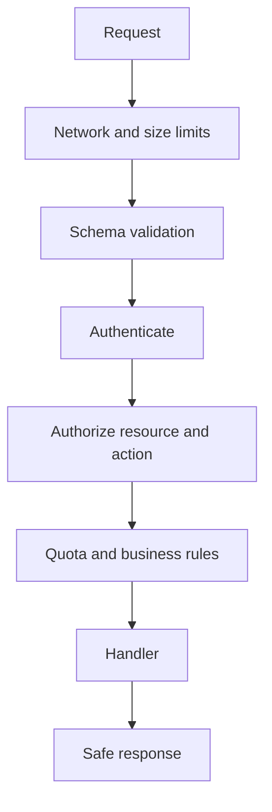

# API Security

APIs must independently enforce identity, authorization, validation, resource limits, and safe error handling. Frontend route guards and CORS do not protect an API from direct requests.

## Baseline controls
- Validate type, shape, length, ranges, enums, and business invariants server-side.
- Enforce object- and function-level authorization on every request.
- Apply rate limits, quotas, timeouts, pagination caps, and concurrency limits.
- Avoid mass assignment: explicitly map writable fields.
- Return consistent errors without stack traces, secrets, or internal topology.
- Version APIs and deprecate insecure endpoints deliberately.

## API request pipeline

For GraphQL, bound query depth/complexity and resolver cost; for WebSockets, authenticate connections and authorize each sensitive message/action. References: [OWASP API Security Top 10](https://owasp.org/www-project-api-security/), [OWASP REST Security Cheat Sheet](https://cheatsheetseries.owasp.org/cheatsheets/REST_Security_Cheat_Sheet.html).
