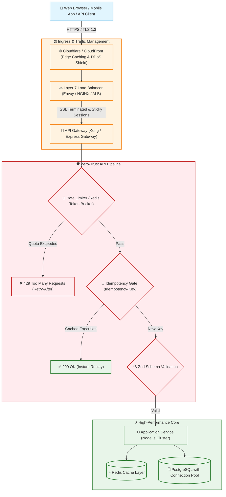

# 🚀 API Security, Performance & Scalability Architecture

> The master engineering guide to high-performance, resilient, and attack-hardened APIs: Zero-trust input validation, sub-millisecond latency, distributed load balancing, and rate limiting.

---

## 📚 Handbook Navigation & Sub-Modules

Explore dedicated deep-dive blueprints for modern high-scale API engineering:

- ⚡ [**How to Make APIs Fast: Performance & Optimization**](api-performance-and-optimization.md) — HTTP caching (`stale-while-revalidate`, ETags), HTTP/2 & HTTP/3 multiplexing, Brotli compression, database connection pooling, pagination, and JSON streaming.
- ⚖️ [**Load Balancing & High Availability Architecture**](load-balancing.md) — Layer 4 vs. Layer 7 balancing, Round Robin, Least Connections, Consistent Hashing, SSL/TLS termination, active health probes, and zero-downtime deployments.
- 🚦 [**Rate Limiting & Throttling Strategies**](rate-limiting-and-throttling.md) — Token Bucket, Leaky Bucket, Sliding Window Counter algorithms, distributed Redis Lua implementations, `RateLimit-*` headers, and exponential backoff.
- 🔁 [**Idempotent Request Architecture**](idempotent-requests.md) — Defeating double-spend charges and network retry corruption with `Idempotency-Key` headers, Redis distributed locks (`SET NX EX`), and database state machines.

---

## 1. 🎯 Overview & Intuitive Mental Model

### The Production Hook
Application Programming Interfaces (APIs) represent the digital nervous system of modern software. They are the primary targets of automated threat actors: botnets credential-stuffing login routes, scrapers exfiltrating product databases, and attackers probing for BOLA and injection flaws.

At the same time, enterprise APIs face extreme non-functional performance requirements: **P99 latencies under 50ms**, 99.999% availability, and resilient handling of traffic spikes. Security and performance cannot be treated as separate silos: a slow API is trivially vulnerable to Denial of Service (DoS), while an unsecured API will leak private customer records regardless of how fast it responds.

### 🧠 The Fun Analogy: The "Formula 1 Pit Stop"
- **High-Performance Architecture (Speed):** The pit crew moves in micro-timed synchrony. Pneumatic wheel guns fire in 1.8 seconds (HTTP/3 QUIC connection reuse, Redis memory caching, and Brotli compression). No time is wasted looking up parts in distant warehouses (database connection pooling).
- **Load Balancing (The Traffic Marshal):** Directs incoming race cars across 4 parallel pit bays so no single mechanic is overwhelmed while others stand idle.
- **Rate Limiting (The Pit Lane Speed Governor):** Even a Formula 1 engine with 1,000 horsepower must engage the pit-lane speed limiter button. If a rogue car enters the pit lane at 200 mph (a botnet flooding requests), the speed governor clamps the throttle down (HTTP 429 Too Many Requests).
- **Idempotency (The Radio Confirmation):** The driver radios: *"Box, box, box! Fitting hard tires!"* The pit wall confirms receipt. If radio static causes the driver to repeat the message three times, the mechanics do not change the tires three times; they recognize the unique transmission tag (`Idempotency-Key`) and execute the change exactly once.

### Severity & Impact
- **OWASP Category:** [OWASP API Security Top 10 (2023 Edition)](https://owasp.org/API-Security/)
  - **API1:2023:** Broken Object Level Authorization
  - **API4:2023:** Unrestricted Resource Consumption (Rate Limiting)
  - **API6:2023:** Unrestricted Access to Sensitive Business Flows
- **Common Weakness Enumeration (CWE):**
  - **CWE-770:** Allocation of Resources Without Limits (DoS)
  - **CWE-918:** Server-Side Request Forgery (SSRF)
  - **CWE-400:** Uncontrolled Resource Consumption
- **Blast Radius:** Complete service outages, financial loss through duplicate billing, infrastructure cost explosions, customer churn.

---

## 2. 🎨 Interactive Visual Architecture



> 💡 **Visual Inspection Tip:** Open Chrome DevTools (`Network` tab). Inspect response headers from high-scale APIs. Check for `Server-Timing: cdn-cache;desc=HIT, db;dur=12.4`, `RateLimit-Remaining: 98`, `Content-Encoding: br` (Brotli), and `CF-Cache-Status: HIT`.

---

## 3. 💥 Real-World Exploit Walkthrough

### Scenario: The Unconstrained API Endpoint & DoS Catastrophe
A high-growth e-commerce API exposed an endpoint `/api/v1/orders/search`. The endpoint lacked rate limiting, omitted pagination maximums, and accepted arbitrary SQL filter parameters.

#### ❌ Vulnerable Route Implementation (Node.js / Express)
```typescript
// vulnerable-order-api.ts
import express from 'express';
import { Pool } from 'pg';

const app = express();
app.use(express.json());
const db = new Pool();

// ⚠️ CATASTROPHIC FLAW 1: No rate limiting on expensive queries!
// ⚠️ CATASTROPHIC FLAW 2: No pagination bounds! Attacker can request limit=10000000!
// ⚠️ CATASTROPHIC FLAW 3: No idempotency handling on financial checkout mutations!
app.get('/api/v1/orders/search', async (req, res) => {
  const { query, limit = 100 } = req.query;

  // Unbounded SQL query causes CPU spikes and Out-Of-Memory (OOM) crashes
  const result = await db.query(
    `SELECT * FROM orders WHERE description ILIKE $1 LIMIT $2`,
    [`%${query}%`, limit]
  );

  res.json(result.rows);
});

// Vulnerable non-idempotent checkout endpoint
app.post('/api/v1/checkout/charge', async (req, res) => {
  const { userId, amount } = req.body;
  // If the network times out and client retries, user is charged MULTIPLE times!
  console.log(`Charging $${amount} to user ${userId}`);
  res.json({ status: 'Charged' });
});
```

#### 💥 The Attacker's Exploit Script
```python
import requests
import concurrent.futures

# Attacker launches 500 concurrent threads requesting unbounded database joins
def flood_expensive_queries():
    requests.get(
        "http://localhost:3000/api/v1/orders/search?query=a&limit=500000"
    )

with concurrent.futures.ThreadPoolExecutor(max_workers=50) as executor:
    for _ in range(500):
        executor.submit(flood_expensive_queries)
```
Within 15 seconds, the database connection pool is completely starved, CPU utilization hits 100%, and all legitimate customer checkouts fail with `504 Gateway Timeout`.

---

## 4. 🛡️ Resolution & Defense-in-Depth

### Production Hardened Gateway Blueprint (Node.js / Express + TypeScript)
```typescript
// hardened-api-gateway.ts - ZERO-TRUST RESILIENT API
import express, { Request, Response, NextFunction } from 'express';
import { z } from 'zod';
import compression from 'compression';
import helmet from 'helmet';

const app = express();

// 🛡️ 1. Security Headers & Payload Boundaries
app.use(helmet());
app.use(express.json({ limit: '10kb' })); // Mitigate payload exhaustion attacks
app.use(compression({ level: 6 }));       // Brotli/Gzip response compression

// 🛡️ 2. Strict Input Validation & Strict Pagination Bounds
const SearchQuerySchema = z.object({
  query: z.string().min(1).max(100),
  page: z.coerce.number().int().positive().default(1),
  limit: z.coerce.number().int().positive().max(50, 'Max pagination limit is 50').default(20),
});

app.get('/api/v1/orders/search', async (req: Request, res: Response) => {
  const parseResult = SearchQuerySchema.safeParse(req.query);
  if (!parseResult.success) {
    return res.status(400).json({ error: 'Invalid parameters', details: parseResult.error.format() });
  }

  const { query, page, limit } = parseResult.data;
  const offset = (page - 1) * limit;

  // 🛡️ Fast, bounded, indexed query execution
  res.json({
    page,
    limit,
    results: [`Safe, bounded order record for ${query}`],
  });
});

export default app;
```

---

## 5. 🧪 Hands-On Verification & Lab

### Testing API Bounds with `curl`
```bash
# Test pagination boundary enforcement (Should return 400 Bad Request)
curl -i "http://localhost:3000/api/v1/orders/search?query=test&limit=999999"

# Expected Response:
# HTTP/1.1 400 Bad Request
# {"error":"Invalid parameters","details":{"limit":{"_errors":["Max pagination limit is 50"]}}}
```

### Automated Integration Test (Supertest)
```typescript
// api-security.test.ts
import request from 'supertest';
import app from './hardened-api-gateway';

describe('API Security & Bounds Suite', () => {
  it('enforces maximum pagination bounds to prevent resource exhaustion', async () => {
    const res = await request(app).get('/api/v1/orders/search?query=shoes&limit=500');
    expect(res.status).toBe(400);
    expect(res.body.details.limit._errors[0]).toContain('Max pagination limit is 50');
  });

  it('rejects oversized JSON payloads (DoS mitigation)', async () => {
    const hugePayload = { data: 'A'.repeat(20 * 1024) }; // 20KB exceeds 10KB limit
    const res = await request(app).post('/api/v1/checkout/charge').send(hugePayload);
    expect(res.status).toBe(413); // Payload Too Large
  });
});
```

---

## 6. 📋 Code Review Checklist

- [ ] **Hard Pagination Limits:** Does every list/search endpoint enforce strict maximum pagination limits (`limit <= 50` or `100`)?
- [ ] **Strict Payload Caps:** Is body parsing configured with explicit byte size caps (`express.json({ limit: '10kb' })`)?
- [ ] **Compression Enabled:** Is Brotli/Gzip compression enabled to minimize network transit time?
- [ ] **Rate Limiting Active:** Are rate limiters configured on all public and authenticated endpoints?
- [ ] **Idempotency Keys:** Do state-changing mutation endpoints (especially payments, orders, transfers) require an `Idempotency-Key`?

---

## 7. 🎥 Curated Video Walkthroughs & Primary References

### 📺 High-Impact Video Explanations
- 🎥 [API Security Best Practices & Gateway Patterns (ByteByteGo)](https://www.youtube.com/watch?v=1r_A_B_k3l4) — Essential system design guide covering rate limiting, authentication gateways, and API boundaries.
- 🎥 [REST API Design, Performance & Security (Hussein Nasser)](https://www.youtube.com/watch?v=7Q17ubqLfaM) — Deep exploration of HTTP protocol nuances, payload parsing exhaustion, and network bottlenecks.
- 🎥 [OWASP API Security Top 10 Walkthrough (FreeCodeCamp)](https://www.youtube.com/watch?v=1FfLg3x_l4k) — End-to-end breakdown of BOLA, broken authentication, mass assignment, and SSRF in modern APIs.

### 📖 Primary Documentation & Specifications
- 📜 [OWASP API Security Project Top 10 (2023 Official)](https://owasp.org/www-project-api-security/) — The primary industry benchmark for REST, GraphQL, and gRPC security.
- 📜 [IETF RFC 9110: HTTP Semantics](https://datatracker.ietf.org/doc/html/rfc9110) — The definitive internet standard governing HTTP methods, status codes, and headers.
- 📜 [OWASP Cheat Sheet: REST Security](https://cheatsheetseries.owasp.org/cheatsheets/REST_Security_Cheat_Sheet.html) — Pragmatic defensive engineering rules for API developers.

### 🧪 Interactive Hands-On Training Labs
- 🎯 [OWASP crAPI (Completely Ridiculous API)](https://github.com/OWASP/crAPI) — Hands-on Docker lab to practice discovering and securing API Top 10 vulnerabilities.
- 🎯 [PortSwigger Lab: Exploiting server-side parameter pollution in REST APIs](https://portswigger.net/web-security/api-testing/lab-exploiting-server-side-parameter-pollution-in-rest-api) — Exploit query string overrides and hidden internal backend APIs.

