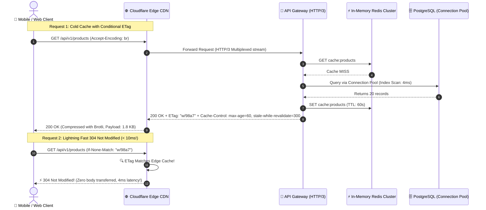

# ⚡ How to Make APIs Fast: Performance & Optimization Blueprint

> The senior engineer's guide to sub-50ms API architectures: Multi-tier HTTP caching, HTTP/3 QUIC, Brotli compression, database connection pooling, and eliminating serialization overhead.

---

## 1. 🎯 Overview & Intuitive Mental Model

### The Production Hook
Performance is not just a user experience luxury; **speed is a core security attribute**. An API endpoint that takes 800ms to process a request can easily be overwhelmed by a small, unsophisticated Denial of Service (DoS) attack. If the same endpoint is optimized to respond in 15ms using Redis caching and HTTP conditional validation (`ETags`), the server can withstand a 50x higher traffic volume on the exact same cloud hardware.

High-scale performance requires eliminating overhead at every layer of the network and compute stack: protocol negotiation, TLS handshakes, reverse proxy buffering, database connection latency, and JSON serialization bottlenecks.

### 🧠 The Fun Analogy: The "Formula 1 High-Speed Express"
- **Unoptimized API (The Bureaucratic DMV):** Every citizen who asks *"What is today's sales tax rate?"* causes a clerk to stand up, walk down three flights of stairs to the paper archives in the basement (database query), xerox the paper, and slowly read it aloud.
- **HTTP Caching (`Cache-Control` & `ETags`):** The clerk posts a massive digital whiteboard in the lobby (`CDN Edge Cache`). If the tax rate hasn't changed, the clerk simply flashes a green light: *"Nothing changed since yesterday; use the copy you already hold!"* (HTTP `304 Not Modified`).
- **HTTP/3 QUIC Multiplexing:** Instead of having one single conveyor belt where one heavy package stalls everything behind it (Head-of-Line Blocking), the airport uses 100 parallel pneumatic vacuum tubes.
- **Brotli Compression:** Vacuum-sealing your winter coat so it takes up 70% less luggage space before putting it on the airplane.

### The API Latency Budget (Target: < 50ms P99)

| Layer | Unoptimized Latency | Optimized Latency | Key Optimization Technique |
|---|---|---|---|
| **DNS & TLS Handshake** | 150ms - 300ms | 0ms - 20ms | TLS 1.3 0-RTT, HTTP/3 QUIC, Connection Keep-Alive |
| **CDN / Edge Ingress** | 80ms | 5ms - 15ms | Edge Caching (`stale-while-revalidate`), Geo-DNS |
| **Gateway Routing** | 20ms | 1ms - 2ms | In-memory reverse proxy (Envoy / NGINX) |
| **Application Compute** | 120ms | 5ms - 10ms | `fast-json-stringify`, asynchronous non-blocking I/O |
| **Data Fetching** | 300ms | 2ms - 8ms | Redis Cache-Aside, Connection Pooling, Indexed Queries |

---

## 2. 🎨 Interactive Visual Architecture



> 💡 **Visual Inspection Tip:** Open Chrome DevTools (`Network` tab). Inspect the **Timing** waterfall tab. Look at **Queueing**, **DNS Lookup**, **Initial Connection (SSL)**, and **Waiting for server response (TTFB)**. In high-performance APIs, TTFB should be under 50ms, and subsequent requests should display `304 Not Modified` or `(from disk cache)`.

---

## 3. 💥 Real-World Exploit Walkthrough

### Scenario: The Thundering Herd / Cache Stampede Collapse
A news portal cached its homepage API in Redis with a 60-second TTL. When a breaking news article was published, 100,000 users per second requested `/api/breaking-news`. At second 60, the cache key expired simultaneously.

All 100,000 concurrent requests encountered a `Cache MISS` at the exact same millisecond and rushed to query the PostgreSQL database at once—triggering a catastrophic **Cache Stampede (Thundering Herd)** that crashed the database.

#### ❌ Vulnerable Cache-Aside Pattern (Node.js / Express)
```typescript
// vulnerable-cache.ts
import express from 'express';
import Redis from 'ioredis';
import { Pool } from 'pg';

const app = express();
const redis = new Redis();
const db = new Pool();

// ⚠️ CATASTROPHIC FLAW: Cache Stampede Vulnerability!
app.get('/api/breaking-news', async (req, res) => {
  const cachedData = await redis.get('news:latest');
  if (cachedData) {
    return res.json(JSON.parse(cachedData));
  }

  // When key expires, 50,000 concurrent requests execute this SQL query simultaneously!
  console.log('[DB HIT] Querying heavy relational database...');
  const result = await db.query('SELECT * FROM articles ORDER BY created_at DESC LIMIT 10');
  
  await redis.set('news:latest', JSON.stringify(result.rows), 'EX', 60);
  res.json(result.rows);
});
```

#### 💥 The Stampede Simulation
When the cache expires, running a load test (`autocannon -c 500 -d 5 http://localhost:3000/api/breaking-news`) causes the database connection pool to max out within 200ms, spiking memory usage to 100% and throwing `500 Internal Server Error: Connection pool exhausted`.

---

## 4. 🛡️ Resolution & Defense-in-Depth

### The Production Blueprint: Mutex Locks + Stale-While-Revalidate + Brotli
```typescript
// hardened-fast-api.ts - ULTRA-FAST RESILIENT API
import express, { Request, Response } from 'express';
import Redis from 'ioredis';
import { Pool } from 'pg';
import compression from 'compression';
import crypto from 'crypto';

const app = express();
const redis = new Redis();

// 🛡️ 1. Database Connection Pooling with Keep-Alive
const db = new Pool({
  max: 20,                  // Maximum active clients in pool
  idleTimeoutMillis: 30000, // Close idle clients after 30s
  connectionTimeoutMillis: 2000, // Fail fast if DB unreachable
});

// 🛡️ 2. High-Efficiency Compression Middleware (Brotli + Gzip)
app.use(compression({
  threshold: 1024, // Only compress responses > 1 KB
  level: 6,        // Optimum trade-off between CPU and compression ratio
}));

// Helper: Distributed Mutex to prevent Cache Stampedes
async function getOrSetWithMutex<T>(key: string, ttlSeconds: number, fetcher: () => Promise<T>): Promise<T> {
  const cached = await redis.get(key);
  if (cached) return JSON.parse(cached);

  const lockKey = `lock:${key}`;
  // 🛡️ SET NX: Acquire atomic lock for 5 seconds
  const acquired = await redis.set(lockKey, 'locked', 'EX', 5, 'NX');

  if (acquired) {
    try {
      const freshData = await fetcher();
      await redis.set(key, JSON.stringify(freshData), 'EX', ttlSeconds);
      return freshData;
    } finally {
      await redis.del(lockKey);
    }
  } else {
    // If another worker is already fetching, wait 50ms and read from cache
    await new Promise((r) => setTimeout(r, 50));
    const retryCached = await redis.get(key);
    if (retryCached) return JSON.parse(retryCached);
    return fetcher(); // Fallback
  }
}

// 🛡️ 3. HTTP Caching with ETags and Stale-While-Revalidate
app.get('/api/v1/news', async (req: Request, res: Response) => {
  const data = await getOrSetWithMutex('news:latest', 60, async () => {
    const result = await db.query('SELECT id, title, published_at FROM articles LIMIT 10');
    return result.rows;
  });

  // Compute weak ETag from data hash
  const etag = `W/"${crypto.createHash('md5').update(JSON.stringify(data)).digest('hex')}"`;

  // 🛡️ Conditional Request Handling (HTTP 304 Not Modified)
  if (req.headers['if-none-match'] === etag) {
    return res.status(304).end(); // Zero body bandwidth! Instant response!
  }

  res.setHeader('ETag', etag);
  // Allow CDN and browser to serve stale content while updating in background
  res.setHeader('Cache-Control', 'public, max-age=60, stale-while-revalidate=300');
  res.json(data);
});

export default app;
```

---

## 5. 🧪 Hands-On Verification & Lab

### Testing Conditional Caching with `curl`
```bash
# 1. First Request: Fetches data and captures ETag
curl -i http://localhost:3000/api/v1/news

# Observe headers:
# HTTP/1.1 200 OK
# ETag: W/"8f14e45fceea167a5a36dedd4bea2543"
# Cache-Control: public, max-age=60, stale-while-revalidate=300

# 2. Second Request: Re-validate with If-None-Match
curl -i http://localhost:3000/api/v1/news \
  -H 'If-None-Match: W/"8f14e45fceea167a5a36dedd4bea2543"'

# Expected Response:
# HTTP/1.1 304 Not Modified (Content-Length: 0, sub-5ms response!)
```

### Automated Benchmark Test (Supertest)
```typescript
// fast-api.test.ts
import request from 'supertest';
import app from './hardened-fast-api';

describe('High-Speed API Performance Suite', () => {
  it('returns HTTP 304 Not Modified when ETag matches', async () => {
    const res1 = await request(app).get('/api/v1/news');
    const etag = res1.headers['etag'];

    const res2 = await request(app)
      .get('/api/v1/news')
      .set('If-None-Match', etag);

    expect(res2.status).toBe(304);
    expect(res2.text).toBe(''); // Body must be completely empty!
  });
});
```

---

## 6. 📋 Code Review Checklist

- [ ] **HTTP Caching Directives:** Does every read-only GET endpoint emit appropriate `Cache-Control` (`stale-while-revalidate`) headers?
- [ ] **Conditional Validation (ETags):** Are ETags generated and checked against `If-None-Match` to return `304 Not Modified`?
- [ ] **Connection Pooling Configured:** Are database pools configured with max limits, connection timeouts, and keep-alives?
- [ ] **Cache Stampede Protected:** Do expensive cache-aside keys use distributed mutexes (`SET NX`) or background warmers?
- [ ] **Compression Enabled:** Is Brotli/Gzip compression enabled with an appropriate minimum byte threshold?
