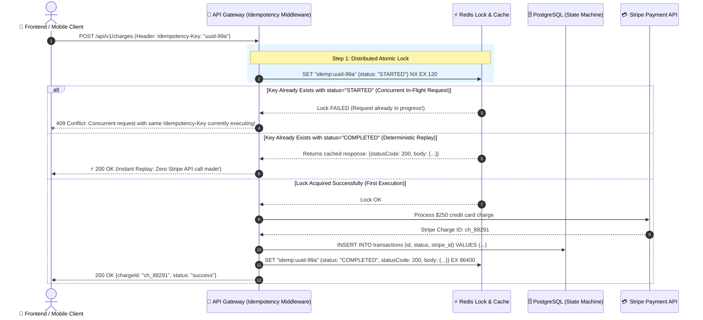

# 🔁 Idempotent Request Architecture

> Defeating duplicate billing, network retry race conditions, and corrupted state with `Idempotency-Key` headers, Redis distributed locks, and atomic database state machines.

---

## 1. 🎯 Overview & Intuitive Mental Model

### The Production Hook
In distributed systems, the network is fundamentally unreliable. When a client sends a `POST /api/v1/payments/charge` request, three things can happen:
1. The request succeeds, and the client receives `200 OK`.
2. The server crashes immediately, and nothing happens.
3. **The Disaster Scenario (Network Timeout):** The server successfully charges the customer's credit card, but right as the server sends the HTTP response back, a mobile cell tower drops the connection. The client times out, assumes the request failed, and **retries the request**—charging the customer a second time!

An operation is **Idempotent** if performing it multiple times yields the exact same state and side effects as performing it once (`f(f(x)) = f(x)`). While HTTP `GET`, `PUT`, and `DELETE` verbs are idempotent by definition (RFC 9110), `POST` is **NOT**. Enterprise architectures must enforce idempotency explicitly via **`Idempotency-Key`** headers.

### 🧠 The Fun Analogy: The "Restaurant Order Ticket"
- **Non-Idempotent System (The Amnesiac Waiter):** You sit at a restaurant and tell the waiter: *"Bring me one plate of sushi."* The waiter walks to the kitchen. You wait 15 minutes, see no waiter, and wave over a second waiter: *"Bring me one plate of sushi."* The kitchen delivers two plates of sushi and charges you twice.
- **Idempotent System with `Idempotency-Key`:** Every customer carries a notebook of unique sequential order vouchers (UUIDs). You hand the waiter Voucher `#ORD-7781`: *"Cook sushi under Voucher #ORD-7781."*
  - If the waiter walks away and disappears, you flag down another waiter with the duplicate voucher copy `#ORD-7781`.
  - The kitchen looks at the order board: *"Voucher #ORD-7781 is already being grilled right now by Chef Marco. Do not start a new plate!"*
  - When the sushi is ready, the kitchen hands you the plate and records the receipt under `#ORD-7781`. Any future inquiries with `#ORD-7781` simply return a reprint of that exact receipt!

### HTTP Method Idempotency & Safety Matrix (RFC 9110)

| HTTP Verb | Safe? (Read-Only) | Idempotent? (`f(f(x)) = f(x)`) | Purpose |
|---|---|---|---|
| **GET** | ✅ Yes | ✅ **Yes** | Read state without side effects |
| **HEAD** | ✅ Yes | ✅ **Yes** | Read headers only |
| **PUT** | ❌ No | ✅ **Yes** | Replace entire resource; repeated calls result in same state |
| **DELETE** | ❌ No | ✅ **Yes** | Delete resource; 1st returns 200/204, subsequent return 404/204 |
| **POST** | ❌ No | ❌ **NO (Requires Idempotency-Key)** | Create resource or execute financial mutation |
| **PATCH** | ❌ No | ❌ **NO** (Often relative: `add $10` is non-idempotent) | Partial update |

---

## 2. 🎨 Interactive Visual Architecture



> 💡 **Visual Inspection Tip:** Open Chrome DevTools (`Network` tab). Click on an order or payment checkout mutation. Look for the `Idempotency-Key: [UUIDv4]` header in **Request Headers**. In enterprise APIs (like Stripe), look for the response header `Idempotent-Replayed: true` when a network retry occurs.

---

## 3. 💥 Real-World Exploit Walkthrough

### Scenario: The Double-Charge Race Condition
An e-commerce mobile app allowed users to redeem gift cards. Because the backend checkout endpoint was not idempotent, an attacker sent 20 concurrent requests with the exact same gift card code in parallel using asynchronous HTTP sockets before the first balance deduction query committed.

#### ❌ Vulnerable Route Implementation (Node.js / Express)
```typescript
// vulnerable-charge.ts
import express from 'express';
import { Pool } from 'pg';

const app = express();
const db = new Pool();

// ⚠️ CATASTROPHIC FLAW: No idempotency check and no distributed lock!
app.post('/api/checkout/pay', async (req, res) => {
  const { orderId, amount, paymentMethodId } = req.body;

  // Race window: If two requests arrive within 50ms, both check status = PENDING!
  const order = await db.query('SELECT status FROM orders WHERE id = $1', [orderId]);
  if (order.rows[0].status === 'PAID') {
    return res.status(400).json({ error: 'Order already paid' });
  }

  // Heavy 3rd-party payment processing takes 600ms:
  await simulateExternalPaymentProcessor(amount);

  // Both concurrent requests commit here -> User charged twice!
  await db.query('UPDATE orders SET status = $1 WHERE id = $2', ['PAID', orderId]);
  res.json({ success: true, orderId, charged: amount });
});

async function simulateExternalPaymentProcessor(amount: number) {
  await new Promise((r) => setTimeout(r, 600));
}
```

#### 💥 The Race Condition Exploit
When a user clicks "Pay" twice on poor mobile Wi-Fi, or an attacker fires concurrent requests, the account is charged $500 instead of $250.

---

## 4. 🛡️ Resolution & Defense-in-Depth

### The Production Blueprint: Redis Distributed Locks + Idempotency Replay
```typescript
// hardened-idempotency.ts - PRODUCTION-READY IDEMPOTENCY MIDDLEWARE
import express, { Request, Response, NextFunction } from 'express';
import Redis from 'ioredis';
import crypto from 'crypto';

const app = express();
app.use(express.json());
const redis = new Redis();

interface CachedIdempotencyRecord {
  status: 'IN_FLIGHT' | 'COMPLETED';
  requestHash: string;
  statusCode?: number;
  responseBody?: any;
}

export const idempotencyMiddleware = (ttlSeconds = 86400) => {
  return async (req: Request, res: Response, next: NextFunction) => {
    // Only enforce idempotency on state-changing mutation verbs
    if (['GET', 'HEAD', 'OPTIONS'].includes(req.method)) {
      return next();
    }

    const idempotencyKey = req.headers['idempotency-key'] as string;
    if (!idempotencyKey) {
      return res.status(400).json({ error: 'Missing mandatory Idempotency-Key header for mutation request.' });
    }

    // 🛡️ 1. Hash the incoming request body to detect payload tampering with reused keys
    const requestHash = crypto.createHash('sha256').update(JSON.stringify(req.body)).digest('hex');
    const redisKey = `idemp:${idempotencyKey}`;

    // 🛡️ 2. Attempt atomic lock acquisition (SET NX)
    const initialRecord: CachedIdempotencyRecord = { status: 'IN_FLIGHT', requestHash };
    const lockAcquired = await redis.set(redisKey, JSON.stringify(initialRecord), 'EX', 120, 'NX');

    if (!lockAcquired) {
      // Key already exists! Check status:
      const existingRaw = await redis.get(redisKey);
      if (!existingRaw) return next();

      const existingRecord: CachedIdempotencyRecord = JSON.parse(existingRaw);

      // Verify that the request body has not changed
      if (existingRecord.requestHash !== requestHash) {
        return res.status(422).json({
          error: 'Unprocessable Entity: Idempotency-Key reused with different request payload.',
        });
      }

      if (existingRecord.status === 'IN_FLIGHT') {
        // Concurrent request currently executing! Prevent race condition
        return res.status(409).json({
          error: 'Conflict: A request with this Idempotency-Key is currently in progress.',
        });
      }

      if (existingRecord.status === 'COMPLETED') {
        // 🛡️ Instant Deterministic Replay
        res.setHeader('Idempotent-Replayed', 'true');
        return res.status(existingRecord.statusCode!).json(existingRecord.responseBody);
      }
    }

    // 🛡️ 3. Intercept response to store snapshot upon completion
    const originalJson = res.json.bind(res);
    res.json = (body: any) => {
      const completedRecord: CachedIdempotencyRecord = {
        status: 'COMPLETED',
        requestHash,
        statusCode: res.statusCode,
        responseBody: body,
      };

      // Persist completed response for 24 hours
      redis.set(redisKey, JSON.stringify(completedRecord), 'EX', ttlSeconds);
      return originalJson(body);
    };

    next();
  };
};

// Hardened payment endpoint protected by idempotency middleware
app.post('/api/checkout/pay', idempotencyMiddleware(), async (req: Request, res: Response) => {
  const { orderId, amount } = req.body;
  
  // Safe payment execution
  const chargeId = `ch_${crypto.randomBytes(8).toString('hex')}`;
  res.status(200).json({ status: 'SUCCESS', chargeId, amount, orderId });
});

export default app;
```

---

## 5. 🧪 Hands-On Verification & Lab

### Testing Idempotency Replay with `curl`
```bash
# 1. Send initial payment request with unique Idempotency-Key:
curl -i -X POST http://localhost:3000/api/checkout/pay \
  -H "Content-Type: application/json" \
  -H "Idempotency-Key: 123e4567-e89b-12d3-a456-426614174000" \
  -d '{"orderId": "ord_99", "amount": 250}'

# Observe response: HTTP 200 OK { chargeId: "ch_abc123" }

# 2. Resend the EXACT SAME request (simulating a mobile network retry):
curl -i -X POST http://localhost:3000/api/checkout/pay \
  -H "Content-Type: application/json" \
  -H "Idempotency-Key: 123e4567-e89b-12d3-a456-426614174000" \
  -d '{"orderId": "ord_99", "amount": 250}'

# Observe headers and body:
# HTTP/1.1 200 OK
# Idempotent-Replayed: true
# { chargeId: "ch_abc123" } (Exact identical charge ID replayed instantly!)
```

### Automated Idempotency Test (Supertest)
```typescript
// idempotency.test.ts
import request from 'supertest';
import app from './hardened-idempotency';

describe('Idempotent Request Enforcement Suite', () => {
  it('returns identical cached response on duplicate request and sets Idempotent-Replayed header', async () => {
    const key = 'test_idem_key_88';
    const payload = { orderId: 'ord_1', amount: 100 };

    // Request 1: Initial execution
    const res1 = await request(app)
      .post('/api/checkout/pay')
      .set('Idempotency-Key', key)
      .send(payload);

    expect(res1.status).toBe(200);
    const chargeId = res1.body.chargeId;

    // Request 2: Duplicate retry
    const res2 = await request(app)
      .post('/api/checkout/pay')
      .set('Idempotency-Key', key)
      .send(payload);

    expect(res2.status).toBe(200);
    expect(res2.headers['idempotent-replayed']).toBe('true');
    expect(res2.body.chargeId).toEqual(chargeId); // Must match original charge ID!
  });

  it('rejects reused key with different payload with 422 Unprocessable Entity', async () => {
    const key = 'test_idem_key_99';

    await request(app)
      .post('/api/checkout/pay')
      .set('Idempotency-Key', key)
      .send({ orderId: 'ord_1', amount: 100 });

    // Send DIFFERENT payload with SAME key
    const res = await request(app)
      .post('/api/checkout/pay')
      .set('Idempotency-Key', key)
      .send({ orderId: 'ord_1', amount: 99999 });

    expect(res.status).toBe(422);
  });
});
```

---

## 6. 📋 Code Review Checklist

- [ ] **Mandatory on Financial Mutations:** Do all endpoints that alter balances, create orders, or dispatch emails require `Idempotency-Key`?
- [ ] **Atomic Lock Acquisition:** Is atomic locking (`SET NX EX`) used to prevent concurrent race-condition executions?
- [ ] **Payload Hash Verification:** Does the middleware hash the request body and reject mismatched payloads with `422 Unprocessable Entity`?
- [ ] **Concurrent In-Flight Protection:** Does an active duplicate request receive `409 Conflict` until the first execution finishes?
- [ ] **Response Snapshotting:** Is the entire HTTP status and response payload cached for deterministic replay (e.g. 24–72 hours)?

---

## 7. 🎥 Curated Video Walkthroughs & Primary References

### 📺 High-Impact Video Explanations
- 🎥 [What is Idempotency? (ByteByteGo)](https://www.youtube.com/watch?v=kYUP7W_5y0w) — Visual system design explanation of network retries, duplicate requests, and idempotency keys.
- 🎥 [Designing Idempotent APIs (Hussein Nasser)](https://www.youtube.com/watch?v=FjL9Vb3hUJE) — Deep dive into distributed locking with Redis, database state machines, and safe HTTP retries.
- 🎥 [Handling Duplicate Payments & Race Conditions (Stripe Engineering Talk)](https://www.youtube.com/watch?v=W4rSg94Wk9g) — How enterprise financial platforms guarantee exactly-once execution semantics.

### 📖 Primary Documentation & Specifications
- 📜 [IETF RFC 9110: HTTP Semantics - Section 9.2.2 Idempotent Methods](https://www.rfc-editor.org/rfc/rfc9110.html#section-9.2.2) — Authoritative specification defining idempotency in HTTP.
- 📜 [IETF Draft: The Idempotency-Key HTTP Header Field](https://datatracker.ietf.org/doc/draft-ietf-httpapi-idempotency-key-header/) — Emerging standard specification for API idempotency.
- 📜 [Stripe Engineering: Designing Robust and Idempotent APIs](https://stripe.com/blog/idempotency) — The industry-standard architecture blueprint.

### 🧪 Interactive Hands-On Training Labs
- 🎯 [Stripe API Idempotency Sandbox](https://docs.stripe.com/api/idempotent_requests) — Interactive live documentation lab demonstrating duplicate charge deduplication.
