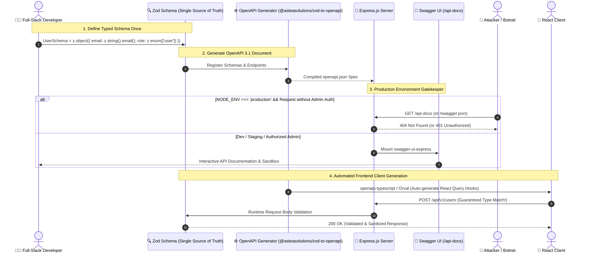

# OpenAPI & Swagger: Node.js / Express Production Integration & Security Architecture

## 1. 🎯 Overview & Intuitive Mental Model

As web systems scale, the gap between backend implementation and frontend consumption becomes a primary source of production bugs and security vulnerabilities. Frontend developers guess request payload formats, mobile developers struggle with undocumented query parameters, and security auditors lack visibility into exposed attack surfaces.

**OpenAPI (formerly Swagger)** is the open standard for machine-readable interface descriptions of RESTful APIs. It provides a formal, language-agnostic contract defining available endpoints, parameters, request bodies, authentication schemes, and response models.

```
+----------------------------------------------------------------------------------------------------+
|                                    🧠 THE PHYSICAL ANALOGY                                         |
|                                                                                                    |
|  🏗️ The Architectural Blueprint of a Skyscraper (OpenAPI / Swagger):                              |
|                                                                                                    |
|  📐 The Standardized Blueprint (The OpenAPI Spec - openapi.json / openapi.yaml):                    |
|     Every electrician, plumber, and interior designer (Frontend, Mobile, QA teams) follows the      |
|     exact same architectural drawing. Dimensions (types), water pipe diameters (validation rules),  |
|     and doorways (endpoints) are unambiguous. No guessing.                                         |
|                                                                                                    |
|  🖥️ The 3D Interactive Building Model (Swagger UI):                                               |
|     Allows clients to walk through the digital building, test doorways, and inspect rooms          |
|     interactively in their web browser without writing a single line of client code.               |
|                                                                                                    |
|  🚨 The Security Threat (Exposed Blueprints to Attackers):                                         |
|     If the skyscraper's blueprints are published on a public billboard without security guards      |
|     (Unprotected Swagger UI in production), burglars immediately discover the bank vault location,  |
|     emergency maintenance tunnels, and unreinforced back doors (Shadow APIs & Admin endpoints).    |
+----------------------------------------------------------------------------------------------------+
```

### 🥊 Code-First vs. Contract-First Architecture

Modern engineering teams adopt one of two workflows:
1. **Contract-First:** You write the OpenAPI YAML specification first; code generators produce TypeScript types, client SDKs, and backend routing stubs.
2. **Code-First (Recommended for Node.js / TypeScript):** You define your schemas using **Zod** or **TypeBox** once in code. A library automatically derives:
   - TypeScript compile-time types.
   - Runtime request validation middleware.
   - The OpenAPI 3.1 JSON document and Swagger UI documentation.
   *Result:* Single Source of Truth with zero documentation drift!

### Vulnerability & Severity Matrix
- **OWASP Category:** [OWASP API Security Top 10 (2023)](https://owasp.org/API-Security/)
  - **API9:2023 – Improper Inventory Management:** Exposed debug, staging, or internal endpoints documented in public Swagger files.
  - **API3:2023 – Broken Object Property Level Authorization:** Leaking sensitive database fields in Swagger response schemas.
  - **API8:2023 – Security Misconfiguration:** Publicly accessible Swagger UI in production without authentication.
- **CWE Identifiers:** [CWE-200: Exposure of Sensitive Information](https://cwe.mitre.org/data/definitions/200.html), [CWE-16: Configuration](https://cwe.mitre.org/data/definitions/16.html)
- **Blast Radius:** Shadow API discovery, reconnaissance for automated exploit bots, mass assignment attacks, token leakage.

---

## 2. 🎨 Interactive Visual Architecture

### Type-Safe OpenAPI Pipeline: From Zod Schema to Swagger UI & Frontend SDKs



> 💡 **Visual Inspection Tip:** Open Chrome DevTools (`F12`) on any public web application. Try navigating to `/api-docs`, `/swagger-ui.html`, `/swagger.json`, `/openapi.json`, or `/docs`. If Swagger UI loads without authentication on a live production domain, the application is actively leaking its entire internal endpoint directory and schema topology!

---

## 3. 💥 Real-World Exploit Walkthrough

### Scenario: The Exposed Production Swagger UI & Shadow Admin Takeover

A fintech startup deployed an Express.js payment gateway. To make it "easy for partners to test," the engineers mounted `swagger-ui-express` at `/api-docs` on the production server without authentication or environment checks.

#### ❌ Vulnerable Implementation (`vulnerable-server.js`)
```javascript
// vulnerable-server.js - DANGEROUS PRODUCTION DEFAULTS
const express = require('express');
const swaggerUi = require('swagger-ui-express');
const YAML = require('yamljs');

const app = express();
app.use(express.json());

// 💥 VULNERABILITY 1: Swagger UI exposed to the entire public internet in production!
// 💥 VULNERABILITY 2: Static YAML spec includes unreleased internal admin endpoints!
const swaggerDocument = YAML.load('./swagger.yaml');
app.use('/api-docs', swaggerUi.serve, swaggerUi.setup(swaggerDocument));

// Public endpoint
app.post('/api/v1/checkout', (req, res) => {
  res.json({ status: 'Charged' });
});

// 💥 Hidden shadow endpoint documented in swagger.yaml:
app.post('/api/v1/internal/admin/refund-override', (req, res) => {
  const { transactionId, refundAmount } = req.body;
  // Flawed assumption: Developers assumed nobody knew this endpoint existed!
  res.json({ status: 'Refunded', transactionId, refundAmount });
});

app.listen(3000);
```

#### The Attacker's Reconnaissance & Exploit Execution
1. **Automated Discovery:** The attacker uses `ffuf` or `dirsearch` scanning for common documentation endpoints:
   ```bash
   dirsearch -u https://api.fintech-startup.com -e json,yaml,html
   ```
2. **Swagger UI Hit:** The scanner discovers `200 OK` on `https://api.fintech-startup.com/api-docs`.
3. **Endpoint Extraction:** The attacker opens Swagger UI and clicks on **`POST /api/v1/internal/admin/refund-override`**. The UI provides the exact JSON schema and a built-in **"Try it out"** button!
4. **Trigger Exploit:**
   ```bash
   curl -X POST https://api.fintech-startup.com/api/v1/internal/admin/refund-override \
     -H "Content-Type: application/json" \
     -d '{"transactionId": "tx_99812", "refundAmount": 50000.00}'
   ```
5. **Impact:** The unauthorized refund executes instantly. Because the endpoint lacked strict middleware authorization and relied on "security by obscurity," the exposed Swagger documentation turned a private vulnerability into an instantaneous loss of funds.

---

## 4. 🛡️ Resolution & Complete Production Implementation

### The Modern Type-Safe Stack: Zod + `@asteasolutions/zod-to-openapi` + `swagger-ui-express`

Instead of maintaining brittle JSDoc comments or out-of-sync YAML files, modern TypeScript applications use **Zod** as the single source of truth for runtime validation, static types, and OpenAPI schema generation.

#### Step 1: Install Dependencies
```bash
npm install express zod @asteasolutions/zod-to-openapi swagger-ui-express helmet
npm install -D @types/express @types/swagger-ui-express typescript
```

---

#### Step 2: Define Schemas & Register OpenAPI Specification (`apiRegistry.ts`)
```typescript
// apiRegistry.ts - SINGLE SOURCE OF TRUTH (Zod -> OpenAPI 3.1)
import { OpenAPIRegistry, OpenApiGeneratorV31, extendZodWithOpenApi } from '@asteasolutions/zod-to-openapi';
import { z } from 'zod';

// Extend Zod with .openapi() metadata methods
extendZodWithOpenApi(z);

export const registry = new OpenAPIRegistry();

// -----------------------------------------------------------------------------
// 1. Define Request / Response Schemas
// -----------------------------------------------------------------------------
export const UserCreateSchema = z.object({
  name: z.string().min(2).max(50).openapi({
    example: 'Alice Johnson',
    description: 'Full name of the user',
  }),
  email: z.string().email().openapi({
    example: 'alice@company.com',
    description: 'Unique business email address',
  }),
  password: z.string().min(8).openapi({
    example: 'P@ssw0rd123!',
    description: 'User master password (minimum 8 characters)',
  }),
}).openapi('UserCreateInput');

export const UserResponseSchema = z.object({
  id: z.string().uuid().openapi({ example: 'a1b2c3d4-e5f6-7a8b-9c0d-1e2f3a4b5c6d' }),
  name: z.string().openapi({ example: 'Alice Johnson' }),
  email: z.string().openapi({ example: 'alice@company.com' }),
  createdAt: z.string().datetime().openapi({ example: '2026-10-13T12:00:00Z' }),
}).openapi('UserResponse');

export const ErrorResponseSchema = z.object({
  error: z.string().openapi({ example: 'Validation Error' }),
  details: z.any().optional(),
}).openapi('ErrorResponse');

// -----------------------------------------------------------------------------
// 2. Register Bearer Authentication Scheme
// -----------------------------------------------------------------------------
export const bearerAuth = registry.registerComponent('securitySchemes', 'bearerAuth', {
  type: 'http',
  scheme: 'bearer',
  bearerFormat: 'JWT',
  description: 'Enter your JWT authorization bearer token',
});

// -----------------------------------------------------------------------------
// 3. Register Endpoints
// -----------------------------------------------------------------------------
registry.registerPath({
  method: 'post',
  path: '/api/v1/users',
  summary: 'Register a new user',
  description: 'Creates a verified user profile and hashes the password securely.',
  tags: ['Users'],
  request: {
    body: {
      content: {
        'application/json': {
          schema: UserCreateSchema,
        },
      },
    },
  },
  responses: {
    201: {
      description: 'User created successfully',
      content: {
        'application/json': {
          schema: UserResponseSchema,
        },
      },
    },
    400: {
      description: 'Invalid input payload',
      content: {
        'application/json': {
          schema: ErrorResponseSchema,
        },
      },
    },
  },
});

// -----------------------------------------------------------------------------
// 4. Generate OpenAPI 3.1 Spec Document
// -----------------------------------------------------------------------------
export function generateOpenAPIDocument() {
  const generator = new OpenApiGeneratorV31(registry.definitions);

  return generator.generateDocument({
    openapi: '3.1.0',
    info: {
      title: 'Enterprise Core API',
      version: '1.0.0',
      description: 'Hardened, production-ready RESTful microservice API.',
      contact: {
        name: 'API Security Team',
        email: 'security@company.com',
      },
    },
    servers: [
      {
        url: 'https://api.company.com',
        description: 'Production API Gateway',
      },
      {
        url: 'http://localhost:3000',
        description: 'Local Development Server',
      },
    ],
  });
}
```

---

#### Step 3: Production-Hardened Express Server with Swagger Gatekeeper (`server.ts`)
```typescript
// server.ts - HARDENED PRODUCTION SERVER WITH SWAGGER GATEKEEPER
import express, { Request, Response, NextFunction } from 'express';
import swaggerUi from 'swagger-ui-express';
import helmet from 'helmet';
import { generateOpenAPIDocument, UserCreateSchema } from './apiRegistry';

const app = express();
app.use(express.json({ limit: '10kb' }));

// 🛡️ 1. Security Headers Configuration (Configured for Swagger UI compatibility)
app.use(
  helmet({
    contentSecurityPolicy: {
      directives: {
        ...helmet.contentSecurityPolicy.getDefaultDirectives(),
        // Allow Swagger UI inline scripts and assets
        'script-src': ["'self'", "'unsafe-inline'"],
        'img-src': ["'self'", 'data:', 'https://validator.swagger.io'],
      },
    },
  })
);

// -----------------------------------------------------------------------------
// 🛡️ 2. Production Swagger UI Gatekeeper Middleware
// -----------------------------------------------------------------------------
function swaggerAuthGatekeeper(req: Request, res: Response, next: NextFunction) {
  // If in local development or staging, allow unrestricted access
  if (process.env.NODE_ENV !== 'production') {
    return next();
  }

  // 🛡️ IN PRODUCTION: Protect Swagger UI with HTTP Basic Authentication or Admin Token
  const authHeader = req.headers.authorization;
  if (!authHeader) {
    res.setHeader('WWW-Authenticate', 'Basic realm="Restricted API Documentation"');
    return res.status(401).send('Authentication required to view API documentation in production.');
  }

  const credentials = Buffer.from(authHeader.split(' ')[1] || '', 'base64').toString('ascii');
  const [username, password] = credentials.split(':');

  const validUser = process.env.SWAGGER_ADMIN_USER || 'secops_admin';
  const validPass = process.env.SWAGGER_ADMIN_PASS || 'S3cur3_Doc_P@ssw0rd!';

  if (username === validUser && password === validPass) {
    return next();
  }

  return res.status(403).send('Forbidden: Insufficient privileges.');
}

// -----------------------------------------------------------------------------
// 3. Mount Swagger UI & JSON Spec Endpoint
// -----------------------------------------------------------------------------
const openapiSpec = generateOpenAPIDocument();

// Raw JSON spec endpoint (useful for automated frontend client generators like Orval)
app.get('/api-docs/openapi.json', swaggerAuthGatekeeper, (req: Request, res: Response) => {
  res.json(openapiSpec);
});

// Interactive Swagger UI
app.use(
  '/api-docs',
  swaggerAuthGatekeeper,
  swaggerUi.serve,
  swaggerUi.setup(openapiSpec, {
    customSiteTitle: 'Enterprise API Documentation',
    swaggerOptions: {
      persistAuthorization: true,
      displayRequestDuration: true,
      docExpansion: 'list',
      filter: true,
    },
  })
);

// -----------------------------------------------------------------------------
// 4. Runtime Request Validation Middleware
// -----------------------------------------------------------------------------
function validateBody(schema: typeof UserCreateSchema) {
  return (req: Request, res: Response, next: NextFunction) => {
    const parseResult = schema.safeParse(req.body);
    if (!parseResult.success) {
      return res.status(400).json({
        error: 'Validation Error',
        details: parseResult.error.format(),
      });
    }
    req.body = parseResult.data; // Strips unknown mass-assignment fields!
    next();
  };
}

// -----------------------------------------------------------------------------
// 5. Protected Endpoint Implementation
// -----------------------------------------------------------------------------
app.post('/api/v1/users', validateBody(UserCreateSchema), (req: Request, res: Response) => {
  const { name, email } = req.body;

  // Emulate database persistence
  const newUser = {
    id: 'a1b2c3d4-e5f6-7a8b-9c0d-1e2f3a4b5c6d',
    name,
    email,
    createdAt: new Date().toISOString(),
  };

  res.status(201).json(newUser);
});

export default app;
```

---

### Part B: Automated Frontend Client Generation (`openapi-typescript` / Orval)

Once you expose `openapi.json`, frontend React/TypeScript applications can generate 100% type-safe fetch clients with one command:

```bash
# Add openapi-typescript
npx openapi-typescript http://localhost:3000/api-docs/openapi.json -o src/api-types.ts
```

#### Consuming the Generated Types in React:
```typescript
// useCreateUser.ts - REACT FRONTEND CONSUMPTION
import { paths } from './api-types';

type UserInput = paths['/api/v1/users']['post']['requestBody']['content']['application/json'];
type UserOutput = paths['/api/v1/users']['post']['responses']['201']['content']['application/json'];

export async function createUser(data: UserInput): Promise<UserOutput> {
  const res = await fetch('/api/v1/users', {
    method: 'POST',
    headers: { 'Content-Type': 'application/json' },
    body: JSON.stringify(data),
  });

  if (!res.ok) throw new Error('Registration failed');
  return res.json();
}
```

---

## 5. 🧪 Hands-On Verification & Lab

### 1. View Interactive Swagger UI Locally
Start your application:
```bash
npm run dev
```
Navigate in your browser to:
`http://localhost:3000/api-docs`

Click the **"Try it out"** button on `POST /api/v1/users`, enter a test payload, and click **Execute**. Confirm the response returns `HTTP 201 Created`.

### 2. Verify Schema Rejection via `curl`
Test that runtime validation rejects malformed email addresses:
```bash
curl -i -X POST http://localhost:3000/api/v1/users \
  -H "Content-Type: application/json" \
  -d '{"name": "Bob", "email": "invalid-email-address", "password": "123"}'
```

#### Expected 400 Bad Request Output:
```http
HTTP/1.1 400 Bad Request
Content-Type: application/json; charset=utf-8

{
  "error": "Validation Error",
  "details": {
    "email": { "_errors": ["Invalid email"] },
    "password": { "_errors": ["String must contain at least 8 character(s)"] }
  }
}
```

### 3. Automated Vitest Integration Test (`swagger.test.ts`)
```typescript
// swagger.test.ts
import { describe, it, expect } from 'vitest';
import request from 'supertest';
import app from './server';

describe('OpenAPI & Swagger Security Suite', () => {
  it('serves openapi.json with valid OpenAPI 3.1 structure', async () => {
    const res = await request(app).get('/api-docs/openapi.json');
    expect(res.status).toBe(200);
    expect(res.body.openapi).toBe('3.1.0');
    expect(res.body.paths['/api/v1/users']).toBeDefined();
  });

  it('enforces runtime input validation conforming to OpenAPI spec', async () => {
    const res = await request(app)
      .post('/api/v1/users')
      .send({ name: 'A', email: 'bad', password: 'short' });

    expect(res.status).toBe(400);
    expect(res.body.error).toBe('Validation Error');
  });

  it('blocks unauthenticated Swagger access in production mode', async () => {
    const prevEnv = process.env.NODE_ENV;
    process.env.NODE_ENV = 'production';

    const res = await request(app).get('/api-docs/');
    expect(res.status).toBe(401);

    // Restore environment
    process.env.NODE_ENV = prevEnv;
  });
});
```

---

## 6. 📋 Code Review Checklist

- [ ] **Single Source of Truth:** Are schemas defined in Zod/TypeBox and translated to OpenAPI to prevent documentation drift?
- [ ] **Production Gatekeeper Active:** Is `/api-docs` either disabled in production (`NODE_ENV === 'production'`) or protected by HTTP Basic Auth / Admin JWT?
- [ ] **No Shadow or Internal Endpoints:** Are internal migration, debug, or super-admin routes excluded from public OpenAPI definitions?
- [ ] **Runtime Validation Active:** Does middleware strictly reject requests that do not match the documented schema?
- [ ] **Mass Assignment Defense:** Does request body parsing strip unrecognized fields (`req.body = schema.parse(req.body)`)?
- [ ] **Sensitive Fields Excluded from Response Specs:** Are password hashes, internal IDs, and secrets omitted from OpenAPI response schemas?
- [ ] **CSPs Tailored for Swagger UI:** Are Content Security Policy headers configured to allow Swagger UI inline styles without opening general XSS loopholes?

---

## 7. 🎥 Curated Video Walkthroughs & Primary References

### 📺 High-Impact Video Explanations
- 🎥 [API Documentation Best Practices & OpenAPI Crash Course (Hussein Nasser)](https://www.youtube.com/watch?v=7Q17ubqLfaM) — Protocol nuances, schema generation, and API contract design.
- 🎥 [OpenAPI & Swagger in 100 Seconds (Fireship)](https://www.youtube.com/watch?v=apouPYPhFLI) — Rapid visual overview of schemas, tooling, and Swagger UI.
- 🎥 [Zod to OpenAPI & Full-Stack Type Safety (Jack Herrington)](https://www.youtube.com/watch?v=L6b_m4wU_6Y) — Step-by-step tutorial generating OpenAPI contracts and frontend TypeScript SDKs directly from Zod.
- 🎥 [OWASP API Security Top 10 Breakdown (ByteByteGo)](https://www.youtube.com/watch?v=1r_A_B_k3l4) — Why exposed documentation and improper inventory management lead to major breaches.

### 📖 Primary Documentation & Specifications
- 📜 [OpenAPI Specification v3.1.0 Official](https://spec.openapis.org/oas/latest.html) — Authoritative internet standard for RESTful API contracts.
- 📜 [zod-to-openapi GitHub Documentation](https://github.com/asteasolutions/zod-to-openapi) — Complete library reference for TypeScript OpenAPI generation.
- 📜 [Swagger UI Express GitHub Documentation](https://github.com/scottie1984/swagger-ui-express) — Express middleware guide.
- 📜 [OWASP API Security Top 10 (API9:2023 Improper Inventory Management)](https://owasp.org/API-Security/editions/2023/en/0xa9-improper-inventory-management/) — Official risk analysis and defense rules.

### 🧪 Interactive Hands-On Training Labs & Tools
- 🎯 [Swagger Petstore Interactive Playground](https://petstore.swagger.io/) — Test-drive the official reference implementation of Swagger UI.
- 🎯 [Swagger Editor (Browser YAML / JSON IDE)](https://editor.swagger.io/) — Real-time in-browser validation and preview tool for OpenAPI contracts.
- 🎯 [PortSwigger Lab: Exploiting API documentation disclosures](https://portswigger.net/web-security/api-testing/lab-exploiting-api-documentation) — Practice discovering exposed documentation to uncover hidden administrative endpoints.
