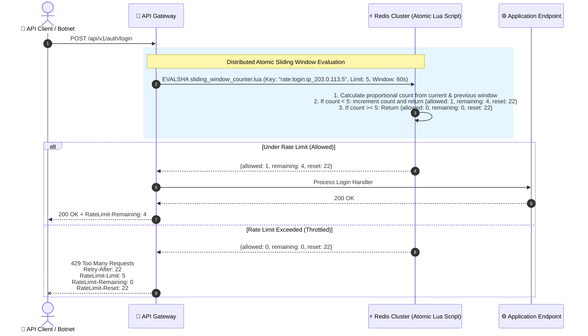

# 🚦 Rate Limiting & Throttling Architecture

> Comprehensive guide to protecting APIs from abuse: Algorithms compared (Token Bucket vs. Sliding Window), distributed Redis Lua scripts, standard HTTP headers, and client backoff.

---

## 1. 🎯 Overview & Intuitive Mental Model

### The Production Hook
Unrestricted resource consumption sits at **API4:2023** in the OWASP API Security Top 10. Without rigorous rate limiting and throttling, any automated script, malicious botnet, or accidental recursive `while(true)` loop deployed by a customer can overwhelm server compute, exhaust database connections, spike third-party API bills (e.g., Stripe, Twilio, OpenAI), and cause complete service outages.

Rate limiting is not a blunt hammer; modern architectures deploy **multi-tiered, contextual throttling**:
- Strict limits on sensitive operations (e.g., max 5 login attempts per minute per IP).
- Generous limits on authenticated read operations (e.g., 1,000 req/min for Pro tier).
- Sliding-window concurrency bounds on expensive generation endpoints (e.g., max 2 concurrent PDF reports per user).

### 🧠 The Fun Analogy: The "Nightclub Bouncer & Velvet Rope"
- **No Rate Limiting:** An open warehouse door. 5,000 partygoers rush through the doorway all at once, crushing the bar, knocking over tables, and causing a structural collapse.
- **Fixed Window (The Hourly Door Stamp):** The bouncer lets in 100 people every hour on the hour (e.g., at 1:00 PM, 2:00 PM). The flaw? 100 people enter at 1:59 PM, and another 100 enter at 2:00 PM—meaning 200 people stampede in within 2 minutes!
- **Token Bucket (The Arcade Coin Dispenser):** You get an arcade bucket that holds 10 coins. You drop a coin into the slot for each video game you play. Every 3 seconds, a referee drops 1 new coin into your bucket. If your bucket is empty, you must wait for the referee to drop the next coin!
- **Sliding Window Counter (The Rolling Stopwatch):** The bouncer wears a digital smartwatch that looks at a continuous, smooth 60-second rolling window. It calculates your proportional usage across the previous and current window, eliminating boundary burst spikes completely!

### Rate Limiting Algorithms Comparison Matrix

| Algorithm | Memory Footprint | Burst Handling | Accuracy | Best Used For |
|---|---|---|---|---|
| **Fixed Window Counter** | 🟢 Extremely Low | 🔴 Poor (2x burst at boundary) | 🔴 Low | Simple low-scale APIs |
| **Sliding Window Log** | 🔴 High (Stores timestamps) | 🟢 Perfect | 🟢 100% Exact | Low-volume, high-security endpoints |
| **Token Bucket** | 🟢 Low (2 numbers: count + time)| 🟢 Excellent (Configurable burst)| 🟢 High | AWS API Gateway, Stripe APIs |
| **Leaky Bucket** | 🟢 Low | 🔴 Smooths bursts into queues | 🟢 Steady flow | Network packet queues, SMS gateways |
| **Sliding Window Counter**| 🟢 Low (Previous + current count)| 🟢 Very Good | 🟢 Proportional (~99%)| Cloudflare, Redis distributed scale |

---

## 2. 🎨 Interactive Visual Architecture



> 💡 **Visual Inspection Tip:** Open Chrome DevTools (`Network` tab). Inspect response headers when making repeated requests. Look for standard IETF headers: `RateLimit-Limit`, `RateLimit-Remaining`, `RateLimit-Reset`, and `Retry-After: 30` when HTTP 429 is received.

---

## 3. 💥 Real-World Exploit Walkthrough

### Scenario: The Distributed Brute-Force & Credential Stuffing Attack
A fintech login API implemented in-memory rate limiting using a Node.js `Map`. Because the application ran behind a cluster of 8 Docker containers, each container had its own isolated memory state.

An attacker launched a distributed credential-stuffing attack: by alternating requests across the 8 containers, the attacker sent 8 times the intended limit without triggering any rate limit block!

#### ❌ Vulnerable In-Memory Rate Limiter (Node.js / Express)
```typescript
// vulnerable-rate-limiter.ts
import express from 'express';

const app = express();
// ⚠️ CATASTROPHIC FLAW: In-memory store does NOT sync across clustered instances!
const requestCounts = new Map<string, number>();

app.post('/api/login', (req, res) => {
  const ip = req.ip || 'unknown';
  const count = requestCounts.get(ip) || 0;

  // In a cluster of 8 servers, attacker gets 8 * 5 = 40 attempts every minute!
  if (count >= 5) {
    return res.status(429).json({ error: 'Too many attempts' });
  }

  requestCounts.set(ip, count + 1);
  res.json({ status: 'Processing login...' });
});
```

#### 💥 The Attacker's Exploit Script
The attacker uses round-robin connections to test 10,000 compromised passwords against a targeted email address without getting blocked.

---

## 4. 🛡️ Resolution & Defense-in-Depth

### The Production Blueprint: Distributed Atomic Sliding Window in Redis via Lua
To prevent race conditions and synchronize limits across all API servers, execute the check atomically inside Redis using a single **Lua Script**:

```typescript
// hardened-rate-limiter.ts - PRODUCTION-READY DISTRIBUTED RATE LIMITER
import express, { Request, Response, NextFunction } from 'express';
import Redis from 'ioredis';

const app = express();
const redis = new Redis();

// 🛡️ Atomic Lua Script for Sliding Window Counter
const SLIDING_WINDOW_LUA = `
local current_key = KEYS[1]
local previous_key = KEYS[2]
local now = tonumber(ARGV[1])
local window = tonumber(ARGV[2])
local limit = tonumber(ARGV[3])

-- Get counts from current and previous windows
local current_count = tonumber(redis.call('GET', current_key) or "0")
local previous_count = tonumber(redis.call('GET', previous_key) or "0")

-- Calculate weight of previous window
local time_into_current_window = now % window
local weight = (window - time_into_current_window) / window
local estimated_count = math.floor(previous_count * weight + current_count)

if estimated_count >= limit then
  local reset_time = math.ceil(window - time_into_current_window)
  return {0, 0, reset_time} -- [allowed=0, remaining=0, retry_after=reset_time]
else
  -- Increment current window counter and set TTL to 2x window
  redis.call('INCR', current_key)
  redis.call('EXPIRE', current_key, window * 2)
  local remaining = limit - (estimated_count + 1)
  local reset_time = math.ceil(window - time_into_current_window)
  return {1, remaining, reset_time} -- [allowed=1, remaining, retry_after]
end
`;

export const createRateLimiter = (options: { limit: number; windowSeconds: number; keyPrefix: string }) => {
  return async (req: Request, res: Response, next: NextFunction) => {
    // 🛡️ Tiered Identifier: Use verified User ID if logged in, otherwise verified client IP
    const identifier = (req as any).user?.id || req.ip;
    const now = Math.floor(Date.now() / 1000);
    const window = options.windowSeconds;
    
    const currentWindowSlot = Math.floor(now / window);
    const currentKey = `${options.keyPrefix}:${identifier}:${currentWindowSlot}`;
    const previousKey = `${options.keyPrefix}:${identifier}:${currentWindowSlot - 1}`;

    try {
      const result = await redis.eval(
        SLIDING_WINDOW_LUA,
        2,
        currentKey,
        previousKey,
        now,
        window,
        options.limit
      ) as [number, number, number];

      const [allowed, remaining, resetSeconds] = result;

      // 🛡️ Standard IETF RateLimit Headers
      res.setHeader('RateLimit-Limit', options.limit);
      res.setHeader('RateLimit-Remaining', remaining);
      res.setHeader('RateLimit-Reset', resetSeconds);

      if (allowed === 0) {
        res.setHeader('Retry-After', resetSeconds);
        return res.status(429).json({
          error: 'Too Many Requests',
          message: `Rate limit exceeded. Please retry after ${resetSeconds} seconds.`,
          retryAfter: resetSeconds,
        });
      }

      next();
    } catch (err) {
      console.error('[RateLimiter Error] Redis unavailable:', err);
      // Fail-open or fallback to prevent complete outage
      next();
    }
  };
};

// Apply strict limit on login (5 attempts per 60 seconds)
app.post('/api/auth/login', createRateLimiter({ limit: 5, windowSeconds: 60, keyPrefix: 'rate:login' }), (req, res) => {
  res.json({ status: 'Login authenticated' });
});

export default app;
```

### Client-Side Handling: Exponential Backoff with Full Jitter (TypeScript)
When a frontend receives an HTTP 429 status, it must gracefully pause and retry using **Exponential Backoff with Full Jitter** to prevent overwhelming the recovering server:

```typescript
// fetchWithRetry.ts - RESILIENT CLIENT BACKOFF
export async function fetchWithRetry(url: string, options: RequestInit, maxRetries = 3): Promise<Response> {
  let attempt = 0;

  while (attempt < maxRetries) {
    const response = await fetch(url, options);

    if (response.status !== 429) {
      return response;
    }

    // Check for server-provided Retry-After header
    const retryAfterHeader = response.headers.get('Retry-After');
    let delayMs = 0;

    if (retryAfterHeader) {
      delayMs = parseInt(retryAfterHeader, 10) * 1000;
    } else {
      // Full Jitter Formula: sleep = rand(0, min(cap, base * 2 ^ attempt))
      const baseDelay = 1000;
      const maxDelay = 16000;
      const exponentialDelay = Math.min(maxDelay, baseDelay * Math.pow(2, attempt));
      delayMs = Math.random() * exponentialDelay;
    }

    console.warn(`[HTTP 429] Rate limited. Retrying in ${Math.round(delayMs)}ms (Attempt ${attempt + 1}/${maxRetries})...`);
    await new Promise((r) => setTimeout(r, delayMs));
    attempt++;
  }

  throw new Error('Maximum request retry threshold exceeded due to persistent rate limiting.');
}
```

---

## 5. 🧪 Hands-On Verification & Lab

### Testing Rate Limiting with `curl`
```bash
# Rapid-fire 6 requests to trigger the 5-request limit:
for i in {1..6}; do
  curl -i -X POST http://localhost:3000/api/auth/login
done

# The 6th request returns:
# HTTP/1.1 429 Too Many Requests
# RateLimit-Limit: 5
# RateLimit-Remaining: 0
# RateLimit-Reset: 48
# Retry-After: 48
```

### Automated Integration Test (Supertest)
```typescript
// rate-limiting.test.ts
import request from 'supertest';
import app from './hardened-rate-limiter';

describe('Distributed Rate Limiting Suite', () => {
  it('allows 5 requests and strictly throttles the 6th with HTTP 429', async () => {
    // Send 5 successful requests
    for (let i = 0; i < 5; i++) {
      const res = await request(app).post('/api/auth/login');
      expect(res.status).toBe(200);
      expect(res.headers['ratelimit-remaining']).toBeDefined();
    }

    // 6th request must be throttled
    const blockedRes = await request(app).post('/api/auth/login');
    expect(blockedRes.status).toBe(429);
    expect(blockedRes.headers['retry-after']).toBeDefined();
    expect(blockedRes.body.error).toEqual('Too Many Requests');
  });
});
```

---

## 6. 📋 Code Review Checklist

- [ ] **Distributed Storage:** Are rate limit counters stored in Redis/Memcached and NOT in container memory?
- [ ] **Atomic Updates:** Are counter increments executed atomically via Lua scripts to eliminate race conditions?
- [ ] **Standard Headers Sent:** Does the gateway return `RateLimit-Limit`, `RateLimit-Remaining`, `RateLimit-Reset`, and `Retry-After`?
- [ ] **Tiered Scoping:** Are limits based on verified User IDs for authenticated users and IP addresses for anonymous requests?
- [ ] **Client Jitter Configured:** Do frontend API clients implement exponential backoff with full jitter upon receiving 429 responses?

---

## 7. 🎥 Curated Video Walkthroughs & Primary References

### 📺 High-Impact Video Explanations
- 🎥 [System Design: Rate Limiting Algorithms (ByteByteGo)](https://www.youtube.com/watch?v=FU4Wisl4544) — Visual step-by-step animation of Token Bucket, Leaky Bucket, and Sliding Window Counter.
- 🎥 [Distributed Rate Limiting with Redis & Lua (Hussein Nasser)](https://www.youtube.com/watch?v=cw_562y0b8A) — Why non-atomic checks create race conditions and how Redis Lua scripts solve them.
- 🎥 [Exponential Backoff And Jitter (AWS Architecture Talk)](https://www.youtube.com/watch?v=4dqpzWq4i1A) — Demonstrating how jitter prevents thundering herd retry waves against recovering servers.

### 📖 Primary Documentation & Specifications
- 📜 [IETF RFC 6585: Additional HTTP Status Codes - Section 4: 429 Too Many Requests](https://www.rfc-editor.org/rfc/rfc6585.html#section-4) — Official HTTP status specification.
- 📜 [IETF Draft: RateLimit Header Fields for HTTP](https://datatracker.ietf.org/doc/draft-ietf-httpapi-ratelimit-headers/) — Standardized `RateLimit-*` response headers.
- 📜 [Stripe API Documentation: Rate Limits](https://stripe.com/docs/rate-limits) — Real-world enterprise tiering and 429 error handling.

### 🧪 Interactive Hands-On Training Labs
- 🎯 [Redis Rate Limiter Playground](https://redis.io/glossary/rate-limiting/) — Official Redis rate-limiting design patterns and code walkthroughs.
