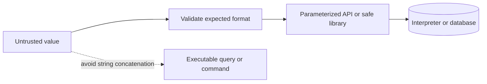

# Injection Attacks

Injection occurs when untrusted input changes the meaning of a command, query, template, or interpreter input. The core defense is to separate data from executable syntax and constrain dangerous capabilities.

## Common classes and defenses
- SQL/NoSQL injection: parameterized queries and safe query builders; never concatenate untrusted query fragments.
- Command injection: avoid shell invocation; use safe APIs and fixed argument arrays.
- XSS: use context-aware output encoding and safe DOM APIs; see the frontend chapter.
- SSRF: allowlist destinations, restrict egress, validate resolved IP ranges, and defend against redirects and DNS rebinding.
- SSTI: never evaluate user-controlled templates; separate template source from values.
- Path traversal: canonicalize paths and enforce storage-root boundaries.

## Secure data flow

Use least privilege for database and service accounts, plus regression tests for maliciously shaped input. References: [OWASP Injection Prevention](https://cheatsheetseries.owasp.org/), [PortSwigger Web Security Academy](https://portswigger.net/web-security).
