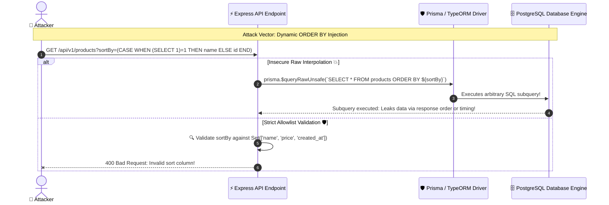

# 🗄️ SQL Injection & ORM Injection Leaks

> Defeating SQLi in modern stacks: Second-order injection, dynamic column ordering risks, ORM escape hatches (`$queryRawUnsafe`), and parameterized queries.

---

## 1. 🎯 Overview & Intuitive Mental Model

### The Production Hook
Many modern engineering teams assume that because they use an Object-Relational Mapper (ORM) like Prisma, TypeORM, or Drizzle, their applications are immune to SQL Injection (CWE-89). **This is a dangerous misconception.**

In real-world production codebases, developers routinely use ORM escape hatches (`prisma.$queryRawUnsafe()`, `typeorm.query(rawSql)`) when writing complex analytics queries, search filters, or dynamic `ORDER BY` clauses. Dynamic sorting (`ORDER BY req.query.sortColumn`) **cannot be parameterized** by database drivers, creating an open backdoor for attackers to extract database tables and password hashes using time-based or error-based blind SQL injection.

### 🧠 The Fun Analogy: The "Rigged ATM Cash Dispenser"
- **Parameterized Query:** You insert your ATM card, select `[CHECK BALANCE]`, and type `[400]`. The ATM firmware treats `400` as an integer counter.
- **SQL Injection:** You walk up to an ATM that accepts free-form handwritten sticky notes. You write: `"Withdraw $20, AND ALSO TRANSFER $1,000,000 FROM VAULT TO MY POCKET"`. The ATM machine executes both commands because it cannot distinguish between your desired withdrawal amount and banking operational instructions.

### Severity & Impact
- **OWASP Category:** [A03:2021 – Injection](https://owasp.org/Top10/A03_2021-Injection/)
- **Common Weakness Enumeration (CWE):** [CWE-89: SQL Injection](https://cwe.mitre.org/data/definitions/89.html)
- **Blast Radius:** Complete database takeover, customer data exfiltration, deletion of production tables, lateral movement to host OS via database extensions (`xp_cmdshell` or `COPY TO PROGRAM`).

---

## 2. 🎨 Interactive Visual Architecture



> 💡 **Visual Inspection Tip:** When auditing backend code, search your repository for `queryRawUnsafe`, `raw(`, `createNativeQuery`, or template strings inside database calls: `\$\{.*\}|\+.*SELECT`. Any dynamic SQL fragment constructed via string concatenation is an immediate high-severity finding.

---

## 3. 💥 Real-World Exploit Walkthrough

### Scenario: The Dynamic Sort & Filter ORM Flaw
An API allows sorting products by various columns. Because ORM query builders do not parameterize table or column names, the developer used a template string.

#### ❌ Vulnerable Route Handler (Node.js / Express / Prisma)
```typescript
// vulnerable-orm-sort.ts
import express from 'express';
import { PrismaClient } from '@prisma/client';

const app = express();
const prisma = new PrismaClient();

// ⚠️ CATASTROPHIC FLAW (ORM SQLi via $queryRawUnsafe):
app.get('/api/products', async (req, res) => {
  const { sortColumn = 'id', sortDirection = 'ASC' } = req.query;

  // Driver parameterization ($1, $2) does NOT work for column names!
  // Developers fall into the trap of using $queryRawUnsafe with template strings:
  const query = `SELECT id, name, price FROM "Product" ORDER BY ${sortColumn} ${sortDirection} LIMIT 10`;
  
  const products = await prisma.$queryRawUnsafe(query);
  res.json(products);
});
```

#### 💥 The Attacker's Exploit Script (Time-Based Blind SQLi)
The attacker injects a PostgreSQL sleep command to verify administrator credentials:
```text
https://target-api.com/api/products?sortColumn=(CASE WHEN (SELECT SUBSTRING(password_hash,1,1) FROM users WHERE role='admin')='a' THEN pg_sleep(5) ELSE id END)
```
If the first character of the password hash is `'a'`, the server delays its response by exactly 5 seconds! By automating this script, the attacker extracts the complete password hash byte by byte.

---

## 4. 🛡️ Resolution & Defense-in-Depth

### Hardened Production Route with Column Allowlists & Parameterization
```typescript
// hardened-orm-sort.ts - BULLETPROOF ORM QUERIES
import express, { Request, Response } from 'express';
import { PrismaClient, Prisma } from '@prisma/client';
import { z } from 'zod';

const app = express();
const prisma = new PrismaClient();

// 🛡️ 1. Explicit Column Allowlist using Enums/Sets
const ALLOWED_SORT_COLUMNS = ['id', 'name', 'price', 'createdAt'] as const;
const ALLOWED_DIRECTIONS = ['asc', 'desc'] as const;

const QuerySchema = z.object({
  sortColumn: z.enum(ALLOWED_SORT_COLUMNS).default('id'),
  sortDirection: z.enum(ALLOWED_DIRECTIONS).default('asc'),
  minPrice: z.coerce.number().positive().optional(),
});

app.get('/api/products', async (req: Request, res: Response) => {
  const parseResult = QuerySchema.safeParse(req.query);
  if (!parseResult.success) {
    return res.status(400).json({ error: 'Invalid sort parameters', details: parseResult.error.format() });
  }

  const { sortColumn, sortDirection, minPrice } = parseResult.data;

  // 🛡️ 2. Use Standard Type-Safe Prisma API (Never use $queryRawUnsafe!)
  const products = await prisma.product.findMany({
    where: minPrice ? { price: { gte: minPrice } } : undefined,
    orderBy: {
      [sortColumn]: sortDirection, // Safe: validated against enum allowlist!
    },
    take: 20,
    select: {
      id: true,
      name: true,
      price: true,
    },
  });

  res.json(products);
});

export default app;
```

---

## 5. 🧪 Hands-On Verification & Lab

### Automated SQL Injection Test (Supertest)
```typescript
// sqli-orm.test.ts
import request from 'supertest';
import app from './hardened-orm-sort';

describe('ORM Column Injection Prevention Suite', () => {
  it('rejects dynamic SQL injection payloads in sortColumn with 400 Bad Request', async () => {
    const maliciousPayload = '(SELECT 1 FROM pg_sleep(5))';
    const res = await request(app).get(`/api/products?sortColumn=${encodeURIComponent(maliciousPayload)}`);

    expect(res.status).toBe(400);
    expect(res.body.error).toContain('Invalid sort parameters');
  });
});
```

---

## 6. 📋 Code Review Checklist

- [ ] **No `queryRawUnsafe`:** Are raw unsafe queries strictly banned by automated linter rules (`@typescript-eslint`)?
- [ ] **Column Name Allowlist:** Are all dynamic `ORDER BY` and `GROUP BY` column names validated against a hardcoded immutable Set?
- [ ] **No String Concatenation in Queries:** Are all database queries constructed using parameterized placeholders or type-safe ORM query builders?
- [ ] **Least-Privilege DB User:** Does the application database user lack administrative privileges (`SUPERUSER`, `DROP DATABASE`, `ALTER SYSTEM`)?
- [ ] **Error Masking:** Are internal database error messages (`pg-error: syntax error at or near...`) caught and replaced with generic user messages?

---

## 7. 🎥 Curated Video Walkthroughs & Primary References

### 📺 High-Impact Video Explanations
- 🎥 [SQL Injection Vulnerabilities & Attacks Explained (Computerphile)](https://www.youtube.com/watch?v=ciNHn38EyRc) — Iconic demonstration of SQL syntax breaking, string literals, and comment terminations.
- 🎥 [Can ORMs Truly Prevent SQL Injection? (Hussein Nasser)](https://www.youtube.com/watch?v=F0_k239Xw4U) — In-depth architectural analysis showing how raw query extensions and dynamic sort columns reintroduce injection flaws.
- 🎥 [Blind SQL Injection with Time Delays (PortSwigger Web Security Academy)](https://www.youtube.com/watch?v=Kz693j_tD3M) — Step-by-step exploit demonstration extracting data bit-by-bit when no query errors are rendered.

### 📖 Primary Documentation & Specifications
- 📜 [OWASP Cheat Sheet: SQL Injection Prevention](https://cheatsheetseries.owasp.org/cheatsheets/SQL_Injection_Prevention_Cheat_Sheet.html) — Gold standard defensive rules covering prepared statements and stored procedures.
- 📜 [OWASP Cheat Sheet: Query Parameterization](https://cheatsheetseries.owasp.org/cheatsheets/Query_Parameterization_Cheat_Sheet.html) — Code implementation patterns across JavaScript/Node.js, Python, Java, and Go.
- 📜 [Prisma ORM: Raw Database Access Security Guidelines](https://www.prisma.io/docs/orm/prisma-client/queries/raw-database-access) — Safe usage of `$queryRaw` tagged templates vs `$queryRawUnsafe`.

### 🧪 Interactive Hands-On Training Labs
- 🎯 [PortSwigger Lab: SQL injection vulnerability allowing retrieval of hidden data](https://portswigger.net/web-security/sql-injection/lab-retrieve-hidden-data) — Exploit a product category filter using `' OR 1=1--`.
- 🎯 [PortSwigger Lab: SQL injection UNION attack, retrieving data from other tables](https://portswigger.net/web-security/sql-injection/union-attacks/lab-retrieve-data-from-other-tables) — Extract password hashes from underlying administrative tables.
- 🎯 [PortSwigger Lab: Blind SQL injection with time delays](https://portswigger.net/web-security/sql-injection/blind/lab-time-delays) — Trigger conditional sleep pauses inside database query engines.

