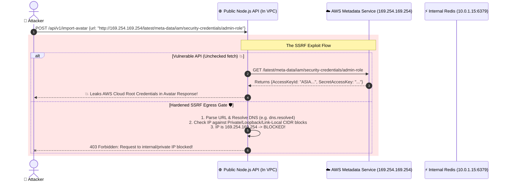

# 🌐 Server-Side Request Forgery (SSRF) Deep-Dive

> Defeating Server-Side Request Forgery: Cloud metadata theft (`169.254.169.254`), internal port scanning, DNS rebinding, and egress zero-trust validation.

---

## 1. 🎯 Overview & Intuitive Mental Model

### The Production Hook
**Server-Side Request Forgery (SSRF / API7:2023)** occurs whenever a server-side web application fetches a remote URL provided by an untrusted client (e.g. *"Import avatar from URL"*, *"Webhook testing endpoint"*, or *"Generate PDF from webpage"*) without verifying that the destination IP belongs to the public internet.

Because backend servers frequently sit inside private virtual networks (AWS VPC, GCP VPC, Kubernetes cluster) with unauthenticated network access to internal microservices, Redis caches, and cloud instance metadata endpoints (`http://169.254.169.254`), an SSRF vulnerability allows an external attacker to **weaponize your own server as a proxy to attack your internal infrastructure from the inside**.

### 🧠 The Fun Analogy: The "Conned Bank Courier"
- Imagine a bank security guard stationed inside a private subterranean vault. The guard has strict orders: *"If a citizen at the front desk hands you an envelope and says 'Deliver this to 123 Main Street', you must walk outside and deliver it."*
- **The SSRF Attack:** An attacker hands the guard an envelope with the destination address written as: `"The Master Safe in Room B-12 down the hall"`.
- Because the guard is already inside the vault past all exterior checkpoints, the guard walks down the hall, opens Room B-12, reads the secret combination on the wall, and writes it on a postcard back to the attacker!
- **The Defense:** The bank inspects the destination address before the guard moves a single step: *"Is this address inside our private building? If yes, REJECT! Only public postal addresses allowed."*

### Severity & Impact
- **OWASP Category:** [A10:2021 – Server-Side Request Forgery (SSRF)](https://owasp.org/Top10/A10_2021-Server-Side_Request_Forgery_%28SSRF%29/), [API7:2023 – Server-Side Request Forgery](https://owasp.org/API-Security/editions/2023/en/0xa7-server-side-request-forgery/)
- **Common Weakness Enumeration (CWE):** [CWE-918: Server-Side Request Forgery (SSRF)](https://cwe.mitre.org/data/definitions/918.html)
- **Blast Radius:** Full AWS IAM role extraction, Kubernetes service account token theft, internal database compromise, remote code execution via internal Redis endpoints (`gopher://`).

---

## 2. 🎨 Interactive Visual Architecture



> 💡 **Visual Inspection Tip:** In AWS environments, test if your EC2 instances enforce **IMDSv2** (Instance Metadata Service Version 2). Run `curl http://169.254.169.254/latest/meta-data/`. If it returns data without requiring a `X-aws-ec2-metadata-token` session header, IMDSv1 is active and vulnerable to simple SSRF attacks!

---

## 3. 💥 Real-World Exploit Walkthrough

### Scenario: The "Webhook / URL Preview" SSRF Catastrophe
A modern project management app allowed users to paste link previews or set up webhook endpoints.

#### ❌ Vulnerable Route Handler (Node.js / Express)
```typescript
// vulnerable-ssrf.ts
import express from 'express';
import axios from 'axios';

const app = express();
app.use(express.json());

// ⚠️ CATASTROPHIC FLAW (SSRF - CWE-918):
// Blindly fetches arbitrary client-supplied URLs from the server network!
app.post('/api/url-preview', async (req, res) => {
  const { targetUrl } = req.body;

  try {
    const response = await axios.get(targetUrl, { timeout: 3000 });
    res.json({ title: 'Preview Content', data: response.data });
  } catch (err: any) {
    res.status(500).json({ error: 'Failed to fetch preview' });
  }
});
```

#### 💥 The Attacker's Exploit Script
```bash
# 1. Steal AWS IAM temporary credentials
curl -X POST https://target-app.com/api/url-preview \
  -H "Content-Type: application/json" \
  -d '{"targetUrl": "http://169.254.169.254/latest/meta-data/iam/security-credentials/"}'

# 2. Extract internal Kubernetes service tokens
curl -X POST https://target-app.com/api/url-preview \
  -H "Content-Type: application/json" \
  -d '{"targetUrl": "http://127.0.0.1:10255/pods"}'

# 3. Scan internal VPC IP space
curl -X POST https://target-app.com/api/url-preview \
  -H "Content-Type: application/json" \
  -d '{"targetUrl": "http://10.0.0.15:6379"}'
```

---

## 4. 🛡️ Resolution & Defense-in-Depth

### The Production Blueprint: Safe DNS Resolution & IP CIDR Block Filtering
To prevent DNS rebinding and Time-of-Check to Time-of-Use (TOCTOU) exploits:
1. Resolve the hostname to an IP address using `dns.lookup()`.
2. Inspect the IP address against an allowlist/denylist of banned ranges (private, loopback, link-local, multicast).
3. Pin the socket directly to the resolved IP address when opening the HTTP connection!

```typescript
// hardened-ssrf-validator.ts - BULLETPROOF SSRF DEFENSE
import dns from 'dns/promises';
import ipaddr from 'ipaddr.js';

// 🛡️ Comprehensive list of private and dangerous IP ranges
const RESTRICTED_RANGES = [
  'unspecified', // 0.0.0.0/8
  'loopback',    // 127.0.0.0/8
  'private',     // 10.0.0.0/8, 172.16.0.0/12, 192.168.0.0/16
  'linkLocal',   // 169.254.0.0/16 (AWS / GCP / Azure Cloud Metadata)
  'carrierGradeNat', // 100.64.0.0/10
  'broadcast',   // 255.255.255.255/32
];

export async function validateSafePublicUrl(rawUrl: string): Promise<string> {
  const parsed = new URL(rawUrl);

  // 🛡️ 1. Restrict protocols strictly to HTTP and HTTPS (Blocks file://, gopher://, ftp://)
  if (parsed.protocol !== 'http:' && parsed.protocol !== 'https:') {
    throw new Error('Invalid protocol: Only HTTP and HTTPS are permitted.');
  }

  // 🛡️ 2. Resolve DNS hostname to IPv4/IPv6
  const addresses = await dns.lookup(parsed.hostname, { all: true });
  if (addresses.length === 0) {
    throw new Error('Unable to resolve target hostname.');
  }

  // 🛡️ 3. Inspect every resolved IP address
  for (const { address } of addresses) {
    const parsedIp = ipaddr.parse(address);
    const range = parsedIp.range();

    if (RESTRICTED_RANGES.includes(range)) {
      throw new Error(`SSRF Blocked: Destination IP ${address} is in restricted range '${range}'.`);
    }
  }

  return rawUrl;
}
```

### Infrastructure Hardening: Enforce IMDSv2 in AWS
Always configure EC2 instances to require **IMDSv2** (tokens required for all metadata requests):
```bash
aws ec2 modify-instance-metadata-options \
    --instance-id i-1234567890abcdef0 \
    --http-tokens required \
    --http-put-response-hop-limit 1 \
    --http-endpoint enabled
```
With `http-tokens required`, standard SSRF `GET` requests cannot retrieve AWS credentials!

---

## 5. 🧪 Hands-On Verification & Lab

### Automated SSRF Defense Unit Test (Vitest)
```typescript
// ssrf.test.ts
import { describe, it, expect } from 'vitest';
import { validateSafePublicUrl } from './hardened-ssrf-validator';

describe('SSRF Egress Security Suite', () => {
  it('blocks link-local cloud metadata service IP (169.254.169.254)', async () => {
    await expect(validateSafePublicUrl('http://169.254.169.254/latest/meta-data/')).rejects.toThrow(
      'restricted range'
    );
  });

  it('blocks localhost and loopback interfaces (127.0.0.1 and localhost)', async () => {
    await expect(validateSafePublicUrl('http://127.0.0.1:8080/admin')).rejects.toThrow('restricted range');
    await expect(validateSafePublicUrl('http://localhost:3000/api')).rejects.toThrow('restricted range');
  });

  it('blocks private VPC ranges (10.0.0.1 and 192.168.1.1)', async () => {
    await expect(validateSafePublicUrl('http://10.0.0.15/internal')).rejects.toThrow('restricted range');
    await expect(validateSafePublicUrl('http://192.168.1.100/status')).rejects.toThrow('restricted range');
  });

  it('allows verified public internet URLs', async () => {
    const safeUrl = await validateSafePublicUrl('https://example.com/logo.png');
    expect(safeUrl).toBe('https://example.com/logo.png');
  });
});
```

---

## 6. 📋 Code Review Checklist

- [ ] **Protocol Restricted:** Are outbound network calls strictly restricted to `http:` and `https:`?
- [ ] **DNS IP Range Validation:** Does the application resolve hostnames and verify that the target IP does NOT reside in private or link-local ranges (`127.0.0.0/8`, `10.0.0.0/8`, `169.254.0.0/16`)?
- [ ] **IMDSv2 Enforced:** Is AWS IMDSv2 (`http-tokens: required`) enforced on all EC2 instances and ECS tasks?
- [ ] **Disable HTTP Redirects:** Does the outbound HTTP client disable automatic redirects (`maxRedirects: 0`), or re-validate every redirect hop?
- [ ] **Network Egress Firewalls:** Are production worker nodes egress-restricted at the VPC security group level to prevent direct intranet scanning?

---

## 7. 🎥 Curated Video Walkthroughs & Primary References

### 📺 High-Impact Video Explanations
- 🎥 [Server-Side Request Forgery (SSRF) Explained (PwnFunction)](https://www.youtube.com/watch?v=D1S-G8rGdc4) — Crisp animated walkthrough showing how web servers are manipulated into internal proxies.
- 🎥 [SSRF to AWS Cloud Takeover (LiveOverflow)](https://www.youtube.com/watch?v=ar-Gk1m_oQo) — Real-world exploit chain demonstrating AWS EC2 metadata credential extraction (`169.254.169.254`).
- 🎥 [What is DNS Rebinding? (Computerphile - Dr. Mike Pound)](https://www.youtube.com/watch?v=FmW_k8kdtoc) — How attackers bypass IP allowlists using fast-flux DNS rebinding.

### 📖 Primary Documentation & Specifications
- 📜 [OWASP API Security: API7:2023 Server-Side Request Forgery](https://owasp.org/API-Security/editions/2023/en/0xa7-server-side-request-forgery/) — Official OWASP API security reference.
- 📜 [OWASP Server-Side Request Forgery Prevention Cheat Sheet](https://cheatsheetseries.owasp.org/cheatsheets/Server_Side_Request_Forgery_Prevention_Cheat_Sheet.html) — Defense-in-depth network architecture rules.
- 📜 [AWS Documentation: Transitioning to IMDSv2](https://docs.aws.amazon.com/AWSEC2/latest/UserGuide/configuring-instance-metadata-service.html) — Official guide to enforcing session-oriented token metadata access.

### 🧪 Interactive Hands-On Training Labs
- 🎯 [PortSwigger Lab: Basic SSRF against the local server](https://portswigger.net/web-security/ssrf/lab-basic-ssrf-against-localhost) — Access internal admin interface via loopback manipulation.
- 🎯 [PortSwigger Lab: Basic SSRF against another back-end system](https://portswigger.net/web-security/ssrf/lab-basic-ssrf-against-backend-system) — Scan private internal IP ranges (`192.168.0.X`) through an external facing API.
