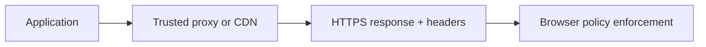

# HTTP, Network, and Headers

Transport security and response headers reduce exposure but do not replace application authorization or safe coding. Configure headers deliberately and test behavior in real deployment paths, including reverse proxies and CDNs.

## 📚 Deep Dive Guides in This Section
- 📖 [HTTPS, TLS 1.3 & PKI: How Browsers Verify Website Security](./https-tls-pki-browser-trust.md) — Step-by-step cryptographic walkthrough of Root CA stores, X.509 chains of trust, OCSP stapling, Certificate Transparency, and why browser warnings trigger.
- 📖 [NGINX Masterclass: Architecture, Reverse Proxy, Microcaching & Hardening](./nginx-reverse-proxy-and-hardening.md) — Exhaustive masterclass on epoll event loop architecture, location matching priority, trailing-slash proxying, microcaching, WebSockets/SSE, rate limiting, and troubleshooting 502/504 errors.

## Review
- Enforce HTTPS and configure TLS through a supported platform; evaluate HSTS before rollout.
- Set CSP, frame-ancestors, nosniff, and an appropriate referrer policy according to application needs.
- Use Cache-Control carefully for authenticated or sensitive responses.
- Configure CORS with explicit trusted origins when credentials are involved; never reflect arbitrary origins.
- Trust forwarded headers only from known proxy infrastructure.
- Remove verbose server banners where feasible and avoid leaking stack traces.

## Browser response path

References: [MDN HTTP](https://developer.mozilla.org/en-US/docs/Web/HTTP), [MDN CSP](https://developer.mozilla.org/en-US/docs/Web/HTTP/CSP), [MDN CORS](https://developer.mozilla.org/en-US/docs/Web/HTTP/CORS).

---

## 7. 🎥 Curated Video Walkthroughs & Primary References

### 📺 High-Impact Video Explanations
- 🎥 [HTTP Security Headers Explained: HSTS, CSP, X-Frame-Options (ByteByteGo)](https://www.youtube.com/watch?v=GHRNEv_zZ7c) — Visual breakdown of the most critical browser defense headers and how they prevent exploitation.
- 🎥 [TLS/HTTPS Handshake Deep Dive (Hussein Nasser)](https://www.youtube.com/watch?v=86cQjh4aX1U) — Deep networking analysis of TLS 1.3 certificates, key exchanges, and downgrade attack prevention.
- 🎥 [HTTP Request Smuggling & Header Manipulation (PortSwigger Web Security Academy)](https://www.youtube.com/watch?v=wXPhb4q1k_s) — Exploit demonstration of frontend reverse proxy vs backend discrepancy flaws.

### 📖 Primary Documentation & Specifications
- 📜 [MDN Web Docs: HTTP Headers Reference](https://developer.mozilla.org/en-US/docs/Web/HTTP/Headers) — Comprehensive encyclopedia of all standard HTTP response headers.
- 📜 [IETF RFC 6797: HTTP Strict Transport Security (HSTS)](https://datatracker.ietf.org/doc/html/rfc6797) — Authoritative standard on mandatory TLS enforcement and preloading.
- 📜 [OWASP Secure Headers Project](https://owasp.org/www-project-secure-headers/) — Standard configuration blueprints for enterprise reverse proxies and web applications.

### 🧪 Interactive Hands-On Training Labs & Tools
- 🎯 [Mozilla Observatory](https://observatory.mozilla.org/) — Free automated scanner to audit and grade your domain's live HTTP security headers.
- 🎯 [PortSwigger Lab: HTTP Request Smuggling basic CL.TE vulnerability](https://portswigger.net/web-security/request-smuggling/lab-basic-cl-te) — Hands-on lab exploiting Content-Length vs Transfer-Encoding header ambiguities.

