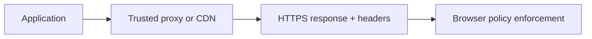

# HTTP, Network, and Headers

Transport security and response headers reduce exposure but do not replace application authorization or safe coding. Configure headers deliberately and test behavior in real deployment paths, including reverse proxies and CDNs.

## Review
- Enforce HTTPS and configure TLS through a supported platform; evaluate HSTS before rollout.
- Set CSP, frame-ancestors, nosniff, and an appropriate referrer policy according to application needs.
- Use Cache-Control carefully for authenticated or sensitive responses.
- Configure CORS with explicit trusted origins when credentials are involved; never reflect arbitrary origins.
- Trust forwarded headers only from known proxy infrastructure.
- Remove verbose server banners where feasible and avoid leaking stack traces.

## Browser response path

References: [MDN HTTP](https://developer.mozilla.org/en-US/docs/Web/HTTP), [MDN CSP](https://developer.mozilla.org/en-US/docs/Web/HTTP/CSP), [MDN CORS](https://developer.mozilla.org/en-US/docs/Web/HTTP/CORS).
