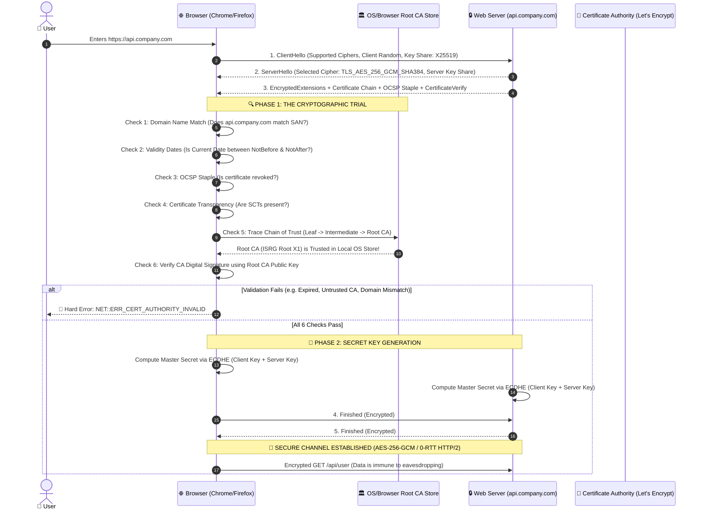

# HTTPS, TLS 1.3 & PKI: How Browsers Verify Website Security

## 1. 🎯 Overview & Intuitive Mental Model

Every time you type a URL into a modern browser and see the lock icon or a severe warning screen (**"Your connection is not private / NET::ERR_CERT_AUTHORITY_INVALID"**), your browser has executed a multi-step cryptographic courtroom trial in under 30 milliseconds.

Understanding how a browser validates identity and establishes confidentiality over an untrusted network is fundamental to web security.

```
+----------------------------------------------------------------------------------------------------+
|                                    🧠 THE PHYSICAL ANALOGY                                         |
|                                                                                                    |
|  🛂 Passport Control at an International Border (The PKI Trust Model):                              |
|     1. You (The Web Server) hand your Passport (X.509 Certificate) to the Border Guard (The Browser)|
|     2. The Border Guard does NOT know you personally.                                              |
|     3. The Guard checks the Holographic Official Seal on your passport (Digital Signature).       |
|     4. The Guard matches the seal against the Official Government Registry pre-loaded in their     |
|        terminal (The Browser's Root Certificate Store).                                            |
|     5. The Guard checks your name (Domain SAN match) and the expiration date (Not After check).     |
|     6. The Guard checks if this passport was reported stolen (OCSP Stapling / Revocation Check).    |
|     7. If everything passes, you step into a soundproof diplomatic room to speak in secret         |
|        (Symmetric Encryption via TLS 1.3).                                                         |
+----------------------------------------------------------------------------------------------------+
```

### Threat & Integrity Matrix
- **OWASP Category:** A02:2021 – Cryptographic Failures & A05:2021 – Security Misconfiguration
- **CWE Identifiers:** [CWE-295: Improper Certificate Validation](https://cwe.mitre.org/data/definitions/295.html), [CWE-319: Cleartext Transmission of Sensitive Information](https://cwe.mitre.org/data/definitions/319.html)
- **Blast Radius:** Total Man-in-the-Middle (MitM) traffic interception, credential harvesting, session hijacking, rogue certificate injection.

---

## 2. 🎨 Interactive Visual Architecture

### The TLS 1.3 Handshake & Browser Certificate Validation Trial



> 💡 **Visual Inspection Tip:** In Google Chrome, press `F12` -> Navigate to the **Security** tab. Click **"View certificate"**. Look under **Details** -> **Certificate Subject Alternative Name (SAN)**. This is the exact field the browser matches against the URL bar!

---

## 3. 💥 Real-World Exploit Walkthrough

### The "Rogue Wi-Fi / Coffee Shop" SSL Stripping & MitM Attack

When an attacker controls the local network (e.g., untrusted airport Wi-Fi or compromised ARP routing), they attempt to intercept communications by breaking the browser's trust verification.

#### Vulnerable Scenario: Missing HSTS & Ignored Certificate Warnings
```html
<!-- Victim visits an insecure site or ignores certificate mismatch -->
<!-- Attacker sets up a rogue proxy with a self-signed certificate -->
```

```bash
# Attacker runs mitmproxy on the local network router
mitmproxy --mode transparent --listen-port 8080
```

#### Attacker Exploit Execution Breakdown
1. **ARP Spoofing:** Attacker poisons the ARP cache, routing all traffic from the victim's laptop through the attacker's machine.
2. **Untrusted Certificate Presentation:** When the victim browses to `https://bank.com`, the attacker generates an on-the-fly certificate signed by `Attacker Fake CA`.
3. **Browser Cryptographic Inspection:**
   - Browser looks up `Attacker Fake CA` in its built-in Root Store.
   - **Root Store Lookup: MISSING!**
   - The browser halts execution and displays the iconic red warning screen:
     ```text
     Your connection is not private
     Attackers might be trying to steal your information from bank.com...
     NET::ERR_CERT_AUTHORITY_INVALID
     ```
4. **The Critical Human Vulnerability:** If a developer or user clicks **"Advanced -> Proceed to site (unsafe)"**, the browser disables its cryptographic shield. The attacker decrypts all passwords, cookies, and tokens in plaintext!

---

## 4. 🛡️ Deep Dive: The 7 Core Checks That Make Browsers Trust a Website

### Check 1: The Pre-Installed Root Certificate Store
Browsers and Operating Systems do not guess trust; they maintain a strictly audited repository of trusted **Root Certificate Authorities (CAs)**:
- **Mozilla NSS Root Store:** Powers Firefox and Linux distros.
- **Microsoft Trusted Root Certificate Program:** Powers Windows OS and Edge.
- **Apple Trust Store:** Powers macOS, iOS, and Safari.
- **Chrome Root Store (CRS):** Google Chrome’s own independent multi-platform root store.

To join a root store, CAs (like Let's Encrypt, DigiCert, Sectigo) must undergo rigorous annual WebTrust audits and adhere to strict CA/Browser Forum baseline requirements.

---

### Check 2: The Chain of Trust (Hierarchical Validation)
A server almost never serves a certificate directly signed by a Root CA (because exposing the Root CA private key online is too risky; Root CAs are stored in offline air-gapped vaults). Instead, a **Chain of Trust** is used:

```
[🏛️ Root CA (ISRG Root X1)]
      │  (Stored safely in Browser/OS Root Store)
      ▼  Signed using Root Private Key
[🏢 Intermediate CA (R3)]
      │  (Transmitted by Web Server during Handshake)
      ▼  Signed using Intermediate Private Key
[📄 Leaf / End-Entity Certificate (*.company.com)]
      │  (Contains Server Public Key + Domain Name)
      ▼
[🌐 Browser Validates Mathematical Signatures Up the Chain]
```

The browser verifies that:
$$\text{Signature}_{\text{Leaf}} = \text{Decrypt}(\text{Sign}_{\text{Leaf}}, \text{PublicKey}_{\text{Intermediate}})$$
$$\text{Signature}_{\text{Intermediate}} = \text{Decrypt}(\text{Sign}_{\text{Intermediate}}, \text{PublicKey}_{\text{Root}})$$

---

### Check 3: Domain Validation via Subject Alternative Name (SAN)
- Legacy browsers validated the `Common Name (CN)` field (e.g., `CN=company.com`).
- **Modern Rule (RFC 5280 / CA/B Forum):** Browsers completely ignore `CN` and strictly validate the **Subject Alternative Name (SAN)** extension:
  ```text
  X509v3 Subject Alternative Name:
      DNS:company.com, DNS:www.company.com, DNS:api.company.com
  ```
- If you request `https://auth.company.com` and the certificate SAN only lists `company.com`, the browser instantly aborts with `NET::ERR_CERT_COMMON_NAME_INVALID`.

---

### Check 4: Temporal Validity (Time Check)
Every certificate defines a strict validity window:
- `Not Before: Oct 1 00:00:00 2026 GMT`
- `Not After:  Dec 30 23:59:59 2026 GMT`
- **Modern CA/B Rule:** Certificates cannot exceed **398 days** (and industry standard is moving towards 90 days via Let's Encrypt to minimize exposure).
- If the client's local system clock is outside this window, the browser reports `NET::ERR_CERT_DATE_INVALID`.

---

### Check 5: Certificate Revocation (CRL vs. OCSP vs. OCSP Stapling)
If a server's private key is compromised, the certificate must be invalidated immediately before its official expiration date.

| Revocation Mechanism | How It Works | Trade-Offs / Weaknesses |
|---|---|---|
| **CRL (Certificate Revocation List)** | Browser downloads a signed list of all revoked serial numbers published by the CA. | High bandwidth, slow, quickly becomes out of date. |
| **OCSP (Online Certificate Status Protocol)** | Browser queries the CA's live server during the TLS handshake: *"Is serial #1234 valid?"* | Severe latency penalty (+100–300ms) and privacy leak (CA sees every website you visit). |
| **🛡️ OCSP Stapling (RFC 6066)** | **The Modern Standard:** The web server queries the CA periodically (e.g. hourly), caches the CA's cryptographically signed timestamped response, and **staples** it directly into the initial TLS handshake. | Zero latency penalty, 100% privacy-preserving, verified instantly by browser. |

---

### Check 6: Certificate Transparency (CT Logs)
To prevent rogue or compromised CAs from secretly issuing unauthorized certificates for domains (e.g., a rogue CA issuing a fake `google.com` certificate):
- Every valid certificate **MUST** be publicly logged in append-only cryptographic Merkle tree logs monitored by Google, Cloudflare, and security researchers.
- Certificates include **Signed Certificate Timestamps (SCTs)** embedded in the X.509 extensions.
- If a browser does not find valid SCTs, it refuses the connection!

---

### Check 7: TLS 1.3 Key Exchange (Forward Secrecy)
Once the certificate is proven genuine, the browser and server establish symmetric encryption:
- Uses **ECDHE (Elliptic Curve Diffie-Hellman Ephemeral)** over curve `X25519`.
- **Perfect Forward Secrecy (PFS):** The server's certificate private key is only used for authentication (signing the handshake), **never** for decrypting session traffic. Even if an attacker steals the server's private key a year later, past recorded traffic can **never** be decrypted!
- Payload data is encrypted using authenticated symmetric ciphers: **AES-256-GCM** or **ChaCha20-Poly1305**.

---

### Production Hardened Configuration: Automated Let's Encrypt + NGINX

```bash
# 1. Automated ACME Certificate Provisioning via Certbot (90-day auto-rotation)
certbot certonly --nginx \
  -d company.com \
  -d api.company.com \
  --rsa-key-size 4096 \
  --must-staple
```

#### Production NGINX TLS 1.3 Configuration (`/etc/nginx/conf.d/tls-hardened.conf`)
```nginx
# tls-hardened.conf - ENTERPRISE TLS 1.3 ENGINE
server {
    listen 443 ssl http2;
    listen [::]:443 ssl http2;
    server_name api.company.com;

    # 🛡️ Modern Fullchain Certificate & Private Key
    ssl_certificate /etc/letsencrypt/live/api.company.com/fullchain.pem;
    ssl_certificate_key /etc/letsencrypt/live/api.company.com/privkey.pem;

    # 🛡️ Enforce TLS 1.3 as Primary Protocol (Disable broken SSLv3, TLS 1.0, TLS 1.1)
    ssl_protocols TLSv1.2 TLSv1.3;
    ssl_prefer_server_ciphers off;

    # 🛡️ Pinned Modern Authenticated Ciphers (AEAD only)
    ssl_ciphers ECDHE-ECDSA-AES128-GCM-SHA256:ECDHE-RSA-AES128-GCM-SHA256:ECDHE-ECDSA-AES256-GCM-SHA384:ECDHE-RSA-AES256-GCM-SHA384:ECDHE-ECDSA-CHACHA20-POLY1305:ECDHE-RSA-CHACHA20-POLY1305;

    # 🛡️ OCSP Stapling (Enables instant, private revocation checks in browser)
    ssl_stapling on;
    ssl_stapling_verify on;
    ssl_trusted_certificate /etc/letsencrypt/live/api.company.com/chain.pem;
    resolver 1.1.1.1 8.8.8.8 valid=300s;
    resolver_timeout 5s;

    # 🛡️ HSTS Preloading: Forbid plain HTTP forever
    add_header Strict-Transport-Security "max-age=63072000; includeSubDomains; preload" always;

    location / {
        proxy_pass http://localhost:3000;
    }
}
```

---

## 5. 🧪 Hands-On Verification & Lab

### 1. Inspect TLS Handshake & Certificate Chain via `openssl`
```bash
# Connect and dump the full certificate verification trial
openssl s_client -connect api.company.com:443 -status -servername api.company.com
```

#### What to Verify in Output:
```text
CONNECTED(00000003)
depth=2 C = US, O = Internet Security Research Group, CN = ISRG Root X1
verify return:1
depth=1 C = US, O = Let's Encrypt, CN = R3
verify return:1
depth=0 CN = api.company.com
verify return:1
---
Certificate chain
 0 s:CN = api.company.com
   i:C = US, O = Let's Encrypt, CN = R3
 1 s:C = US, O = Let's Encrypt, CN = R3
   i:C = US, O = Internet Security Research Group, CN = ISRG Root X1
---
OCSP Response:
    OCSP Response Status: successful (0x0)
    Cert Status: good
---
Verify return code: 0 (ok)
```
*(Notice: `Verify return code: 0 (ok)` and `OCSP Response Status: successful (0x0)` prove end-to-end browser cryptographic trust).*

### 2. Automated Certificate & HSTS Integration Test (Vitest)
```typescript
// tls-security.test.ts
import { describe, it, expect } from 'vitest';
import https from 'https';
import tls from 'tls';

describe('Production HTTPS & TLS Verification Suite', () => {
  it('confirms server certificate is valid and issued by a trusted root CA', async () => {
    const options: https.RequestOptions = {
      hostname: 'api.company.com',
      port: 443,
      method: 'GET',
      rejectUnauthorized: true, // Strictly fail if CA is invalid or self-signed
    };

    const isSecure = await new Promise<boolean>((resolve, reject) => {
      const req = https.request(options, (res) => {
        const cert = (res.socket as tls.TLSSocket).getPeerCertificate();
        
        // Assert certificate is active and not expired
        const validTo = new Date(cert.valid_to).getTime();
        expect(validTo).toBeGreaterThan(Date.now());

        // Assert HSTS header is active
        const hsts = res.headers['strict-transport-security'];
        expect(hsts).toBeDefined();
        expect(hsts).toContain('max-age=63072000');

        resolve(true);
      });

      req.on('error', (err) => reject(err));
      req.end();
    });

    expect(isSecure).toBe(true);
  });
});
```

---

## 6. 📋 Code Review Checklist

- [ ] **Automated ACME Rotation:** Are certificates automatically renewed via Let's Encrypt / Certbot before expiration?
- [ ] **SAN Matching:** Are all primary domains and subdomains explicitly listed under the Subject Alternative Name (SAN) extension?
- [ ] **TLS 1.3 / 1.2 Only:** Are deprecated legacy protocols (`SSLv2`, `SSLv3`, `TLS 1.0`, `TLS 1.1`) disabled?
- [ ] **OCSP Stapling Enabled:** Are `ssl_stapling on;` and `ssl_stapling_verify on;` configured to eliminate browser validation delays?
- [ ] **HSTS with Preload:** Does the server return `Strict-Transport-Security: max-age=63072000; includeSubDomains; preload`?
- [ ] **DNS CAA Records Configured:** Are DNS Certification Authority Authorization (CAA) records published (e.g. `company.com. CAA 0 issue "letsencrypt.org"`) to forbid unauthorized CAs from issuing certs?
- [ ] **No Mixed Content:** Are all assets, scripts, images, and API endpoints loaded strictly over `https://`?

---

## 7. 🎥 Curated Video Walkthroughs & Primary References

### 📺 High-Impact Video Explanations
- 🎥 [How HTTPS Works: TLS 1.3 & PKI Cryptography Explained (Computerphile)](https://www.youtube.com/watch?v=17U0Gj5bZtw) — Iconic visual demonstration of asymmetric public keys, symmetric session encryption, and digital signatures.
- 🎥 [TLS 1.3 Handshake Deep Dive (Hussein Nasser)](https://www.youtube.com/watch?v=86cQjh4aX1U) — Wire-level packet inspection of 1-RTT handshake, ECDHE key shares, and zero-round-trip session resumption.
- 🎥 [Public Key Infrastructure (PKI) & Digital Certificates (ByteByteGo)](https://www.youtube.com/watch?v=0P4LxFbU_y4) — Clear architectural breakdown of Root CAs, Intermediate CAs, and OS Trust Stores.

### 📖 Primary Documentation & Specifications
- 📜 [IETF RFC 8446: The Transport Layer Security (TLS) Protocol Version 1.3](https://datatracker.ietf.org/doc/html/rfc8446) — The authoritative internet standard defining TLS 1.3.
- 📜 [CA/Browser Forum Baseline Requirements](https://cabforum.org/baseline-requirements-documents/) — Mandatory global rules governing certificate issuance and validation.
- 📜 [IETF RFC 6066: TLS Extensions (OCSP Stapling)](https://datatracker.ietf.org/doc/html/rfc6066) — Specification for Certificate Status Request extension.
- 📜 [MDN Web Docs: How Browsers Verify HTTPS Connections](https://developer.mozilla.org/en-US/docs/Web/Security/Transport_Layer_Security) — Browser trust model documentation.

### 🧪 Interactive Hands-On Training Labs & Tools
- 🎯 [Qualys SSL Labs: SSL Server Test](https://www.ssllabs.com/ssltest/) — World standard testing tool analyzing certificate chains, cipher strength, and browser compatibility.
- 🎯 [BadSSL.com Interactive Broken Certificate Sandbox](https://badssl.com/) — Test your browser against deliberately broken SSL certificates (expired, wrong host, self-signed, revoked).
