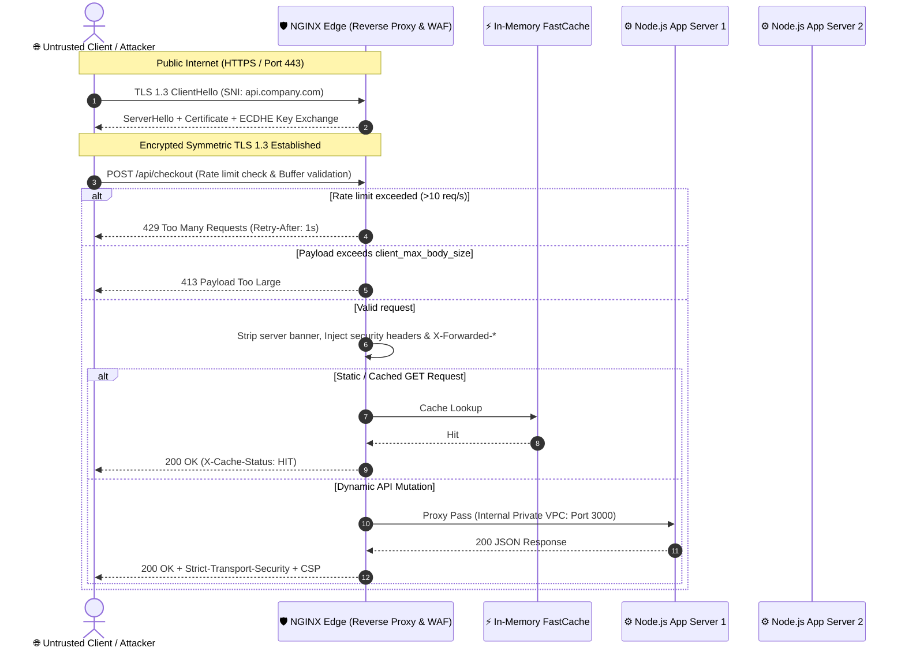

# NGINX Reverse Proxy, Load Balancing & Production Hardening

## 1. 🎯 Overview & Intuitive Mental Model

In modern frontend and distributed API architectures, frontend single-page apps (SPAs) and microservices should almost never be directly exposed to the open internet. 

**NGINX** acts as the high-performance gatekeeper, traffic cop, and armor standing between chaotic public traffic and your private application cluster.

```
+----------------------------------------------------------------------------------------------------+
|                                    🧠 THE PHYSICAL ANALOGY                                         |
|                                                                                                    |
|  🏢 The Corporate Office Front Desk (NGINX):                                                       |
|     - Unvetted visitors cannot wander into employee desks (backend microservices).                 |
|     - The security guard inspects IDs (TLS termination & certificates).                            |
|     - The front desk queues visitors so staff aren't swamped (Rate Limiting & Throttling).          |
|     - The front desk hands out pre-printed company brochures instantly without bothering           |
|       executives (Static File Caching & Gzip/Brotli).                                              |
|     - If Worker A is overwhelmed or on break, the receptionist guides visitors to Worker B         |
|       (Upstream Load Balancing).                                                                   |
+----------------------------------------------------------------------------------------------------+
```

### Vulnerability & Operational Severity Matrix
- **OWASP Category:** A05:2021 – Security Misconfiguration & A04:2021 – Insecure Design
- **CWE Identifiers:** [CWE-200: Exposure of Sensitive Information](https://cwe.mitre.org/data/definitions/200.html), [CWE-400: Uncontrolled Resource Consumption (DoS)](https://cwe.mitre.org/data/definitions/400.html)
- **Blast Radius:** Slowloris DoS collapse, backend service crash, internal IP leakage, SSL/TLS downgrade, unmitigated volumetric scraping.

---

## 2. 🎨 Interactive Visual Architecture

### NGINX Reverse Proxy, TLS Offloading & Upstream Load Balancing Pipeline



> 💡 **Visual Inspection Tip:** Inspect your application's HTTP response headers using `curl -I https://your-domain.com`. If you see `Server: nginx/1.18.0 (Ubuntu)`, your server is leaking exact OS and patch versions! Hardened NGINX configurations must return `Server: nginx` or remove the banner entirely.

---

## 3. 💥 Real-World Exploit Walkthrough

### The "Slowloris" Denial-of-Service & Information Leakage Vulnerability

When NGINX is misconfigured or when applications are exposed directly without a hardened reverse proxy, attackers exploit default connection timeouts using **Slowloris**.

#### Vulnerable Default Configuration (`nginx.conf`)
```nginx
# vulnerable-nginx.conf - DANGEROUS DEFAULTS
http {
    # 💥 FLAW 1: Leaks exact version number in error pages and headers
    server_tokens on;

    # 💥 FLAW 2: Huge client header and body timeouts allow Slowloris socket exhaustion
    client_body_timeout 60s;
    client_header_timeout 60s;
    keepalive_timeout 75s;

    # 💥 FLAW 3: Unlimited client payload size allows disk/memory exhaustion
    client_max_body_size 0;

    server {
        listen 80;
        server_name api.company.com;

        # 💥 FLAW 4: Missing rate limits and missing upstream failure timeouts
        location / {
            proxy_pass http://localhost:3000;
        }
    }
}
```

#### Attacker Exploit Execution
An attacker uses Slowloris to open hundreds of HTTP connections, sending header bytes at an agonizingly slow pace (1 byte every 15 seconds):

```bash
# Attacker initiates 500 slow header connections
slowloris api.company.com -p 80 -s 500
```

#### Breakdown of Failure
1. **Thread / Socket Starvation:** Default large timeouts keep file descriptors open indefinitely waiting for incomplete headers.
2. **Server Banner Fingerprinting:** Attacker triggers a `404` or `500` error and receives `Server: nginx/1.18.0 (Ubuntu)`. The attacker looks up known CVEs for that specific unpatched Ubuntu package.
3. **Backend Collapse:** Legitimate clients attempting to connect encounter `Connection Timed Out`.

---

## 4. 🛡️ Resolution & Complete Production Implementation

### Hardened Production Configuration (`/etc/nginx/nginx.conf`)

```nginx
# nginx-hardened.conf - ENTERPRISE PRODUCTION CONFIGURATION
user nginx;
pid /var/run/nginx.pid;

# 🛡️ 1. Worker Configuration
# Automatically binds 1 worker process per physical CPU core
worker_processes auto;
worker_rlimit_nofile 65535; # Allow high file-descriptor limits

events {
    # epoll (Linux) or kqueue (macOS/BSD) high-performance event loop
    use epoll;
    worker_connections 8192;
    multi_accept on;
}

http {
    include /etc/nginx/mime.types;
    default_type application/octet-stream;

    # 🛡️ 2. Information Leakage Mitigation
    # Suppresses NGINX version numbers in Server header and error pages
    server_tokens off;

    # 🛡️ 3. Performance & Zero-Copy File Transfers
    sendfile on;
    tcp_nopush on;
    tcp_nodelay on;

    # 🛡️ 4. Anti-Slowloris & Buffer Overflow Boundaries
    client_body_timeout 10s;
    client_header_timeout 10s;
    send_timeout 10s;
    keepalive_timeout 30s 30s;
    
    # Cap request bodies to 10MB (adjust according to app needs)
    client_max_body_size 10M;
    client_body_buffer_size 128k;
    client_header_buffer_size 1k;
    large_client_header_buffers 4 8k;

    # 🛡️ 5. Gzip & Modern Compression
    gzip on;
    gzip_vary on;
    gzip_proxied any;
    gzip_comp_level 6;
    gzip_types text/plain text/css application/json application/javascript text/xml application/xml+rss;

    # 🛡️ 6. Production Rate Limiting Zones (Token Bucket in Shared Memory)
    # 10MB zone tracks ~160,000 active client IP addresses
    limit_req_zone $binary_remote_addr zone=api_rate_limit:10m rate=15r/s;
    limit_conn_zone $binary_remote_addr zone=ip_conn_limit:10m;

    # 🛡️ 7. SSL / TLS 1.3 Production Hardening
    ssl_protocols TLSv1.2 TLSv1.3;
    ssl_prefer_server_ciphers off;
    ssl_ciphers ECDHE-ECDSA-AES128-GCM-SHA256:ECDHE-RSA-AES128-GCM-SHA256:ECDHE-ECDSA-AES256-GCM-SHA384:ECDHE-RSA-AES256-GCM-SHA384:ECDHE-ECDSA-CHACHA20-POLY1305:ECDHE-RSA-CHACHA20-POLY1305;
    
    # SSL Session Caching (10 minutes session reuse avoids TLS handshake compute)
    ssl_session_timeout 1d;
    ssl_session_cache shared:SSL:20m;
    ssl_session_tickets off;

    # OCSP Stapling (Speeds up browser certificate verification)
    ssl_stapling on;
    ssl_stapling_verify on;
    resolver 1.1.1.1 8.8.8.8 valid=300s;
    resolver_timeout 5s;

    # 🛡️ 8. Upstream Cluster with Health Checks & Load Balancing
    upstream backend_cluster {
        # Least Connections: routes traffic to the server with fewest active requests
        least_conn;
        
        server 10.0.1.10:3000 max_fails=3 fail_timeout=10s;
        server 10.0.1.11:3000 max_fails=3 fail_timeout=10s;
        
        # Keepalive connections to upstream microservices avoids socket churn
        keepalive 32;
    }

    # 🛡️ 9. Canonical HTTPS Redirect
    server {
        listen 80 default_server;
        listen [::]:80 default_server;
        server_name _;
        return 301 https://$host$request_uri;
    }

    # 🛡️ 10. Hardened HTTPS Reverse Proxy Virtual Host
    server {
        listen 443 ssl http2;
        listen [::]:443 ssl http2;
        server_name api.company.com;

        ssl_certificate /etc/letsencrypt/live/api.company.com/fullchain.pem;
        ssl_certificate_key /etc/letsencrypt/live/api.company.com/privkey.pem;

        # 🛡️ Mandatory Security Response Headers
        add_header Strict-Transport-Security "max-age=63072000; includeSubDomains; preload" always;
        add_header X-Frame-Options "DENY" always;
        add_header X-Content-Type-Options "nosniff" always;
        add_header Referrer-Policy "strict-origin-when-cross-origin" always;
        add_header Content-Security-Policy "default-src 'self'; frame-ancestors 'none';" always;
        add_header Permissions-Policy "geolocation=(), microphone=(), camera=()" always;

        # Enforce max 20 simultaneous connections per IP
        limit_conn ip_conn_limit 20;

        location /api/ {
            # Apply rate limiting with bounded burst
            limit_req zone=api_rate_limit burst=20 nodelay;

            # Forward authentic client metadata to upstream Node.js/Go services
            proxy_pass http://backend_cluster;
            proxy_http_version 1.1;
            proxy_set_header Connection ""; # Required for upstream keepalive
            proxy_set_header Host $host;
            proxy_set_header X-Real-IP $remote_addr;
            proxy_set_header X-Forwarded-For $proxy_add_x_forwarded_for;
            proxy_set_header X-Forwarded-Proto $scheme;

            # Upstream timeout guards
            proxy_connect_timeout 5s;
            proxy_send_timeout 10s;
            proxy_read_timeout 10s;
        }

        # Static asset caching
        location /static/ {
            root /var/www/assets;
            expires 30d;
            add_header Cache-Control "public, no-transform";
            access_log off;
        }
    }
}
```

---

## 5. 🧪 Hands-On Verification & Lab

### 1. Test NGINX Configuration Syntax
```bash
# Validates syntax without restarting the daemon
nginx -t

# Expected output:
# nginx: the configuration file /etc/nginx/nginx.conf syntax is ok
# nginx: configuration file /etc/nginx/nginx.conf test is successful
```

### 2. Verify Security Headers & Server Token Removal (`curl`)
```bash
curl -I https://api.company.com/api/orders
```

#### Expected Production Hardened Output:
```text
HTTP/2 200
server: nginx
date: Tue, 13 Oct 2026 12:00:00 GMT
content-type: application/json; charset=utf-8
strict-transport-security: max-age=63072000; includeSubDomains; preload
x-frame-options: DENY
x-content-type-options: nosniff
referrer-policy: strict-origin-when-cross-origin
content-security-policy: default-src 'self'; frame-ancestors 'none';
```
*(Notice: No version number after `server: nginx`, and all security headers are present).*

### 3. Verify Rate Limiter Enforcement
```bash
# Send 30 requests in rapid succession
for i in {1..30}; do curl -s -o /dev/null -w "%{http_code}\n" https://api.company.com/api/orders; done
```
**Verification:** Confirm that requests beyond the allowed burst threshold return `429 Too Many Requests`.

---

## 6. 📋 Code Review Checklist

- [ ] **`server_tokens off;`:** Is NGINX version leakage disabled across all virtual hosts?
- [ ] **HTTP to HTTPS Redirect:** Is port 80 strictly redirected to 443 with `301 Moved Permanently`?
- [ ] **Rate Limiting Zones Configured:** Is `limit_req_zone` applied to sensitive authentication and API routes?
- [ ] **Aggressive Timeouts Set:** Are `client_body_timeout` and `client_header_timeout` configured to 10s or less to neutralize Slowloris?
- [ ] **`client_max_body_size` Defined:** Is request body size explicitly capped (e.g., `10M`) to prevent disk exhaustion?
- [ ] **Upstream Keepalive Active:** Is `proxy_http_version 1.1; proxy_set_header Connection "";` configured to prevent TCP socket exhaustion?
- [ ] **Strict Security Headers Injected:** Are HSTS, CSP, X-Frame-Options, and X-Content-Type-Options headers added with the `always` parameter?
- [ ] **OCSP Stapling Enabled:** Are `ssl_stapling on;` and `ssl_stapling_verify on;` configured for fast, privacy-preserving certificate validation?

---

## 7. 🎥 Curated Video Walkthroughs & Primary References

### 📺 High-Impact Video Explanations
- 🎥 [NGINX Crash Course: Reverse Proxy, Load Balancer & Caching (Hussein Nasser)](https://www.youtube.com/watch?v=7VAI73roXaY) — Complete networking masterclass on event loops, worker processes, and upstream proxies.
- 🎥 [Reverse Proxy vs Forward Proxy in System Design (ByteByteGo)](https://www.youtube.com/watch?v=SqqrOspasag) — Clear mental model explaining edge proxies, gateway routing, and security boundaries.
- 🎥 [Hardening NGINX: Security Best Practices & DDoS Defense (FreeCodeCamp)](https://www.youtube.com/watch?v=1FfLg3x_l4k) — Step-by-step walkthrough configuring rate limiters, SSL parameters, and security headers.

### 📖 Primary Documentation & Specifications
- 📜 [NGINX Official Documentation: Reverse Proxy Guide](https://docs.nginx.com/nginx/admin-guide/web-server/reverse-proxy/) — Authoritative guide for `proxy_pass` and buffer tuning.
- 📜 [Mozilla SSL Configuration Generator (Modern / Intermediate Profiles)](https://ssl-config.mozilla.org/) — Industry standard tool generating battle-tested TLS parameters.
- 📜 [OWASP Cheat Sheet: Secure Headers Configuration in NGINX](https://cheatsheetseries.owasp.org/cheatsheets/HTTP_Headers_Cheat_Sheet.html) — Concrete header rules.

### 🧪 Interactive Hands-On Training Labs & Tools
- 🎯 [NGINX Playground (Docker-based Sandbox)](https://github.com/nginxinc/docker-nginx) — Spin up local NGINX containers to test custom `nginx.conf` routing and load balancing rules.
- 🎯 [Mozilla Observatory](https://observatory.mozilla.org/) — Free online security scanner auditing NGINX HTTP response headers.
