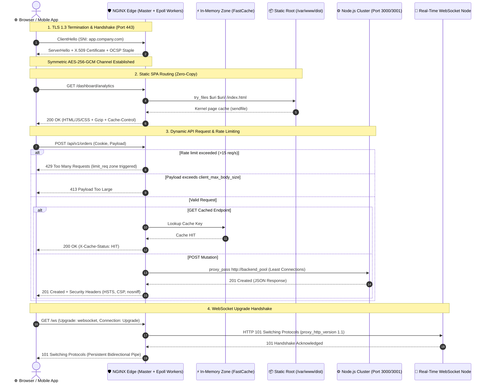

# The Complete NGINX Masterclass: Architecture, Configuration, Reverse Proxy, Microcaching & Security Hardening

## 1. 🎯 Overview & Intuitive Mental Model

In modern full-stack systems, frontend single-page applications (React, Angular, Vue) and backend microservices should almost never face the open internet directly. Exposing Node.js, Python, or Go servers directly to public traffic exposes them to Slowloris connection starvation, TLS handshake computational overhead, memory leaks from unbuffered payloads, and server fingerprinting.

**NGINX** (pronounced *"Engine-X"*) is an asynchronous, event-driven reverse proxy, web server, load balancer, and edge security gateway. It is designed to handle **100,000+ concurrent connections** on minimal RAM by decoupling connection management from worker threads.

```
+----------------------------------------------------------------------------------------------------+
|                                    🧠 THE PHYSICAL ANALOGY                                         |
|                                                                                                    |
|  🏢 The Five-Star Hotel Concierge & Security Gate (NGINX):                                        |
|                                                                                                    |
|  1. The Velvet Rope & ID Check (TLS Termination & Security Headers):                               |
|     Inspects passports and VIP credentials (SSL/TLS certificates) at the grand entrance. Once you   |
|     are verified, internal bellhops can communicate with you without re-checking credentials.      |
|                                                                                                    |
|  2. The Instant Brochure Dispenser (Static Assets & Zero-Copy Caching):                            |
|     If a guest asks for the hotel menu or city map (React index.html, JS bundles, images), the     |
|     concierge hands it over from the front desk drawer immediately without calling the master      |
|     chef in the kitchen (Bypassing Node.js entirely via OS kernel sendfile).                       |
|                                                                                                    |
|  3. The Traffic Usher (Reverse Proxy & Load Balancing):                                            |
|     When custom dinner orders arrive (dynamic API mutations), the usher checks which of the four   |
|     kitchen lines is least busy and forwards the order smoothly (least_conn load balancing).       |
|                                                                                                    |
|  4. The Bouncer (Rate Limiting & Slowloris Defense):                                              |
|     If a rogue visitor begins talking at 1 word per minute to hold up the line (Slowloris attack),  |
|     the bouncer taps his watch and ejects them after 10 seconds (aggressive client timeouts).       |
+----------------------------------------------------------------------------------------------------+
```

### ⚙️ NGINX Core Internals: Why It Destroys the C10K Problem

Traditional web servers (like Apache MPM Prefork) allocate a dedicated operating system process or thread per client connection:
* **Apache Thread-per-Client:** 10,000 connections = 10,000 threads. Context-switching between 10,000 threads swamps the CPU, and each thread's stack memory (1MB to 8MB) quickly drains system RAM, triggering Out-Of-Memory (OOM) crashes.
* **NGINX Asynchronous Event-Driven Architecture:** NGINX spawns one **Master Process** and a small pool of **Worker Processes** (typically 1 worker per physical CPU core).
  * Each worker process runs a non-blocking, single-threaded event loop driven by high-performance OS kernel multiplexing primitives: `epoll` on Linux, `kqueue` on BSD/macOS.
  * A single NGINX worker can handle tens of thousands of active connections simultaneously. When an HTTP client sends data, the OS signals the worker via `epoll`. The worker reads the ready bytes, processes the pipeline, and immediately moves to the next ready socket without ever blocking or waiting for disk or network I/O.
  * **Zero-Copy Transfers (`sendfile`):** When serving static files, NGINX uses the `sendfile()` system call to transfer bytes directly from the page cache to the network socket buffer inside kernel space, bypassing user-space memory copies entirely.

### Vulnerability & Operational Severity Matrix
- **OWASP Category:** A05:2021 – Security Misconfiguration & A04:2021 – Insecure Design
- **CWE Identifiers:** [CWE-200: Exposure of Sensitive Information](https://cwe.mitre.org/data/definitions/200.html), [CWE-400: Uncontrolled Resource Consumption (DoS)](https://cwe.mitre.org/data/definitions/400.html), [CWE-22: Path Traversal via Misconfigured Alias](https://cwe.mitre.org/data/definitions/22.html)
- **Blast Radius:** Slowloris DoS collapse, backend service crash, internal IP leakage, arbitrary file disclosure, SSL/TLS downgrade, volumetric credential-stuffing scraping.

---

## 2. 🎨 Interactive Visual Architecture

### NGINX Reverse Proxy, Microcaching, WebSockets & Upstream Mesh



> 💡 **Visual Inspection Tip:** Open Chrome DevTools (`F12`) -> **Network** tab -> Click on any API request:
> - Check **Response Headers**: Ensure `Server: nginx` does **NOT** contain version numbers like `nginx/1.18.0 (Ubuntu)`.
> - Check **`X-Cache-Status`**: When microcaching is active, subsequent GET requests will reflect `HIT`, with response times dropping from ~120ms to under **3ms**.

---

## 3. 💥 Real-World Exploit Walkthrough

### Exploit A: The "Slowloris" Socket Exhaustion Attack

When NGINX is left with permissive default timeouts (`client_header_timeout 60s`, `client_body_timeout 60s`), attackers can monopolize all available worker connections using minimal bandwidth.

#### ❌ Vulnerable Configuration (`vulnerable-nginx.conf`)
```nginx
# vulnerable-nginx.conf
http {
    # 💥 FLAW 1: Version banner exposed to the public
    server_tokens on;

    # 💥 FLAW 2: Huge timeouts allow Slowloris socket hoarding
    client_body_timeout 60s;
    client_header_timeout 60s;
    keepalive_timeout 75s;

    # 💥 FLAW 3: Unlimited payload size opens memory/disk exhaustion
    client_max_body_size 0;

    server {
        listen 80;
        server_name api.company.com;

        location / {
            proxy_pass http://localhost:3000;
        }
    }
}
```

#### Attacker Payload & Execution
The attacker runs a Slowloris script sending incomplete HTTP headers at 1 byte every 15 seconds:

```bash
# Attacker opens 1,000 slow connections
slowloris api.company.com -p 80 -s 1000
```

```http
GET / HTTP/1.1\r\n
Host: api.company.com\r\n
User-Agent: Mozilla/5.0...\r\n
X-a: b\r\n
[Wait 15 seconds]
X-b: c\r\n
[Wait 15 seconds]
...
```

**Impact:** Every worker connection remains open waiting for the terminating `\r\n\r\n`. Within 30 seconds, all `worker_connections` are exhausted. Legitimate customers receive `504 Gateway Timeout` or `ERR_CONNECTION_TIMED_OUT`. Furthermore, error pages display `nginx/1.18.0 (Ubuntu)` allowing attackers to locate unpatched CVEs.

---

### Exploit B: The NGINX "Off-by-Slash" Alias Path Traversal

A subtle and notorious vulnerability occurs when the `alias` directive is used without matching trailing slashes:

#### ❌ Vulnerable Location Block:
```nginx
location /static {
    alias /var/www/app/static/;
}
```

#### Attacker Exploit Request:
```bash
curl "http://company.com/static../secret_config.json"
```

#### Breakdown:
Because `/static` does not have a trailing slash, NGINX strips `/static` from `/static../secret_config.json` and appends `../secret_config.json` to `/var/www/app/static/`, resolving to:
`/var/www/app/static/../secret_config.json` $\rightarrow$ **`/var/www/app/secret_config.json`**!
Attacker reads environment variables, source code, and private keys!

**The Fix:** Always ensure the location directive and alias directive have matching trailing slashes:
```nginx
location /static/ {
    alias /var/www/app/static/;
}
```

---

## 4. 🛡️ Resolution & Complete Production Implementation

### Part A: Configuration Hierarchy & Location Block Matching Rules

Understanding NGINX configuration begins with understanding its context tree:
* **`main` context:** Process settings, user privileges, file descriptor limits.
* **`events` context:** Event-loop engine (`epoll`), worker connection limits.
* **`http` context:** Universal HTTP settings, MIME types, logging, caching, rate limiting zones.
* **`server` context:** Virtual hosts, domain names (`server_name`), port bindings (`listen`), SSL certificates.
* **`location` context:** URI routing rules, reverse proxy passes, static file serving.
* **`upstream` context:** Backend server pools, load balancing algorithms, health checks.

```
                  +--------------------------+
                  |       main context       |
                  |  (worker_processes, pid) |
                  +-------------+------------+
                                |
                  +-------------+------------+
                  |      events context      |
                  | (epoll, worker_connections)
                  +-------------+------------+
                                |
                  +-------------+------------+
                  |       http context       |
                  | (gzip, limit_req_zone)   |
                  +-------------+------------+
                                |
         +----------------------+----------------------+
         |                                             |
+--------+--------+                           +--------+--------+
| server context  |                           | upstream block  |
| (listen 443)    |                           | (backend_pool)  |
+--------+--------+                           +-----------------+
         |
    +----+----+----------------+
    |         |                |
+---+---+ +---+----+     +-----+-----+
| /     | | /api/  |     | /static/  |
| (SPA) | |(proxy) |     | (caching) |
+-------+ +--------+     +-----------+
```

#### The Location Block Priority Algorithm

When NGINX receives a request URI, it tests location blocks in a strict mathematical order:

| Priority | Modifier | Match Type | Behavior | Example |
|---|---|---|---|---|
| **1 (Highest)** | `=` | Exact Match | If matched, search terminates immediately. | `location = /login { ... }` |
| **2** | `^~` | Preferential Prefix | If this is the longest prefix match, **skip regex checks** and terminate search. | `location ^~ /images/ { ... }` |
| **3** | `~` | Regular Expression | Case-sensitive regex. Evaluated in order of appearance in file; first match wins. | `location ~ \.(png\|jpg\|svg)$ { ... }` |
| **4** | `~*` | Regular Expression | Case-insensitive regex. First match wins. | `location ~* \.(mp4\|webm)$ { ... }` |
| **5 (Lowest)** | *(none)* | Prefix Match | Longest matching prefix is stored; checked only if no regex matched. | `location /api/ { ... }` |

---

### Part B: The "Trailing Slash" Trap in `proxy_pass`

One of the most frequent production bugs involves the trailing slash on `proxy_pass`:

```nginx
# CASE 1: With Trailing Slash (URI Replacement)
location /api/ {
    proxy_pass http://backend:3000/;
}
# Request: GET /api/v1/users -> Forwarded: GET /v1/users (strips '/api/')

# CASE 2: Without Trailing Slash (URI Preservation)
location /api/ {
    proxy_pass http://backend:3000;
}
# Request: GET /api/v1/users -> Forwarded: GET /api/v1/users (preserves full URI)
```

---

### Part C: Production-Hardened Master Configuration (`/etc/nginx/nginx.conf`)

Here is an enterprise-grade, battle-tested configuration combining reverse proxying, microcaching, WebSockets, SPA routing, rate limiting, and zero-trust security:

```nginx
# ==============================================================================
# NGINX PRODUCTION ENTERPRISE CONFIGURATION
# File: /etc/nginx/nginx.conf
# ==============================================================================

user nginx;
pid /var/run/nginx.pid;

# 🛡️ 1. Process & Concurrency Optimization
# Automatically allocates 1 worker process per physical CPU core
worker_processes auto;

# Maximum number of open file descriptors per worker process
worker_rlimit_nofile 65535;

events {
    # High-performance Linux epoll event notification mechanism
    use epoll;
    
    # Maximum concurrent connections per worker process (65535 connections total)
    worker_connections 8192;
    
    # Accept as many connections as possible upon notification
    multi_accept on;
}

http {
    # --------------------------------------------------------------------------
    # MIME Types & Zero-Copy File Handling
    # --------------------------------------------------------------------------
    include /etc/nginx/mime.types;
    default_type application/octet-stream;

    # Zero-copy kernel file transfer (bypasses user-space buffer copies)
    sendfile on;
    
    # Send HTTP response headers in one packet rather than frames
    tcp_nopush on;
    
    # Disable Nagle's algorithm; send small packets immediately (low latency)
    tcp_nodelay on;

    # 🛡️ 2. Security: Suppress Server Banners & Version Leakage
    server_tokens off;

    # 🛡️ 3. Anti-Slowloris Timeouts & Request Size Boundaries
    client_body_timeout 10s;
    client_header_timeout 10s;
    send_timeout 10s;
    keepalive_timeout 30s 30s;
    keepalive_requests 1000;

    # Payload Caps: Mitigate memory and disk space exhaustion
    client_max_body_size 10M;
    client_body_buffer_size 128k;
    client_header_buffer_size 1k;
    large_client_header_buffers 4 8k;

    # --------------------------------------------------------------------------
    # 🛡️ 4. Structured JSON Access Logging for ELK / Datadog / Grafana Loki
    # --------------------------------------------------------------------------
    log_format json_analytics escape=json '{'
        '"time_local":"$time_iso8601",'
        '"remote_addr":"$remote_addr",'
        '"request_method":"$request_method",'
        '"request_uri":"$request_uri",'
        '"status":$status,'
        '"body_bytes_sent":$body_bytes_sent,'
        '"request_time":$request_time,'
        '"upstream_response_time":"$upstream_response_time",'
        '"upstream_status":"$upstream_status",'
        '"http_referrer":"$http_referer",'
        '"http_user_agent":"$http_user_agent",'
        '"cache_status":"$upstream_cache_status"'
    '}';

    access_log /var/log/nginx/access.json json_analytics;
    error_log /var/log/nginx/error.log warn;

    # --------------------------------------------------------------------------
    # 🛡️ 5. Gzip & Compression
    # --------------------------------------------------------------------------
    gzip on;
    gzip_vary on;
    gzip_proxied any;
    gzip_comp_level 6;
    gzip_min_length 1024;
    gzip_types
        text/plain
        text/css
        text/xml
        text/javascript
        application/json
        application/javascript
        application/xml
        application/xml+rss
        image/svg+xml;

    # --------------------------------------------------------------------------
    # 🛡️ 6. Rate Limiting Zones (Shared Memory Token Bucket)
    # --------------------------------------------------------------------------
    # Track IP addresses using $binary_remote_addr (uses only 4 bytes per IP)
    # 10MB zone tracks ~160,000 concurrent IPs; rate = 15 requests/second
    limit_req_zone $binary_remote_addr zone=api_rate_limit:10m rate=15r/s;
    limit_req_zone $binary_remote_addr zone=login_rate_limit:10m rate=3r/s;
    limit_conn_zone $binary_remote_addr zone=ip_conn_limit:10m;

    # Return HTTP 429 Too Many Requests when limits are breached
    limit_req_status 429;
    limit_conn_status 429;

    # --------------------------------------------------------------------------
    # 🛡️ 7. Microcaching & Proxy Cache Configuration
    # --------------------------------------------------------------------------
    # Cache storage on disk with two directory levels (e.g., /var/cache/nginx/a/1b/...)
    proxy_cache_path /var/cache/nginx levels=1:2 keys_zone=api_cache:20m max_size=2g inactive=60m use_temp_path=off;
    proxy_cache_key "$scheme$request_method$host$request_uri";

    # --------------------------------------------------------------------------
    # 🛡️ 8. Upstream Connection Pooling & WebSocket Map
    # --------------------------------------------------------------------------
    # WebSocket Upgrade mapping helper
    map $http_upgrade $connection_upgrade {
        default upgrade;
        ''      close;
    }

    # Upstream Node.js application cluster
    upstream backend_cluster {
        # Least connections routing: Sends requests to server with fewest active sockets
        least_conn;

        server 127.0.0.1:3000 max_fails=3 fail_timeout=10s;
        server 127.0.0.1:3001 max_fails=3 fail_timeout=10s;

        # Keepalive upstream pool: Prevents ephemeral port exhaustion
        keepalive 64;
    }

    # --------------------------------------------------------------------------
    # 🛡️ 9. Port 80 Canonical HTTP to HTTPS Redirect
    # --------------------------------------------------------------------------
    server {
        listen 80 default_server;
        listen [::]:80 default_server;
        server_name _;

        # Let's Encrypt ACME challenge path
        location /.well-known/acme-challenge/ {
            root /var/www/certbot;
        }

        location / {
            return 301 https://$host$request_uri;
        }
    }

    # --------------------------------------------------------------------------
    # 🛡️ 10. Hardened Virtual Host (HTTPS / TLS 1.3 / HTTP/2)
    # --------------------------------------------------------------------------
    server {
        listen 443 ssl http2;
        listen [::]:443 ssl http2;
        server_name app.company.com;

        # SSL Certificates
        ssl_certificate /etc/letsencrypt/live/app.company.com/fullchain.pem;
        ssl_certificate_key /etc/letsencrypt/live/app.company.com/privkey.pem;

        # TLS Protocols & Cipher Suites (Mozilla Intermediate Profile)
        ssl_protocols TLSv1.2 TLSv1.3;
        ssl_prefer_server_ciphers off;
        ssl_ciphers ECDHE-ECDSA-AES128-GCM-SHA256:ECDHE-RSA-AES128-GCM-SHA256:ECDHE-ECDSA-AES256-GCM-SHA384:ECDHE-RSA-AES256-GCM-SHA384:ECDHE-ECDSA-CHACHA20-POLY1305:ECDHE-RSA-CHACHA20-POLY1305;

        # SSL Session Cache (10 minutes reuse avoids heavy TLS handshakes)
        ssl_session_timeout 1d;
        ssl_session_cache shared:SSL:20m;
        ssl_session_tickets off;

        # OCSP Stapling (Fast, privacy-preserving browser certificate validation)
        ssl_stapling on;
        ssl_stapling_verify on;
        resolver 1.1.1.1 8.8.8.8 valid=300s;
        resolver_timeout 5s;

        # 🛡️ Mandatory Defense-in-Depth Response Headers
        add_header Strict-Transport-Security "max-age=63072000; includeSubDomains; preload" always;
        add_header X-Frame-Options "DENY" always;
        add_header X-Content-Type-Options "nosniff" always;
        add_header Referrer-Policy "strict-origin-when-cross-origin" always;
        add_header Content-Security-Policy "default-src 'self'; script-src 'self'; style-src 'self' 'unsafe-inline'; img-src 'self' data: https:; connect-src 'self' wss://app.company.com; frame-ancestors 'none';" always;
        add_header Permissions-Policy "geolocation=(), microphone=(), camera=()" always;
        add_header X-Cache-Status $upstream_cache_status always;

        # Max 20 concurrent TCP connections per IP address
        limit_conn ip_conn_limit 20;

        # ----------------------------------------------------------------------
        # Feature 1: Static React / Angular SPA Serving with Client Routing
        # ----------------------------------------------------------------------
        root /var/www/dist;
        index index.html;

        location / {
            # try_files ensures browser reload on deep routes (/dashboard/settings)
            # serves index.html so React Router takes over instead of returning 404
            try_files $uri $uri/ /index.html;
        }

        # Long-lived caching for immutable hashed static assets
        location ~* \.(?:css|js|woff2?|png|jpg|jpeg|gif|ico|svg|webp)$ {
            expires 1y;
            add_header Cache-Control "public, immutable";
            access_log off;
            try_files $uri =404;
        }

        # ----------------------------------------------------------------------
        # Feature 2: Microcached API Reverse Proxy
        # ----------------------------------------------------------------------
        location /api/ {
            # Enforce 15 req/s rate limit with a burst buffer of 20
            limit_req zone=api_rate_limit burst=20 nodelay;

            # Upstream proxy destination
            proxy_pass http://backend_cluster;
            proxy_http_version 1.1;
            proxy_set_header Connection ""; # Required for upstream keepalive!

            # Header preservation
            proxy_set_header Host $host;
            proxy_set_header X-Real-IP $remote_addr;
            proxy_set_header X-Forwarded-For $proxy_add_x_forwarded_for;
            proxy_set_header X-Forwarded-Proto $scheme;

            # Upstream timeout guards
            proxy_connect_timeout 5s;
            proxy_send_timeout 10s;
            proxy_read_timeout 10s;

            # Microcaching (Cache GET responses for 5 seconds to absorb spikes)
            proxy_cache api_cache;
            proxy_cache_valid 200 302 5s;
            proxy_cache_valid 404 1m;
            proxy_cache_use_stale error timeout updating http_500 http_502 http_503 http_504;
            proxy_cache_bypass $http_cache_control;
            proxy_no_cache $cookie_session; # Never cache authenticated user responses!
        }

        # ----------------------------------------------------------------------
        # Feature 3: Strict Rate-Limited Login Endpoint
        # ----------------------------------------------------------------------
        location /api/v1/auth/login {
            limit_req zone=login_rate_limit burst=5 nodelay;
            
            proxy_pass http://backend_cluster;
            proxy_http_version 1.1;
            proxy_set_header Connection "";
            proxy_set_header Host $host;
            proxy_set_header X-Real-IP $remote_addr;
            proxy_set_header X-Forwarded-For $proxy_add_x_forwarded_for;
            proxy_set_header X-Forwarded-Proto $scheme;
        }

        # ----------------------------------------------------------------------
        # Feature 4: Full-Duplex WebSocket Reverse Proxy
        # ----------------------------------------------------------------------
        location /ws {
            proxy_pass http://backend_cluster;
            proxy_http_version 1.1;

            # WebSocket upgrade headers
            proxy_set_header Upgrade $http_upgrade;
            proxy_set_header Connection $connection_upgrade;

            proxy_set_header Host $host;
            proxy_set_header X-Real-IP $remote_addr;
            proxy_set_header X-Forwarded-For $proxy_add_x_forwarded_for;
            proxy_set_header X-Forwarded-Proto $scheme;

            # Long read timeout so idle WebSockets aren't prematurely killed
            proxy_read_timeout 3600s;
            proxy_send_timeout 3600s;
        }

        # ----------------------------------------------------------------------
        # Feature 5: Server-Sent Events (SSE) Unbuffered Stream
        # ----------------------------------------------------------------------
        location /api/v1/live-feed {
            proxy_pass http://backend_cluster;
            proxy_http_version 1.1;
            proxy_set_header Connection "";
            proxy_set_header Host $host;

            # Disable NGINX proxy buffering for real-time chunk streaming
            proxy_buffering off;
            proxy_cache off;
            chunked_transfer_encoding on;

            proxy_read_timeout 24h;
        }

        # ----------------------------------------------------------------------
        # Feature 6: Block Sensitive Hidden Files (.git, .env)
        # ----------------------------------------------------------------------
        location ~ /\.(?!well-known).* {
            deny all;
            access_log off;
            log_not_found off;
        }
    }
}
```

---

### Part D: Diagnostic Guide to Common NGINX HTTP Status Codes

| HTTP Status | Meaning | Root Cause in NGINX | Exact Resolution |
|---|---|---|---|
| **`502 Bad Gateway`** | Upstream Unreachable | NGINX reached the IP/port specified in `proxy_pass`, but nothing is listening or the app crashed. | Check if Node.js/PM2 is running (`pm2 list`), check firewall between NGINX and port 3000. |
| **`504 Gateway Timeout`** | Upstream Took Too Long | The upstream app received the request but didn't finish processing before `proxy_read_timeout`. | Optimize backend database query, or increase `proxy_read_timeout 30s;` if operation is legitimately long. |
| **`499 Client Closed Request`** | Client Gave Up | NGINX-specific status code. The browser or mobile client closed the connection before NGINX received the upstream reply. | Backend query is too slow; client timed out or user navigated away. |
| **`413 Request Entity Too Large`** | Payload Exceeded Boundary | The uploaded file or POST body exceeded `client_max_body_size`. | Increase `client_max_body_size 25M;` in the specific upload location block. |
| **`403 Forbidden`** | Directory Listing Denied | NGINX looked for an `index.html` file in `root`, didn't find one, and `autoindex` is off. | Ensure build files are placed in `/var/www/dist` and permissions are readable (`chmod -R 755`). |

---

## 5. 🧪 Hands-On Verification & Lab

### 1. Test NGINX Configuration Syntax
Always test configuration syntax before reloading to prevent dropping live production traffic:

```bash
# Validates syntax without restarting the daemon
nginx -t

# Expected output:
# nginx: the configuration file /etc/nginx/nginx.conf syntax is ok
# nginx: configuration file /etc/nginx/nginx.conf test is successful
```

### 2. Zero-Downtime Hot Reload
Reload configurations smoothly without dropping a single active TCP connection:

```bash
# Graceful hot reload
sudo systemctl reload nginx
# Or using the native signal:
sudo nginx -s reload
```

### 3. Verify Security Headers & Server Banner Suppression
```bash
curl -I https://app.company.com/api/v1/orders
```

#### Expected Production Output:
```http
HTTP/2 200
server: nginx
date: Tue, 13 Oct 2026 12:00:00 GMT
content-type: application/json; charset=utf-8
strict-transport-security: max-age=63072000; includeSubDomains; preload
x-frame-options: DENY
x-content-type-options: nosniff
referrer-policy: strict-origin-when-cross-origin
content-security-policy: default-src 'self'; script-src 'self'; ...
x-cache-status: MISS
```
*(Notice: `server: nginx` leaks no version numbers or OS packages).*

### 4. Verify Rate Limiter Enforcement (`curl`)
```bash
# Send 30 requests in rapid succession
for i in {1..30}; do curl -s -o /dev/null -w "%{http_code}\n" https://app.company.com/api/v1/orders; done
```
**Assertion:** The first 20 requests return `200` or `201`. Requests 21 through 30 return `429 Too Many Requests`.

---

## 6. 📋 Code Review Checklist

- [ ] **`server_tokens off;`:** Is version leakage disabled across the `http` context?
- [ ] **HTTP to HTTPS Redirect:** Is port 80 strictly redirected to 443 with `301 Moved Permanently`?
- [ ] **Trailing Slash Verification:** Did you verify whether `proxy_pass` has or does not have a trailing slash based on intended URI mapping?
- [ ] **SPA Route Fallback:** Is `try_files $uri $uri/ /index.html;` configured for Single Page Applications to prevent 404s on refresh?
- [ ] **Upstream Keepalive Configured:** Are `proxy_http_version 1.1;` and `proxy_set_header Connection "";` present to reuse upstream sockets?
- [ ] **Anti-Slowloris Timeouts:** Are `client_body_timeout` and `client_header_timeout` configured to $\le 10\text{s}$?
- [ ] **`client_max_body_size` Defined:** Is the payload size capped explicitly (e.g., `10M`) to prevent disk/RAM exhaustion?
- [ ] **Microcaching Safe for Auth:** Is `proxy_no_cache` applied to user session cookies to prevent cross-account cache poisoning?
- [ ] **WebSocket Headers Mapped:** Are `Upgrade` and `Connection` headers dynamically mapped via `map $http_upgrade $connection_upgrade`?
- [ ] **Unbuffered SSE Streams:** Are `proxy_buffering off;` and `chunked_transfer_encoding on;` set for Server-Sent Events?
- [ ] **Hidden Files Blocked:** Is `location ~ /\.(?!well-known).* { deny all; }` configured to protect `.env` and `.git` folders?

---

## 7. 🎥 Curated Video Walkthroughs & Primary References

### 📺 High-Impact Video Explanations
- 🎥 [NGINX Crash Course: Reverse Proxy, Load Balancer & Caching (Hussein Nasser)](https://www.youtube.com/watch?v=7VAI73roXaY) — Complete networking masterclass on the epoll event loop, worker processes, and upstream proxies.
- 🎥 [Reverse Proxy vs Forward Proxy in System Design (ByteByteGo)](https://www.youtube.com/watch?v=SqqrOspasag) — Clear mental model explaining edge proxies, gateway routing, and security boundaries.
- 🎥 [Hardening NGINX: Security Best Practices & DDoS Defense (FreeCodeCamp)](https://www.youtube.com/watch?v=1FfLg3x_l4k) — Step-by-step walkthrough configuring rate limiters, SSL parameters, and security headers.
- 🎥 [NGINX Load Balancing & Upstream Keepalive (Hussein Nasser)](https://www.youtube.com/watch?v=2Nt-ZrNP22A) — Deep networking analysis of least connections, IP hashing, and upstream socket exhaustion.

### 📖 Primary Documentation & Specifications
- 📜 [NGINX Official Documentation: Reverse Proxy Guide](https://docs.nginx.com/nginx/admin-guide/web-server/reverse-proxy/) — Authoritative guide for `proxy_pass`, buffers, and headers.
- 📜 [Mozilla SSL Configuration Generator](https://ssl-config.mozilla.org/) — Industry standard tool generating battle-tested TLS parameters for NGINX.
- 📜 [OWASP Cheat Sheet: Secure Headers Configuration in NGINX](https://cheatsheetseries.owasp.org/cheatsheets/HTTP_Headers_Cheat_Sheet.html) — Practical defensive header blueprints.
- 📜 [NGINX Pitfalls and Common Mistakes](https://www.nginx.com/resources/wiki/start/topics/tutorials/pitfalls/) — The official guide on avoiding "If is Evil", alias traversal, and redundant rewrites.

### 🧪 Interactive Hands-On Training Labs & Tools
- 🎯 [NGINX Official Docker Playground](https://github.com/nginxinc/docker-nginx) — Spin up local NGINX containers to test custom `nginx.conf` routing and load balancing rules.
- 🎯 [Mozilla Observatory](https://observatory.mozilla.org/) — Free automated scanner auditing your live NGINX HTTP response headers.
- 🎯 [DigitalOcean NGINX Config Tool](https://www.digitalocean.com/community/tools/nginx) — Interactive GUI generator for production-ready, modular NGINX configurations.
