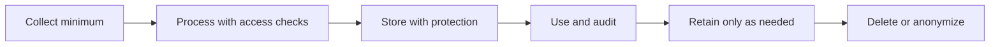

# Data and Database Security

Protect confidentiality, integrity, availability, and privacy throughout data collection, processing, storage, export, logging, backup, and deletion.

## 📚 Deep Dive Guides in This Section
- 📖 [Database Types, Indexing Internals & Decision Framework](./database-types-and-indexing-deep-dive.md) — Comprehensive masterclass on Relational, NoSQL, Key-Value, Time-Series & Vector DBs, plus B+Tree, Hash, GIN, GiST, BRIN, and LSM-Tree indexing trade-offs.

## Controls
- Classify data and minimize collection and retention.
- Use TLS in transit and appropriate encryption at rest; manage keys separately from encrypted data.
- Give application/database identities least privilege and separate read/write/admin roles where practical.
- Use parameterized queries, transactions, constraints, and safe migration practices.
- Redact tokens, passwords, session IDs, and unnecessary personal data from logs.
- Test backup restoration and define retention/deletion requirements.
- Restrict exports and audit high-impact access.

## Data lifecycle

References: [OWASP Cryptographic Storage](https://cheatsheetseries.owasp.org/cheatsheets/Cryptographic_Storage_Cheat_Sheet.html), [OWASP Logging](https://cheatsheetseries.owasp.org/cheatsheets/Logging_Cheat_Sheet.html).

---

## 7. 🎥 Curated Video Walkthroughs & Primary References

### 📺 High-Impact Video Explanations
- 🎥 [Database Security: Encryption At Rest vs In Transit (ByteByteGo)](https://www.youtube.com/watch?v=1r_A_B_k3l4) — Clear system design guide explaining envelope encryption, KMS key management, and cryptographic boundaries.
- 🎥 [PostgreSQL Row Level Security & Multi-Tenancy Architecture (Hussein Nasser)](https://www.youtube.com/watch?v=F0_k239Xw4U) — Step-by-step tutorial configuring database-level authorization and tenant policies.
- 🎥 [How Password Hashing Works: Argon2, bcrypt, PBKDF2 (Computerphile)](https://www.youtube.com/watch?v=O6cmui3H00U) — Cryptographic deep-dive into work factors, salts, and GPU attack resistance.

### 📖 Primary Documentation & Specifications
- 📜 [OWASP Cheat Sheet: Cryptographic Storage](https://cheatsheetseries.owasp.org/cheatsheets/Cryptographic_Storage_Cheat_Sheet.html) — Concrete engineering rules for cipher selection, key derivation, and secrets rotation.
- 📜 [OWASP Cheat Sheet: Password Storage](https://cheatsheetseries.owasp.org/cheatsheets/Password_Storage_Cheat_Sheet.html) — Current recommended work factors for Argon2id and bcrypt.
- 📜 [NIST Special Publication 800-57: Recommendation for Key Management](https://csrc.nist.gov/publications/detail/sp/800-57-part-1/rev-5/final) — Federal cryptographic standards for lifecycle key protection.

### 🧪 Interactive Hands-On Training Labs & Tools
- 🎯 [OWASP WebGoat: Insecure Storage Lessons](https://owasp.org/www-project-webgoat/) — Practice cracking legacy MD5/SHA1 hashes and poorly implemented key derivation functions.
- 🎯 [PostgreSQL Official Interactive Tutorial: Row Level Security](https://www.postgresql.org/docs/current/ddl-rowsecurity.html) — Hands-on examples building declarative multi-tenant isolation.

