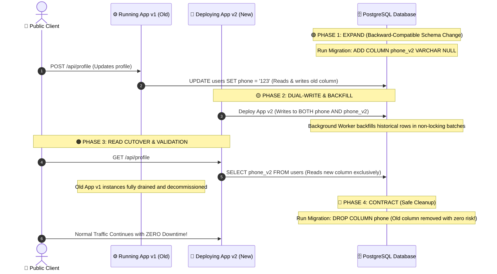

# Zero-Downtime Database Migrations & Safe Schema Evolution

## 1. 🎯 Overview & Intuitive Mental Model

In software engineering, code can be rolled back with a single button click. **Database state cannot.**

Running an uncontrolled schema migration (`ALTER TABLE`, column renaming, or adding unindexed foreign keys) on a live table with millions of rows can acquire an **`ACCESS EXCLUSIVE` table lock**, freezing all reads and writes, backing up connection pools, and knocking your entire platform offline within seconds.

```
+----------------------------------------------------------------------------------------------------+
|                                    🧠 THE PHYSICAL ANALOGY                                         |
|                                                                                                    |
|  🌉 Renovating a Highway Bridge While 5,000 Cars Are Driving Over It Every Minute:                 |
|                                                                                                    |
|  ❌ The Naive / Destructive Approach:                                                              |
|     You blow up two lanes of the bridge without warning (Dropping or renaming a column instantly).  |
|     Incoming traffic plunges into the river (Old backend instances crash with 500 errors).         |
|                                                                                                    |
|  ✅ The "Expand and Contract" Pattern:                                                             |
|     1. Expand: Build an auxiliary parallel bridge lane alongside the old one (Add new column).     |
|     2. Dual-Route: Allow traffic to flow across both lanes seamlessly (Dual-write in backend).     |
|     3. Divert: Gently route all traffic to the new lane once certified (Deploy new backend code).   |
|     4. Contract: Demolish the retired lane after zero cars are using it (Drop old column cleanly). |
+----------------------------------------------------------------------------------------------------+
```

### Risk & Operational Severity Matrix
- **OWASP Category:** A04:2021 – Insecure Design & A05:2021 – Security Misconfiguration
- **CWE Identifiers:** [CWE-400: Uncontrolled Resource Consumption](https://cwe.mitre.org/data/definitions/400.html), [CWE-662: Improper Synchronization](https://cwe.mitre.org/data/definitions/662.html)
- **Blast Radius:** Global database lockup (`Lock wait timeout exceeded`), connection pool exhaustion, multi-hour production downtime, catastrophic data corruption during rollback.

---

## 2. 🎨 Interactive Visual Architecture

### The 4-Phase "Expand and Contract" Zero-Downtime Migration Lifecycle



> 💡 **Visual Inspection Tip:** Connect to your PostgreSQL database and run `SELECT pid, mode, granted, query FROM pg_locks l JOIN pg_stat_activity a ON l.pid = a.pid WHERE mode = 'AccessExclusiveLock';`. If you see queries waiting on `AccessExclusiveLock`, your migration is actively blocking all production read/write transactions!

---

## 3. 💥 Real-World Exploit & Migration Catastrophe Walkthrough

### The "Table Lock of Death" (`ALTER TABLE ... ADD COLUMN ... NOT NULL`)

A developer wants to add a mandatory `country_code` column to a 10-million-row `users` table.

#### Catastrophic Migration Script (`migration_v12.sql`)
```sql
-- DANGEROUS MIGRATION - ACQUIRES ACCESS EXCLUSIVE LOCK FOR 45 MINUTES
ALTER TABLE users 
ADD COLUMN country_code VARCHAR(3) NOT NULL DEFAULT 'USA';
```

#### What Actually Happens in Production
1. **Catalog Lock Acquisition:** PostgreSQL requests an `AccessExclusiveLock` on the `users` table.
2. **Heavy Table Rewrite (Pre-PG 11 / Volatile Defaults):** If the default expression is volatile (or on older database versions), PostgreSQL physically rewrites every single 8KB disk page on a 40GB table to insert `'USA'` into every row.
3. **Queue Head-of-Line Blocking:** While the migration runs, **EVERY SINGLE** incoming `SELECT`, `INSERT`, `UPDATE`, and `DELETE` query queues up behind the migration lock.
4. **Cascading Pool Exhaustion:** Backend connection pools (Node.js/Prisma/HikariCP) max out in 3 seconds. NGINX returns `504 Gateway Timeout` to all users.
5. **The Panic Abort Mistake:** The desperate engineer presses `Ctrl+C` to cancel the migration. PostgreSQL must now roll back all disk writes, doubling the total lock duration!

---

## 4. 🛡️ The 8 Golden Rules of Safe PostgreSQL DDL Migrations

### Rule 1: Always Set Strict Lock Timeouts
Never let a migration wait in line indefinitely. If a table lock cannot be acquired within 2 seconds, fail immediately and retry during a traffic lull:

```sql
-- Enforce strict lock acquisition ceiling
SET lock_timeout = '2s';
SET statement_timeout = '30s';
```

---

### Rule 2: Never Add a Non-Nullable Column Without a Default
If a column must be `NOT NULL`, split the operation into three non-locking stages:

```sql
-- 🛡️ Step 1: Add the column as NULLABLE (Instantaneous metadata-only change in PG 11+)
ALTER TABLE users ADD COLUMN country_code VARCHAR(3);

-- 🛡️ Step 2: Add a check constraint without validating existing rows (Takes 0.01ms!)
ALTER TABLE users 
ADD CONSTRAINT check_country_code_not_null 
CHECK (country_code IS NOT NULL) NOT VALID;

-- 🛡️ Step 3: Validate the constraint asynchronously (Acquires SHARE UPDATE EXCLUSIVE lock; DOES NOT BLOCK READS OR WRITES!)
ALTER TABLE users VALIDATE CONSTRAINT check_country_code_not_null;
```

---

### Rule 3: Always Create Indexes Concurrently
A standard `CREATE INDEX` locks the entire table against all writes for the duration of the index build (minutes or hours).

```sql
-- ❌ DANGEROUS: Blocks all INSERT, UPDATE, DELETE queries
CREATE INDEX idx_users_email ON users(email);

-- 🛡️ SAFE: Builds index in background while production traffic continues normally
CREATE INDEX CONCURRENTLY idx_users_email ON users(email);
```
*(Note: `CONCURRENTLY` cannot run inside a standard transaction block).*

---

### Rule 4: Never Add a Foreign Key Constraint Without `NOT VALID`
Adding a foreign key validates every existing row against the foreign table, locking both tables!

```sql
-- 🛡️ Step 1: Add constraint as NOT VALID (Zero-lock metadata update)
ALTER TABLE orders 
ADD CONSTRAINT fk_orders_user_id 
FOREIGN KEY (user_id) REFERENCES users(id) NOT VALID;

-- 🛡️ Step 2: Validate existing rows in background without write blocking
ALTER TABLE orders VALIDATE CONSTRAINT fk_orders_user_id;
```

---

### Rule 5: Safe Batch Backfilling (Avoiding Transaction Log Bloat)
Never run `UPDATE users SET country_code = 'USA';` in one massive transaction! It blows up the PostgreSQL Write-Ahead Log (WAL) and causes severe replication lag.

#### Safe Batch Backfill Script (Node.js / TypeScript)
```typescript
// backfill-worker.ts - NON-BLOCKING BATCH BACKFILLER
import { Pool } from 'pg';

const pool = new Pool({ connectionString: process.env.DATABASE_URL });

async function backfillInBatches(batchSize = 2000) {
  let updatedRows = 0;
  
  while (true) {
    // 🛡️ Update only a small bounded batch of rows per transaction
    const result = await pool.query(`
      WITH batch AS (
        SELECT id FROM users
        WHERE country_code IS NULL
        LIMIT $1
        FOR UPDATE SKIP LOCKED -- Skips rows currently locked by live user activity!
      )
      UPDATE users u
      SET country_code = 'USA'
      FROM batch
      WHERE u.id = batch.id;
    `, [batchSize]);

    updatedRows += result.rowCount || 0;
    console.log(`Backfilled ${updatedRows} rows so far...`);

    if (!result.rowCount || result.rowCount === 0) {
      console.log('✅ Backfill complete!');
      break;
    }

    // 🛡️ Sleep 50ms between batches to let the DB flush dirty pages & serve traffic
    await new Promise((resolve) => setTimeout(resolve, 50));
  }
}
```

---

### Rule 6: Distributed Advisory Locks (Preventing Multi-Node Migration Races)
When 5 container instances boot up simultaneously in Kubernetes or AWS ECS, all 5 might attempt to run database migrations at the exact same millisecond.

#### Multi-Node Migration Guard (`migrate.ts`)
```typescript
// migrate.ts - PRODUCTION ADVISORY LOCK GUARD
import { Pool } from 'pg';
import { execSync } from 'child_process';

const pool = new Pool({ connectionString: process.env.DATABASE_URL });

// Unique 64-bit integer identifier for your application migrations lock
const MIGRATION_LOCK_ID = 8492049281;

export async function runSafeMigrations() {
  const client = await pool.connect();
  try {
    console.log('🔒 Acquiring PostgreSQL advisory lock for migrations...');
    
    // 🛡️ Try to acquire exclusive session advisory lock
    const lockRes = await client.query(
      'SELECT pg_try_advisory_lock($1) as acquired', 
      [MIGRATION_LOCK_ID]
    );

    if (!lockRes.rows[0].acquired) {
      console.log('⏳ Another instance is currently executing migrations. Waiting...');
      // Block until the active migration instance finishes and releases lock
      await client.query('SELECT pg_advisory_lock($1)', [MIGRATION_LOCK_ID]);
    }

    console.log('🚀 Lock acquired! Executing pending migrations...');
    // Run Prisma, Knex, or Flyway migrations
    execSync('npx prisma migrate deploy', { stdio: 'inherit' });
    console.log('✅ Migrations applied successfully.');

  } finally {
    // 🛡️ Always release advisory lock so subsequent deployments proceed
    await client.query('SELECT pg_advisory_unlock($1)', [MIGRATION_LOCK_ID]);
    client.release();
  }
}
```

---

### Rule 7: Zero-Downtime Column Renaming Pattern

Renaming a column directly (`ALTER TABLE users RENAME COLUMN phone TO mobile;`) instantly breaks all currently running backend instances that still execute `SELECT phone FROM users`.

#### The 4-Step Zero-Downtime Renaming Playbook:
1. **Migration 1:** Add the new column `mobile` (nullable).
2. **App Release 1 (Dual-Write):** Backend writes to **both** `phone` and `mobile`, but continues reading from `phone`.
3. **Backfill:** Asynchronously copy historical values from `phone` to `mobile`.
4. **App Release 2 (Read Cutover):** Backend switches to reading and writing `mobile` exclusively.
5. **Migration 2:** Drop the retired column `phone`.

---

## 5. 🧪 Hands-On Verification & Lab

### 1. Test Lock Contention Locally
1. Open Terminal 1 and start an open transaction on your local PostgreSQL:
   ```sql
   psql -d dev_db
   BEGIN;
   SELECT * FROM users WHERE id = 1 FOR UPDATE;
   -- Keep this terminal open!
   ```

2. Open Terminal 2 and attempt to run a migration with a lock timeout:
   ```sql
   psql -d dev_db
   SET lock_timeout = '2s';
   ALTER TABLE users ADD COLUMN bio TEXT;
   ```

3. **Verification:** Confirm that after exactly 2 seconds, the migration safely fails with:
   ```text
   ERROR: canceling statement due to lock timeout
   ```
   *(Proving your production database will never lock up indefinitely waiting for active transactions to clear!)*

---

### 2. Automated Safe Migration Integrity Test (Vitest)
```typescript
// migration-safety.test.ts
import { describe, it, expect, beforeAll } from 'vitest';
import { Pool } from 'pg';

describe('Database Migration Safety Guard Suite', () => {
  let pool: Pool;

  beforeAll(() => {
    pool = new Pool({ connectionString: process.env.TEST_DATABASE_URL });
  });

  it('confirms all table constraints are validated and active', async () => {
    const res = await pool.query(`
      SELECT conname, convalidated 
      FROM pg_constraint 
      WHERE conname = 'check_country_code_not_null';
    `);

    expect(res.rows.length).toBe(1);
    expect(res.rows[0].convalidated).toBe(true);
  });

  it('confirms concurrent indexes were successfully built without invalid flag', async () => {
    const res = await pool.query(`
      SELECT indisvalid 
      FROM pg_index i 
      JOIN pg_class c ON c.oid = i.indexrelid 
      WHERE c.relname = 'idx_users_email';
    `);

    expect(res.rows.length).toBe(1);
    expect(res.rows[0].indisvalid).toBe(true);
  });
});
```

---

## 6. 📋 Code Review & Migration PR Checklist

- [ ] **Lock Timeout Set:** Does the migration script start with `SET lock_timeout = '2s';` to prevent cascading queue lockups?
- [ ] **`CREATE INDEX CONCURRENTLY` Used:** Are all indexes created using `CONCURRENTLY` outside of a single transaction block?
- [ ] **No Raw Renames or Drops:** Does the PR avoid renaming or dropping columns in the same release as code changes?
- [ ] **`NOT NULL` Added via `NOT VALID`:** Are non-nullable constraints added as `NOT VALID` and subsequently validated in a separate step?
- [ ] **Foreign Keys Added via `NOT VALID`:** Are foreign key references validated asynchronously to prevent locking both tables?
- [ ] **Bounded Batch Backfills:** Are large data updates executed in small batches (`LIMIT 2000`) with `FOR UPDATE SKIP LOCKED`?
- [ ] **Advisory Locks in Multi-Container Rollouts:** Is an advisory lock (`pg_try_advisory_lock`) utilized to prevent simultaneous deployment race conditions?
- [ ] **Roll-Forward Plan:** Does the team have a forward-fixing strategy rather than attempting destructive down-migrations on live customer data?

---

## 7. 🎥 Curated Video Walkthroughs & Primary References

### 📺 High-Impact Video Explanations
- 🎥 [Database Locks, Concurrency & Table Lock Contention (Hussein Nasser)](https://www.youtube.com/watch?v=F0_k239Xw4U) — Deep wire-level breakdown of row locks, table locks, and lock escalation.
- 🎥 [Zero-Downtime Database Migrations in System Design (ByteByteGo)](https://www.youtube.com/watch?v=1r_A_B_k3l4) — Visual architectural walkthrough of the Expand and Contract pattern and dual-write cutovers.
- 🎥 [PostgreSQL CREATE INDEX CONCURRENTLY Under the Hood (Hussein Nasser)](https://www.youtube.com/watch?v=-qNSXK7sWBw) — How PostgreSQL builds indexes in two transactions without blocking writes.

### 📖 Primary Documentation & Specifications
- 📜 [PostgreSQL Documentation: Explicit Locking & Lock Modes](https://www.postgresql.org/docs/current/explicit-locking.html) — Authoritative hierarchy of table lock modes (`AccessExclusiveLock`, `RowExclusiveLock`).
- 📜 [Stripe Engineering: Zero-Downtime Database Migrations](https://stripe.com/blog/page/6) — Industry benchmark article on safe schema migrations at massive scale.
- 📜 [GitLab PostgreSQL Migration Style Guide](https://docs.gitlab.com/ee/development/database/) — Enterprise-grade guidelines for background migrations and batching.

### 🧪 Interactive Hands-On Training Labs & Tools
- 🎯 [pg-osc: PostgreSQL Zero-Downtime Schema Changes Tool](https://github.com/ankane/pg-osc) — Open-source CLI tool to practice shadow table ghost migrations.
- 🎯 [Crunchy Data Interactive PostgreSQL Tutorial on Constraints & Indexes](https://www.crunchydata.com/developers/tutorials) — Practice building concurrent indexes and `NOT VALID` constraints in an interactive browser terminal.
