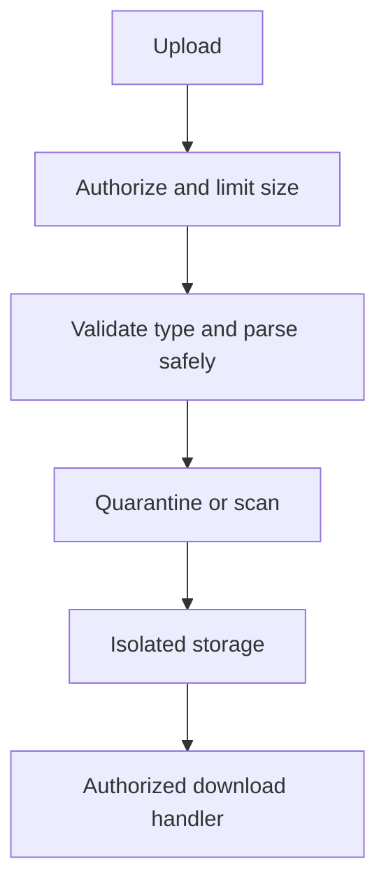

# File Uploads and Serialization

Uploads and serialized data cross trust boundaries. A filename, extension, MIME type, or client-side validation alone is not proof that content is safe.

## Upload defenses
- Apply authentication, authorization, size limits, and request quotas.
- Allowlist business-required formats; inspect content using maintained parsers and do not trust the supplied MIME type.
- Generate storage names, store outside executable web roots, and isolate processing.
- Scan or transform files where appropriate; defend against archive bombs and path traversal.
- Serve downloads with safe content types and attachment disposition when appropriate.
- Avoid unsafe native deserialization of untrusted data; prefer explicit schemas and safe formats.

## Upload pipeline

References: [OWASP File Upload Cheat Sheet](https://cheatsheetseries.owasp.org/cheatsheets/File_Upload_Cheat_Sheet.html), [OWASP Deserialization](https://cheatsheetseries.owasp.org/cheatsheets/Deserialization_Cheat_Sheet.html).
