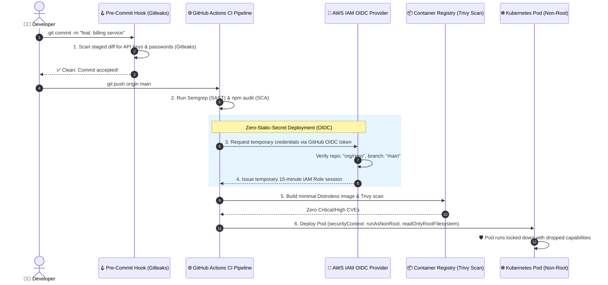

# ☁️ Cloud Infrastructure, Container & DevSecOps Security

> The master engineering blueprint for zero-trust cloud architecture: IAM least-privilege, Workload Identity (OIDC), container hardening, and automated DevSecOps CI/CD gates.

---

## 1. 🎯 Overview & Intuitive Mental Model

### The Production Hook
You can write the most hardened, bug-free TypeScript code in the world, but if your AWS IAM policy grants `Resource: "*", Action: "*"` to an EC2 instance, or if your developer commits an AWS access key to a public GitHub repository, your entire company infrastructure can be held for ransom within 20 minutes.

Security in modern systems is an infrastructure-wide continuum: **Code -> Dependency -> Container -> Pipeline -> Cloud IAM**. Modern DevSecOps automates security gates inside the continuous delivery pipeline: scanning dependencies for vulnerabilities (SCA), auditing source code (SAST), detecting exposed secrets before commits land in git, and enforcing immutable, non-root container runtimes.

### 🧠 The Fun Analogy: The "Nuclear Submarine Compartments"
Imagine a deep-sea naval submarine:
- **Flawed Architecture (The Hollow Hull):** The submarine is one giant hollow cavern. If a torpedo punches a 2-inch hole anywhere in the hull (a single compromised container or leaked AWS key), water rushes in and drowns all 120 crew members instantly.
- **DevSecOps & Zero-Trust (Watertight Bulkheads):**
  1. **Watertight Bulkheads (Container Hardening):** Every room is sealed with heavy steel doors. Even if an attacker compromises the web container, it runs as `USER 1000` with a read-only root filesystem and zero Linux capabilities (`cap_drop: ALL`). The attacker cannot install tools or touch the kernel.
  2. **Biometric Air Locks (Workload Identity / OIDC):** Nobody gets permanent master keys (no static AWS keys stored in GitHub Actions secrets). When the deployment robot wants to deploy code, it uses a temporary 15-minute cryptographic passport (OIDC token exchange).
  3. **X-Ray Cargo Scanners (CI/CD Gates):** Every crate loaded onto the sub is scanned by automated sensors (Gitleaks, Semgrep, Trivy) to ensure no smuggled contraband enters production.

### Severity & Impact
- **OWASP Category:** [A05:2021 – Security Misconfiguration](https://owasp.org/Top10/A05_2021-Security_Misconfiguration/), [A06:2021 – Vulnerable and Outdated Components](https://owasp.org/Top10/A06_2021-Vulnerable_and_Outdated_Components/)
- **Common Weakness Enumeration (CWE):**
  - **CWE-250:** Execution with Unnecessary Privileges (Running container as root)
  - **CWE-798:** Use of Hard-coded Credentials
  - **CWE-1395:** Dependency on Vulnerable Third-Party Component
- **Blast Radius:** Total cloud account takeover, cryptocurrency mining hijack, ransomware extortion, complete intellectual property exfiltration.

---

## 2. 🎨 Interactive Visual Architecture



> 💡 **Visual Inspection Tip:** In AWS Console, open **IAM** > **Roles**. Inspect the **Trust Relationships** tab. Confirm that roles used by CI/CD use `Principal: Federated: accounts.google.com` or `token.actions.githubusercontent.com` rather than long-lived `aws_access_key_id` credentials. In Kubernetes, run `kubectl get pod <name> -o yaml` and check `securityContext.runAsNonRoot: true`.

---

## 3. 💥 Real-World Exploit Walkthrough

### Scenario: The Leaked Static AWS Key & Root Container Escape
A developer stored static `AWS_ACCESS_KEY_ID` and `AWS_SECRET_ACCESS_KEY` in GitHub repository secrets. The Dockerfile ran as default `root`, and the IAM user had full administrative permissions (`AdministratorAccess`).

#### ❌ Vulnerable Dockerfile & IAM Policy
```dockerfile
# Vulnerable Dockerfile
FROM node:20

# ⚠️ FLAW 1: Runs as root by default!
WORKDIR /app
COPY package*.json ./
RUN npm install
COPY . .

# ⚠️ FLAW 2: Allows write access to root filesystem and installs full build tooling
EXPOSE 3000
CMD ["node", "server.js"]
```

```json
/* ⚠️ CATASTROPHIC FLAW: Overly permissive IAM Policy attached to CI/CD user */
{
  "Version": "2012-10-17",
  "Statement": [
    {
      "Effect": "Allow",
      "Action": "*",
      "Resource": "*"
    }
  ]
}
```

#### 💥 The Attacker's Exploit Execution
1. The developer accidentally opens a public fork or an attacker compromises a third-party CI dependency.
2. The attacker extracts the static `AWS_SECRET_ACCESS_KEY` from the CI build logs or environment variables.
3. The attacker spins up 50 GPU instances in AWS (`p3.16xlarge`) across 5 global regions to mine Monero, costing the company $35,000 in 48 hours.
4. If an RCE occurs inside the container, because the process runs as `root`, the attacker can inspect host network namespaces and attempt container escape exploits (`CVE-2024-21626`).

---

## 4. 🛡️ Resolution & Defense-in-Depth

### Hardened Production Multi-Stage Distroless Dockerfile
```dockerfile
# syntax=docker/dockerfile:1.4
# Stage 1: Build & Dependencies
FROM node:20-alpine AS builder

WORKDIR /build
COPY package*.json ./
RUN npm ci --omit=dev

COPY . .
RUN npm run build

# 🛡️ Stage 2: Minimal Distroless Production Runtime
# Google Distroless contains NO shell (bash/sh), NO package managers, and NO compilers!
FROM gcr.io/distroless/nodejs20-debian12:nonroot

WORKDIR /app

# Copy production artifacts from builder
COPY --from=builder --chown=nonroot:nonroot /build/dist ./dist
COPY --from=builder --chown=nonroot:nonroot /build/node_modules ./node_modules
COPY --from=builder --chown=nonroot:nonroot /build/package.json ./package.json

# 🛡️ Enforce Non-Root Execution (UID 65532)
USER nonroot

ENV NODE_ENV=production
EXPOSE 3000

# Runs directly without a shell: Attacker cannot execute /bin/sh commands!
CMD ["dist/server.js"]
```

### Production Kubernetes Hardened Pod Security Context
```yaml
# pod-security-blueprint.yaml
apiVersion: apps/v1
kind: Deployment
metadata:
  name: hardened-api
spec:
  replicas: 3
  template:
    spec:
      securityContext:
        # 🛡️ Prevent running as root UID 0
        runAsNonRoot: true
        runAsUser: 10001
        runAsGroup: 10001
        fsGroup: 10001
        seccompProfile:
          type: RuntimeDefault
      containers:
        - name: api
          image: company/api:1.0.0
          securityContext:
            # 🛡️ Make root filesystem read-only (prevents writing malware to disk)
            readOnlyRootFilesystem: true
            allowPrivilegeEscalation: false
            capabilities:
              drop:
                - ALL # Drop all 38 Linux kernel capabilities!
          resources:
            limits:
              cpu: "1"
              memory: "512Mi"
            requests:
              cpu: "250m"
              memory: "256Mi"
```

### GitHub Actions OIDC Workload Identity Blueprint (No Static Keys!)
```yaml
# .github/workflows/deploy.yml
name: Deploy Production API
on:
  push:
    branches: [main]

permissions:
  id-token: write # 🛡️ Mandatory for OIDC token minting
  contents: read

jobs:
  deploy:
    runs-on: ubuntu-latest
    steps:
      - uses: actions/checkout@v4

      # 🛡️ Authenticate to AWS via OIDC (Zero static passwords/keys!)
      - name: Configure AWS Credentials via OIDC
        uses: aws-actions/configure-aws-credentials@v4
        with:
          role-to-assume: arn:aws:iam::123456789012:role/GitHubActionsDeployRole
          aws-region: us-east-1

      # Automated Security Audit Gate in CI
      - name: Run Gitleaks Secret Scanner
        uses: gitleaks/gitleaks-action@v2
        env:
          GITHUB_TOKEN: ${{ secrets.GITHUB_TOKEN }}
```

---

## 5. 🧪 Hands-On Verification & Lab

### Testing Docker Container Privileges Locally
```bash
# 1. Inspect user UID inside container (Must NOT be 0)
docker run --rm company/api id
# Expected: uid=10001(nonroot) gid=10001(nonroot)

# 2. Verify that root filesystem is completely read-only
docker run --rm --read-only company/api touch /test-file
# Expected: touch: /test-file: Read-only file system

# 3. Verify absence of interactive shells (Distroless check)
docker run --rm company/api /bin/sh
# Expected: docker: Error response from daemon: failed to create task: exec: "/bin/sh": executable file not found
```

---

## 6. 📋 Code Review Checklist

- [ ] **No Static Cloud Secrets:** Are AWS/GCP static secret keys banned from GitHub Actions in favor of OIDC Workload Identity?
- [ ] **Distroless or Alpine Base:** Are production containers using minimal Distroless images without shells or build tools?
- [ ] **Non-Root Execution:** Does every Dockerfile declare `USER nonroot` or `USER 1000`?
- [ ] **Read-Only Root Filesystem:** Is `readOnlyRootFilesystem: true` enabled in Kubernetes manifests?
- [ ] **Dropped Linux Capabilities:** Are container capabilities dropped (`cap_drop: ALL`)?
- [ ] **Automated CI Security Scanners:** Are SAST (Semgrep), SCA (Trivy), and Secret Scanning (Gitleaks) blocking pull requests on High/Critical findings?
