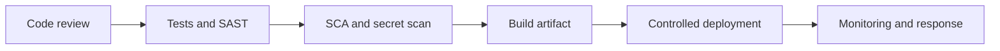

# Cloud, Infrastructure, and DevSecOps

Secure delivery requires least-privilege identities, controlled secrets, reproducible builds, patched dependencies, and monitoring. A secure application can still be exposed by an overly permissive cloud role or deployment pipeline.

## Controls
- Use short-lived workload identities where supported and scope permissions narrowly.
- Keep secrets out of source, logs, images, and client bundles; rotate exposed secrets promptly.
- Pin and review dependencies, scan for known vulnerabilities, and maintain a patch process.
- Harden container images, run as non-root, minimize capabilities, and restrict network access.
- Protect CI/CD credentials and production deployment approvals.
- Separate environments and data; monitor access and have a tested incident-response path.

## Delivery controls

References: [OWASP DevSecOps Guideline](https://owasp.org/www-project-devsecops-guideline/), [NIST SSDF](https://csrc.nist.gov/Projects/ssdf).
