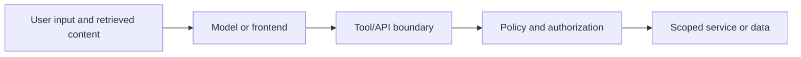

# Modern Apps, Micro-frontends, and AI

Multiple frontend applications and AI features add trust boundaries; they do not change the need for server-side authorization. Host applications, remote modules, tools, and retrieved documents should not be assumed trustworthy by default.

## Micro-frontends and SSR
- Treat remote bundles and runtime configuration as supply-chain and trust-boundary decisions.
- Keep authorization in APIs and backend services; a host shell or route guard is not sufficient.
- Avoid sharing secrets through browser globals, URLs, or local storage.
- For SSR, prevent server-only secrets from entering serialized page data and cache personalized responses safely.
- Validate postMessage origins and message schemas.

## AI/RAG and tool use
- Treat prompts, retrieved documents, and tool outputs as untrusted input.
- Separate instructions from retrieved content; do not let a document authorize a tool call.
- Enforce permissions and argument validation in the tool/backend layer.
- Minimize tool privileges, require confirmation for high-impact actions, and log safely.

## Trust boundaries

References: [OWASP Top 10 for LLM Applications](https://owasp.org/www-project-top-10-for-large-language-model-applications/), [MDN postMessage](https://developer.mozilla.org/en-US/docs/Web/API/Window/postMessage).
