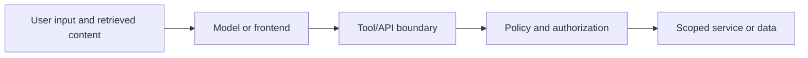

# Modern Apps, Micro-frontends, and AI

Multiple frontend applications and AI features add trust boundaries; they do not change the need for server-side authorization. Host applications, remote modules, tools, and retrieved documents should not be assumed trustworthy by default.

## Micro-frontends and SSR
- Treat remote bundles and runtime configuration as supply-chain and trust-boundary decisions.
- Keep authorization in APIs and backend services; a host shell or route guard is not sufficient.
- Avoid sharing secrets through browser globals, URLs, or local storage.
- For SSR, prevent server-only secrets from entering serialized page data and cache personalized responses safely.
- Validate postMessage origins and message schemas.

## AI/RAG and tool use
- Treat prompts, retrieved documents, and tool outputs as untrusted input.
- Separate instructions from retrieved content; do not let a document authorize a tool call.
- Enforce permissions and argument validation in the tool/backend layer.
- Minimize tool privileges, require confirmation for high-impact actions, and log safely.

## Trust boundaries

References: [OWASP Top 10 for LLM Applications](https://owasp.org/www-project-top-10-for-large-language-model-applications/), [MDN postMessage](https://developer.mozilla.org/en-US/docs/Web/API/Window/postMessage).

---

## 7. 🎥 Curated Video Walkthroughs & Primary References

### 📺 High-Impact Video Explanations
- 🎥 [Micro-Frontends Architecture Explained: Module Federation & Webpack (Jack Herrington)](https://www.youtube.com/watch?v=s_Fs4AXsTnA) — Real-world architecture sharing dependencies and sandboxing micro-apps.
- 🎥 [OWASP Top 10 for LLM & AI Applications (Snyk / Cyber In-Depth)](https://www.youtube.com/watch?v=1FfLg3x_l4k) — Deep dive into prompt injection, insecure output handling, and indirect data poisoning.
- 🎥 [Cross-Window Communication: postMessage Security Flaws (LiveOverflow)](https://www.youtube.com/watch?v=3m_4iWl8G8s) — Exploit walkthrough demonstrating origin validation bypasses in iframe event listeners.

### 📖 Primary Documentation & Specifications
- 📜 [OWASP Top 10 for Large Language Model (LLM) Applications](https://owasp.org/www-project-top-10-for-large-language-model-applications/) — Authoritative security standard for AI-integrated web applications.
- 📜 [Webpack Module Federation Architecture Guide](https://module-federation.io/) — Official documentation for federated dynamic runtime dependencies.
- 📜 [MDN Web Docs: Window.postMessage() API](https://developer.mozilla.org/en-US/docs/Web/API/Window/postMessage) — Cross-origin messaging security guidelines and origin checking requirements.

### 🧪 Interactive Hands-On Training Labs & Tools
- 🎯 [PortSwigger Lab: DOM XSS using web messages](https://portswigger.net/web-security/cross-site-scripting/dom-based/lab-dom-xss-using-web-messages) — Exploit missing origin checks in `window.addEventListener('message')`.
- 🎯 [PortSwigger Lab: DOM XSS using web messages and a JavaScript URL](https://portswigger.net/web-security/cross-site-scripting/dom-based/lab-dom-xss-using-web-messages-and-a-javascript-url) — Chain postMessage listener sinks to execute arbitrary JavaScript.

