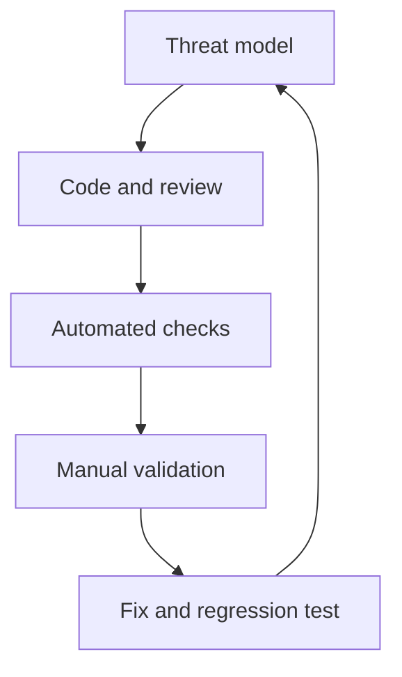

# Security Testing and Tools

Testing combines design review, automated checks, manual verification, and regression tests. Run active scanners only against systems you own or are authorized to assess, with an agreed scope.

## Testing layers
- Threat modeling and architecture review before implementation.
- Unit tests for validation, authorization, encoding, and error handling.
- SAST and secret scanning in pull requests.
- SCA and container/image scanning in build pipelines.
- DAST against controlled staging environments.
- Manual review for business logic, tenant isolation, and access-control gaps.

## Tools
- [OWASP ZAP](https://www.zaproxy.org/) — dynamic application testing.
- [Semgrep](https://semgrep.dev/) — static analysis rules.
- [Trivy](https://trivy.dev/) — container, filesystem, and dependency scanning.
- [PortSwigger Academy](https://portswigger.net/web-security) — authorized practice labs.

## Feedback loop

A clean scan does not prove security. Triage findings for exploitability, impact, false positives, and compensating controls. References: [OWASP WSTG](https://owasp.org/www-project-web-security-testing-guide/), [OWASP ASVS](https://owasp.org/www-project-application-security-verification-standard/).

---

## 7. 🎥 Curated Video Walkthroughs & Primary References

### 📺 High-Impact Video Explanations
- 🎥 [Web Security Testing with OWASP ZAP (Tanya Janca / SheHacksKe)](https://www.youtube.com/watch?v=kY31Wn6Vw6I) — Hands-on automated baseline and full active scanning with OWASP Zed Attack Proxy.
- 🎥 [Semgrep Crash Course: Static Code Analysis & Custom SAST Rules (Hussein Nasser)](https://www.youtube.com/watch?v=R6tV_W_6u_4) — Writing custom static analysis rules to flag security antipatterns before commit.
- 🎥 [DevSecOps in CI/CD: Automated Security Pipelines (TechWorld with Nana)](https://www.youtube.com/watch?v=F0_k239Xw4U) — Integrating SAST, SCA, container scanning, and secrets detection into GitHub Actions.

### 📖 Primary Documentation & Specifications
- 📜 [OWASP Web Security Testing Guide (WSTG v4.2)](https://owasp.org/www-project-web-security-testing-guide/) — The industry premier testing manual for penetration testers and software security teams.
- 📜 [OWASP Application Security Verification Standard (ASVS v4.0)](https://owasp.org/www-project-application-security-verification-standard/) — Standardized basis for testing web application technical security controls.
- 📜 [Semgrep Official Documentation & Rule Registry](https://semgrep.dev/docs/) — Declarative semantic code analysis engine.

### 🧪 Interactive Hands-On Training Labs & Tools
- 🎯 [OWASP Juice Shop Deliberately Vulnerable App](https://owasp.org/www-project-juice-shop/) — Test automated DAST tools (ZAP, Burp) and verify detection rates.
- 🎯 [PortSwigger Web Security Academy](https://portswigger.net/web-security) — Free guided hands-on vulnerability lab environments.

