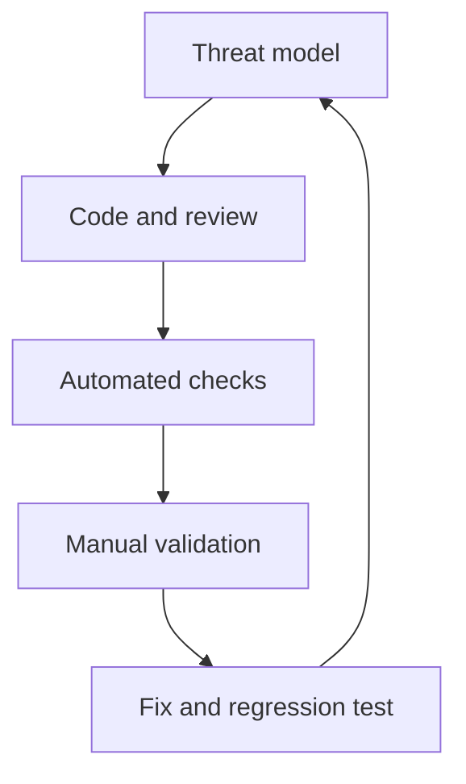

# Security Testing and Tools

Testing combines design review, automated checks, manual verification, and regression tests. Run active scanners only against systems you own or are authorized to assess, with an agreed scope.

## Testing layers
- Threat modeling and architecture review before implementation.
- Unit tests for validation, authorization, encoding, and error handling.
- SAST and secret scanning in pull requests.
- SCA and container/image scanning in build pipelines.
- DAST against controlled staging environments.
- Manual review for business logic, tenant isolation, and access-control gaps.

## Tools
- [OWASP ZAP](https://www.zaproxy.org/) — dynamic application testing.
- [Semgrep](https://semgrep.dev/) — static analysis rules.
- [Trivy](https://trivy.dev/) — container, filesystem, and dependency scanning.
- [PortSwigger Academy](https://portswigger.net/web-security) — authorized practice labs.

## Feedback loop

A clean scan does not prove security. Triage findings for exploitability, impact, false positives, and compensating controls. References: [OWASP WSTG](https://owasp.org/www-project-web-security-testing-guide/), [OWASP ASVS](https://owasp.org/www-project-application-security-verification-standard/).
