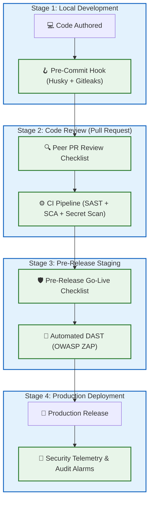

# 📋 Security Prevention Checklists & Pre-Flight Audits

> Actionable, production-ready security review checklists for engineers, tech leads, and security champions: Pull Requests, Frontend Sandboxes, APIs, Cloud Infra, and Incident Response.

---

## 1. 🎯 Overview & Intuitive Mental Model

### The Production Hook
Software engineering teams often view security checklists as bureaucratic compliance theater. But in high-reliability engineering (such as commercial aviation and aerospace), **checklists are the primary reason commercial air travel is the safest mode of transportation on earth**.

Before an airliner leaves the tarmac, pilots do not rely on memory; they methodically verify every single flap, gauge, and fuel valve. In web and distributed systems, deploying code without a pre-flight security review is equivalent to taking off in a blizzard with the de-icing equipment uninspected.

### 🧠 The Fun Analogy: The "NASA Apollo Flight Readiness Review"
- **Ad-Hoc Engineering (No Checklist):** The astronauts climb into the spacecraft. The engineer says: *"I think Bob tightened the oxygen valve yesterday, and Jane usually checks the heat shield."* Result: Catastrophic failure during atmospheric re-entry.
- **Flight Readiness Checklists:** Every subsystem (Propulsion, Navigation, Life Support, Telemetry) has an explicit, non-negotiable checklist. Every item has an owner, an automated verification procedure, and a go/no-go criterion. If a single item fails, the launch halts until the discrepancy is resolved.

### Severity & Impact
- **OWASP Category:** [OWASP Application Security Verification Standard (ASVS 4.0)](https://owasp.org/www-project-application-security-verification-standard/)
- **Common Weakness Enumeration (CWE):**
  - **CWE-1059:** Incomplete Documentation of Security Architecture
  - **CWE-1008:** Architectural Errors
- **Blast Radius:** Catching bugs at the PR stage costs **1x**; catching them in QA costs **10x**; remediating a live customer breach costs **100x to 1000x**.

---

## 2. 🎨 Interactive Visual Architecture



> 💡 **Visual Inspection Tip:** Turn these checklists into GitHub/GitLab Pull Request templates (`.github/pull_request_template.md`). When developers submit code, the checklist automatically populates in the PR description, prompting reviewers to confirm that security controls are satisfied before merging.

---

## 3. 💥 Real-World Exploit Walkthrough

### Scenario: The Bypassed PR Review & Missing Row Scope
A developer created an endpoint to update user notification preferences: `PUT /api/v1/users/:userId/notifications`. In the PR review, the reviewer checked formatting and unit test coverage, but failed to verify whether the handler validated object ownership.

#### ❌ The Flawed Code Merged to Production
```typescript
// vulnerable-pr-code.ts
app.put('/api/v1/users/:userId/notifications', async (req, res) => {
  const { emailAlerts, smsAlerts } = req.body;
  const { userId } = req.params;

  // ⚠️ MISSED IN CODE REVIEW: Server completely ignores authenticated user ID!
  // Any user can update ANY other user's notification phone number and email!
  await db.query(
    'UPDATE notifications SET email_alerts = $1, sms_alerts = $2 WHERE user_id = $3',
    [emailAlerts, smsAlerts, userId]
  );

  res.json({ success: true });
});
```

#### 💥 The Exploit
An attacker changes the notification email on administrator accounts to an attacker-controlled inbox, requests a password reset, and takes over the system—all because the PR reviewer lacked a structured checklist!

---

## 4. 🛡️ The Master Production Checklists

### 📋 Checklist 1: Pull Request (PR) Security Review
Every engineer reviewing a pull request must audit:
- [ ] **Zero Client Trust:** Are all authorization, validation, and business invariants enforced on the server, even if already checked in React/Vue?
- [ ] **Object-Level Authorization (BOLA/IDOR):** Does every query that accesses or mutates an object filter by `user_id` or `tenant_id`?
- [ ] **No Raw SQL Concatenation:** Are all database queries parameterized ($1, ?) with zero template string interpolation?
- [ ] **No Secrets in Code or Diffs:** Are API keys, test passwords, private tokens, or connection strings absent from all commits?
- [ ] **Strict Input Schemas:** Is incoming request data parsed against a typed validation schema (e.g. Zod) before use?
- [ ] **Safe Output Rendering:** Are user-provided values safely encoded? Is `dangerouslySetInnerHTML` avoided or scrubbed with DOMPurify?
- [ ] **Error Handling & Masking:** Do API error responses hide database syntax, stack traces, and internal server topology?

---

### 🌐 Checklist 2: Frontend & Browser Security
- [ ] **Content Security Policy (CSP):** Is a strict CSP deployed with nonces (`'strict-dynamic'`), `object-src 'none'`, and `base-uri 'none'`?
- [ ] **Anti-Framing (Clickjacking):** Does the document return `Content-Security-Policy: frame-ancestors 'none';` (or `'self'`) and `X-Frame-Options: DENY`?
- [ ] **Token Storage Location:** Are access tokens stored in JavaScript memory and refresh tokens in `HttpOnly; Secure; SameSite=Strict; __Host-` cookies? (Zero JWTs in `localStorage`!)
- [ ] **Same-Origin Messaging (`postMessage`):** Does every `message` listener verify `event.origin` against an immutable allowlist? Does every outgoing message specify an explicit target origin?
- [ ] **Protocol Sanitization:** Are dynamic anchor links (`<a href={url}>`) validated to block `javascript:` and `data:` URLs?

---

### 🚪 Checklist 3: Backend & API Hardening
- [ ] **Authentication Lifecycle:** Are session identifiers regenerated upon login to defeat Session Fixation (CWE-384)?
- [ ] **JWT Hardening:** Is the signing algorithm explicitly pinned (`algorithms: ['RS256']`) to eliminate `alg: none` and key confusion?
- [ ] **Strict CORS Allowlist:** Is CORS configured with an explicit Set of permitted origins (zero blind reflection of `req.headers.origin`)?
- [ ] **Rate Limiting Active:** Are rate limits enforced on authentication routes (max 5/min) and general endpoints using distributed Redis sliding windows?
- [ ] **Idempotent Mutations:** Do financial and order endpoints require an `Idempotency-Key` header with distributed locking?
- [ ] **SSRF Egress Filtering:** Do webhook and avatar URL fetchers resolve DNS and block private/loopback/cloud metadata IP ranges (`169.254.169.254`)?
- [ ] **File Upload Defense:** Are file types validated via magic byte sniffing (`file-type`), stored under random UUIDs, and hosted outside the web root?

---

### ☁️ Checklist 4: Cloud, Containers & DevSecOps
- [ ] **OIDC Workload Identity:** Are CI/CD pipelines deploying using temporary OIDC credentials rather than static AWS/GCP keys?
- [ ] **Non-Root Containers:** Do Dockerfiles declare `USER nonroot` or `USER 1000`?
- [ ] **Read-Only Root Filesystem:** Is `readOnlyRootFilesystem: true` enabled in Kubernetes pod specs?
- [ ] **Dropped Linux Capabilities:** Are all container capabilities dropped (`cap_drop: ALL`)?
- [ ] **Automated CI Scanners:** Are Semgrep (SAST), Trivy (SCA/Containers), and Gitleaks (Secret Scanning) active in the build pipeline?
- [ ] **IMDSv2 Enforced:** Is AWS IMDSv2 (`http-tokens: required`) mandated on all EC2 instances to neutralize SSRF?

---

### 🚀 Checklist 5: Production Go-Live Gate
- [ ] **HSTS Preload:** Is `Strict-Transport-Security: max-age=31536000; includeSubDomains; preload` configured?
- [ ] **MIME-Sniffing Prevention:** Is `X-Content-Type-Options: nosniff` returned on all responses?
- [ ] **Default Deny Firewall:** Are all non-essential ports closed at the cloud security group layer?
- [ ] **Immutable Audit Logging:** Are all administrative, login, and financial events recorded in an append-only log without logging passwords or tokens?
- [ ] **Automated Backups:** Are automated database backups enabled with point-in-time recovery and tested restoration drills?

---

### 🚨 Checklist 6: Incident Response & Containment Playbook
- [ ] **Kill-Switch Implemented:** Can user sessions be revoked globally via Redis timestamp invalidation?
- [ ] **Token Revocation API:** Can specific API keys or OAuth clients be revoked in sub-second time?
- [ ] **Emergency Secret Rotation:** Is there a documented, tested procedure to rotate database credentials and JWT signing keys within 15 minutes?
- [ ] **Audit Trail Preservation:** Are logs shipped off-host to a central collector (e.g. Datadog, CloudWatch, Splunk) with write-once permissions?

---

## 5. 🧪 Hands-On Verification & Lab

### Setting Up Automated Pre-Commit Secret Scanning (Husky + Gitleaks)
Enforce pre-commit protection automatically on developer workstations:

```bash
# 1. Install Husky
npm install husky --save-dev
npx husky init

# 2. Add Gitleaks pre-commit hook
cat << 'EOF' > .husky/pre-commit
#!/bin/sh
# 🛡️ Run Gitleaks secret scanner on staged files
if command -v gitleaks >/dev/null 2>&1; then
  gitleaks protect --staged --verbose
  if [ $? -ne 0 ]; then
    echo "❌ [SECURITY ALERT] Gitleaks detected secrets in staged files! Commit rejected."
    exit 1
  fi
fi
EOF

chmod +x .husky/pre-commit
```

---

## 6. 📋 Code Review Checklist Summary

- [ ] **PR Template Integrated:** Is this checklist embedded into `.github/pull_request_template.md`?
- [ ] **Peer Verification:** Does every pull request require at least one approving review before merge?
- [ ] **Automated CI Blockers:** Are pull requests blocked from merging if automated security tests fail?
- [ ] **Regular Audit Drills:** Does the team conduct quarterly threat modeling and checklist review sessions?

---

## 7. 🎥 Curated Video Walkthroughs & Primary References

### 📺 High-Impact Video Explanations
- 🎥 [OWASP Top 10 Explained by Security Professionals (Computerphile)](https://www.youtube.com/watch?v=F0O5Q_P6a40) — Essential briefing on modern application threat vectors.
- 🎥 [How to Perform a Security Code Review (OWASP Foundation)](https://www.youtube.com/watch?v=kYUP7W_5y0w) — Methodical peer review techniques for detecting vulnerabilities in pull requests.
- 🎥 [Application Security Verification Standard (ASVS) in Practice (OWASP)](https://www.youtube.com/watch?v=2r1o_i1R8vY) — How engineering teams operationalize checklists into automated pipelines.

### 📖 Primary Documentation & Specifications
- 📜 [OWASP Application Security Verification Standard (ASVS 4.0)](https://owasp.org/www-project-application-security-verification-standard/) — The industry benchmark for application security requirements.
- 📜 [OWASP Code Review Guide](https://owasp.org/www-project-code-review-guide/) — Comprehensive handbook for manual and automated secure code auditing.
- 📜 [NIST Secure Software Development Framework (SSDF SP 800-218)](https://csrc.nist.gov/Projects/ssdf) — National cybersecurity standards for software delivery lifecycles.

### 🧪 Interactive Hands-On Training Labs
- 🎯 [OWASP Juice Shop Deliberately Vulnerable Web App](https://owasp.org/www-project-juice-shop/) — Practice auditing and testing against real-world prevention checklists.
