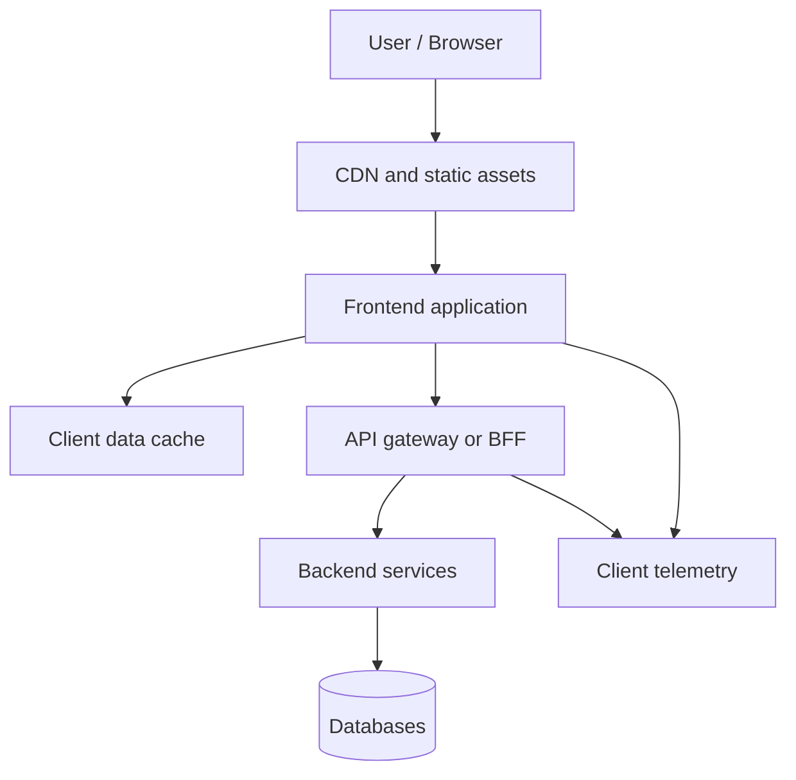

# Frontend System Design

A practical curriculum for senior frontend and lead engineers designing scalable, accessible, secure, and maintainable browser applications. It complements the security chapters rather than replacing them.

## Study plan
Follow the [15-day Frontend System Design study plan](15-day-study-plan.md) and use the [video resource list](../resources/FRONTEND_SYSTEM_DESIGN_VIDEOS.md) for guided learning.

## A repeatable interview framework

1. **Clarify requirements:** user journeys, functional scope, devices, accessibility, offline needs, real-time expectations, and failure modes.
2. **Estimate scale:** users, request rates, payload sizes, update frequency, media volume, and latency targets.
3. **Define boundaries:** browser, CDN/edge, frontend app, API gateway/BFF, backend services, data stores, and third parties.
4. **Design the data flow:** API contracts, pagination, caching, state ownership, synchronization, and error handling.
5. **Design the UI structure:** routes, components, state boundaries, design system, and module ownership.
6. **Address quality attributes:** performance, security, accessibility, reliability, observability, and maintainability.
7. **Explain trade-offs:** why this design fits the constraints, what it costs, and how it evolves.
8. **Close with validation:** tests, metrics, rollout, fallback behavior, and risks.

## Architecture overview

The diagram is a starting point, not a universal architecture. A small product may not need a BFF or separate services; add boundaries when they solve a real problem.

## Curriculum

| Module | Learn and practice |
|---|---|
| [Networking and communication](communication-patterns.md) | HTTP, REST, GraphQL, gRPC, polling, WebSockets, SSE, WebRTC, webhooks |
| [Performance and caching](performance-and-caching.md) | rendering, Core Web Vitals, CDN, HTTP cache, app cache, code splitting |
| [Low-level design](low-level-design.md) | component contracts, state, design patterns, SOLID, common UI widgets |
| [High-level design](high-level-design.md) | feeds, chat, e-commerce, video, collaborative editors, dashboards |
| [Offline, accessibility, and observability](offline-accessibility-observability.md) | PWA, service workers, keyboard/screen reader support, telemetry and alerts |
| [System design video resources](../resources/FRONTEND_SYSTEM_DESIGN_VIDEOS.md) | Namaste FSD introduction, curriculum repo, topic-focused learning links |

## Important architecture decisions

- **CSR vs SSR vs SSG vs streaming:** choose based on SEO, personalization, time-to-first-byte, interactivity, and infrastructure cost.
- **REST vs GraphQL vs gRPC:** choose by client needs, schema/tooling, caching, network constraints, and service boundaries.
- **Polling vs SSE vs WebSockets vs WebRTC:** choose based on directionality, latency, connection scale, and media requirements.
- **Local state vs URL state vs server cache:** assign each kind of state a clear owner; avoid duplicating server data in multiple stores without a reason.
- **Monolith vs micro-frontends:** use micro-frontends when independent team delivery or runtime isolation justifies integration and operational complexity.
- **Client cache vs HTTP/CDN cache:** distinguish freshness, invalidation, authorization, and cache scope.
- **Optimistic UI vs confirmed updates:** use optimistic updates only when rollback/conflict behavior is defined.

## Review checklist

- [ ] Requirements and non-functional goals are explicit.
- [ ] API contracts include pagination, errors, timeouts, and retry rules.
- [ ] State has a clear source of truth and invalidation strategy.
- [ ] Large lists and expensive UI use virtualization or measured optimization where useful.
- [ ] Loading, empty, partial, offline, and failure states are designed.
- [ ] Accessibility, localization, and reduced-motion needs are included.
- [ ] Security controls are server-enforced and align with the security chapters.
- [ ] Client errors, performance metrics, and API failures are observable without logging secrets.
- [ ] Testing covers behavior, integration, accessibility, and critical user journeys.
- [ ] Trade-offs and deferred work are documented.

## Practice prompts

1. Design an autocomplete component with debouncing, cancellation, caching, keyboard navigation, and accessibility.
2. Design an infinite-scroll feed with cursor pagination, virtualization, deduplication, and recovery from network failure.
3. Design a real-time chat interface with reconnect, ordering, optimistic sends, and unread counts.
4. Design a shared design system consumed by React and Angular applications.
5. Design a dashboard with filters in the URL, cached queries, stale data indicators, and export.
6. Design an offline-capable PWA with safe synchronization and conflict handling.

## References

- [Namaste Frontend System Design course](https://namastedev.com/learn/namaste-frontend-system-design)
- [NamasteDev curriculum repository](https://github.com/namastedev/namaste-frontend-system-design)
- [Frontend system design interview guide](https://www.systemdesignhandbook.com/guides/frontend-system-design-interview/)
- [MDN Web APIs and web platform documentation](https://developer.mozilla.org/en-US/docs/Web)
