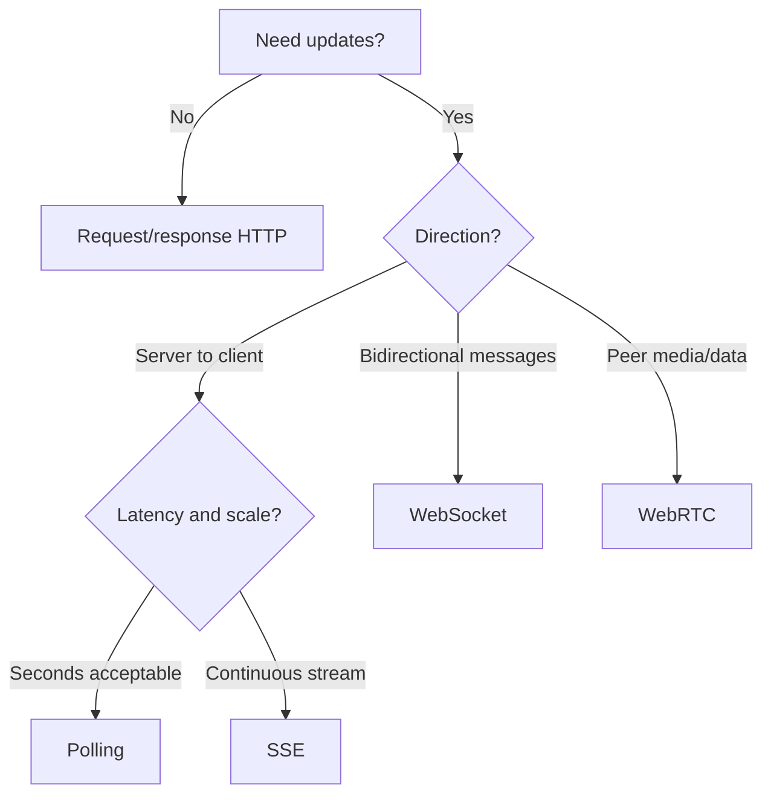
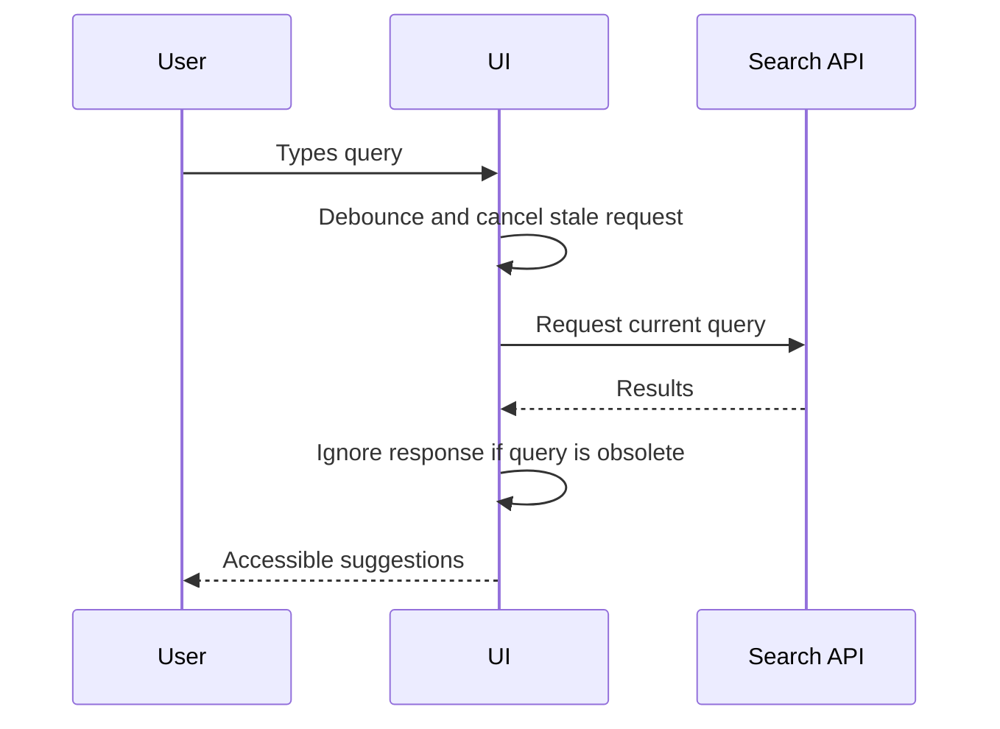

# Networking and Communication Patterns

Choose communication based on interaction requirements, not trend.

## Request/response options

| Pattern | Strengths | Trade-offs / use when |
|---|---|---|
| REST over HTTP | Simple, broadly supported, HTTP caching works well | Multiple resources may require multiple requests; design stable resource contracts |
| GraphQL | Client requests shaped data; useful for varied client views | Query complexity, authorization at resolvers, caching and observability need care |
| gRPC | Typed service contracts, efficient binary protocol, streaming support | Browser use often needs gRPC-Web or a gateway; less directly inspectable |
| Short polling | Simple, works with standard HTTP | Repeated requests and latency between polls |
| Long polling | Near-real-time without persistent bidirectional socket | Connection management and server resource use |
| Server-Sent Events (SSE) | Server-to-client event stream over HTTP | One-way stream; reconnect and event IDs matter |
| WebSockets | Bidirectional low-latency messages | Connection lifecycle, backpressure, auth and scaling complexity |
| WebRTC | Peer media/data paths, useful for voice/video | Signaling, NAT traversal, TURN costs and connectivity complexity |
| Webhooks | Server-to-server event notification | Not a browser transport; receiver must verify signatures and handle retries/idempotency |

## Realtime decision guide

## Resilience requirements

- Set connection and request timeouts.
- Retry only safe/idempotent operations, with bounded exponential backoff and jitter.
- Cancel obsolete UI requests when filters or routes change.
- Define ordering, deduplication, idempotency, reconnect, and replay semantics for event-driven interfaces.
- Apply backpressure or bounded queues so slow consumers do not accumulate unlimited work.
- Treat API errors as typed states: loading, success, empty, partial, unauthorized, rate-limited, offline, and failed.
- Authenticate connections and authorize sensitive actions server-side.
- For streaming protocols, define heartbeat, idle timeout, reconnect policy, and deployment behavior.

## Example: autocomplete request flow

## Interview prompts

- When would you choose SSE over WebSockets?
- How do you avoid stale responses overwriting newer search results?
- How do you design reconnect and duplicate-event handling?
- How do pagination and rate limits affect API contracts?

References: [MDN WebSockets](https://developer.mozilla.org/en-US/docs/Web/API/WebSockets_API), [MDN Server-Sent Events](https://developer.mozilla.org/en-US/docs/Web/API/Server-sent_events), [MDN WebRTC](https://developer.mozilla.org/en-US/docs/Web/API/WebRTC_API), [MDN Fetch](https://developer.mozilla.org/en-US/docs/Web/API/Fetch_API).

---

## 7. 🎥 Curated Video Walkthroughs & Primary References

### 📺 High-Impact Video Explanations
- 🎥 [WebSockets vs SSE vs Long Polling (ByteByteGo)](https://www.youtube.com/watch?v=1bXyG2pT7R8) — Visual comparison of connection lifecycles, HTTP headers, and server concurrency.
- 🎥 [REST vs GraphQL vs gRPC: What to Choose in 2024 (Hussein Nasser)](https://www.youtube.com/watch?v=I43nshX7wZ8) — Deep networking analysis of payload size, serializing JSON vs Protobuf, and HTTP/2 multiplexing.
- 🎥 [WebRTC Crash Course: Peer-to-Peer Realtime Communication (Hussein Nasser)](https://www.youtube.com/watch?v=FExZvpVvYxA) — Detailed breakdown of STUN, TURN, ICE candidates, and SDP offer/answer handshakes.

### 📖 Primary Documentation & Specifications
- 📜 [MDN Web Docs: WebSockets API](https://developer.mozilla.org/en-US/docs/Web/API/WebSockets_API) — Full API reference for client socket handling, error recovery, and binary streams.
- 📜 [MDN Web Docs: Server-Sent Events (EventSource)](https://developer.mozilla.org/en-US/docs/Web/API/Server-sent_events) — Single-direction HTTP event streaming spec and reconnection logic.
- 📜 [MDN Web Docs: WebRTC API](https://developer.mozilla.org/en-US/docs/Web/API/WebRTC_API) — Peer-to-peer data channels and audio/video streaming standards.

### 🧪 Interactive Hands-On Training Labs
- 🎯 [Postman WebSocket Echo & Realtime Testing Sandbox](https://www.postman.com/postman/workspace/published-postman-templates/documentation/631643-f69797be-2178-4395-97df-66a7b3db0c5a) — Practice building and debugging live WebSocket connections.
- 🎯 [Socket.io Interactive Chat Walkthrough](https://socket.io/get-started/chat) — Step-by-step implementation of real-time event broadcasting and rooms.

