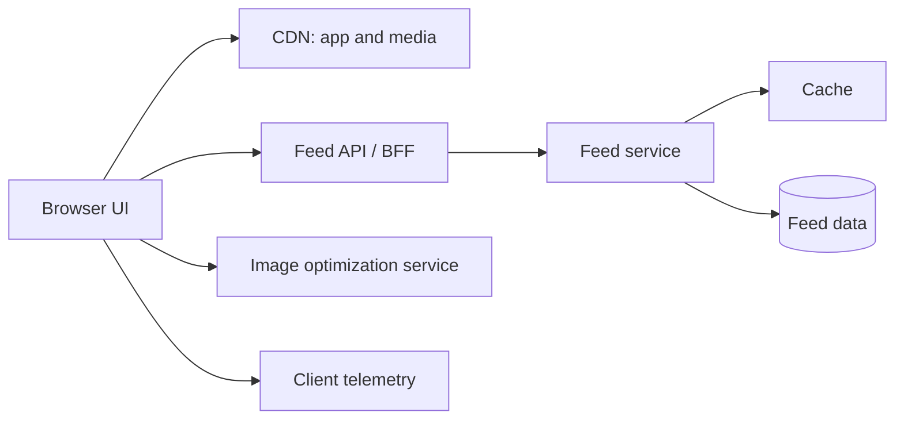

# Frontend High-Level Design (HLD)

HLD describes system boundaries, major components, data flow, scale assumptions, quality attributes, and trade-offs. Start with requirements; do not jump straight to a fashionable stack.

## Case study framework

For each prompt:
1. Clarify product scope and core user journeys.
2. Estimate users, concurrency, update frequency, data size, and latency.
3. Draw browser, CDN, frontend, API/BFF, services, storage, and telemetry boundaries.
4. Define APIs, data contracts, pagination, cache behavior, and failure handling.
5. Explain rendering, state, accessibility, security, testing, and deployment.
6. Discuss scaling bottlenecks, trade-offs, and evolution.

## Example: social feed

Discuss cursor pagination, ranking latency, skeleton/loading states, media lazy loading, virtualization, optimistic likes, cache invalidation, moderation, and accessibility.

## Case study prompts

| Product | Main design challenges |
|---|---|
| Social/photo feed | Cursor pagination, ranking, image delivery, optimistic actions, virtualization |
| E-commerce marketplace | Search/filter URL state, inventory freshness, cart consistency, checkout resilience |
| Video streaming | Adaptive streaming, CDN delivery, player state, captions, network changes |
| Collaborative document | Realtime updates, conflict resolution, offline edits, presence, undo/redo |
| Live chat/comments | Ordering, reconnect, event replay, unread counts, optimistic messages |
| Analytics dashboard | Query filters, large datasets, charts, export jobs, stale-data indicators |
| Ride-hailing map | Geolocation permissions, map performance, live updates, battery and privacy |
| Design tool | Canvas rendering, keyboard access, undo/redo, collaborative state |
| Shared design system | Versioning, multi-team ownership, visual regression, migration strategy |
| Micro-frontend portal | Deployment independence, routing, shared dependencies, failure isolation and auth boundaries |

## Architecture trade-offs to articulate

- SSR improves initial HTML and can help SEO, but introduces server cost and cache/personalization complexity.
- Micro-frontends can support independent delivery, but increase runtime, dependency, testing, and observability complexity.
- Optimistic UI improves perceived latency, but requires rollback and conflict behavior.
- WebSockets reduce update latency, but add connection lifecycle and scaling costs.
- A BFF can simplify client contracts, but becomes another service to operate.
- Global state can simplify cross-route sharing, but overuse creates coupling; keep local state local.

References: [System Design Handbook — Frontend System Design](https://www.systemdesignhandbook.com/guides/frontend-system-design/), [Namaste FSD curriculum repository](https://github.com/namastedev/namaste-frontend-system-design).

---

## 7. 🎥 Curated Video Walkthroughs & Primary References

### 📺 High-Impact Video Explanations
- 🎥 [Frontend System Design: Design Facebook / Twitter Feed (ByteByteGo)](https://www.youtube.com/watch?v=kY31Wn6Vw6I) — End-to-end HLD covering cursor pagination, optimistic mutations, image lazy loading, and caching.
- 🎥 [Design an E-Commerce Web App Frontend Architecture (Chirag Goel)](https://www.youtube.com/watch?v=rc3JGT56kd4) — High-level design breakdown of cart synchronization, SEO SSR rendering, and checkout flows.
- 🎥 [Micro-Frontends Architecture at Scale (Jack Herrington)](https://www.youtube.com/watch?v=s_Fs4AXsTnA) — Real-world enterprise case study of independent deployment, Module Federation, and shared state.

### 📖 Primary Documentation & Specifications
- 📜 [System Design Primer: System Architecture Foundations](https://github.com/donnemartin/system-design-primer) — Open-source industry guide on scalability, caches, CDNs, and proxies.
- 📜 [BFF Architectural Pattern (Sam Newman)](https://samnewman.io/patterns/architectural/bff/) — Definitive guide to tailoring Backend-for-Frontend services for web and mobile clients.
- 📜 [W3C Architecture of the World Wide Web](https://www.w3.org/TR/webarch/) — Foundational principles of web protocol design and resource representation.

### 🧪 Interactive Hands-On Training Labs & Case Studies
- 🎯 [GreatFrontEnd HLD Interactive Practice Platform](https://www.greatfrontend.com/system-design) — Practice full 45-minute architectural whiteboard simulations.
- 🎯 [NamasteDev HLD Case Studies & Code Samples](https://github.com/namastedev/namaste-frontend-system-design) — Complete reference implementations for streaming feeds, dashboards, and portals.

