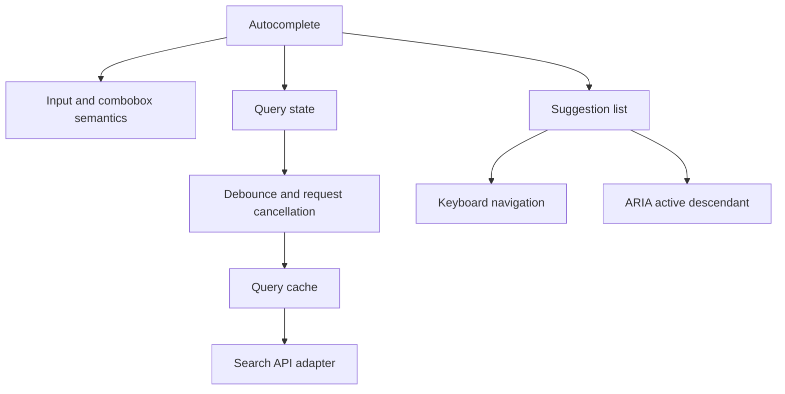

# Frontend Low-Level Design (LLD)

LLD explains component responsibilities, public contracts, state transitions, data models, and interaction details.

## Design a component contract

For each component, document:
- Purpose and non-goals.
- Inputs, outputs, events, and controlled/uncontrolled behavior.
- State ownership and derived state.
- Loading, empty, error, disabled, and partial states.
- Accessibility semantics and keyboard behavior.
- Data fetching boundaries and cancellation.
- Test strategy and extension points.

## Patterns worth understanding

- **Composition over inheritance:** compose focused components and slots.
- **Container/presentation separation:** useful when it clarifies data orchestration, but not a mandatory split for every component.
- **State machine:** model complex flows such as uploads, checkout, or multi-step forms explicitly.
- **Adapter:** normalize inconsistent API or third-party library interfaces.
- **Observer/pub-sub:** coordinate events when a direct dependency would be too coupled; define ownership and cleanup.
- **Strategy:** encapsulate interchangeable policies such as sorting or validation.
- **Factory:** centralize creation when setup is complex or varies by configuration.

## Example: autocomplete LLD

Key decisions: debounce delay, cancellation, stale response protection, keyboard navigation, selection behavior, empty state, retry behavior, and accessible announcements.

## Practice designs

1. **Infinite scroll:** cursor-based pagination, duplicate prevention, IntersectionObserver, cancellation, virtualization, retry, and accessible alternative controls.
2. **Nested comments:** tree model, collapse/expand, pagination, optimistic reply, and depth limits.
3. **Image carousel:** keyboard support, focus behavior, touch gestures, lazy loading, and reduced motion.
4. **Live chat:** message ordering, pending/failed states, reconnect, unread count, and bounded rendering.
5. **Form builder:** schema, validation, dirty state, async validation, error summaries, and autosave.
6. **Design system:** tokens, theme, versioning, semantic components, visual regression, and compatibility.

## Testing

Use unit tests for pure logic, component tests for user behavior, integration tests for data flow, and E2E tests for critical journeys. Prefer accessible role/name queries. Include keyboard and failure-path tests, not only happy paths.

References: [React Thinking in React](https://react.dev/learn/thinking-in-react), [Testing Library](https://testing-library.com/docs/), [WAI-ARIA Authoring Practices](https://www.w3.org/WAI/ARIA/apg/).

---

## 7. 🎥 Curated Video Walkthroughs & Primary References

### 📺 High-Impact Video Explanations
- 🎥 [Frontend Machine Coding / LLD: Building an Autocomplete System (Chirag Goel)](https://www.youtube.com/watch?v=RCZ8mvsKEu4) — Complete step-by-step breakdown of debouncing, LRU caching, race conditions, and ARIA roles.
- 🎥 [Frontend LLD: Virtualized Infinite Scroll Feed (Akshay Saini)](https://www.youtube.com/watch?v=rc3JGT56kd4) — High-performance DOM recycling, windowing techniques, and IntersectionObserver integration.
- 🎥 [Designing Nested Comments & Recursive Tree Components (Frontend In-Depth)](https://www.youtube.com/watch?v=1FfLg3x_l4k) — State normalization, optimistic tree mutations, and depth limit guards.

### 📖 Primary Documentation & Specifications
- 📜 [W3C WAI-ARIA Authoring Practices Guide (APG)](https://www.w3.org/WAI/ARIA/apg/) — Authoritative specifications and interaction patterns for accessible widgets.
- 📜 [React Documentation: Thinking in React](https://react.dev/learn/thinking-in-react) — Architectural model for component decomposition and unidirectional data flow.
- 📜 [DOM Living Standard: Intersection Observer API](https://developer.mozilla.org/en-US/docs/Web/API/Intersection_Observer_API) — Web platform standard for performant viewport tracking and infinite scrolling.

### 🧪 Interactive Hands-On Training Labs & Coding Challenges
- 🎯 [GreatFrontEnd Machine Coding Practice: Autocomplete & Typeahead](https://www.greatfrontend.com/questions/javascript) — Live code editor with unit tests and edge-case evaluations.
- 🎯 [NamasteDev LLD Hands-On Code Repository](https://github.com/namastedev/namaste-frontend-system-design) — Complete implementations of accordion, carousel, infinite scroll, and tree view.

