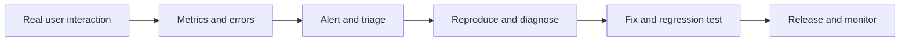

# Offline Support, Accessibility, and Observability

These are core system qualities, not last-minute polish.

## Offline and PWA

- Define what must work offline: app shell, read-only data, drafts, or queued writes.
- Use service workers deliberately; version caches and define activation/update behavior.
- Store structured data in IndexedDB when appropriate; define schema migration and quota behavior.
- Queue writes only when idempotency, ordering, conflict resolution, and user feedback are defined.
- Show offline/stale status and a recovery path.
- Do not cache sensitive data without a threat model, retention policy, and logout cleanup.
- Test offline, reconnect, interrupted updates, and old/new service-worker versions.

## Accessibility

- Use semantic HTML first; add ARIA only where native semantics are insufficient.
- Support keyboard navigation, visible focus, correct focus management, and logical tab order.
- Ensure controls have accessible names and errors are programmatically associated with fields.
- Provide text alternatives, captions where needed, contrast, zoom/reflow support, and reduced-motion behavior.
- Announce asynchronous status changes appropriately without making the page excessively noisy.
- Test with automated checks plus keyboard and screen-reader workflows.

## Observability

Collect enough information to diagnose real user issues without exposing private data.

- **Performance:** LCP, INP, CLS, route load, resource timing, API latency.
- **Reliability:** JavaScript errors, failed requests, retries, offline rates, release regressions.
- **Product behavior:** carefully governed feature usage and funnel events.
- **Alerts:** define thresholds, owners, severity, deduplication, and runbooks.
- **Privacy:** avoid secrets, full tokens, sensitive form values, and unnecessary personal data in telemetry.
- **Correlation:** use safe request/trace identifiers where available; avoid putting personal information in IDs.

## Failure-to-feedback loop

References: [MDN Service Worker API](https://developer.mozilla.org/en-US/docs/Web/API/Service_Worker_API), [web.dev PWA](https://web.dev/explore/progressive-web-apps), [WAI tutorials](https://www.w3.org/WAI/tutorials/), [web.dev Web Vitals](https://web.dev/articles/vitals).
