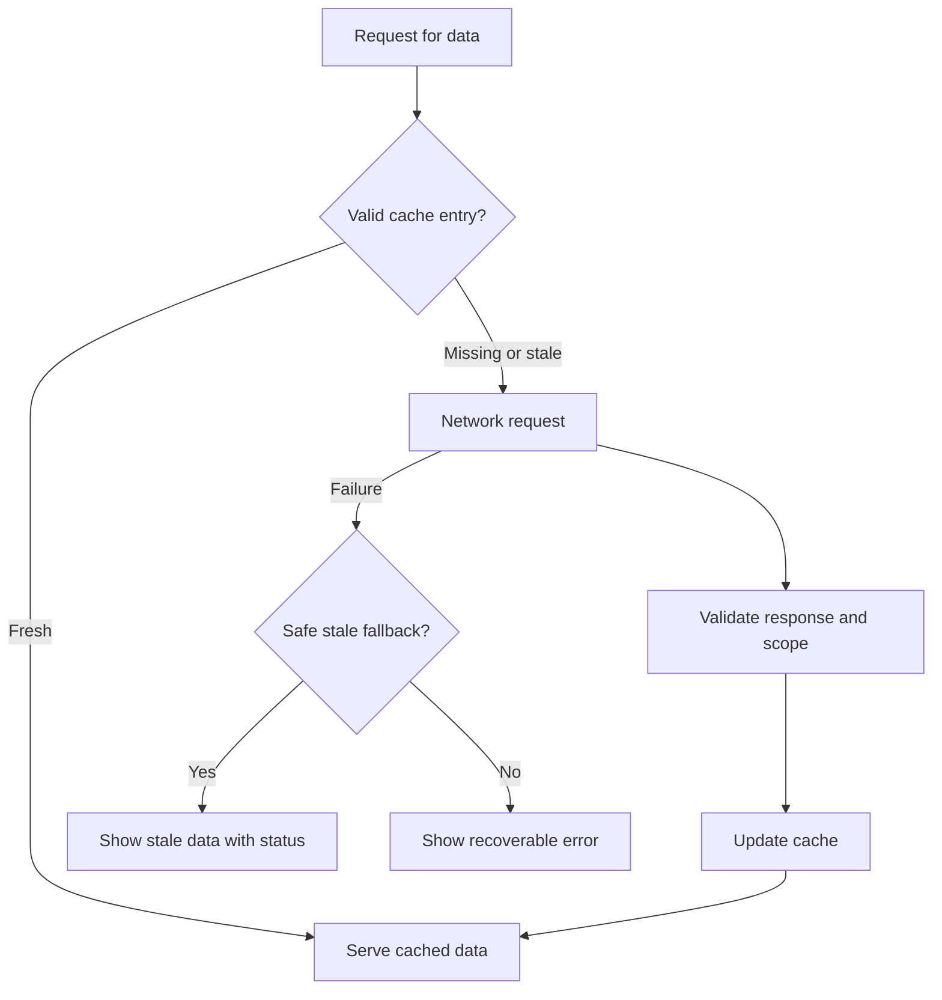

# Frontend Performance and Caching

Optimize measured user experience, not bundle size in isolation.

## Performance toolkit

- **Rendering:** choose CSR/SSR/SSG/streaming based on SEO, personalization, hydration cost, and server capacity.
- **JavaScript:** split routes and heavy features, remove unused dependencies, avoid unnecessary hydration and long tasks.
- **Assets:** responsive images, modern formats, compression, font subsets, immutable hashed filenames.
- **Network:** CDN, HTTP/2 or HTTP/3 where supported, request deduplication, parallelize independent requests.
- **Large interfaces:** list virtualization, pagination, windowing, memoization only when profiling shows value.
- **Runtime:** avoid layout thrashing, reduce main-thread work, yield long tasks, use workers for suitable CPU-heavy tasks.
- **Monitoring:** track Core Web Vitals and real-user data segmented by device, route, and release.

## Caching layers

| Layer | Good for | Main risks |
|---|---|---|
| Browser HTTP cache | Static assets and suitable responses | Incorrect Cache-Control or cache key |
| CDN/edge cache | Public, reusable assets/responses | Accidentally caching personalized content |
| In-memory query cache | Reuse of API data in a session | Staleness and invalidation |
| IndexedDB | Larger structured offline data | Schema migration, quota, sensitive-data retention |
| Service worker cache | Offline shell and selected assets | Stale deployments and complicated update behavior |

## Cache strategy

## Cache correctness

- Define freshness, TTL, invalidation, and stale behavior explicitly.
- Never put sensitive personalized responses in a shared cache without a correct authorization-aware cache design.
- Include relevant query parameters and tenant/user scope in application cache keys.
- Invalidate or update cache after mutations; handle concurrent updates and optimistic rollback.
- Use ETags or conditional requests when they reduce transfer and origin work.
- Treat browser storage as accessible to scripts running in the origin; do not store secrets casually.

## Useful measures

Track LCP, INP, CLS and route-level performance. Set budgets appropriate to the product and device mix; investigate regressions rather than blindly optimizing one metric. Lighthouse is useful for diagnostics, but real-user monitoring shows production variation.

References: [web.dev Learn Performance](https://web.dev/learn/performance/), [MDN HTTP caching](https://developer.mozilla.org/en-US/docs/Web/HTTP/Caching), [web.dev Core Web Vitals](https://web.dev/articles/vitals).
