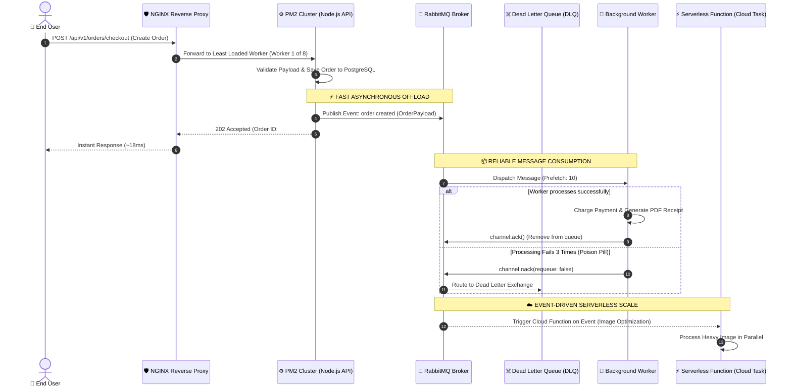

# PM2 Process Manager, RabbitMQ Message Queues & Serverless Architecture

## 1. 🎯 Overview & Intuitive Mental Model

A production Node.js backend running as a single plain process (`node server.js`) is an operational catastrophe waiting to happen:
- A single unhandled promise rejection crashes the entire website for all users.
- Node.js runs on a single thread by default, wasting 7 out of 8 CPU cores on modern servers.
- Long-running tasks (video transcoding, PDF reports, invoice emails) freeze the event loop, causing all API requests to stall.

To achieve enterprise reliability, we combine three architectural powerhouses:
1. **PM2:** The process supervisor and cluster manager maximizing CPU cores and ensuring zero downtime.
2. **RabbitMQ:** The asynchronous message broker offloading heavy workloads into reliable queues.
3. **Serverless (Lambda / Cloud Functions):** Elastic, on-demand workers triggered by events without server overhead.

```
+----------------------------------------------------------------------------------------------------+
|                                    🧠 THE PHYSICAL ANALOGY                                         |
|                                                                                                    |
|  🏭 The Busy Restaurant Kitchen:                                                                    |
|     - PM2 (The Shift Supervisors): Directs a team of 8 line chefs (1 per CPU core). If Chef 3      |
|       faints (unhandled crash), the supervisor instantly brings in a fresh chef to take over.     |
|     - RabbitMQ (The Order Wheel / Ticket Spike): Waiters don't stand at the stove waiting for the   |
|       order to bake; they spike the order ticket onto the wheel. Independent pastry chefs pick up   |
|       tickets at their own pace without delaying table service.                                    |
|     - Serverless (On-Demand Catering Contractors): If 500 orders suddenly surge at once for a      |
|       wedding banquet, the restaurant calls in on-demand specialist cooks for 30 minutes, pays     |
|       only for their exact cooking time, and sends them home.                                      |
+----------------------------------------------------------------------------------------------------+
```

### Operational Risk & Availability Matrix
- **OWASP Category:** A04:2021 – Insecure Design & A05:2021 – Security Misconfiguration
- **CWE Identifiers:** [CWE-400: Uncontrolled Resource Consumption](https://cwe.mitre.org/data/definitions/400.html), [CWE-755: Improper Handling of Exceptional Conditions](https://cwe.mitre.org/data/definitions/755.html)
- **Blast Radius:** Complete server lockup due to event loop starvation, unhandled exception application termination, message queue overflow and data loss.

---

## 2. 🎨 Interactive Visual Architecture

### Full-Stack Asynchronous Processing Pipeline (PM2 + RabbitMQ + Serverless)



> 💡 **Visual Inspection Tip:** Open the RabbitMQ Management Web UI (`http://localhost:15672`). Inspect the **Queues** tab. Monitor the **Ready** vs. **Unacked** message count. If **Unacked** continues growing, your background workers are crashing or stalling before sending acknowledgments!

---

## 3. 💥 Real-World Exploit & Crash Walkthrough

### The "Single Unhandled Exception Crash & Event Loop Starvation"

In an unmanaged Node.js application, an unhandled exception or synchronous CPU operation crashes the entire process for every concurrent user.

#### Vulnerable Implementation (`vulnerable-server.js`)
```javascript
// vulnerable-server.js - SINGLE THREAD OF FAILURE
const express = require('express');
const crypto = require('crypto');
const app = express();

app.post('/api/export-analytics', (req, res) => {
  // 💥 FLAW 1: Blocking synchronous CPU computation freezes event loop for all users!
  const key = crypto.pbkdf2Sync('secret', 'salt', 1000000, 64, 'sha512');
  
  // 💥 FLAW 2: Unhandled exception terminates the entire Node.js OS process!
  if (!req.body.userId) {
    throw new Error('Fatal: Missing userId parameter!');
  }

  res.json({ status: 'done', key: key.toString('hex') });
});

app.listen(3000);
```

#### Failure Breakdown
1. **Event Loop Freeze:** While `crypto.pbkdf2Sync` runs, Node.js cannot process any other HTTP request. Latency for all users jumps from 15ms to 8,000ms.
2. **Process Termination:** When an uncaught error throws, Node.js triggers `process.exit(1)`. The server process immediately dies.
3. **Total Outage:** Without a process manager like PM2, the server stays dead until an engineer manually logs in and restarts it.

---

## 4. 🛡️ Resolution & Complete Production Implementation

### Part A: Production PM2 Cluster Configuration (`ecosystem.config.js`)

```javascript
// ecosystem.config.js - ENTERPRISE PM2 CLUSTER DEFINITION
module.exports = {
  apps: [
    {
      name: 'api-service',
      script: './dist/server.js',
      // 🛡️ 1. Cluster Mode: Spawns 1 worker process per physical CPU core
      instances: 'max',
      exec_mode: 'cluster',

      // 🛡️ 2. Environment Variables & Isolation
      env_production: {
        NODE_ENV: 'production',
        PORT: 3000,
      },

      // 🛡️ 3. Automatic Recovery from Memory Leaks
      // Restarts worker if it exceeds 500MB (prevents OS Out-Of-Memory kills)
      max_memory_restart: '500M',

      // 🛡️ 4. Zero-Downtime Rolling Reload Configuration
      wait_ready: true,            // Waits for process.send('ready') from app
      listen_timeout: 10000,       // Max time to wait for ready signal
      kill_timeout: 5000,          // Grace period for worker to drain active requests

      // 🛡️ 5. Crash Throttling (Prevents infinite reboot death-loops)
      min_uptime: '10s',
      max_restarts: 10,
      restart_delay: 2000,

      // 🛡️ 6. Structured Logging & Log Rotation
      output: './logs/out.log',
      error: './logs/error.log',
      merge_logs: true,
      log_date_format: 'YYYY-MM-DD HH:mm:ss Z',
    },
    {
      name: 'queue-worker',
      script: './dist/workers/order-consumer.js',
      instances: 2, // Background workers run in fork mode
      exec_mode: 'fork',
      max_memory_restart: '800M',
    }
  ],
};
```

#### Node.js Server Handshake with PM2 (`server.ts`)
```typescript
// server.ts - GRACEFUL SHUTDOWN & PM2 READY SIGNAL
import express from 'express';
import http from 'http';

const app = express();
const server = http.createServer(app);

server.listen(3000, () => {
  console.log('Server running on port 3000');
  
  // 🛡️ Notify PM2 cluster master that this worker is ready to receive traffic
  if (process.send) {
    process.send('ready');
  }
});

// 🛡️ Graceful Shutdown: Cleanly close DB connections and finish active HTTP requests
process.on('SIGINT', () => {
  console.log('SIGINT received: Starting graceful shutdown...');
  server.close(() => {
    console.log('HTTP server closed. Exiting process.');
    process.exit(0);
  });
});
```

---

### Part B: Production RabbitMQ Publisher & Consumer with Dead-Letter Queues

#### 1. Resilient RabbitMQ Connection & Publisher (`publisher.ts`)
```typescript
// publisher.ts - PRODUCTION-READY AMQP PUBLISHER
import amqp, { Connection, Channel } from 'amqplib';

const RABBITMQ_URL = process.env.RABBITMQ_URL || 'amqp://localhost:5672';
const EXCHANGE_NAME = 'orders_exchange';

let channel: Channel;

export async function initRabbitMQ() {
  const connection: Connection = await amqp.connect(RABBITMQ_URL);
  channel = await connection.createChannel();

  // 🛡️ Declare durable exchange (survives RabbitMQ server restart)
  await channel.assertExchange(EXCHANGE_NAME, 'topic', { durable: true });

  // 🛡️ Declare Dead Letter Exchange (DLX) for failed messages
  await channel.assertExchange('dlx_exchange', 'topic', { durable: true });
  await channel.assertQueue('orders_dlq', { durable: true });
  await channel.bindQueue('orders_dlq', 'dlx_exchange', 'orders.failed.#');

  // 🛡️ Declare main orders queue with DLX binding
  await channel.assertQueue('orders_queue', {
    durable: true,
    arguments: {
      'x-dead-letter-exchange': 'dlx_exchange',
      'x-dead-letter-routing-key': 'orders.failed.processing',
      'x-message-ttl': 86400000, // 24 hours max TTL
    },
  });
  await channel.bindQueue('orders_queue', EXCHANGE_NAME, 'orders.created');

  console.log('🐰 RabbitMQ initialized with Dead Letter Queue protection');
}

export function publishOrderEvent(order: { id: string; amount: number; email: string }) {
  const message = Buffer.from(JSON.stringify(order));
  // 🛡️ persistent: true ensures messages are flushed to disk
  return channel.publish(EXCHANGE_NAME, 'orders.created', message, {
    persistent: true,
    contentType: 'application/json',
  });
}
```

#### 2. Resilient RabbitMQ Consumer (`consumer.ts`)
```typescript
// consumer.ts - PRODUCTION AMQP WORKER WITH BACKOFF & ACK
import amqp, { Channel, ConsumeMessage } from 'amqplib';

export async function startOrderConsumer() {
  const connection = await amqp.connect(process.env.RABBITMQ_URL!);
  const channel: Channel = await connection.createChannel();

  // 🛡️ Prefetch limit: Prevents a single worker from starving other workers
  await channel.prefetch(10);

  channel.consume('orders_queue', async (msg: ConsumeMessage | null) => {
    if (!msg) return;

    try {
      const orderData = JSON.parse(msg.content.toString());
      console.log(`Processing order: ${orderData.id}`);

      // Perform heavy operations (Billing, PDF rendering, email sending)
      await processOrderPayment(orderData);

      // 🛡️ Explicit ACK: Message is safely removed from queue
      channel.ack(msg);
    } catch (err: any) {
      console.error(`Order processing failed: ${err.message}`);
      
      // 🛡️ Reject without requeue: Automatically routes to Dead Letter Queue (DLQ)
      // Prevents infinite poison-pill retry loops from taking down workers
      channel.nack(msg, false, false);
    }
  });
}

async function processOrderPayment(order: any) {
  // Business logic ...
}
```

---

### Part C: Serverless Event Processing (AWS Lambda / Cloud Functions)

When tasks are spiky or rare (e.g., end-of-month financial reports or user avatar resizing), serverless functions scale automatically to zero cost when idle.

#### Production Serverless Handler (`handler.ts`)
```typescript
// handler.ts - AWS LAMBDA / CLOUD FUNCTION HANDLER
import { APIGatewayProxyEvent, APIGatewayProxyResult } from 'aws-lambda';

// 🛡️ Database connection pool kept OUTSIDE the handler to reuse warm execution contexts
let dbClientInstance: any = null;

async function getDBClient() {
  if (!dbClientInstance) {
    dbClientInstance = await initDatabasePool();
  }
  return dbClientInstance;
}

export const generateInvoiceReport = async (
  event: APIGatewayProxyEvent
): Promise<APIGatewayProxyResult> => {
  try {
    const db = await getDBClient();
    const { month, year } = JSON.parse(event.body || '{}');

    // Process heavy batch aggregation
    const reportUrl = await generatePDFSummary(db, month, year);

    return {
      statusCode: 200,
      headers: {
        'Content-Type': 'application/json',
        'Cache-Control': 'no-store',
      },
      body: JSON.stringify({ status: 'success', downloadUrl: reportUrl }),
    };
  } catch (error: any) {
    return {
      statusCode: 500,
      body: JSON.stringify({ error: 'Internal Serverless Execution Failure' }),
    };
  }
};
```

---

## 5. 🧪 Hands-On Verification & Lab

### 1. Verify PM2 Cluster & Zero-Downtime Reload
```bash
# Start your application in cluster mode
pm2 start ecosystem.config.js --env production

# Inspect running cluster workers across all CPU cores
pm2 list
pm2 monit

# Execute a zero-downtime rolling reload (kills and replaces 1 worker at a time)
pm2 reload api-service
```

### 2. Verify RabbitMQ Queues & Dead Letter Routing (`rabbitmqadmin`)
```bash
# Check queue status and unacknowledged messages via CLI
rabbitmqadmin list queues vhost name messages messages_ready messages_unacknowledged

# Publish a poisoned message to test Dead Letter Queue routing
rabbitmqadmin publish exchange=orders_exchange routing_key=orders.created payload='{"corrupt": true}'

# Verify message landed safely in Dead Letter Queue (orders_dlq)
rabbitmqadmin get queue=orders_dlq count=1
```

### 3. Automated Queue Processing Integration Test (Vitest)
```typescript
// queue.test.ts
import { describe, it, expect, beforeAll } from 'vitest';
import { initRabbitMQ, publishOrderEvent } from './publisher';

describe('RabbitMQ Pipeline Suite', () => {
  beforeAll(async () => {
    await initRabbitMQ();
  });

  it('publishes message with persistent flag and durable exchange', async () => {
    const isPublished = publishOrderEvent({
      id: 'test_order_123',
      amount: 49.99,
      email: 'customer@example.com',
    });

    expect(isPublished).toBe(true);
  });
});
```

---

## 6. 📋 Code Review & Deployment Checklist

- [ ] **PM2 Cluster Mode:** Is `exec_mode: 'cluster'` enabled with `instances: 'max'` to leverage all available server CPU cores?
- [ ] **Zero-Downtime Handshake:** Does the Node.js application call `process.send('ready')` and does PM2 use `wait_ready: true`?
- [ ] **Memory Ceiling Guard:** Is `max_memory_restart: '500M'` defined to prevent rogue memory leaks from crashing the host OS?
- [ ] **Durable Exchanges & Queues:** Are RabbitMQ exchanges and queues created with `{ durable: true }` and messages published with `{ persistent: true }`?
- [ ] **Dead Letter Exchange (DLX):** Does every business-critical queue have an associated Dead Letter Queue to capture poison pills?
- [ ] **Consumer Prefetch Configured:** Is `channel.prefetch(10)` set on every consumer to prevent worker memory exhaustion?
- [ ] **Database Pools in Serverless:** Are database connections in Lambda functions instantiated outside the handler loop and sized with strict connection bounds to prevent connection pool exhaustion?

---

## 7. 🎥 Curated Video Walkthroughs & Primary References

### 📺 High-Impact Video Explanations
- 🎥 [Node.js Cluster Mode & PM2 in Production (Hussein Nasser)](https://www.youtube.com/watch?v=7Q17ubqLfaM) — Step-by-step masterclass on scaling Node.js across multi-core processors with PM2.
- 🎥 [RabbitMQ Crash Course: Exchanges, Queues & Consumers (Hussein Nasser)](https://www.youtube.com/watch?v=deG25y_r6OY) — Deep architectural walkthrough of AMQP protocols, direct/topic/fanout exchanges, and acknowledgments.
- 🎥 [Message Queues Explained in System Design (ByteByteGo)](https://www.youtube.com/watch?v=oUJbuFMyBDk) — Visual breakdown of asynchronous buffering, pub/sub, and decoupling.
- 🎥 [Serverless Architecture & AWS Lambda Explained (Fireship)](https://www.youtube.com/watch?v=W_VNBNrkq1Y) — Fast overview of event-driven functions, cold starts, and pricing models.

### 📖 Primary Documentation & Specifications
- 📜 [PM2 Official Documentation](https://pm2.keymetrics.io/docs/usage/quick-start/) — Complete guide to ecosystem files, cluster mode, and log management.
- 📜 [RabbitMQ Official Documentation: AMQP 0-9-1 Protocol](https://www.rabbitmq.com/tutorials) — Authoritative guides for reliability, persistence, and dead-lettering.
- 📜 [AWS Lambda Developer Guide: Best Practices](https://docs.aws.amazon.com/lambda/latest/dg/best-practices.html) — Execution environment lifecycle and connection reuse.

### 🧪 Interactive Hands-On Training Labs & Tools
- 🎯 [RabbitMQ Official Tutorials (Node.js & Python)](https://www.rabbitmq.com/tutorials/tutorial-one-javascript) — Hands-on interactive code examples for work queues and routing.
- 🎯 [Serverless Framework Interactive Sandbox](https://www.serverless.com/framework/docs/getting-started) — CLI tool to build and test serverless endpoints locally.
