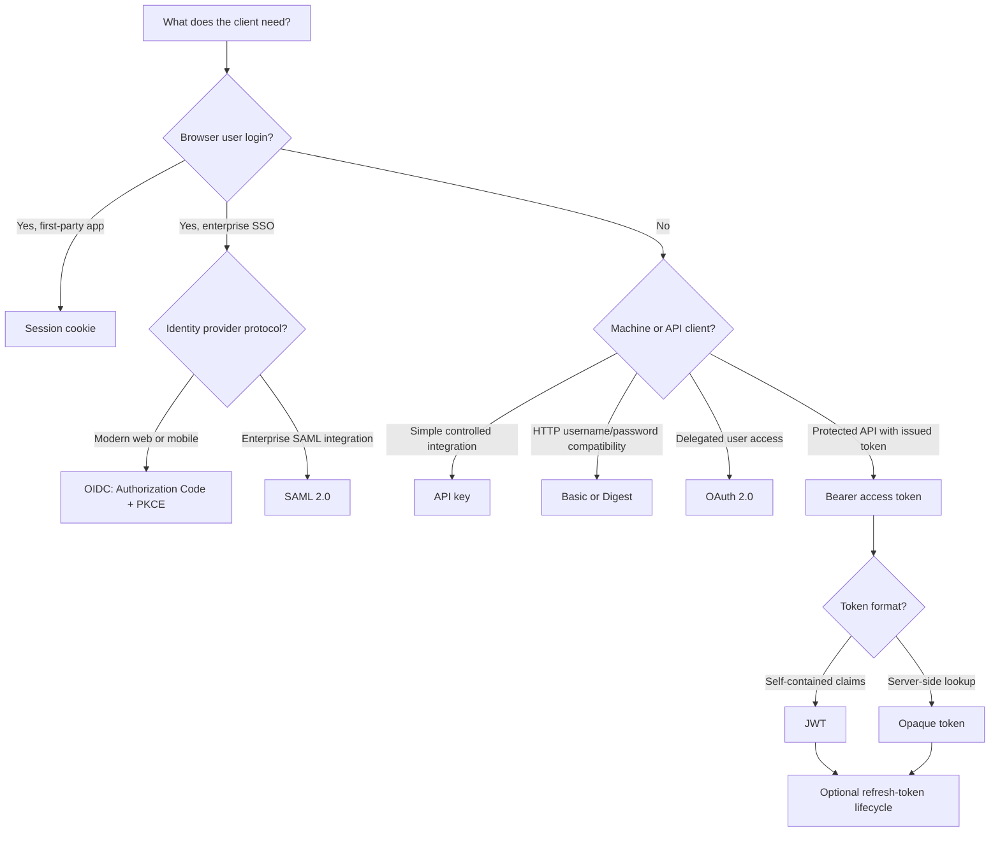
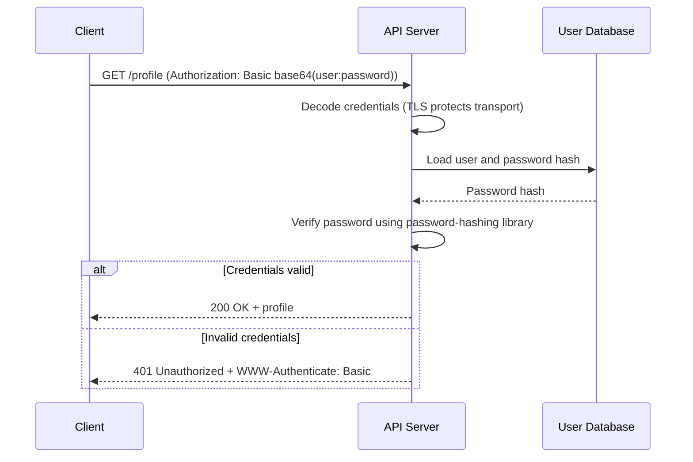
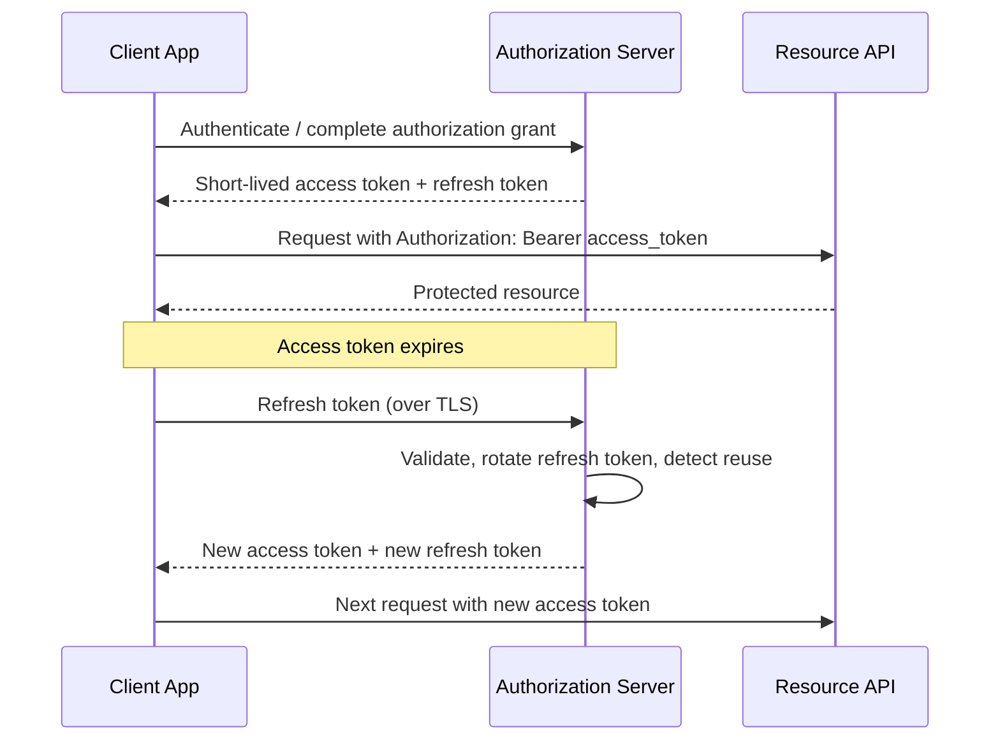
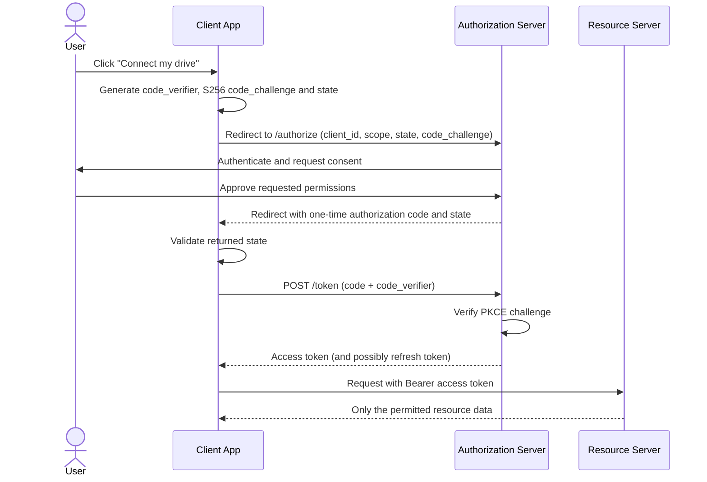
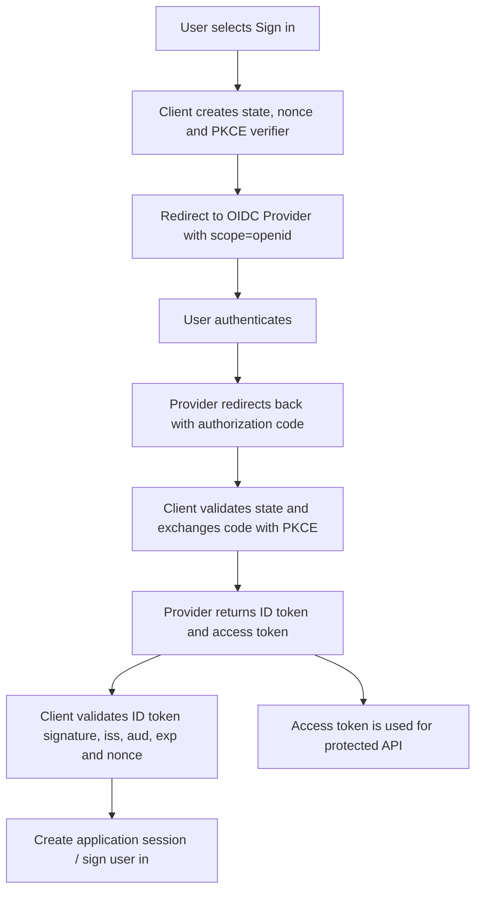
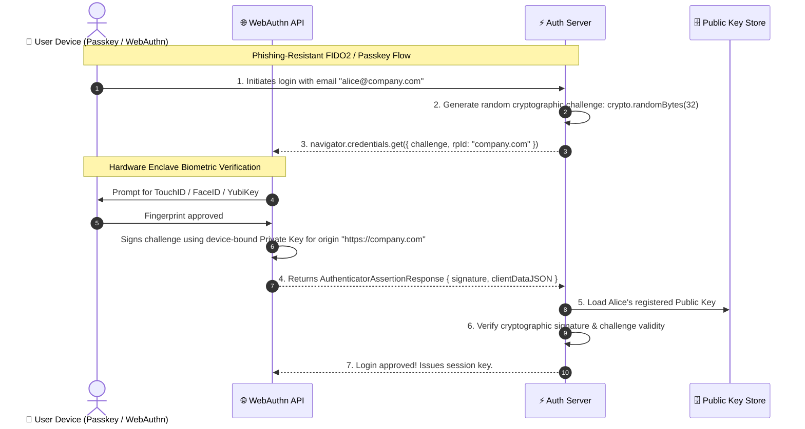

# 🪪 All Authentication Types: The Complete Engineering Guide

> Comprehensive taxonomy, architecture trade-offs, and security profiles for every major web and API authentication mechanism.

---

## 1. 🎯 Overview & Intuitive Mental Model

### The Production Hook
Modern software engineering has moved far beyond the naive "username and password in a database" model. Today's applications must authenticate single-page apps, mobile clients, background microservices, enterprise employees, and IoT sensors across heterogeneous networks.

Choosing the wrong authentication strategy introduces catastrophic vulnerabilities or unmaintainable architectural complexity. For example:
- Using stateless JWTs for browser sessions makes **instant session revocation virtually impossible**.
- Using stateful sessions for third-party mobile apps introduces **brittle cookie management and CORS headaches**.
- Using long-lived static API keys without rotation leads to **imminent GitHub repository credential leaks**.

### 🧠 The Fun Analogy: The "Metropolitan Transit Passports"
Think of your system as a high-security international airport transit terminal:
1. **Stateful Session (`HttpOnly` Cookie):** An electronic keycard issued by the airport lounge. The lounge mainframe remembers keycard `#42`. If the traveler is banned, the front desk clicks "Revoke", and card `#42` immediately stops opening doors.
2. **Stateless JWT:** A laminated international driver's license stamped with a cryptographic watermark. The security guard at the gate doesn't need to call the government DMV; they just check the watermark with a UV light. But if you lose your license, an impostor can use it until the expiration date stamped on the plastic!
3. **PASETO (Platform-Agnostic Security Tokens):** The bulletproof replacement for JWTs. Unlike JWTs (which let developers mistakenly choose insecure ciphers like `alg: "none"`), PASETO enforces modern cryptography (Ed25519 or ChaCha20-Poly1305) with zero cipher negotiation.
4. **OAuth 2.0 / OIDC:** A diplomatic valet ticket. You authorize the airport parking attendant to park your car without handing them the key to your bank safe.
5. **Passkeys / WebAuthn (FIDO2):** A fingerprint scanner on a hardware security enclave. The airport security desk generates a cryptographic riddle (a challenge). Your smartphone signs the riddle using a private key stored inside a tamper-proof hardware chip unlocked only by your physical face or thumb. The private key never leaves your phone!
6. **Mutual TLS (mTLS):** Two armored guards meeting in a secure bunker. Both guards demand to inspect each other's cryptographic certificates before speaking a single word.

### Authentication Taxonomy Matrix

| Auth Type | State Location | Best Suited For | Revocation Speed | Primary Risk |
|---|---|---|---|---|
| **Stateful Sessions** | Central Redis / DB | Web SPAs & Monoliths | ⚡ Instant (< 1ms) | Redis storage scaling & CSRF |
| **Stateless JWT** | Client / Microservices | High-throughput APIs | 🐢 Slow (Until TTL expires) | Token theft, alg confusion |
| **PASETO** | Client / Microservices | Zero-Trust APIs | 🐢 Slow (Until TTL) | Token theft |
| **OAuth 2.0 + PKCE** | IdP + Client | 3rd-party auth & SPAs | ⚡ Fast via Refresh Revocation | Redirect URI hijacking |
| **WebAuthn / Passkeys**| Hardware Enclave | Phishing-resistant login | ⚡ Fast (Server-side key disable) | Device recovery complexity |
| **SAML 2.0 / SSO** | Enterprise IdP (Okta) | B2B SaaS Enterprise | ⚡ Controlled by enterprise IdP | XML signature wrapping (XSW) |
| **mTLS** | TLS Handshake | Service-to-Service | ⚡ Immediate via CRL / OCSP | Certificate rotation overhead |
| **API Keys** | Database / Cache | Developer APIs & CLIs | ⚡ Instant | Accidental source code commit |

## 1.1 The nine authentication mechanisms — what they mean and how they work

The nine items below are related, but they are **not nine equivalent ways to do the same thing**. Some are HTTP authentication schemes, some are credentials or token formats, and some are identity/authorization protocols. Keeping those categories separate prevents common design mistakes.

| # | Mechanism | What it is | Typical use |
|---|---|---|---|
| 1 | Basic Authentication | HTTP authentication scheme: username and password encoded with Base64 | Simple protected endpoints, mainly controlled/internal use |
| 2 | Digest Authentication | HTTP challenge-response scheme using a nonce and a digest instead of sending the password itself | Legacy HTTP integrations; rarely chosen for new applications |
| 3 | API Keys | An application/client credential, usually a random secret sent with a request | Server-to-server APIs, developer access, metering |
| 4 | Session-Based Authentication | Server-side login state identified by a session cookie | Browser applications |
| 5 | Bearer Tokens & JWT | Bearer describes how a token is presented; JWT is one possible token format | APIs and distributed services |
| 6 | Access & Refresh Tokens | A short-lived access credential plus a longer-lived credential used to obtain a new one | OAuth-based apps and mobile clients |
| 7 | OAuth 2.0 | An authorization framework for delegated access; it is not, by itself, a login protocol | “Allow this app to access my files” |
| 8 | OpenID Connect (OIDC) | An identity/authentication layer built on OAuth 2.0 | “Sign in with Google/enterprise identity provider” |
| 9 | SAML 2.0 | An XML-based federation and single-sign-on protocol | Enterprise browser SSO |

### One decision flow: choose the right family



### 1. Basic Authentication

**Idea:** The client sends a username and password in the HTTP `Authorization` header. The credentials are Base64-encoded; Base64 is encoding, **not encryption**. HTTPS is mandatory.

**Request example:**

```http
GET /api/profile HTTP/1.1
Host: api.example.com
Authorization: Basic YWxpY2U6c2VjcmV0
```

The value decodes to `alice:secret`. The server looks up Alice and compares the supplied password against a secure password hash (never store the raw password).

**Simple client example:**

```bash
curl --user alice:secret https://api.example.com/api/profile
```

**Flow:**



Use only over TLS, avoid exposing credentials in logs, and prefer modern session/OIDC flows for interactive browser login. Basic sends the same reusable credential on every request.

### 2. Digest Authentication

**Idea:** The server sends a challenge containing a nonce. The client calculates a response digest using the username, password-derived value, nonce, HTTP method, and request URI. The password itself is not sent in the request.

**Simplified flow:**

```mermaid
sequenceDiagram
    participant C as Client
    participant S as Server
    C->>S: GET /private
    S-->>C: 401 + WWW-Authenticate: Digest realm, nonce, qop
    Note over C: Calculate response digest from credentials, nonce, method and URI
    C->>S: GET /private + Authorization: Digest ... response=...
    S->>S: Recalculate and compare response; validate nonce/replay rules
    S-->>C: 200 OK or 401 Unauthorized
```

**Challenge example:**

```http
HTTP/1.1 401 Unauthorized
WWW-Authenticate: Digest realm="example", nonce="server-random-nonce", qop="auth", algorithm=SHA-256
```

The client then replies with an `Authorization: Digest` header containing fields such as `username`, `realm`, `nonce`, `uri`, `response`, `qop`, `nc`, and `cnonce`.

Digest is more complex than Basic and has compatibility and security limitations. Use a well-maintained implementation if a legacy integration requires it; do not invent your own digest calculation. Prefer TLS and a modern authentication protocol for new systems. Digest is not a substitute for transport encryption.

### 3. API Keys

**Idea:** A service issues a random key to an application or integration. The client sends it with each request. An API key commonly identifies a project or client; it does **not automatically prove which human user is calling** and should not be treated as user login.

**Request example:**

```http
GET /v1/reports HTTP/1.1
Host: api.example.com
X-API-Key: ak_live_REPLACE_WITH_RANDOM_SECRET
```

**Minimal Express example (illustrative):**

```typescript
import express from 'express';
import crypto from 'node:crypto';

const app = express();

// In production, store only a hash of each issued key in a database.
// This example assumes findActiveKeyByHash returns a record or null.
app.use('/v1', async (req, res, next) => {
  const suppliedKey = req.header('x-api-key');
  if (!suppliedKey) return res.status(401).json({ error: 'API key required' });

  const keyHash = crypto.createHash('sha256').update(suppliedKey).digest('hex');
  const keyRecord = await findActiveKeyByHash(keyHash);

  if (!keyRecord || keyRecord.revokedAt || keyRecord.expiresAt < new Date()) {
    return res.status(401).json({ error: 'Invalid API key' });
  }

  // Enforce the key's scopes and rate limit after identification.
  res.locals.apiClient = keyRecord.clientId;
  next();
});
```

Use high-entropy random keys, show the secret only once, store a one-way hash, support expiry/revocation/rotation, scope permissions, rate-limit by key, and never commit keys to source control. For browser apps, do not embed a private API key in JavaScript delivered to every user.

### 4. Session-Based Authentication

**Idea:** After checking a username and password, the server creates a session record. The browser receives only a random session ID in a cookie; the server stores the associated user and session state (often in Redis or a database).

**Login response example:**

```http
HTTP/1.1 200 OK
Set-Cookie: __Host-session=RANDOM_SESSION_ID; Path=/; Secure; HttpOnly; SameSite=Lax
```

**Express example (using a session middleware and a production Redis store):**

```typescript
import session from 'express-session';
import { RedisStore } from 'connect-redis';
import { createClient } from 'redis';

const redisClient = createClient({ url: process.env.REDIS_URL });
await redisClient.connect();

app.use(session({
  name: '__Host-session',
  store: new RedisStore({ client: redisClient }),
  secret: process.env.SESSION_SECRET!,
  resave: false,
  saveUninitialized: false,
  cookie: {
    httpOnly: true,
    secure: true,       // HTTPS only
    sameSite: 'lax',
    path: '/',
    maxAge: 30 * 60 * 1000
  }
}));
```

On successful login, regenerate the session ID to prevent session fixation. On logout, destroy the server-side session and clear the cookie. Protect state-changing cookie-authenticated requests against CSRF; use HTTPS and sensible idle/absolute timeouts.

**Flow:**

```mermaid
sequenceDiagram
    participant B as Browser
    participant A as Application
    participant R as Redis Session Store
    B->>A: POST /login (credentials)
    A->>A: Verify password; regenerate session ID
    A->>R: Store sessionId -> userId, expiry, session data
    A-->>B: Set-Cookie: __Host-session=opaque-id; HttpOnly; Secure
    B->>A: GET /account + session cookie
    A->>R: Look up session ID
    R-->>A: Active session and user ID
    A-->>B: 200 OK + account data
```

### 5. Bearer Tokens and JSON Web Tokens (JWT)

These terms describe different things:

- **Bearer token** describes the presentation rule: whoever possesses the token can use it, so protect it like a password.
- **JWT** is a token format containing claims in a signed (or otherwise protected) structure. A bearer token can be an opaque random string instead of a JWT.
- A signed JWT is normally readable by its holder; signing does not encrypt its contents.

**Request example:**

```http
GET /api/orders HTTP/1.1
Authorization: Bearer eyJhbGciOi...
```

**Express verification example (JWT access token):**

```typescript
import jwt from 'jsonwebtoken';

function authenticateBearer(req, res, next) {
  const [scheme, token] = (req.header('authorization') ?? '').split(' ');
  if (scheme !== 'Bearer' || !token) {
    return res.status(401).json({ error: 'Bearer token required' });
  }

  try {
    req.user = jwt.verify(token, process.env.JWT_PUBLIC_KEY!, {
      algorithms: ['RS256'], // Pin the algorithm expected by this API
      issuer: 'https://identity.example.com',
      audience: 'https://api.example.com'
    });
    next();
  } catch {
    return res.status(401).json({ error: 'Invalid or expired token' });
  }
}
```

Validate signature, allowed algorithm, issuer (`iss`), audience (`aud`), expiry (`exp`), and any required claims. Do not authorize based only on decoded/unverified payload data. Bearer tokens require TLS and careful storage; avoid putting them in URLs.

### 6. Access Tokens and Refresh Tokens

**Idea:** An access token is short-lived and sent to the API. A refresh token is a longer-lived credential sent only to the authorization server to obtain a new access token. Refresh tokens should not be sent to ordinary resource APIs.

**Example lifecycle:**



**Illustrative refresh request:**

```http
POST /oauth/token HTTP/1.1
Content-Type: application/x-www-form-urlencoded

grant_type=refresh_token&refresh_token=REFRESH_TOKEN
```

Use short access-token lifetimes, securely store refresh tokens, rotate refresh tokens on use, detect reuse and revoke the token family when appropriate. For browser applications, consider a Backend-for-Frontend (BFF) that keeps tokens server-side and exposes a secure HttpOnly session cookie to the browser. Exact storage choices depend on the client type and threat model.

### 7. OAuth 2.0 — delegated authorization

**Idea:** OAuth 2.0 lets a user authorize a client application to access a resource with limited scopes, without sharing their password with that application. OAuth 2.0 is an **authorization framework**, not an identity protocol. A successful OAuth authorization alone does not tell the client who the user is.

**Example:** A photo-printing app asks permission to read selected photos from a cloud drive. The user signs in at the drive provider and grants the requested scope; the photo app receives an access token, not the user's drive password.

**Authorization Code with PKCE flow:**



Use Authorization Code with PKCE for public clients (browser/mobile). Validate `state`, exact redirect URIs, scopes and token audience. Follow current OAuth security best practices; do not use the implicit grant for new applications.

### 8. OpenID Connect (OIDC) — user authentication on top of OAuth 2.0

**Idea:** OIDC adds an identity layer to OAuth 2.0. The client requests the `openid` scope and receives an **ID token** that represents the authentication event and user identity claims. The access token is for calling APIs; the ID token is for the client to learn who authenticated.

**Example:** “Sign in with Google” is typically an OIDC flow. The application redirects the user to the identity provider, receives an authorization code, exchanges it using PKCE, validates the ID token, and creates its own application session.

**Important ID-token checks:** Verify signature using trusted issuer keys, exact `iss`, intended `aud` (and `azp` when applicable), expiry, nonce, and other applicable protocol requirements. Do not treat an access token as an ID token.



### 9. SAML 2.0 — enterprise federated identity and SSO

**Idea:** SAML allows an Identity Provider (IdP) to send a signed XML assertion about a user to a Service Provider (SP). It is common in enterprise SSO, for example an employee signing in to a SaaS application using their company's identity platform.

**Main parties:**
- **User/Browser:** Carries the browser redirects and form POST.
- **Identity Provider (IdP):** Authenticates the employee and issues a signed assertion.
- **Service Provider (SP):** The application that validates the assertion and creates its local session.

**SP-initiated SSO flow:**

```mermaid
sequenceDiagram
    actor U as Employee
    participant B as Browser
    participant SP as Service Provider (SaaS App)
    participant IdP as Identity Provider (Company SSO)
    U->>B: Open SaaS application
    B->>SP: GET /protected
    SP-->>B: Redirect to IdP with SAML AuthnRequest
    B->>IdP: Send AuthnRequest
    IdP->>U: Authenticate employee (password/MFA/passkey)
    U->>IdP: Complete authentication
    IdP-->>B: HTML form containing signed SAML Response
    B->>SP: POST SAML Response to Assertion Consumer Service (ACS)
    SP->>SP: Validate signature, issuer, audience, recipient, time and InResponseTo
    SP->>SP: Map subject/attributes and create local session
    SP-->>B: Set secure session cookie; redirect to application
```

**Example assertion shape (illustrative only — never accept an unsigned hand-written assertion):**

```xml
<saml:Assertion>
  <saml:Issuer>https://idp.example.com</saml:Issuer>
  <saml:Subject>
    <saml:NameID>employee@example.com</saml:NameID>
  </saml:Subject>
  <saml:Conditions NotBefore="..." NotOnOrAfter="...">
    <saml:AudienceRestriction>
      <saml:Audience>https://app.example.com/saml</saml:Audience>
    </saml:AudienceRestriction>
  </saml:Conditions>
  <!-- The real response contains a valid XML Digital Signature. -->
</saml:Assertion>
```

Use a maintained SAML library and trusted IdP metadata/certificates. Validate the XML signature over the exact assertion/response being consumed, issuer, audience, destination/recipient, time conditions, request correlation (`InResponseTo`), and replay protection. Defend against XML Signature Wrapping and unsafe XML parsing; never disable signature validation.

### Quick comparison: don't confuse these terms

| Term | Category | Remember |
|---|---|---|
| Basic / Digest | HTTP authentication schemes | Define how HTTP credentials are sent/proven |
| API key | Client/application credential | Identifies a calling integration; scope and rotate it |
| Session | Server-side login state | Browser holds an opaque session cookie |
| Bearer | Token presentation method | Possession is enough to present the token |
| JWT | Token format | A signed claim container, not an authentication protocol |
| Access token | API credential | Presented to a resource server |
| Refresh token | Token lifecycle credential | Used only with the authorization server to obtain new tokens |
| OAuth 2.0 | Authorization framework | Delegates limited access |
| OIDC | Identity layer/protocol | Adds authentication and ID tokens to OAuth 2.0 |
| SAML 2.0 | Federation protocol | Enterprise SSO using signed XML assertions |

**Primary specifications and security references**

- [RFC 7617 — The 'Basic' HTTP Authentication Scheme](https://www.rfc-editor.org/rfc/rfc7617)
- [RFC 7616 — HTTP Digest Access Authentication](https://www.rfc-editor.org/rfc/rfc7616)
- [RFC 6749 — OAuth 2.0 Authorization Framework](https://www.rfc-editor.org/rfc/rfc6749)
- [RFC 7636 — Proof Key for Code Exchange (PKCE)](https://www.rfc-editor.org/rfc/rfc7636)
- [RFC 9700 — OAuth 2.0 Security Best Current Practice](https://www.rfc-editor.org/rfc/rfc9700)
- [OpenID Connect Core 1.0](https://openid.net/specs/openid-connect-core-1_0.html)
- [OASIS SAML 2.0 Technical Overview](https://www.oasis-open.org/committees/download.php/27819/sstc-saml-tech-overview-2.0-cd-02.pdf)
- [OWASP Authentication Cheat Sheet](https://cheatsheetseries.owasp.org/cheatsheets/Authentication_Cheat_Sheet.html)
- [OWASP REST Security Cheat Sheet](https://cheatsheetseries.owasp.org/cheatsheets/REST_Security_Cheat_Sheet.html)

### Video reference

- 🎥 [7 Authentication Concepts Every Developer Should Know — Hayk Simonyan](https://www.youtube.com/watch?v=iX8g4LqF8p8) — Use this as the conceptual overview for the distinctions in this section. The linked video title and attribution match the supplied video reference. The examples and security notes above expand the concepts for implementation practice.

---

---

## 2. 🎨 Interactive Visual Architecture



> 💡 **Visual Inspection Tip:** In Chrome DevTools, open the **Application** tab and locate the **WebAuthn** pane under the *Sensors* / *More tools* drawer. You can enable a virtual hardware authenticator to simulate FIDO2 / WebAuthn registration and assertion flows locally without physical biometric hardware!

---

## 3. 💥 Real-World Exploit Walkthrough

### Scenario: The Pitfall of Stateless JWTs for Web Banking
A fintech company implemented stateless JWTs stored in browser cookies. A customer reported their laptop was stolen. The customer support agent clicked "Deactivate Account" in the admin dashboard, marking the user as `active: false` in the database.

However, because the application used pure stateless JWTs without a revocation blacklist, the thief was able to execute wire transfers for another 6 hours because the API gateway checked only the cryptographic signature and expiration timestamp (`exp`)!

#### ❌ Vulnerable Stateless JWT Gateway (Node.js / Express)
```typescript
// vulnerable-gateway.ts
import express, { Request, Response, NextFunction } from 'express';
import jwt from 'jsonwebtoken';

const app = express();
const JWT_SECRET = 'super-secret-key-123';

// ⚠️ CATASTROPHIC FLAW: Pure stateless verification ignores database revocation state!
app.use((req: Request, res: Response, next: NextFunction) => {
  const token = req.headers.authorization?.split(' ')[1];
  if (!token) return res.status(401).json({ error: 'Missing token' });

  try {
    const payload = jwt.verify(token, JWT_SECRET) as any;
    // ⚠️ Server never checks if payload.sub is banned or if session was revoked!
    (req as any).user = payload;
    next();
  } catch (err) {
    res.status(401).json({ error: 'Invalid token' });
  }
});

app.post('/api/bank/withdraw', (req: Request, res: Response) => {
  const user = (req as any).user;
  res.json({ message: `Withdrew $10,000 for user ${user.sub}` });
});
```

#### 💥 The Exploit Execution
1. The attacker obtains a stolen JWT with 12 hours remaining on its `exp` claim.
2. Even after the victim clicks "Log out of all devices" and changes their password, the signature on the JWT remains cryptographically valid.
3. The attacker issues withdrawals repeatedly using `curl` until the token expires.

---

## 4. 🛡️ Resolution & Defense-in-Depth

### The Production Fix: Hybrid Distributed Session Revocation via Redis
For high-scale systems requiring stateless performance with instant revocation, implement a **Token Blacklist / Versioning Pattern** or use stateful Redis sessions:

```typescript
// hardened-session-auth.ts - PRODUCTION-READY REVOCABLE AUTH
import express, { Request, Response, NextFunction } from 'express';
import Redis from 'ioredis';
import crypto from 'crypto';

const app = express();
app.use(express.json());

// In-memory distributed session cache (Redis cluster)
const redis = new Redis();

// 🛡️ Middleware: Fast Redis Session Check (< 1ms latency)
export const authenticateSession = async (req: Request, res: Response, next: NextFunction) => {
  const sessionId = req.cookies?.['__Host-session_id'];
  if (!sessionId) {
    return res.status(401).json({ error: 'Unauthenticated' });
  }

  // Lookup active session in Redis
  const sessionData = await redis.get(`session:${sessionId}`);
  if (!sessionData) {
    return res.status(401).json({ error: 'Session expired or revoked' });
  }

  const session = JSON.parse(sessionData);

  // Check if user was globally revoked / banned
  const isRevoked = await redis.get(`user_revoked:${session.userId}`);
  if (isRevoked && Number(isRevoked) > session.issuedAt) {
    await redis.del(`session:${sessionId}`); // Destroy session immediately
    return res.status(401).json({ error: 'Account session invalidated globally' });
  }

  (req as any).session = session;
  next();
};

// 🛡️ Global Revocation Handler (Kills all active sessions across all devices instantly!)
app.post('/api/auth/revoke-all', authenticateSession, async (req: Request, res: Response) => {
  const userId = (req as any).session.userId;

  // Mark all tokens issued before this timestamp as invalid
  await redis.set(`user_revoked:${userId}`, Date.now(), 'EX', 7 * 86400);

  res.json({ message: 'All active sessions globally revoked across all devices.' });
});

export default app;
```

---

## 5. 🧪 Hands-On Verification & Lab

### Testing Instant Session Revocation with Supertest
```typescript
// auth-types.test.ts
import request from 'supertest';
import app from './hardened-session-auth';
import Redis from 'ioredis';

describe('Global Session Revocation Suite', () => {
  it('instantly denies requests after global revocation timestamp', async () => {
    // 1. Simulate active session
    const sid = 'test_sid_123';
    const redis = new Redis();
    await redis.set(`session:${sid}`, JSON.stringify({ userId: 'u99', issuedAt: Date.now() - 5000 }));

    // 2. Trigger global revocation
    await redis.set(`user_revoked:u99`, Date.now());

    // 3. Attempt request with previous session
    const res = await request(app)
      .get('/api/protected')
      .set('Cookie', [`__Host-session_id=${sid}`]);

    expect(res.status).toBe(401);
    expect(res.body.error).toContain('Account session invalidated');
  });
});
```

---

## 6. 📋 Code Review Checklist

- [ ] **Auth Type Appropriate for Architecture:** Are web SPAs using stateful sessions or memory tokens + `HttpOnly` cookies rather than raw `localStorage` JWTs?
- [ ] **Revocation Strategy Defined:** If using JWTs, is an active revocation check (Redis blacklist or token version in user claims) implemented?
- [ ] **Phishing-Resistant MFA:** Are critical systems adopting FIDO2/WebAuthn Passkeys over insecure SMS verification?
- [ ] **Service-to-Service mTLS:** Are internal microservices communicating over mutual TLS rather than unauthenticated internal HTTP?
- [ ] **Cryptographic Strength:** Are password hashes computed with modern memory-hard algorithms (**Argon2id** or **bcrypt** with cost >= 12), and NOT MD5/SHA-256?

---

## 7. 🎥 Curated Video Walkthroughs & Primary References

### 📺 High-Impact Video Explanations
- 🎥 [Authentication vs Authorization (Hussein Nasser)](https://www.youtube.com/watch?v=I0ptz8Bwtm4) — Crisp breakdown of identity vs privilege boundaries and stateful vs stateless mechanisms.
- 🎥 [How Passkeys and WebAuthn Actually Work (Fireship)](https://www.youtube.com/watch?v=b4b8m8zU7cA) — Clear visual explanation of FIDO2 challenge-response public key cryptography.
- 🎥 [Session vs Token Based Authentication (ByteByteGo)](https://www.youtube.com/watch?v=UBUNrFtufWo) — System design comparison of scaling stateful sessions vs stateless tokens.

### 📖 Primary Documentation & Specifications
- 📜 [W3C Web Authentication (WebAuthn) Level 3 Specification](https://www.w3.org/TR/webauthn-3/) — Official specification for public key credentials.
- 📜 [FIDO Alliance: Passkey Implementation Guidance](https://fidoalliance.org/passkeys/) — Enterprise implementation patterns for biometric credentials.
- 📜 [OWASP Authentication Cheat Sheet](https://cheatsheetseries.owasp.org/cheatsheets/Authentication_Cheat_Sheet.html) — Comprehensive identity security standards.

### 🧪 Interactive Hands-On Training Labs
- 🎯 [WebAuthn.io (Duo Security Lab)](https://webauthn.io/) — Interactive playground to test biometric passkey registration and verification in your browser.
- 🎯 [PortSwigger Lab: 2FA simple bypass](https://portswigger.net/web-security/authentication/multi-factor/lab-2fa-simple-bypass) — Practice exploiting flawed multi-factor authentication flows.
