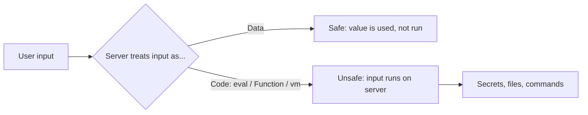

# 🧨 Server-Side JavaScript Injection (SSJI)

> Server-Side JavaScript Injection (SSJI) happens when user input is run as JavaScript code on your Node.js server. This chapter covers `eval`, `new Function`, `vm` and MongoDB `$where`, and shows safer designs.

---

## 1. What is it?

Your server normally treats user input as **data**, such as a name or a search word. With SSJI, the server treats that input as **code** and runs it.

Because the code runs on the server, the attacker is not limited to the browser. They can read environment variables, read files, call your database and often run operating system commands. This is a form of Remote Code Execution (RCE).

**Everyday example:** a shop adds a "price rule" box for admins. The server runs whatever is typed, using `eval`. Someone types a rule that reads `process.env` instead of a discount.

- **Related weakness:** CWE-94 (Code Injection) and CWE-95 (Eval Injection).
- **OWASP category:** A03:2021 Injection.
- **Not the same as XSS:** XSS runs script in a *victim's browser*. SSJI runs script on *your server*.

## 2. Why it matters

- Full server takeover is possible: secrets, database passwords, customer data.
- The server can be used to reach internal systems (see [SSRF](ssrf-deep-dive.md)).
- It is easy to introduce by accident when building "flexible" features such as formulas, filters or rule engines.

## 3. How it works



The danger is any function that turns a **string into running code**. Common ones in Node.js:

| Sink (dangerous function) | What it does |
|---|---|
| `eval(str)` | Runs a string as JavaScript in the current scope |
| `new Function(str)` | Builds a function from a string |
| `vm.runInNewContext(str)` | Runs code in a separate context. **Not a security sandbox.** |
| MongoDB `$where` or `mapReduce` with a string | Runs JavaScript inside the database |
| Template engines with code features | Can run code from untrusted templates (this is SSTI, a close relative) |

## 4. A simple example

> ⚠️ **Local learning example only.** Never run this in a shared or real environment.

A "discount calculator" that lets the user type a formula:

```ts
import express from 'express';

const app = express();
app.use(express.json());

// UNSAFE: input becomes code
app.post('/api/discount', (req, res) => {
  const { formula } = req.body; // e.g. "price * 0.9"
  const price = 100;
  const result = eval(formula); // <-- the bug
  res.json({ result });
});
```

**Line `eval(formula)`:** the string is run as JavaScript with access to the whole Node.js process. A safe formula like `price * 0.9` works. But a harmless-looking test string such as `process.env.NODE_ENV` shows that the user can read server values. Any value the server can read, the user can read.

### Another common place: MongoDB `$where`

```ts
// UNSAFE: user text is placed inside JavaScript that MongoDB runs
const name = req.query.name as string;
const users = await db.collection('users').find({
  $where: `this.name == '${name}'`,
}).toArray();
```

If `name` contains a quote and extra JavaScript, the condition can be changed so that it matches every user, or it can slow the database down on purpose.

## 5. Common mistakes

- Using `eval` or `new Function` for "dynamic" features like formulas, filters or config.
- Believing `vm` is a sandbox. Node.js documentation clearly states that it is not a security mechanism.
- Building `$where` strings by joining user input.
- Parsing JSON with `eval(jsonString)` instead of `JSON.parse`.
- Merging untrusted objects into server objects (prototype pollution) that later reach a code sink.
- Trying to fix it with a blocklist of bad words (`process`, `require`). Attackers find ways around lists.

## 6. How to do it safely

1. **Do not run user input as code.** This is the main rule. Look for another design.
2. **Use data, not code.** Let the user choose from fixed options.

```ts
import { z } from 'zod';

const bodySchema = z.object({
  rule: z.enum(['none', 'tenPercent', 'twentyPercent']),
});

const rules = {
  none: (p: number) => p,
  tenPercent: (p: number) => p * 0.9,
  twentyPercent: (p: number) => p * 0.8,
} as const;

app.post('/api/discount', (req, res) => {
  const parsed = bodySchema.safeParse(req.body);
  if (!parsed.success) return res.status(400).json({ error: 'Invalid rule' });
  res.json({ result: rules[parsed.data.rule](100) });
});
```

**What changed:** the user can only pick a name. The code that runs is code **you wrote**.

3. **If you truly need user formulas,** use a small expression parser that has no access to JavaScript (for example, a math-only library) and set limits on input size and time.
4. **Replace `$where`** with normal query operators, and make sure the value is a string (see the NoSQL injection part of the [SQL injection chapter](sqli-and-orm-leaks.md)).

```ts
const name = String(req.query.name ?? '');
const users = await db.collection('users').find({ name }).toArray();
```

5. **Use `JSON.parse`** for JSON, never `eval`.
6. **Run with least privilege:** low-permission OS user, no secrets in the environment that the app does not need, read-only file system where possible, and restricted outbound network access. This limits damage if a bug slips through.
7. **Add a lint rule.** ESLint rules `no-eval`, `no-implied-eval` and `no-new-func` catch most of these bugs in code review.

**Limits of this advice:** if you must run untrusted code (for example, a coding-challenge site), use a separate process or container with strict limits. Do not rely on `vm` alone.

## 7. How to test it

- **Search the code:** `grep -rnE "eval\(|new Function|vm\.run|\\\$where"` in your source (excluding `node_modules`).
- **Turn on ESLint:** `no-eval`, `no-implied-eval`, `no-new-func`.
- **Write a test** that sends an unexpected value and expects a clean `400` response:

```ts
import request from 'supertest';
import app from './app';

it('rejects a rule that is not on the list', async () => {
  const res = await request(app)
    .post('/api/discount')
    .send({ rule: 'process.env.NODE_ENV' });
  expect(res.status).toBe(400);
});
```

- **Test only systems you own** or have written permission to test.

## 8. 📋 Code review checklist

- [ ] No `eval`, `new Function` or string-based code evaluation of user-influenced input.
- [ ] No `vm` used as a security boundary.
- [ ] No `$where` or string-based `mapReduce` in MongoDB queries.
- [ ] JSON is parsed with `JSON.parse`.
- [ ] Inputs are validated with a schema, and choices come from a fixed list.
- [ ] The app runs with least privilege and limited outbound access.

## 9. Interview questions

1. **What is SSJI, and how is it different from XSS?** SSJI runs attacker input as code on the server. XSS runs it in the victim's browser.
2. **Why is `vm` not a safe sandbox?** Code inside it can often reach the host's objects and escape. Node.js docs say it is not a security mechanism.
3. **How can MongoDB lead to SSJI?** `$where` and some `mapReduce` options run JavaScript, so joining user text into them is injection.
4. **How would you add a "custom formula" feature safely?** Use a fixed list of operations or a math-only parser with limits, never `eval`.
5. **What reduces the damage if SSJI happens?** Least privilege, minimal secrets, and restricted network access.

## 10. Quick revision

- SSJI = user input becomes server-side JavaScript. Result: often RCE.
- Dangerous sinks: `eval`, `new Function`, `vm`, `$where`.
- Best fix: do not run input as code. Offer a fixed list of options.
- Validate input, use normal query operators, lint for `no-eval`.
- Limit damage with least privilege.

## 11. Useful references

- [OWASP: Code Injection](https://owasp.org/www-community/attacks/Code_Injection) — explains the general attack.
- [CWE-94: Improper Control of Generation of Code](https://cwe.mitre.org/data/definitions/94.html) — formal weakness description.
- [Node.js `vm` documentation](https://nodejs.org/api/vm.html) — states that `vm` is not a security mechanism.
- [MongoDB `$where` operator](https://www.mongodb.com/docs/manual/reference/operator/query/where/) — notes on the JavaScript execution risk.
- [ESLint `no-eval`](https://eslint.org/docs/latest/rules/no-eval) — a rule that catches this early.

---

⬅️ Previous: [Server-Side Request Forgery (SSRF)](ssrf-deep-dive.md) · 🏠 [Injection Attacks Home](README.md)
